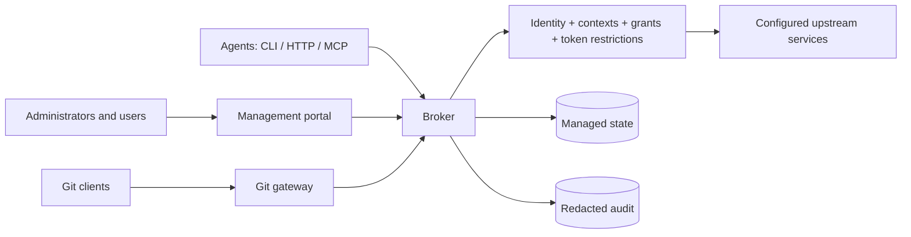
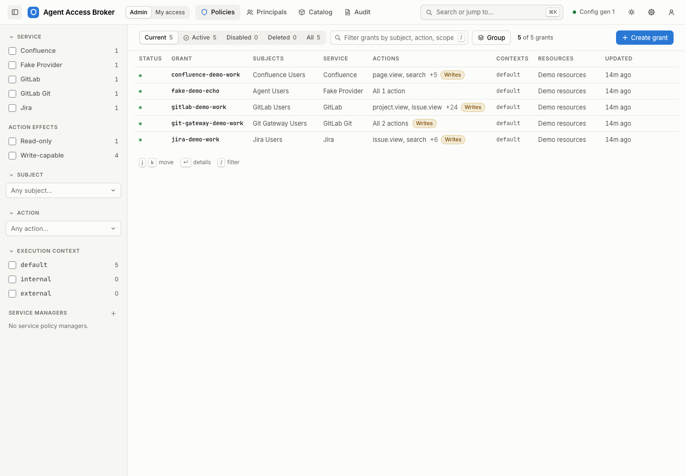
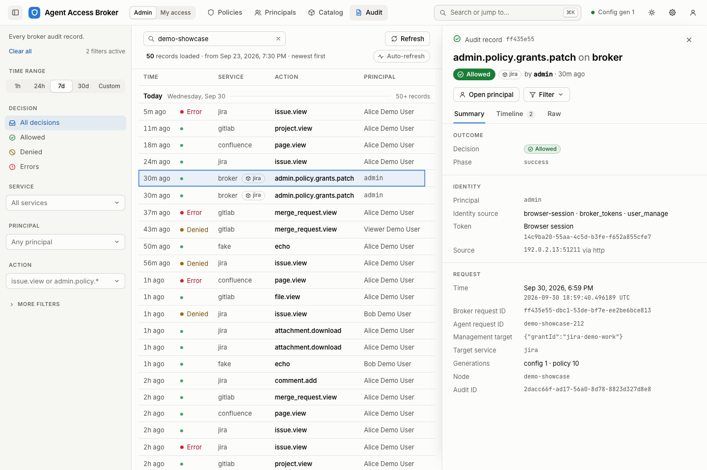
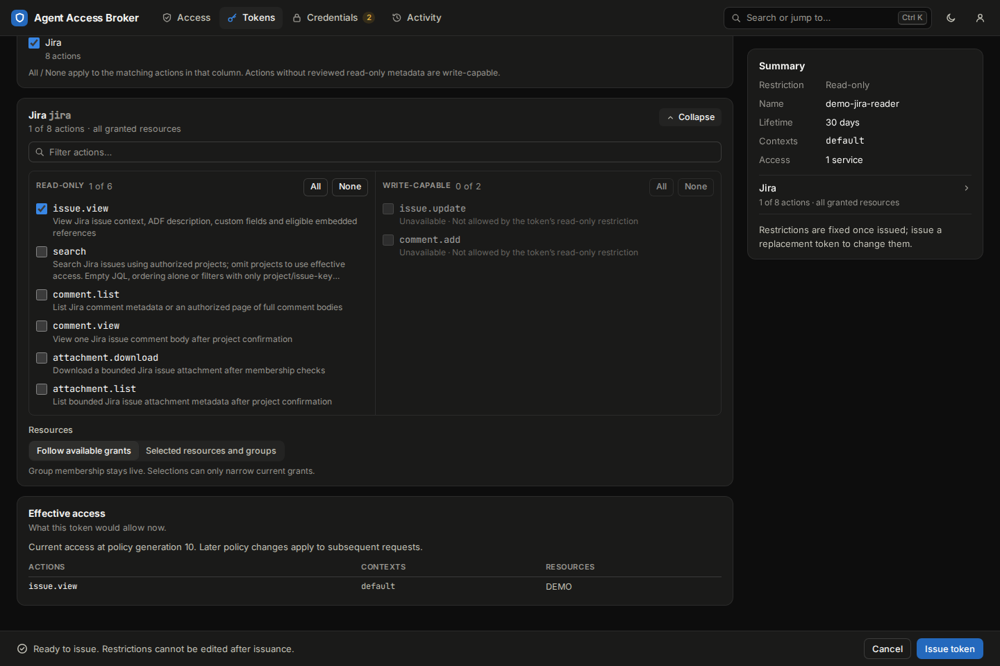

# Agent Access Broker

Agent Access Broker gives AI agents scoped, audited access to service APIs while
keeping upstream execution credentials inside the broker. It supports both
interactive work with an agent and automated workflows. Administrators choose who
can use each action, which resources within a service it can affect, which
execution contexts may use it, and whether it runs as the user or a shared service
identity.

Teams that run agent platforms can manage agent-specific policy across services
in one place. Upstream account permissions and token scopes continue to apply;
the broker adds restrictions, audit logging, rate limiting, and attribution.

The broker works best with organization-managed execution environments or network
egress controls that limit direct access to upstream services. Its trusted-caller
integration can receive verified execution context and user identity from that
infrastructure. An execution context, such as an internal workspace or external
automation environment, helps determine permitted actions and resources.

## Supported integrations

Native integrations pair action permissions with the following resource controls:

| Integration | Supported operations | Resource controls |
| --- | --- | --- |
| [Jira](docs/providers-jira.md) | Project discovery, issues, search, comments, and attachments | Projects |
| [Confluence](docs/providers-confluence.md) | Live space listing, pages, blogs, drafts, comments, and attachments | Spaces, including personal spaces |
| [GitLab REST](docs/providers-gitlab-rest.md) | Repository discovery, content search, issues, merge requests, CI, uploads, and webhooks | Repositories and namespaces |
| [CloudBees CI](docs/providers-cloudbees-ci.md) | Live job listing, builds, Pipelines, logs, artifacts, queues, and triggers | Jobs, folders, and controllers |
| [Teams Workflows](docs/providers-teams.md) | Notifications | Configured Workflow destinations |
| [Git HTTP gateway](docs/git-http-gateway.md) | Git fetch and push | Repositories and namespaces |
| [Gmail](docs/providers-gmail.md) | Mail reads and management through Google OAuth | Actions within the connected user's mailbox; no resource filters |

Administrators can also import [MCP HTTP servers](docs/imported-services.md),
[OpenAPI and Swagger definitions](docs/imported-openapi.md), and approved
[local commands](docs/command-imports.md) as reviewed actions. MCP and OpenAPI
imports authorize actions without resource or query containment; command imports
can declare resource types. [HTTP gateways](docs/http-gateway-setup.md) let native
clients use approved upstream operations through the broker.

## Access model

Agents connect through the `agent-access` CLI, HTTP API, local stdio MCP, or
HTTP MCP. Git clients use the Git smart HTTP gateway. These interfaces and the
administration portal share one permission model.



A principal identifies a person or workload. Grants select the services, actions,
resources, execution contexts, and credential modes that principal can use.
Resource groups combine reusable selections and exclusions. Agent tokens can
narrow that access further. A stored credential provides upstream authentication;
storing it does not grant permission to use it.

Before executing an action, the broker checks current grants and resource
selections and applies the authorized credential mode. Agents discover their
available actions and resources. Administrative roles and personal self-service
are managed separately from permission to invoke service actions.

The broker governs requests sent through it. Network controls establish whether
agents can reach upstream services directly. Revocation blocks new admissions;
operations already prepared may finish. See the [security model](docs/security-model.md),
[resource policy](docs/resources.md), [account roles](docs/roles.md), and
[trusted ingress](docs/trusted-callers.md) for the detailed boundaries.

## Management portal

Administrators manage accounts, resources, grants, credentials, and imported
services. Users review their access and manage their own credentials and agent
tokens. Auditors investigate recorded activity. Sign-in supports local accounts
or optional [Microsoft Entra ID](docs/operator-guide.md#microsoft-entra-oidc-setup-and-operation),
with group mappings and [account enrollment](docs/administrator-guide.md#microsoft-onboarding).

<table>
  <tr>
    <td><a href="assets/screenshots/grants-light.png"></a></td>
    <td><a href="assets/screenshots/audit-detail-light.png"></a></td>
    <td><a href="assets/screenshots/token-access-dark.png"></a></td>
  </tr>
  <tr>
    <td align="center">Grants</td>
    <td align="center">Audit details</td>
    <td align="center">Agent token restrictions</td>
  </tr>
</table>

## Start here

| Your task | Read |
| --- | --- |
| Try the broker locally | [Local quickstart](#local-quickstart) or [interactive portal demo](demo/README.md) |
| Install and operate a deployment | [Operator guide](docs/operator-guide.md) |
| Set up accounts and grant access | [Administrator guide](docs/administrator-guide.md) |
| Connect an agent | [End-user guide](docs/end-user-guide.md) |
| Learn the portal workflows | [Portal walkthroughs](docs/portal-guide/index.md) |

## Local quickstart

This loopback-only evaluation uses the offline fake provider. It does not require
Jira, Confluence, or another live service. Install Rust through rustup; the
checked-in [toolchain file](rust-toolchain.toml) selects the tested Rust/Cargo
1.99.1 toolchain. The commands below build locally. A configured
[build service](AGENTS.md#build-service) is optional.

```bash
cargo build --locked
cargo run --locked -p agent-access-broker -- \
  --config tests/fixtures/fake-broker.toml config validate
cargo run --locked -p agent-access -- \
  --config agent-access.sample.toml config validate
```

In one terminal, start the broker:

```bash
export FAKE_SERVICE_TOKEN=dev-only-token
cargo run --locked -p agent-access-broker -- \
  --config tests/fixtures/fake-broker.toml serve --listen 127.0.0.1:8787
```

In another terminal, check readiness and invoke one action:

```bash
curl -fsS http://127.0.0.1:8787/v1/readyz
cargo run --locked -p agent-access -- \
  --url http://127.0.0.1:8787 --no-token \
  invoke fake.echo --input-json '{"project":"TEST","message":"hello"}'
```

An allowed response has `decision = "allow"` and echoes `hello` in `result`.
Every response carries request IDs for log/audit correlation. Stop the broker with
Ctrl+C. The fixture writes development audit state under `target/fake-broker-audit`.

For an interactive managed administration walkthrough, see the
[local portal demo](demo/README.md). Its setup script creates disposable state and
leaves a background broker running; follow its stop/reset instructions.

### Build the portal

The tested portal toolchain is Node.js 24.18.0 and npm 11.16.0. Build the web assets
separately from the Rust binaries:

```bash
npm --prefix apps/portal ci
npm --prefix apps/portal run build
```

Configure `[portal].static_dir` with the absolute path to the generated
`apps/portal/dist` directory. Deploy the portal and broker from the same source
revision. See the [portal build instructions](apps/portal/README.md) for supported
Node.js versions and the [demo instructions](demo/README.md) for local setup on
Linux and macOS.

## Operate and upgrade

Start with [the production sample](agent-access-broker.production.sample.toml)
and follow the [operator guide](docs/operator-guide.md) to configure HTTPS,
identity, protected state directories, encryption keys, and administrator access.
The sample grants no provider access; administrators add integrations and grants
explicitly. Local demos and the general samples are development configurations.

Run one broker per managed-store, audit, and upload-spool state set. Back up both
the managed and audit stores together with the keys needed to restore them.
Deploy matching broker, CLI, and portal versions, and follow the
[upgrade and rollback procedure](docs/operator-guide.md#upgrade-and-rollback)
and [changelog](CHANGELOG.md) when changing a deployment.

## Documentation reference

| Reference | Contents |
| --- | --- |
| [Configuration](docs/configuration.md) | Broker and client settings, defaults, and validation |
| [CLI](docs/cli.md) | Commands, discovery, input/output, and exit codes |
| [HTTP API](docs/http-api.md) | Routes, responses, and management API |
| [MCP](docs/mcp.md) | Local and HTTP connections, discovery, transfers, and sessions |
| [Architecture](docs/design.md) | Components, crate layout, and request lifecycle |
| [Provider SDK](docs/provider-sdk.md) | Writing native integrations |
| [Downstream assembly](docs/downstream-assembly.md) | Building a custom Broker distribution |
| [Database](docs/database.md) | Storage, encryption, migrations, and keys |
| [Providers](docs/providers.md) | Provider capabilities and individual contracts |
| [OAuth](docs/oauth.md) | Delegated connections to upstream services |
| [Applications](docs/applications.md) | Client applications that obtain agent tokens with user approval |
| [Testing](docs/testing.md) | Offline suites and optional live-provider checks |
| [Release readiness](docs/release-readiness.md) | Qualification, packaging, and deployment acceptance |

Agent-facing instructions under [skills/](skills/) cover
[typed CLI](skills/agent-access-cli-typed/SKILL.md),
[canonical invoke](skills/agent-access-cli-invoke/SKILL.md),
[JSON send](skills/agent-access-cli-send/SKILL.md),
[HTTP](skills/agent-access-http/SKILL.md), and
[MCP](skills/agent-access-mcp/SKILL.md).

## Contributing

Focused bug reports and fixes are welcome through issues and pull requests.
Use issues for focused feature requests and GitHub Discussions for larger ideas
or proposals whose fit needs discussion. See [CONTRIBUTING.md](CONTRIBUTING.md)
for reporting, proposal, and pull-request guidance, and [AGENTS.md](AGENTS.md)
for development checks.

## Project status

Agent Access Broker is serving users in real-world deployments but is still
in early development. APIs, configuration, and operational workflows may
evolve as the project matures.
