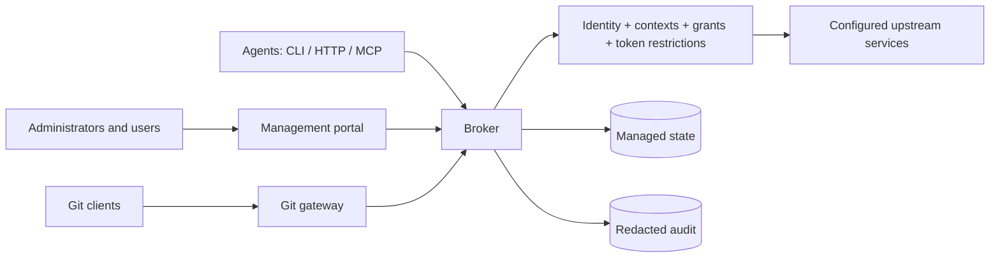
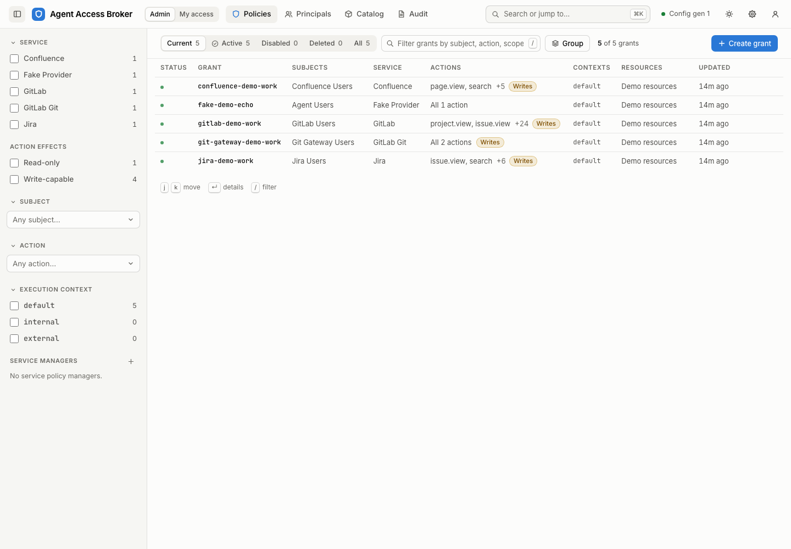
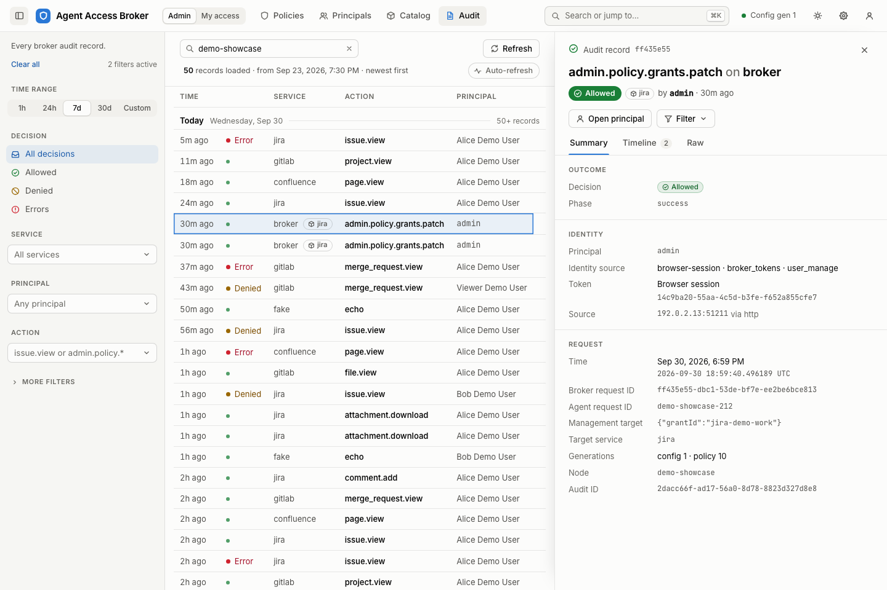
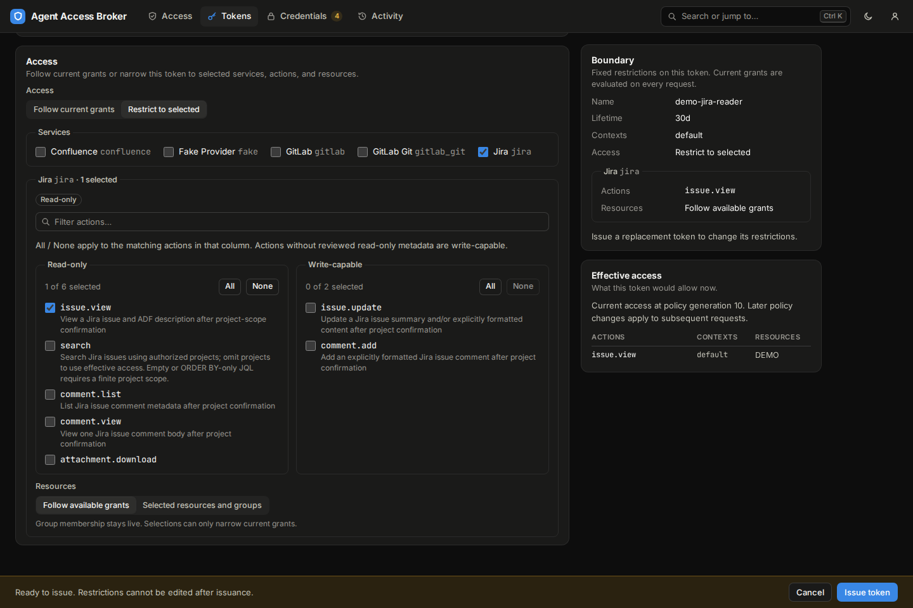

# Agent Access Broker

Agent Access Broker gives AI agents scoped, audited access to service APIs while
keeping upstream execution credentials inside the broker. It supports both
interactive work with an agent and automated workflows. Administrators choose who
can use each action, which resources within a service it can affect, which
execution contexts may use it, and whether it runs as the user or a shared service
identity.

Teams that run agent platforms can own the first layer of access control for
their agents. The broker gives them one place to set and audit agent-specific
policy across services, without relying solely on individual service owners to
model each agent workflow. Service owners retain control of upstream permissions.

Agents can use individual user accounts or shared service accounts, with
organization-level policy limiting permitted actions and supported resource
scopes. Upstream permissions and token scopes continue to apply, while the broker
adds further restrictions, audit logging, rate limiting, and attribution.

This setup works best with organization-managed execution environments or network
egress controls that limit direct access to upstream services. Through its
trusted-caller integration, the broker can also receive verified execution context
and, when configured, user identity from that infrastructure. An **execution
context**, such as an internal workspace or external automation environment,
helps determine permitted actions and resources. The agent cannot gain more
access simply by claiming a different context or identity. Administrators can
disable each trusted identity path or limit it to read actions without changing
the person's grants; see [managed workspace identity](docs/managed-identity.md).

The portal supports local account sign-in or optional
[Microsoft Entra ID sign-in](docs/operator-guide.md#microsoft-entra-oidc-setup-and-operation)
through OpenID Connect (OIDC), with Entra group mappings for access management.
Administrators can also [automatically add newly created Microsoft users to local
groups](docs/administrator-guide.md#microsoft-onboarding). These memberships
persist independently of Microsoft group evidence; the mapped-group admission
requirement still applies.
Optional [membership renewal](docs/operator-guide.md#microsoft-membership-renewal)
keeps group-derived access working after one sign-in while people and their
agents use the Broker.

## Supported integrations

Native integrations pair action permissions with the following resource controls:

| Integration | Supported operations | Resource controls |
| --- | --- | --- |
| [Jira](docs/providers-jira.md) | Project discovery, issues, search, comments, and attachments | Projects |
| [Confluence](docs/providers-confluence.md) | Live space listing, pages, blogs, drafts, comments, and attachments | Spaces, including personal spaces |
| [GitLab REST](docs/providers-gitlab-rest.md) | Repository discovery, content search, issues, merge requests, CI, uploads, and webhooks | Repositories and namespaces |
| [CloudBees CI](docs/providers-cloudbees-ci.md) | Live job listing, builds, Pipelines, logs, artifacts, queues, and triggers | Jobs, folders, and controllers |
| [Teams Workflows](docs/providers-teams.md) | Notifications | Configured Workflow destinations |
| [Git HTTP gateway](docs/git-http-gateway.md) | Git fetch and push | Repositories and namespaces |
| [Gmail](docs/providers-gmail.md) | Mail reads and management through Google OAuth | Actions within the connected user's mailbox; no resource filters |

Confluence space keys preserve their exact case across listing, resource grants,
and content access, including mixed-case, digit-leading, and single-character
ordinary keys as well as personal-space keys.

Jira’s separately grantable [`project.list`](docs/providers-jira.md#live-project-listing)
action lists visible live projects within effective project grants. It needs only
pagination inputs, supports service and personal credentials including OAuth,
and returns confidential continuations when more scanning remains.
[`project.view`](docs/providers-jira.md#project-details-and-searchable-fields)
then describes an authorized project and its searchable fields. Use the returned
stable JQL references, such as `cf[12345]`, in the existing issue search action;
supported operators come from both Jira and Broker's bounded grammar. Project
view and search have independent grants.

Jira issue views include [resolution, dates, components, versions and status
category](docs/providers-jira.md#standard-context), plus [supported custom-field
values and Jira display names](docs/providers-jira.md#custom-fields), with typed
JSON and readable Markdown. They can also include [linked issue details](docs/providers-jira.md#issue-links)
and [the direct parent and subtasks](docs/providers-jira.md#parent-and-subtasks)
when effective `issue.view` access covers every project in the selected credential
mode. Gaps in that coverage withhold all three reference fields. Subtasks are
not a complete list of epic children or descendants.

GitLab's [live project listing](docs/providers-gitlab-rest.md#repository-discovery-and-content-search)
action, `project.list`, returns authorized repositories, including namespace-granted
projects without individual Broker resource registrations. It accepts only pagination,
includes archived projects, and is separately grantable from `project.search`
and object reads. `project.search` adds optional project filters; content actions
search issues, merge requests, code, commits, project wikis, or comments. Each
category is separately grantable. Omit `engine` to use the service's configured
default. Engine and instance-wide availability are operator configured; basic code, commit, wiki,
and comment search require a project. Search pages report bounded progress and
incomplete retrieval coverage explicitly, and may return no items with a
continuation.
Repository discovery accepts GitLab's defaulted keyset pagination links while
preserving the requested filters and repository authorization on every page.
`project.view` includes description, last activity, and star count when supplied
by GitLab. Wiki search returns snippets; full wiki-page reading is not currently
supported, and `file.view` reads source-repository files only.

Administrators can import [MCP HTTP servers](docs/imported-services.md),
[OpenAPI definitions](docs/imported-openapi.md), and operator-approved
[local commands](docs/command-imports.md) as reviewed actions, using the same
identity, execution-context, credential, and audit controls. MCP and OpenAPI
imports provide action-level authorization without resource or query
containment. A command can declare resource types: the Broker checks resources
named in an action's inputs before the command runs, and hands other actions
the caller's grants to filter by.
Commands can also declare file-download actions when the operator enables an
explicit download byte cap. [`agent-access invoke --output`](docs/cli.md#save-action-results-to-a-file)
saves native and imported downloads with size/hash verification, atomic local
replacement and a metadata receipt. JSON `send` and local stdio MCP support the
same downloads; HTTP MCP exposes their detail but excludes executable file tools.
Imported MCP supports administrator-approved [personal OAuth](docs/imported-oauth.md)
connections.

Use [`resource-access describe`](docs/cli.md#resource-access), or MCP
`resource_access_describe`, to see effective local access by action and resource
type across these integrations. It separates access coverage from registered
resource references and identifies explicitly declared live-listing actions.
The summary reflects current policy and usable credentials without contacting
upstream services; invocation still checks every target together.

Native integrations are ordinary Rust crates built on the provider SDK. A team
can write providers in its own repository and build its own Broker distribution
that links them alongside upstream modules; see the
[provider SDK guide](docs/provider-sdk.md) and the
[downstream assembly guide](docs/downstream-assembly.md).

## Access model

The Rust broker, `agent-access` CLI, and administration portal share one
permission model. Agents connect through typed CLI commands, JSON request files,
HTTP, local stdio MCP, or authenticated HTTP MCP. Git clients use the Git smart
HTTP gateway.



A principal identifies a person or workload. Grants select the services, actions,
resources, execution contexts, and credential modes that principal can use.
Resource groups combine reusable selections and exclusions. Resource types can
opt out of exclusions; the portal hides those exclusion choices and the Broker
rejects them. Agent tokens can narrow the granted access further. A stored credential provides upstream
authentication; storing it does not grant permission to use it. A
[credential connection](docs/configuration.md#credential-connections) lets
several services share one personal credential, such as one GitLab token for
GitLab REST and Git or one Atlassian API token for Jira and Confluence. It lists
the token types principals may store, optionally others for service accounts,
or none when its services accept only one, and people connect through OAuth
where an administrator configures it.

Before executing an action, the broker checks current grants and resource
selections and applies the authorized credential mode. Agents discover their
available actions and resources. Administrative roles and personal self-service
are managed separately from permission to invoke service actions.

The broker governs requests sent through it. Network controls establish whether
agents can reach upstream services directly, and upstream account permissions
continue to apply. Revocation blocks new admissions; operations already prepared
may finish. See the [security model](docs/security-model.md),
[resource policy](docs/resources.md), [account roles](docs/roles.md), and
[trusted ingress](docs/trusted-callers.md) for the detailed boundaries.

## Management portal

Administrators manage accounts, resources, grants, credentials, and imported
services in the portal. Users review their access and manage their own credentials
and agent tokens. A dedicated token creation page reuses the grant builder’s
read-only and write-capable action columns, with a live access preview and
copy-ready HTTP MCP client setup after issuance. Auditors investigate recorded
activity.

<table>
  <tr>
    <td><a href="assets/screenshots/grants-light.png"></a></td>
    <td><a href="assets/screenshots/audit-detail-light.png"></a></td>
    <td><a href="assets/screenshots/token-access-dark.png"></a></td>
  </tr>
  <tr>
    <td align="center">Grants</td>
    <td align="center">Audit details</td>
    <td align="center">Agent token restrictions</td>
  </tr>
</table>

## Start here

| Your task | Read |
| --- | --- |
| Try the broker locally | [Local quickstart](#local-quickstart) or [interactive portal demo](demo/README.md) |
| Install and operate a deployment | [Operator guide](docs/operator-guide.md) |
| Set up accounts and grant access | [Administrator guide](docs/administrator-guide.md) |
| Connect an agent | [End-user guide](docs/end-user-guide.md) |
| Learn the portal workflows | [Portal walkthroughs](docs/portal-guide/index.md) |

## Local quickstart

This loopback-only evaluation uses the offline fake provider. It does not require
Jira, Confluence, or another live service. Install Rust through rustup; the
checked-in [toolchain file](rust-toolchain.toml) selects the tested Rust/Cargo
1.98.1 toolchain. The commands below build locally. A configured
[build service](AGENTS.md#build-service) is optional.

```bash
cargo build --locked
cargo run --locked -p agent-access-broker -- \
  --config tests/fixtures/fake-broker.toml config validate
cargo run --locked -p agent-access -- \
  --config agent-access.sample.toml config validate
```

In one terminal, start the broker:

```bash
export FAKE_SERVICE_TOKEN=dev-only-token
cargo run --locked -p agent-access-broker -- \
  --config tests/fixtures/fake-broker.toml serve --listen 127.0.0.1:8787
```

In another terminal, check readiness and invoke one action:

```bash
curl -fsS http://127.0.0.1:8787/v1/readyz
cargo run --locked -p agent-access -- \
  --url http://127.0.0.1:8787 --no-token \
  invoke fake.echo --input-json '{"project":"TEST","message":"hello"}'
```

An allowed response has `decision = "allow"` and echoes `hello` in `result`.
Every response carries request IDs for log/audit correlation. Stop the broker with
Ctrl+C. The fixture writes development audit state under `target/fake-broker-audit`.

For an interactive managed administration walkthrough, see the
[local portal demo](demo/README.md). Its setup script creates disposable state and
leaves a background broker running; follow its stop/reset instructions.

### Build the portal

The tested portal toolchain is Node.js 24.18.0 and npm 11.16.0. Build the web assets
separately from the Rust binaries:

```bash
npm --prefix apps/portal ci
npm --prefix apps/portal run build
```

Configure `[portal].static_dir` with the absolute path to the generated
`apps/portal/dist` directory. Deploy the portal and broker from the same source
revision. See the [portal build instructions](apps/portal/README.md) for supported
Node.js versions and the [demo instructions](demo/README.md) for local setup on
Linux and macOS.

## Operate and upgrade

Start with [the production sample](agent-access-broker.production.sample.toml)
and follow the [operator guide](docs/operator-guide.md) to configure HTTPS ingress,
identity, protected state directories, encryption keys, and administrator access.
The sample grants no provider access; administrators add integrations and grants
explicitly. Local demos and the general samples are development configurations.

Run one broker per managed-store, audit, and upload-spool state set. Back up both
the managed and audit stores together with the keys needed to restore them.
Deploy matching broker, CLI, and portal versions, and follow the
[upgrade and rollback procedure](docs/operator-guide.md#upgrade-and-rollback)
and [changelog](CHANGELOG.md) when changing a deployment.

## Documentation reference

| Reference | Contents |
| --- | --- |
| [Configuration](docs/configuration.md) | Broker and client settings, defaults, and validation |
| [CLI](docs/cli.md) | Commands, discovery, input/output, and exit codes |
| [HTTP API](docs/http-api.md) | Routes, request IDs, responses, and management API |
| [MCP](docs/mcp.md) | Local and HTTP connections, discovery, transfers, and sessions |
| [Architecture](docs/design.md) | Components, crate layout, and request lifecycle |
| [Provider SDK](docs/provider-sdk.md) | Writing native providers: supported API, trust model, contracts, testing, and compatibility |
| [Downstream assembly](docs/downstream-assembly.md) | Building a distribution: composition, identity, pinning, assets, and qualification |
| [Database](docs/database.md) | Storage, encryption, migrations, and keys |
| [Providers](docs/providers.md) | Provider capabilities and individual contracts |
| [OAuth](docs/oauth.md) | Supported delegated connections, consent, and recovery |
| [Testing](docs/testing.md) | Offline suites and optional live-provider checks |
| [Release readiness](docs/release-readiness.md) | Qualification, packaging, and deployment acceptance |

Agent-facing instructions are organized by access surface under [skills/](skills/):
[typed CLI](skills/agent-access-cli-typed/SKILL.md),
[canonical invoke](skills/agent-access-cli-invoke/SKILL.md),
[JSON send](skills/agent-access-cli-send/SKILL.md),
[HTTP](skills/agent-access-http/SKILL.md), and
[MCP](skills/agent-access-mcp/SKILL.md).

## Contributing

Focused bug reports and fixes are welcome through issues and pull requests.
Use issues for focused feature requests and GitHub Discussions for larger ideas
or proposals whose fit needs discussion. See [CONTRIBUTING.md](CONTRIBUTING.md)
for reporting, proposal, and pull-request guidance, and [AGENTS.md](AGENTS.md)
for development checks.

The [release procedure](AGENTS.md#release-procedure) separates preparation,
qualification, and publication: review version and changelog changes first,
qualify the final clean merged commit, and publish that exact commit. The
[release checklist](docs/release-readiness.md) describes the required checks,
distribution contents, and acceptance work.

## Project status

Agent Access Broker is serving users in real-world deployments but is still
in early development. APIs, configuration, and operational workflows may
evolve as the project matures.
