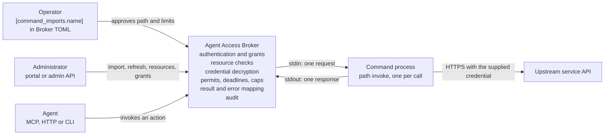
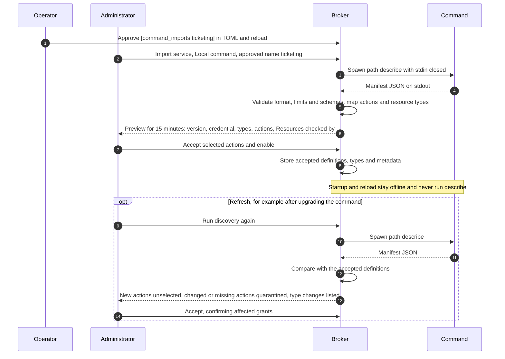
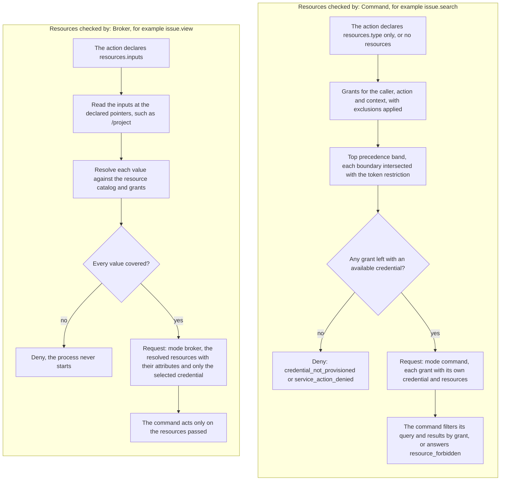
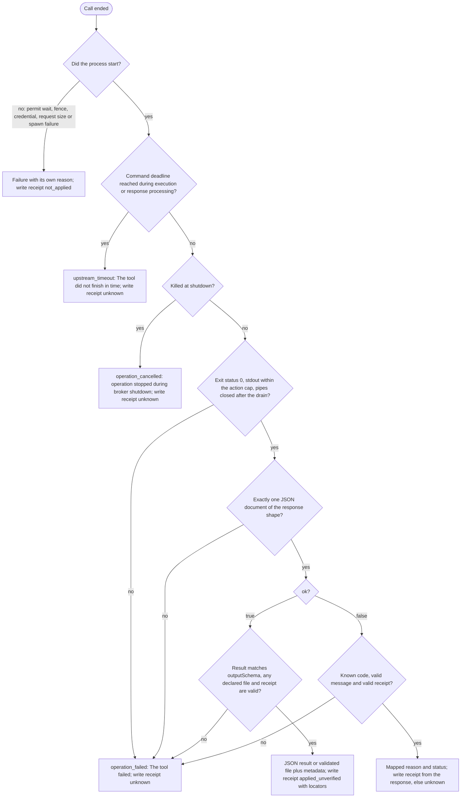

# Command imports

A command import makes an operator-approved local executable a Broker service.
The command describes its actions and resource types in a JSON manifest, and
administrators review, accept and enable them as they do
[MCP and OpenAPI imports](imported-services.md). Grants, credentials, limits,
audit and the portal work as for other imports. `command` is the third import
kind, next to `mcp_http` and `openapi_http`.

Each call runs the command once: the Broker starts `<path> invoke`, writes one
JSON request to its stdin and reads one JSON response from its stdout, and the
process exits. The Broker kills it at its deadline, caps its output and
concurrency, and gives it an empty environment plus the variables the operator
configures.

The **command** is the executable; it becomes one Broker **service**. Its
manifest describes **actions** and **resource types**.

Command imports differ from MCP and OpenAPI imports in three ways:

- **No URL.** The operator names the command in Broker TOML. That name is the
  import's identity, and its endpoint is `command:<name>`.
- **Resource containment.** A command can declare resource types. An action
  whose inputs name resources has them checked by the Broker before the
  process starts; any other action receives the caller's grants and the
  command checks them. See [who checks resources](#who-checks-resources).
- **Plaintext on stdin.** The command makes its own upstream calls, so it
  receives the selected credentials, private resource attributes and caller
  details. This is a deliberate exception to the rule that import adapters
  never receive credential plaintext; see [trust model](#trust-model).

Commands are trusted code: the Broker does not sandbox, checksum or pin them.
Command imports are available on Unix platforms.



*The Broker never calls the upstream for a command. It hands the command a
checked request with the credentials it needs, and the command calls the
upstream itself.*

## Operator approval

Enable imports and the `command` kind, then approve each command under
`[command_imports.<name>]`:

```toml
[imports]
enabled = true
allowed_kinds = ["command"]          # add "mcp_http" or "openapi_http" when used

[command_imports.ticketing]
path = "/opt/agent-commands/ticketing/bin/ticketing-command"
timeout = "30s"
max_output_bytes = 1048576
max_download_bytes = 8388608         # optional: enable files up to 8 MiB
max_concurrent = 4
working_dir = "/var/lib/agent-commands/ticketing"
network = "inherit"
log_stderr = false

[command_imports.ticketing.env]
PATH = "/usr/local/bin:/usr/bin:/bin"
LANG = "C.UTF-8"
```

| Setting | Default | Rules |
| --- | --- | --- |
| Table name | Required | The command name, `^[a-z][a-z0-9_-]{0,62}$`. Administrators pick commands by this name; it is the import's identity. |
| `path` | Required | Absolute path of the executable. |
| `timeout` | `30s` | At most `10m`. Includes the permit wait, process execution, and download validation, decoding and hashing. |
| `max_output_bytes` | 1 MiB | Ordinary JSON and `verify` stdout limit; at most `limits.max_upstream_response_bytes`. |
| `max_download_bytes` | Absent | Positive decoded file cap; omission disables downloads. Must fit both global ceilings described under [download bounds](#download-bounds). |
| `max_concurrent` | 4 | Concurrent processes plus download response workers; at most `limits.max_concurrent_requests`. Download consumers use request capacity instead. |
| `working_dir` | `/` | Absolute. |
| `network` | `inherit` | `inherit` passes the Broker's egress settings; `none` passes none. See [network settings](#network-settings). |
| `log_stderr` | `false` | Adds the command's stderr to failure log lines. See [audit and logs](#audit-and-logs). |
| `env` | Empty | Extra environment variables. Names match `^[A-Za-z_][A-Za-z0-9_]*$`; values contain no NUL and are at most 4 KiB; at most 64 variables. The [network variables](#network-settings) are reserved: set `network = "none"` to supply your own. Not for secrets. |

`config validate`, startup and reload check these settings offline. A
`[command_imports]` entry is usable only when the binary links the `command`
adapter and `[imports].allowed_kinds` includes `command`. `allowed_endpoints`
gates URL-based imports and may be omitted when `command` is the only allowed
kind; the rest of the [import gate](imported-services.md#operator-setup)
applies unchanged, including `disabled_services`.

A missing or non-executable `path` produces only a warning, because binaries
are replaced freely and must not stop the Broker. Calls then fail with
`operation_failed` before any process starts. Nothing records, compares or
pins a command's version or checksum.

The import stores `command:<name>` as its endpoint, fixed after creation like
any endpoint; the path is not part of its identity. Removing the entry makes
imports of that command unavailable but keeps their records, grants and
credentials, as removing an allowed endpoint does. Changes apply on reload:
running processes finish under their old settings, and queued calls that have
not started are rejected with `service_action_denied`.

`max_concurrent` is one budget per command name. Every import of the command,
and its `describe`, `invoke` and `verify` runs, draws from it. A reload that
lowers it applies to new calls; admitted processes and download response workers
still count until they finish. A validated download releases the command slot
before its bytes are delivered.

Download actions require `max_download_bytes`. Without it, discovery marks them
unsupported and acceptance refuses them; ordinary JSON actions remain eligible.
Removing it on reload makes an import with enabled accepted downloads unavailable
until the setting is restored or those actions are disabled or quarantined.

## Importing a command

1. As a base administrator, open **Admin > Catalog**, choose **Import
   service** and the **Local command** import type. Enter a service ID and
   display name, pick an approved command by name, and choose credential modes,
   or none for a command without credentials. The portal never accepts a
   path. The draft has `adapterKind: "command"`, endpoint `command:<name>`,
   credential delivery `stdin` and anonymous discovery.
2. Run discovery from the service's **Import** tab. The Broker runs
   `<path> describe` and stores a 15-minute preview showing the command
   version; the credential kind, or none; each resource type with its proposed
   Broker type ID and any type changes; and each action with its proposed
   action ID, read-only suggestion, download behavior, **Resources checked by**
   and the **Audit inputs** declaration. The latter shows metadata only, never
   invocation values.
   An invalid action is listed as unsupported with a reason; an invalid manifest
   fails discovery.
3. Review the action IDs, Broker type IDs and the Read-only / Write-capable
   classification, accept the selection, then enable the service. Actions stay
   Write-capable until reviewed as Read-only, and the classification also limits
   [read-only identity paths](imported-services.md#classification-and-read-only-identity-access).
   Set the
   service credential, with its username for a `username_token` command, or
   let users add personal credentials on the existing Credentials screens; a
   command without credentials needs neither. The service credential can be
   set once the manifest is accepted, since it declares the credential kind.
   Create resource entries of the command's types and grants with the
   existing policy editor.

**Broker type IDs.** The preview proposes `<service>_<id>` for each declared
type, with hyphens replaced by underscores; `ticketing`'s `project` becomes
`ticketing_project`. The administrator may edit it before the type is first
accepted; it is then fixed. It must match `^[a-z][a-z0-9_]{0,63}$` and not
collide with a registered type. Accepted types appear in
`GET /v1/resource-types` like native ones and survive restarts, disabling and
retirement of the import. The import service owns its types, and the Broker
validates their attribute values against the declaration.

The existing `/v1/admin/imports` routes and `agent-access admin imports`
commands apply ([management](imported-services.md#cli-and-http-management)).
The import list response (`GET /v1/admin/imports`) also includes
`commandImports: [{"name": ...}]`, the approved command names (never paths),
and each command import includes `commandVersion`, the accepted manifest
version. The portal shows it as "Imported at version X".



*Import and refresh. Discovery is the only time the Broker runs `describe`;
grants survive a refresh, and quarantined actions stay unavailable until an
administrator accepts them again.*

### Refresh

Startup and reload use the stored accepted definitions and never run the
command. Binaries may be replaced at any time, so **after upgrading a command,
run discovery again to review its changes.** Until then the Broker keeps
sending requests that match the accepted definitions, and the new binary
should accept them or answer `input_invalid`.

Refresh applies the [import rules](imported-services.md#administrative-workflow):
new actions stay unselected; missing, unsupported or behaviorally changed
actions are quarantined; grants are retained; and accepting a change that
affects grants requires confirming them. An action's behavior is its input
schema, output schema, download behavior, and the resource declaration and
credential modes and complete `auditInputs` declaration the adapter records in
its annotations. Adding, removing or changing an audit rule, its label, placement,
role, kind, shape, bounds or order quarantines the action until accepted again.
Identical canonical declarations do not change behavior. Failed discovery keeps
the accepted declaration intact. The manifest `version`
and `verify` flag take effect on acceptance. An older Broker cannot load a service containing an
accepted download definition; see [upgrade and rollback](operator-guide.md#upgrade-and-rollback).

Accepting a refresh also checks the managed policy against the new
definitions. If a retained grant would become invalid, for example because an
action's credential modes narrow and no longer include the grant's mode, or
because an action gains typed resources while it has same-precedence grants
in different modes, acceptance is rejected and names the grants. Update or
remove them, then accept again.

A refresh that adds, removes or changes `credential` fails discovery, because
stored credentials and grants assume its shape. Create a new import instead.

### Resource type changes

A refresh matches each declared type to the accepted type with the same
manifest type `id`, which must keep its accepted Broker type ID; a type the
manifest renames is a new type, and the old one is removed. The preview lists
every change, and accepting the preview applies it:

| Change | Outcome |
| --- | --- |
| Any change to a type with no stored resources | Applied |
| New type | Applied |
| Label, plural label, example, attribute label or description | Applied |
| New optional attribute; required attribute made optional | Applied |
| `supportsExclusions` changes from `false` to `true` | Applied |
| `supportsExclusions` changes from `true` to `false` | Applied only when no group excludes any resource of the type; the preview names blocking groups and memberships |
| Removed attribute | Applied. Its stored values are deleted on acceptance, which advances each affected resource's version as an attribute edit does; the preview names the affected resources |
| Pattern or `maxLength` change | Applied if every stored resource value of the type still matches. Otherwise the preview lists the resources that do not; edit or delete them before accepting |
| New required attribute, optional attribute made required, or changed attribute pattern, on a type with exact resources | Not applied: the actions using the type become unsupported and must declare it under a new type ID. Stored attribute values are encrypted, so checking them would mean decrypting them |
| Type removed from the manifest | Its actions are quarantined. The type stays registered and accepts no new resources until its resources are deleted; a later acceptance then drops it |
| Removed type declared again while still registered | Restored: compared with its retained declaration like any change, and accepts new resources again once applied |

Only resources with an exact selector hold attribute values. Resources that
select all values of a type therefore never prevent an attribute change, but
they do keep a removed type registered.

When an incompatible attribute change needs a new type ID, the entire accepted
declaration stays, including its exclusion capability. The preview lists all
changes, but none of that type's changes apply; its actions remain unsupported
and quarantined until a usable declaration is reviewed and accepted.

Acceptance rechecks every decision that depends on stored resources inside its
transaction. If a resource created or changed since the preview makes a change
no longer allowed, acceptance is rejected and names the resources; fix them or
refresh. It also rechecks excluded group memberships, including unused groups;
remove blocking exclusions before accepting an opt-out. Rejection preserves the
accepted metadata and runtime state from before acceptance. Type changes never
quarantine actions by themselves. The preview and
acceptance fields are described under
[imported resource types](imported-services.md#imported-resource-types).

A command declares at most 16 resource types, and an import keeps at most 16
removed types besides them. The declared types' metadata is limited to
128 KiB of the 256 KiB the Broker stores per import, so a command that renames
a type can still keep the old one for its resources.

Resource type listings, `GET /v1/resource-types` and the runtime catalog's
`resourceTypes`, name each imported type's `importedService` and mark a
removed type with `removed: true`. The portal offers removed types for no new
resources.

Each listing includes the resolved `supportsExclusions` boolean. It defaults to
`true`; a manifest can set it to `false` when its command cannot honor exclusions.
The Broker then rejects all excluded group memberships of that type and the
portal hides those exclusion choices. Inclusions remain available. The capability
applies to every action using the type, including Broker-enforced actions, and
to every selector kind. Declare separate types when actions need different
exclusion capabilities. It does not change resource matching or the invocation
payload.

Dropping an unused removed type needs an acceptance even when no action is
left to select. For an import that already has accepted actions, an
acceptance with no selections applies only the preview's type changes. A
draft still needs at least one selection. In the portal, clear every action
in the review and accept it.

## Who checks resources

Each action's manifest entry decides who checks its resources. The portal's
preview, **Actions** tab and grant editor show it per action:

| Manifest `resources` | Portal | Grants | Request `authorization` |
| --- | --- | --- | --- |
| `{"type": "project", "inputs": ["/project"]}` | **Resources checked by: Broker** (Project, from `project`) | Resources of the type | `mode: "broker"` with the resolved resources |
| `{"type": "project"}` | **Resources checked by: Command** (Projects) | Resources of the type | `mode: "command"` with the caller's grants |
| Absent | **Resources checked by: Command** (no resource type) | Whole action | `mode: "command"` without `resourceType`, with grants whose resources are `"any"` |



*The two authorization modes. Both check authentication, context, token
restrictions, the action grant and the input schema first.*

### Broker-enforced actions

An action that declares `resources.inputs` names one to four JSON pointers to
required string or string-array inputs. The Broker reads those values,
resolves them against the resource catalog and grants with the same rules as
native actions, and denies the call without starting the process unless a
grant covers every value. The request carries the resolved resources, and
`authorization.credential` names the wire mode of the one credential the
covering grant selects, which `credentials` holds. For a command without a
credential, `authorization` has no `credential` member and the request no
`credentials`.

Each resource carries its `value`. When an enabled, context-eligible exact
catalog entry holds the value, the resource also carries the entry's `id`,
its private `attributes` (an empty object for an entry without any) and
`name` when the entry has a display name, whichever grant covered the value,
including one that selects all resources of the type. Only a value that no
such entry holds carries just its `value`. `resourceType` is the manifest's
type ID, not the Broker type ID.

Every admitted exact entry is fenced, with or without attributes. After the
call's permit the Broker rechecks each entry and decrypts its attributes; an
entry that changed, was deleted and recreated, or was disabled while the call
waited fails `scope_unresolved` without starting the process. Each entry is
compared on its version (which every change advances), its creation time
(to the second), and its display name, type and selector. An entry with
private attributes is also compared on the versions of its attribute
material, which are fresh for every stored value, so a recreated entry that
holds attributes always counts as replaced. An entry without attributes
deleted and recreated within the same second with the same version, display
name, type and selector counts as the same entry.

### Command-enforced actions

An action without `resources.inputs`, such as a search that takes a query
expression, is checked by the Broker at the action level only. One command
authority planner computes the grants passed to the command, and caller
discovery uses the same planner:

1. Take the grants for the caller, action and execution context, with group
   memberships expanded and [exclusions](resources.md#groups-and-exclusions)
   applied.
2. Keep the top precedence band only, as native searches do; a lower band is
   never consulted.
3. Express each grant's boundary as finite values or as all values except
   some, intersected with the agent token's resource restriction.
4. Omit grants whose boundary ends up empty, whose credential mode the
   action no longer supports, or whose credential is unavailable, including a
   personal grant for a caller whose principal kind the import's credential
   connection offers no method. Each remaining grant still uses only its own
   mode's credential. If none
   remain, the call is denied: `credential_not_provisioned` when credentials
   were the cause, otherwise `service_action_denied`.

Unlike native searches, the grants in the band may use different credential
modes; each entry names its own. Policy validation accordingly accepts
same-precedence grants of a command-enforced action that differ in credential
mode, which it rejects as ambiguous for native and Broker-enforced actions.
The catalog, MCP tool lists and resource discovery show exactly what
invocation would pass.

Each grant becomes `{"credential", "resources", "except"?}`. `credential` is
the grant's wire mode, `service` or `user`, and is omitted for a command
without a credential. `resources` is `"any"` or a list of resources shaped as
for Broker-enforced actions. `except` appears only with `"any"`, and only when
it is not empty, and lists excluded exact values: a grant of all resources
minus a group exclusion is an all-except boundary, and plain `"any"` would
broaden it. For an action without
a resource type, `authorization` has no `resourceType` and every entry is
`{"resources": "any"}`, plus `credential` when the command has one.

The command must use each grant's credential only for that grant's resources,
filter its query or results accordingly, and answer a request it will not serve
with `resource_forbidden`. The Broker cannot check this: an unfiltered search
reaches whatever its credential can, as with other imports.

A command that declares `supportsExclusions: false` must still fail with
`resource_forbidden` if it receives an `except` boundary for that type. Never
ignore the exceptions: a newly deployed command can run while its previous
declaration is still accepted. Remove the type's existing group exclusions
before deploying a command version that cannot enforce them, then refresh and
accept the declaration. See [upgrade and rollback](operator-guide.md#upgrade-and-rollback).

## Credentials

A command declares at most one credential kind, in one or both modes:

| Manifest `credential.kind` | Stored as | Sent on stdin |
| --- | --- | --- |
| `token` | `bearer_token` | `{"kind": "token", "token": "..."}` |
| `username_token` | `basic_api_token` | `{"kind": "username_token", "username": "...", "token": "..."}` |

- **Service mode** (`service`) uses the import's encrypted execution
  credential, set by an administrator.
- **Personal mode** (`per_user`) uses the caller's token for the import's
  [credential connection](configuration.md#credential-connections), which the
  Broker publishes under the imported service ID with the profile `token` or
  `username-token`. People and `system` principals store their own token, and
  administrators provision service accounts'. Command imports offer no OAuth.
  A personal credential never falls back to the service credential.
- An action may narrow the modes with `credentialModes`.

On stdin, `credentials` is keyed by wire mode, `service` or `user`, and holds
only the credentials that `authorization` uses. Credentials travel only on
stdin, never in arguments or the environment. `describe` never receives
credentials.

A service credential is read at the version admitted with the call; rotating
it while a call waits for a permit rejects that call with
`service_action_denied` rather than substituting the new secret. A personal
credential is read after the permit, so a call that waited uses the current
value, and a removed credential fails with `credential_not_provisioned`.

**Commands without credentials.** A manifest without `credential` declares
none. Grants for its actions use service mode, which counts as available
without a stored credential, and enabling the service needs no credential.
Requests carry no `credentials`, and neither `authorization` nor any of its
grant entries has a `credential` member. Verification stays local; the
command's `verify` is never run.

The credential kind and the `stdin` delivery are fixed once actions are
accepted. Stored credentials of both kinds take part in key readiness,
used-key inventory and rewrap, as described in [database operations](database.md).

## The command contract

### Running a command

The Broker runs the executable at `path` with one argument:

| Argument | Stdin | Stdout |
| --- | --- | --- |
| `describe` | Closed | The [manifest](#describe-the-manifest) |
| `invoke` | One [request](#invoke-the-request) | One [response](#the-response) |
| `verify` | One [verify request](#verify) | One response |

The process runs in `working_dir` and in a new process group, with stdin,
stdout and stderr piped. Its environment is empty apart from `env` and, for
`invoke` and `verify` with `network = "inherit"`, the
[network variables](#network-settings); `describe` gets `env` only. A command
must:

- **Set up first, then read the request from stdin**, without assuming it
  arrives immediately, and read all of it.
- Print exactly one JSON document on stdout (trailing whitespace is allowed)
  and exit with status 0, for errors too.
- Keep any child processes in its process group.
- Never log, persist or forward credentials, and keep any private attribute
  it treats as secret out of logs, its error messages, verification stages
  and locators: the Broker checks those fields for credentials and proxy
  secrets only. Stderr is for diagnostics; it never reaches callers or audit.

### describe: the manifest

`<path> describe` prints a manifest such as:

```json
{
  "format": "agent-access-command/1",
  "version": "1.4.0",
  "credential": { "kind": "username_token", "modes": ["service", "per_user"] },
  "verify": true,
  "resourceTypes": [{
    "id": "project", "label": "Project", "pluralLabel": "Projects",
    "example": "OPS", "pattern": "[A-Z][A-Z0-9]{1,9}", "maxLength": 10,
    "attributes": [
      { "name": "region", "label": "Region", "description": "Hosting region.",
        "required": false, "pattern": "[a-z0-9-]{1,32}" },
      { "name": "webhookSecret", "label": "Webhook secret",
        "description": "Per-project signing secret.", "required": false }
    ]
  }],
  "actions": [
    {
      "name": "issue.view", "description": "Show one issue.", "readOnly": true,
      "inputSchema": { "type": "object", "required": ["project", "issue"],
        "properties": { "project": { "type": "string" }, "issue": { "type": "integer", "minimum": 1 } },
        "additionalProperties": false },
      "resources": { "type": "project", "inputs": ["/project"] }
    },
    {
      "name": "issue.search", "description": "Search issues with a query expression.",
      "readOnly": true,
      "inputSchema": { "type": "object", "required": ["query"],
        "properties": { "query": { "type": "string", "maxLength": 2000 } },
        "additionalProperties": false },
      "resources": { "type": "project" }
    },
    {
      "name": "project.list", "description": "List visible projects.",
      "readOnly": true, "listingOf": "project",
      "inputSchema": { "type": "object", "properties": {},
        "additionalProperties": false },
      "resources": { "type": "project" }
    },
    {
      "name": "issue.create", "description": "Create an issue in a project.",
      "readOnly": false,
      "inputSchema": { "type": "object", "required": ["project", "summary"],
        "properties": { "project": { "type": "string" },
          "summary": { "type": "string", "minLength": 1, "maxLength": 200 } },
        "additionalProperties": false },
      "resources": { "type": "project", "inputs": ["/project"] }
    }
  ]
}
```

| Field | Rules |
| --- | --- |
| `format` | Exactly `agent-access-command/1`; anything else fails discovery |
| `version` | String of 1–64 bytes, for display only |
| `credential` | Optional; omit it for a command without credentials |
| `credential.kind` | `token` or `username_token` |
| `credential.modes` | Nonempty subset of `service` and `per_user` |
| `verify` | Boolean, default `false`; `true` requires `credential`. See [verify](#verify) |
| `resourceTypes[]` | At most 16 |
| `.id` | `^[a-z][a-z0-9_]{0,31}$`, unique |
| `.label`, `.pluralLabel` | 1–64 bytes |
| `.supportsExclusions` | Optional boolean, default `true`. `false` disallows excluded group memberships of this type. `null` and non-booleans are rejected |
| `.pattern` | Required. A [pattern](#patterns) matched against the whole value |
| `.maxLength` | Default 256, at most 1,024 bytes |
| `.example` | Required, nonempty, and must match `pattern` and `maxLength` |
| `.attributes[]` | At most 16: `name` (`^[a-z][A-Za-z0-9_]{0,63}$`), `label`, `description` (at most 1 KiB, without control characters), `required` and an optional [pattern](#patterns). Values are at most 8 KiB. Every attribute is private and encrypted |
| `actions[]` | At most 2,048 |
| `.name` | The action's source identity; proposes its action ID |
| `.description` | At most 16 KiB |
| `.inputSchema` | `type: object` in the import schema profile |
| `.outputSchema` | Optional; `result` must validate against it, including metadata on download actions |
| `.readOnly` | A suggestion; the administrator classifies each action |
| `.download` | Optional literal `true`; a successful call returns one file and bounded metadata. Omit for JSON actions; `false`, `null` and non-booleans are unsupported |
| `.listingOf` | Optional declared source type ID, equal to `.resources.type`; requires a JSON command-enforced collection without resource input pointers and administrator acceptance as read-only; forbidden on downloads |
| `.auditInputs` | Optional nonempty ordered array of reviewed input capture rules; see [audit input declarations](#audit-input-declarations) |
| `.credentialModes` | Optional subset of `credential.modes`; absent without `credential` |
| `.resources.type` | A declared type ID; an action has at most one resource type |
| `.resources.inputs` | 1–4 JSON pointers to required string or string-array inputs; their presence makes the action Broker-enforced |
| `oauth` | Reserved; see [not supported](#not-supported-in-this-version) |

Other fields are rejected. The [import limits](imported-services.md#limits-and-admission)
apply: a 16 MiB manifest and 256 KiB per action, including schemas. Resource
types support exact and all-resources selectors.

`listingOf` explicitly declares ordinary enumeration of canonical items of the
action's resource type without a required query. Query searches and collections
of other objects must not declare it. In the example, `project.list` is
command-enforced: it filters every emitted project
against the supplied authority. The administrator must accept it as read-only;
the manifest's `readOnly` suggestion alone does not authorize publication.
Acceptance maps the source type ID (`project`) to that import's stable Broker
type ID. The accepted action's capabilities and runtime catalog expose this
Broker ID as `listingOf`, and OpenAPI/send projections expose
`x-agent-access-listing-of`.

The shared [resource-access helper](resources.md#caller-discovery) can then
advertise the action in `liveListings` when its own grants and credentials make
it available. This hint does not promise a complete inventory for another action
or grant access to it. No action name implies listing capability, and a command
without `listingOf` gets no enumeration hint. The helper still describes each
scoped or unscoped action's local access and registered references.
For a command-enforced action, `enforcement: "command"` identifies coverage as
the grants the Broker hands to the command. The command must enforce that
boundary and filter results itself; the helper does not imply Broker checks of
the command's output. Broker-enforced resource inputs use `enforcement: "request"`.

#### Audit input declarations

`auditInputs` selects original caller inputs to retain in `requestAudit`. Omit
the field to capture none; an empty array is invalid. Unlisted inputs are omitted.
The same strict SDK declaration and preparation rules apply to native actions
and commands. For example, an action whose schema declares `query`, `limit` and
`pageToken` can include:

```json
"auditInputs": [
  {"key":"query","label":"Requested query","pointer":"/query","display":"primary","role":"fact","kind":"query","capture":"value","shape":"scalar","maxBytes":4096,"overflow":"prefix"},
  {"key":"limit","label":"Requested limit","pointer":"/limit","display":"detail","role":"fact","kind":"number","capture":"value","shape":"scalar"},
  {"key":"pageToken","label":"Continuation supplied","pointer":"/pageToken","display":"detail","role":"fact","kind":"boolean","capture":"presence"}
]
```

Rules use unique keys and exact JSON pointers into the action's input schema.
`value` requires `shape: "scalar"` or `"list"` and a formatting kind; it retains
only matching scalar types. String-bearing kinds require `maxBytes` and
`overflow`; only `text` and `query` permit `prefix`, while identifiers, paths,
emails and dates use `omit`. Numeric and boolean kinds reject string options.
Integer identifiers are exempt from string caps and retain their exact integer
representation. Lists sample at most 20 positions.

`presence` records whether the property was supplied, without inspecting it.
`itemCount` counts array items; `utf8ByteCount` counts a string's UTF-8 bytes.
Their required kinds are `boolean`, `number` and `bytes`, respectively.
`records` uses kind `records` and explicit relative child rules to retain at
most 20 object rows. `omit` contains only `key`, `pointer` and `capture`, and
records no fact. Other modes have a plain-text `label`, a `display` placement
(`primary`, `detail` or `raw`) and a `role` (`target`, `change` or `fact`).

Discovery rejects invalid rules per action, including unknown fields, duplicate
or conflicting selectors, missing schema paths and prohibited sensitive-value
capture. Accepted metadata is checked again when loading and building the
service. `x-agent-access-sensitive: true` marks sensitive schema values; the
existing root-header sensitivity rules also apply. No declaration can select credentials, private resource attributes,
environment, process stdout/stderr or response values: those are not caller
inputs. A command cannot return a replacement `requestAudit`.

The preview and installed action details expose the reviewed declaration.
Acceptance approves it as a whole, under the existing manifest/version fences;
the selection request cannot replace individual rules. Captured data is visible
to readers allowed to inspect complete audit records. Every string-bearing value
rule records requested text, which can include arbitrary caller-supplied text;
it does not certify that the value matched a schema enum or pattern or that the
text is secret-free. Identifier text is searchable too. Keep body content and
opaque credentials omitted, or declare only an appropriate presence summary.

The declaration is stored only in `annotations.command.auditInputs`. Commands
without it keep their existing persisted shape. The format stays
`agent-access-command/1`, and invoke/verify stdin and stdout are unchanged.
Older binaries reject accepted annotations containing this field: rollback
requires a pre-upgrade store state or a version that understands the metadata.
Do not strip the declaration to make rollback succeed.

#### Patterns

Resource type and attribute patterns use the syntax of the Rust
[`regex`](https://docs.rs/regex) crate, which matches in time linear in the
value's length; lookaround and backreferences are not supported. The Broker
anchors a pattern to the whole value, so `[A-Z]{2,10}` accepts `OPS` but not
`OPS-1`, and a pattern must be a complete expression on its own: `x)|(?s:.*`
is rejected rather than escaping the anchors. In verbose mode (`(?x)`) a `#`
comment runs to the end of its line, so a pattern that ends with a comment
must end with a newline. `maxLength` and the 8 KiB attribute value bound count
the bytes of the UTF-8 value, not characters. A pattern's source is at most
8 KiB, and its compiled form must fit the 256 KiB compilation budgets.

Attributes are stored encrypted with the existing credential key ring. Normal
admin reads show only the names of configured attributes; values are returned
only through the explicit [attribute reveal](resources.md#private-resource-attributes),
and never appear in catalogs, exports, audit or agent surfaces. The command
receives them only in the requests of Broker-enforced actions and
command-enforced grant lists.

### invoke: the request

`<path> invoke` reads one request of at most 1 MiB:

| Field | Contents |
| --- | --- |
| `format` | `agent-access-command/1` |
| `action` | The manifest action `name` |
| `requestId` | The Broker request ID |
| `deadline` | The call's deadline, RFC 3339 UTC in whole seconds, such as `2026-10-14T15:04:35Z` |
| `context` | The execution context |
| `caller` | The calling principal, below |
| `inputs` | The inputs, already validated against the accepted input schema |
| `authorization` | [Who checks resources](#who-checks-resources) and with which credential |
| `credentials` | The credentials `authorization` uses; absent without credentials |
| `network` | The Broker's egress settings, with `network = "inherit"` only |

| `caller` field | Contents |
| --- | --- |
| `principal` | The principal ID |
| `kind` | `user`, `service_account` or `system` |
| `displayName`, `email` | When set on the principal |
| `username` | `{namespace, name}`, only when a trusted username assertion identified the caller |
| `token` | `{id, label}`, only when the caller used an agent token |
| `groups` | The caller's policy groups |

A Broker-enforced request (`issue.view`):

```json
{
  "format": "agent-access-command/1", "action": "issue.view", "context": "internal",
  "requestId": "brk_01JA7Q2W9V8X", "deadline": "2026-10-14T15:04:35Z",
  "caller": { "principal": "avery", "kind": "user", "displayName": "Avery Example",
    "email": "avery@example.com", "token": { "id": "tok_5c1d", "label": "laptop agent" },
    "groups": ["engineering"] },
  "inputs": { "project": "OPS", "issue": 42 },
  "authorization": { "mode": "broker", "credential": "user", "resourceType": "project",
    "resources": [{ "value": "OPS", "id": "ops", "name": "Operations",
      "attributes": { "region": "eu-1", "webhookSecret": "s3cr3t-example" } }] },
  "credentials": { "user": { "kind": "username_token", "username": "avery", "token": "pat-example" } },
  "network": { "proxy": { "url": "https://proxy.example.net:8443" }, "noProxy": [".internal.example"],
    "trust": "system_plus_custom", "caCertificate": "/etc/agent-access-broker/corporate-ca.pem" }
}
```

A command-enforced request (`issue.search`), with one personal grant of every
project except `SEC` and one service grant of `OPS`:

```json
{
  "format": "agent-access-command/1", "action": "issue.search", "context": "internal",
  "requestId": "brk_01JA7Q3D2K4M", "deadline": "2026-10-14T15:05:10Z",
  "caller": { "principal": "avery", "kind": "user", "groups": ["engineering"] },
  "inputs": { "query": "status = open ORDER BY updated DESC" },
  "authorization": { "mode": "command", "resourceType": "project", "grants": [
    { "credential": "user", "resources": "any", "except": ["SEC"] },
    { "credential": "service", "resources": [{ "value": "OPS", "id": "ops", "name": "Operations",
      "attributes": { "region": "eu-1" } }] } ] },
  "credentials": {
    "user": { "kind": "username_token", "username": "avery", "token": "pat-example" },
    "service": { "kind": "username_token", "username": "svc-tickets", "token": "svc-example" } }
}
```

```mermaid
sequenceDiagram
    autonumber
    participant G as Agent
    participant B as Broker
    participant C as Command
    participant U as Upstream
    G->>B: Invoke issue.view with project OPS and issue 42
    B->>B: Authenticate, check context, token restrictions and action grants, validate inputs
    B->>B: Authority plan: resolve /project against grants, or collect top-band grants
    break Not authorized or invalid input
        B-->>G: Deny, and no process starts
    end
    B->>B: Wait for a permit until the deadline
    B->>B: Final checks: import fence, resource fences and attributes, credentials
    B->>B: Build the request, then check the import fence and action again
    B->>C: Spawn path invoke: empty environment plus configured variables, own process group
    B->>C: stdin: the request JSON, then close
    Note over C: Set up first, then read stdin
    C->>U: HTTPS with the supplied credential
    U-->>C: Upstream response
    Note over C: Command-enforced actions filter by grant here
    C-->>B: stdout: one response JSON, then exit 0
    B->>B: Kill and reap the process group, drain pipes
    B->>B: Validate and map the result, error or receipt, then audit; release download worker permit
    B-->>G: Result or mapped error
```

*One call. A client disconnect does not stop a running command: it finishes
or reaches its deadline. The command's timeout includes the permit wait and
download response validation.*

### The response

```json
{ "ok": true, "result": { "issue": { "key": "OPS-42", "status": "open" } } }
```

```json
{ "ok": true, "result": { "key": "OPS-43" }, "receipt": { "safeLocators": { "issue": "OPS-43" } } }
```

```json
{ "ok": false, "error": { "code": "resource_not_found", "message": "Issue OPS-42 was not found." },
  "receipt": { "mutationStatus": "not_applied" } }
```

The Broker returns `result` to the caller as `result.upstreamCommand`. Ordinary
actions return JSON; actions declaring `download: true` use the file contract
below. The command result is marked sensitive at
`/result/upstreamCommand` on every surface, including reads, as other imported
payloads are. With an `outputSchema`, `result` must validate against it.

### Download responses

An action declares `"download": true` in its manifest and always returns one
file on success. Output kind is independent of read-only classification and
cannot be selected through inputs, filenames or content types. The protocol
remains `agent-access-command/1`; base64 is fixed, with no encoding selector.

An exit-zero success requires `ok`, an object `result` containing metadata, and
`download`. An optional `receipt` follows the [write rules](#receipts-for-writes):

```json
{
  "ok": true,
  "result": { "warnings": ["Only completed records are included."] },
  "download": {
    "content": "AAECAw==",
    "filename": "report.bin",
    "contentType": "application/octet-stream",
    "size": 4
  }
}
```

`outputSchema` validates only `result`, never the file or transport envelope.
An empty `{}` is valid unless the schema requires metadata. The download fields
are:

| Field | Contract |
| --- | --- |
| `content` | Required unescaped ASCII JSON string of strict standard RFC 4648 base64: required padding, zero unused pad bits, no whitespace or backslash escapes. Empty string means an empty file. |
| `filename` | Required UTF-8 basename of 1–255 bytes, without controls, slash or backslash, and not `.` or `..`. Metadata only; never a local destination. |
| `contentType` | Required ASCII media type of 1–255 bytes, with valid media-type and HTTP header syntax and no controls. Parameters are allowed. |
| `size` | Optional non-null unsigned 64-bit integer equal to the decoded byte count. |
| `sha256` | Optional non-null 64-character ASCII hexadecimal digest equal to the computed SHA-256, compared case-insensitively. |

Unknown or duplicate fields in the envelope, download, error or receipt objects,
trailing JSON documents, invalid base64, bad metadata, and mismatched size or hash
are contract violations. A claimed success without a valid file also fails.
The Broker computes size and SHA-256 even when the command omits them, and sends
raw bytes with this result metadata:

```json
{
  "filename": "report.bin",
  "contentType": "application/octet-stream",
  "size": 4,
  "sha256": "054edec1d0211f624fed0cbca9d4f9400b0e491c43742af2c5b0abebf0c990d8",
  "upstreamCommand": { "warnings": ["Only completed records are included."] }
}
```

The Broker never adds `download.content` or its encoded response to metadata,
receipts, diagnostics or audit. Write receipt fields retain their root result
locations. The filename never overrides the caller's local destination.

A normal exit-zero failure remains a supported response:

```json
{"ok": false, "error": {"code": "resource_not_found", "message": "The requested download was not found."}}
```

It maps to the ordinary HTTP 404 JSON envelope with `contractViolation: false`.
`result` and `download` are forbidden on errors. Other existing error codes, retry metadata and write
receipts keep their meanings. A nonzero exit is a generic process failure.
No error produces a successful file receipt or replaces the local destination.

A partial export can succeed with a complete, valid file and bounded warnings or
a completeness flag in `result`, documented by its schema. An interrupted or
truncated transfer fails. The Broker does not inspect file contents to prove
semantic completeness or the command's resource filtering.

### Download bounds

For `D = command_imports.<name>.max_download_bytes`, the raw stdout cap is
`E = 4 * ceil(D / 3) + 16384`. Both the decoded cap D and envelope cap E apply.
Envelope overhead excluding the base64 characters is separately capped at
16,384 bytes, including whitespace and all metadata. Configuration validation
rejects D above `limits.max_download_bytes`, E above
`limits.max_upstream_response_bytes`, arithmetic overflow, and values that
cannot be represented on the target platform; it never clamps or raises limits.
These checks apply only when the optional setting is present. The sample 8 MiB
cap requires E = 11,201,196 bytes; 8 MiB is not a default.

`result` is limited to 2,048 bytes both as raw JSON and after compact
serialization, nesting depth 8, 256 total object members/array elements, and
1,024 UTF-8 bytes per string. The complete Broker metadata envelope also has the
shared [16,384-byte encoded HTTP header cap](http-api.md#raw-download-negotiation).
Ordinary JSON and `verify` retain `max_output_bytes`; `describe` retains 16 MiB.

The command budget covers capture and validation/decode/hash workers, whose
conservative payload allocation budget is `4E + D` per active worker, plus
bounded metadata. Encoded buffers are released before delivery. Validated files
use at most D plus transport buffers while being sent; global and principal
request permits remain held by the response and any outstanding byte chunks.
Retained file buffers are bounded by
`limits.max_concurrent_requests * limits.max_download_bytes`, separately from
worker memory. Size aggregate memory across commands and allow for admitted
calls keeping older caps after a reload lowers them.

Use [generic invoke](cli.md#save-action-results-to-a-file) with `--output`, JSON
`send` with `responseMode: "stream"` and an output sink, or local stdio MCP with
an absolute `outputPath` beside `inputs`. Paths stay local to `agent-access`.
HTTP MCP excludes executable downloads but permits their action detail.
Receipts retain bounded metadata and mark command files sensitive; that marker
does not redact metadata. Sensitive binary responses use `Cache-Control: no-store`.

### Error codes

A command reports a failure with one of these codes:

| Command `code` | Broker reason | HTTP | Decision |
| --- | --- | --- | --- |
| `input_invalid` | `input_invalid` | 400 | deny |
| `resource_not_found` | `resource_not_found` | 404 | deny |
| `resource_forbidden` | `service_action_denied` | 403 | deny |
| `conflict` | `version_conflict` | 409 | deny |
| `upstream_unauthorized` | `upstream_unauthorized` | 424 | error |
| `upstream_forbidden` | `upstream_forbidden` | 424 | error |
| `upstream_rate_limited` | `upstream_rate_limited` | 429 | error |
| `upstream_unreachable` | `upstream_connection_failed` | 502 | error |
| `upstream_timeout` | `upstream_timeout` | 504 | error |
| `upstream_failed` | `upstream_failed` | 424 | error |

- `message` reaches the caller. It is UTF-8, at most 1,024 bytes, possibly
  empty, with no control characters except tab, and must not contain a
  supplied credential or proxy secret
  ([secrets in responses](#secrets-in-responses)).
- `upstream_rate_limited` may carry `retryAfterSeconds` inside `error`, from 1
  to 86,400:
  `{"ok": false, "error": {"code": "upstream_rate_limited", "message": "Slow down.", "retryAfterSeconds": 30}}`.
  The Broker builds the [upstream rate-limit result](http-api.md#provider-reported-standard-reasons).
- A command that should not reveal whether a resource exists may answer
  `resource_not_found` instead of `resource_forbidden`.
- Any other code is a contract violation; see
  [how the Broker reads the result](#how-the-broker-reads-the-result).

### Receipts for writes

A write-capable action reports what it knows about its write through an
optional `receipt`, which becomes the Broker's
[mutation receipt](http-api.md#mutation-receipts). The Broker always derives
`retrySafe` from the status.

| Response | Allowed `receipt` | Caller sees |
| --- | --- | --- |
| `ok: true` | Absent, or `{"safeLocators"}` | `applied_unverified`, `retrySafe: false`, with the locators given |
| `ok: false` | Absent | `unknown` |
| `ok: false` | `{"mutationStatus": "not_applied"}` or `{"mutationStatus": "unknown"}` | That status |
| `ok: false` | `{"mutationStatus": "applied_unverified", "verificationStage"?, "safeLocators"?}` | `applied_unverified`; the stage defaults to `command_response` and the locators to `{}` |
| Any generic failure after the process started | Ignored | `unknown` |
| A failure before the process started | Not applicable | `not_applied` |

- A receipt on a read-only action, an unknown receipt field, or a `retrySafe`
  from the command is a contract violation.
- `verificationStage` matches `^[a-z][a-z0-9_]{0,63}$`.
- `safeLocators` is a flat object of at most 16 entries, with keys of at most
  64 bytes and string (at most 256 bytes) or integer values, at most 1 KiB in
  total. Locators sit outside the sensitive pointer and may be copied into
  compact CLI receipts, so they must hold identifiers only and must not
  contain a supplied credential or proxy secret
  ([secrets in responses](#secrets-in-responses)).
- A failed write's result reports `operationDispatched` beside its receipt:
  `false` only when the process never started. A successful write's result
  does not carry it.

### Secrets in responses

Download filenames and content types, error messages, `verificationStage` and
`safeLocators` keys and values leave
the sensitive result, so none may contain a credential or proxy secret the
request supplied. The Broker rejects such a response as a contract violation
(`operation_failed`, logged as `secret_in_message`, `secret_in_receipt` for a
verification stage, `secret_in_locator`, or `secret_in_download_metadata`) when
the text contains, anywhere:

- Every supplied credential's token, or the Basic `username:token` form of a
  `username_token` credential.
- The proxy password in every form the command receives or derives: raw,
  percent-encoded, inside the credentialed proxy URL and in the Basic
  `username:password` form.

Private resource attribute values are not checked. They are stored
privately, but many, such as an issue key or a region, legitimately appear in
replies. A command must keep any attribute it treats as a secret out of these
fields.

A verification response is checked against the credential it verified and
the proxy secrets.

### verify

Verification checks personal credentials only. With `verify: true` in the
accepted manifest, the **Verify** buttons of personal credentials and the
credential verify routes run `<path> verify` through the same budget,
process handling, limits and response contract. The request carries
`format`, `requestId`, `deadline`, the one `credential` to check, in wire
mode `user`, and, with `network = "inherit"`, `network`; it has no
`context`, `caller`, `inputs` or `authorization`. The import's service
credential has no verify route, for command imports as for other imports.

```json
{ "format": "agent-access-command/1", "requestId": "brk_01JA7Q4F7N1P",
  "deadline": "2026-10-14T15:06:00Z",
  "credential": { "mode": "user", "kind": "username_token", "username": "avery", "token": "pat-example" },
  "network": { "proxy": null, "noProxy": [], "trust": "system", "caCertificate": null } }
```

`{"ok": true, ...}` reports `upstream_verified` (**Upstream verified** in the
portal); an error fails with its mapped reason (**Verification failed**).
Without `verify`, or for a command without a credential, the credential is
checked locally only and reports `local_verified` (**Local verified**); no
process starts. A verification queued for the command's
budget is fenced like a call: the import fence is checked after the permit
and again immediately before the process starts, and a change or reload that
retired the import or its command entry meanwhile fails
`service_action_denied`. The verification audit, of a failed verification
too, records the process facts under `providerAudit.verification.command`,
with `upstreamStatus` `null`, since a command has no upstream status.

### How the Broker reads the result



*Response handling. Generic failures never expose stdout, stderr, exit
statuses or paths to callers.*

| Condition | Reason | Write receipt |
| --- | --- | --- |
| Request over 1 MiB; spawn error; fence or credential failure after the permit | `operation_failed`, or the fence's or credential's own reason | `not_applied` |
| No permit by the deadline | `upstream_timeout` | `not_applied` |
| Shutdown before the process started | `operation_cancelled` | `not_applied` |
| Command timeout | `upstream_timeout` ("The tool did not finish in time.") | `unknown` |
| Shutdown killed the running process | `operation_cancelled` ("operation stopped during broker shutdown") | `unknown` |
| HTTP MCP operation deadline or forced shutdown | The host's interrupted outcome | Its `executionState`, `retrySafe: false` |
| Non-zero exit, crash or signal | `operation_failed` ("The tool failed.") | `unknown` |
| Stdout over the action output cap; pipes still open after the post-exit drain; invalid download payload or metadata | `operation_failed` | `unknown` |
| Empty, invalid or trailing JSON; wrong shape; unknown `code`; invalid `message`; invalid receipt or locator; output schema mismatch | `operation_failed` | `unknown` |
| Valid error response | As [mapped](#error-codes) | As in [receipts](#receipts-for-writes) |
| Stderr over 4 KiB | Not a failure; the excess is discarded | None |

## Network settings

`network = "inherit"`, the default, passes the Broker's egress settings to the
command; `network = "none"` passes nothing. Neither restricts what the command
can reach. With `inherit`, the request's `network` object is the contract:

- `proxy`: `{"url", "username"?, "password"?}` or `null`. This is the route
  the Broker would use for an HTTPS destination outside `NO_PROXY`: the
  environment proxy, else [`[network.egress_proxy]`](configuration.md#network),
  else none, with its credentials if it needs them. Imports have no
  service-specific proxy.
- `noProxy`: the Broker's `NO_PROXY` entries, as given.
- `trust`: the [`network.outbound_tls`](configuration.md#networkoutbound_tls)
  trust mode: `"system"` (the platform store), `"custom"` (only the
  certificates in `caCertificate`) or `"system_plus_custom"` (both).
- `caCertificate`: the configured `network.outbound_tls.ca_certificate` path,
  or `null` under `system` trust.

The Broker passes the configured path as is; certificates never appear in the
request. The command reads the file itself.

As a convenience, the Broker also sets `HTTPS_PROXY`, `HTTP_PROXY`,
`https_proxy`, `http_proxy` (with any proxy credentials percent-encoded in the
URL), `NO_PROXY` and `no_proxy`. Under `custom` trust it sets `SSL_CERT_FILE`
and `REQUESTS_CA_BUNDLE` to the path, since they replace a runtime's default
roots; under `custom` and `system_plus_custom` it sets `NODE_EXTRA_CA_CERTS`,
since it adds to Node's bundled roots. `system` trust sets none of them. Prefer
the explicit fields: runtimes differ. For example, Node's built-in `fetch`
ignores the proxy variables unless the command configures a proxy agent, and a
runtime's default roots need not match the platform store the Broker uses.
Proxy credentials in the environment are readable by other processes of the
same user, which the trust model accepts.

## Process lifecycle and limits

```mermaid
stateDiagram-v2
    direction LR
    [*] --> Queued: admitted
    Queued --> Checking: permit acquired
    Queued --> [*]: deadline first, upstream_timeout
    Checking --> Running: fence, attributes and credentials pass, spawn
    Checking --> [*]: check or spawn fails, not_applied
    Running --> Exited: leader exit observed, not yet reaped
    Running --> Exited: kill request while live sends SIGKILL to the group
    Exited --> Released: SIGKILL the group, mark released
    Released --> [*]: reap, drain pipes for at most 1 s; download worker retains budget
    note right of Running
        Four concurrent I/O branches:
        stdin writer, stdout reader up to the action's cap,
        stderr reader keeping 4 KiB, exit watcher
    end note
```



*One call's process. Kill requests come from the deadline, stdout overflow,
the host dropping the call, or shutdown, and are sent only while the group is
live, so a reused process ID is never signaled.*

1. **Permit.** After admission, the call waits for a permit from the
   command's `max_concurrent` budget until its deadline.
2. **Final checks.** After the permit, the Broker rechecks that the import
   is unchanged and available (quarantine, disable, operator removal or a
   changed command entry fail with `service_action_denied`), revalidates
   every admitted exact resource against its fence (version, creation time,
   display name, type, selector and attribute versions) and decrypts its
   attributes (a changed, replaced or disabled entry fails with
   `scope_unresolved`), and reads the credentials. Once the request is
   built, it checks the import fence and the action's availability again
   immediately before starting the process, so a change made in the meantime
   also fails `service_action_denied`. None of these failures starts a
   process or supplies a credential; a write reports `not_applied`.
3. **Spawn and I/O.** One supervisor drives four branches concurrently so no
   pipe can block another: the stdin writer writes the request and closes
   stdin (a closed pipe is ignored); the stdout reader kills the group when
   output exceeds the action cap (`max_output_bytes` for JSON, E for downloads);
   the stderr reader keeps the first 4 KiB
   and discards the rest; and the exit watcher waits for the process.
4. **Exit.** When the process exits, the Broker kills its whole process group,
   reaps it and drains stdout and stderr for at most one second. Pipes still
   open after that mean a descendant left the group, which fails the call.
5. **Release.** The supervisor unregisters after the group is killed and reaped
   and every I/O branch has finished. A download response worker retains the
   same budget unit until validation, decoding and hashing finish, then releases
   it before delivery. A slow download consumer holds request capacity, not a
   command process slot; retained files do not count as unfinished processes.

The deadline is the earlier of admission plus `timeout` and the host
operation deadline, if any. At the deadline the Broker kills and reaps the
group and reports `upstream_timeout`. Download response processing runs on a
blocking worker within that same deadline. A process exiting at 29.9 seconds of
a 30-second timeout can still time out during validation: no file is delivered,
a write has an unknown outcome, and `contractViolation` is null. An abandoned
worker cannot publish a late result and retains its budget unit until it exits.

**Cancellation.** A queued or running command is not stopped by a client
disconnect or MCP cancellation: it finishes or reaches its deadline, as other
dispatched invocations do. Only the host abandoning the call, at the HTTP MCP
operation deadline or a forced shutdown, and Broker shutdown (below) kill it;
a call the host abandoned reports the host's interrupted outcome,
conservatively `unknown`, even when it was still queued.
Command downloads retain this independently owned execution through preparation
and validation even if the HTTP waiter disconnects. Once execution completes,
dropping the response body cancels delivery and records its terminal audit.

**Shutdown.** After draining operations, shutdown stops new commands (a call
that has not started fails with `operation_cancelled`), kills every running
command, whose call also fails with `operation_cancelled` and a write receipt
`unknown` unless the host has already abandoned it, and waits for their
cleanup within the remaining shutdown time. Commands still running are
logged and reported as `unfinished_command_processes`; see the
[operator guide](operator-guide.md).

| Limit | Value |
| --- | --- |
| `timeout` | Default 30 s, at most 10 minutes, including the permit wait and download validation/decode/hash |
| `max_output_bytes` | Default 1 MiB for JSON and `verify`, at most `limits.max_upstream_response_bytes` |
| `max_download_bytes` | Optional with no default; decoded cap D with derived stdout cap E; see [download bounds](#download-bounds) |
| `max_concurrent` | Default 4, at most `limits.max_concurrent_requests`; one process/response-worker budget per command name |
| Request | 1 MiB |
| Stderr kept | 4 KiB |
| Error message | 1,024 bytes |
| Post-exit pipe drain | 1 s |
| `describe` | The command `timeout`, within the 60-second discovery deadline; 16 MiB of output |
| Rate | The import's [invocation limit](configuration.md#service-invocation-limits) |

## Audit and logs

Invocation audit records keep the ordinary fields and the admitted import
revisions. `providerAudit.command` adds the process facts, for example:

```json
{ "name": "ticketing", "spawned": true, "exitCode": 0, "signal": null, "durationMs": 184,
  "contractViolation": false, "operationDispatched": true }
```

With audit enabled, command downloads reserve a dedicated stream-start audit
slot after preparation and before provider dispatch. It covers the command's
budget wait, execution and response validation until the required started
record is acknowledged. The separate terminal reservation covers final delivery
audit. The internal start pool is sized to the effective
`audit.terminal_queue_capacity`, so command execution leaves ordinary
`audit.queue_capacity` available for queued writer work.

Calls also record `providerAudit.commandAuthorization`, the authorization
the request carried, never attributes. A Broker-enforced call records
`{"mode": "broker", "resourceType", "credentialMode", "values", "grant"}`:
the resolved values and the covering grant's ID, version, subject and
boundary. A command-enforced call records
`{"mode": "command", "resourceType"?, "grants"}`: the grants passed, with
their IDs, versions, credential modes and boundaries. Both are captured by the
Broker, so an interrupted call keeps them, with facts not yet known, such as
the exit status of a killed process, recorded as `null`. Reviewed
[`auditInputs`](#audit-input-declarations) rules retain bounded requested facts
under `requestAudit` after successful invocation preparation. Initial credential
preparation failures keep ordinary audit without that snapshot; later command
credential resolution or process failures retain it. Results, private attributes
and stderr are not input-capture sources.
A call that passes a personal grant also records `credentialConnection`, the
imported service ID of the import's credential connection, even when mixed
modes leave `credentialMode` null; a call passing only service grants omits it.
Verification records the same facts under `providerAudit.verification.command`.

`contractViolation` is a verdict on the response:

| Value | When |
| --- | --- |
| `null` | No verdict: the process never started, the deadline or cancellation prevented a response verdict (including during download validation), or its exit could not be observed |
| `false` | No violation: a response was read and kept the contract, or the process failed on its own with a non-zero exit or a signal |
| `true` | A violation: oversized output, pipes held open after the drain, or a response that breaks the contract |

Each failure the Broker reports logs one `command_import_failed` line with
the service, action, request ID, operation, exit status or signal and the
violation category, without the command's output. A call the host drops, at
the HTTP MCP operation deadline or a forced shutdown, logs none; its audit
record keeps the process facts:

| Category | Failure |
| --- | --- |
| `spawn_failed`, `shutdown_before_start`, `deadline_before_start` | The process never started |
| `timeout`, `shutdown` | The command deadline expired, including during download processing, or shutdown stopped the command |
| `exit_status`, `signal`, `exit_unobserved` | The process failed on its own, or its exit could not be observed |
| `output_limit`, `pipes_held_open` | Stdout exceeded the action output cap, or a pipe stayed open after the drain |
| `empty_response`, `invalid_json`, `response_shape`, `unknown_code`, `invalid_message`, `invalid_retry_after`, `output_schema` | The response document breaks the contract |
| `receipt_on_read`, `invalid_receipt`, `invalid_locator` | The receipt breaks the contract |
| `download_content`, `download_base64`, `download_size`, `download_sha256` | Invalid payload token or encoding, or a size/hash mismatch |
| `download_limit`, `download_envelope_limit`, `download_result_limit` | Decoded file, envelope overhead or metadata exceeds its cap |
| `download_result_shape`, `download_filename`, `download_content_type` | Invalid result metadata, filename or media type |
| `download_allocation` | The bounded decoded buffer could not be allocated |
| `secret_in_message`, `secret_in_receipt`, `secret_in_locator`, `secret_in_download_metadata` | The response contains a supplied credential or proxy secret ([secrets in responses](#secrets-in-responses)) |

Stderr is not logged by default, which keeps credentials a command might
print out of the Broker's logs. To debug a command, an operator may set
`log_stderr = true` for it; failure lines then include up to 4 KiB of stderr
with control characters escaped. The Broker cannot redact secrets a command
prints, so `config validate` warns while it is on.

## Trust model

Commands are trusted like [linked modules](security-model.md#linked-module-trust).
The operator approves the path, and the Broker runs the command as its own
user, so a command can read whatever the Broker can, including its state and
keys. There is no sandbox, checksum or isolation, and `network = "none"` is
not isolation. See [command imports in the security model](security-model.md#command-imports).

| | Broker guarantees | The command must |
| --- | --- | --- |
| All actions | Authentication, context, token restrictions, grants, rate limits and audit; inputs valid against the accepted schema; final fence and credential checks before the process starts; no fallback from personal to service credentials; the deadline kill; output and concurrency caps; no rejected stdout in responses or default logs; sensitive-marked results; no supplied credential or proxy secret in messages, stages, locators or download filename/content type | Not log, persist or forward credentials or private attributes; keep attributes it treats as secret out of messages, stages, locators and download metadata; keep children in its process group; answer exactly once; put only identifiers in `safeLocators` |
| Broker-enforced | Every named resource is covered by a grant before the process starts; only that grant's credential is passed | Act only on the resources passed |
| Command-enforced | Action-level authorization; one planner for invocation and discovery; only the credentials the passed grants use | Constrain queries and results to each grant, using that grant's credential, and answer `resource_forbidden` otherwise |

## Not supported in this version

- OAuth credentials. A manifest's `oauth` object is checked to be an object of
  at most 16 KiB and otherwise ignored; the preview notes that the command
  declares OAuth, which this Broker does not support, and that static
  credentials still work.
- File uploads, pagination and continuation tokens.
- Long-running or pre-started processes; every call starts a new one.
- Broker-side filtering of results from command-enforced actions.
- Sandboxing, checksums, version tracking or upgrade blocking.
- Windows.

## Reference command

[`ticketing.py`](../crates/agent-access/tests/fixtures/command-imports/ticketing.py)
is a complete command in Python's standard library: the `ticketing` manifest
above, with output schemas, plus `issue.close`, a write the command checks
against the passed grants, and `whoami`, an action without a resource type.
It has deterministic fake data, filters searches by grant, returns write
receipts in both authorization modes and verifies personal credentials. It
never contacts a network. Its header documents alternative manifests for
credential-free, refresh and attribute-removal testing, and inputs that
trigger each error code, each failure receipt status, a set of contract
violations and process failures. The CLI smoke and the portal's browser spec
import it as a command; run its own checks with:

```bash
python3 crates/agent-access/tests/fixtures/command-imports/ticketing.test.py
```
