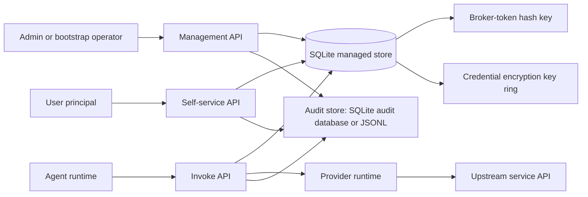
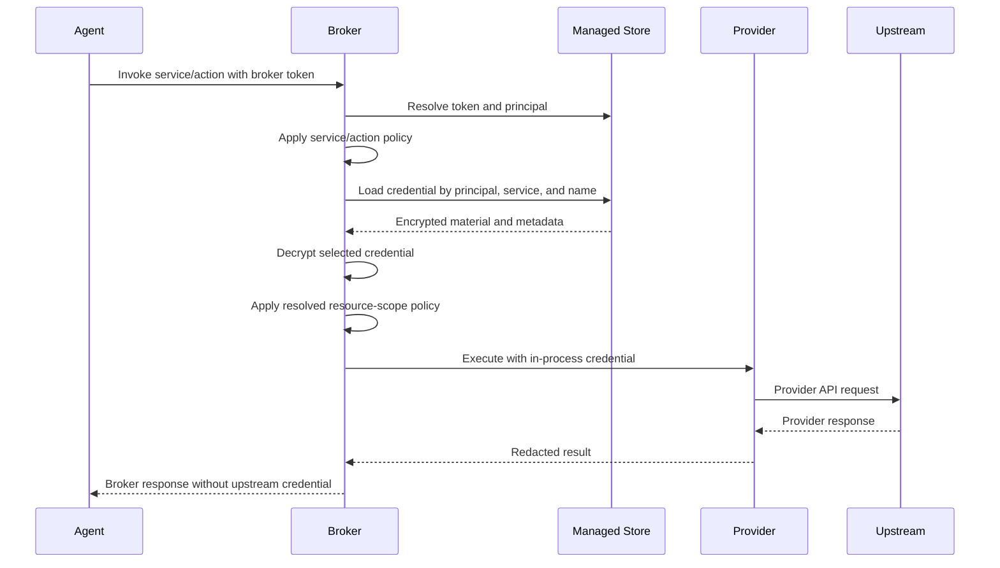

# Managed Store Database, Encryption, and Audit Database

This document describes the SQLite managed store used for broker-issued tokens,
managed principals, account roles, self-service rights, encrypted credentials,
identity tokens, OAuth state, private resource attributes, and imported-service slots,
and the separate SQLite audit database. It is a reference for operators,
security reviewers, and contributors who need to understand what durable state
the broker owns.

The managed store is separate from the audit store, static `env:`/`file:`
credential references, and provider APIs. Managed secret material is encrypted
and stored in SQLite. When `[audit]` uses
`type = "sqlite"`, audit records live in a separate SQLite database described
in [Audit database](#audit-database).

## Runtime Boundaries



The managed store is operational state. It answers questions such as:

- Is this principal active?
- Does this broker token admit this request class?
- Has this principal been granted a right to manage this credential?
- Which encrypted credential should be selected for this principal, service, and
  credential name?

It does not replace provider-side authorization or the audit log. In
`policy.authority = "managed"` mode, it is the source of truth for broker service
policy grants; in `policy.authority = "toml"` mode, service policy grants remain
in broker TOML. It also does not give agents direct access to Jira, Confluence,
GitLab REST, or Git HTTP credentials. The agent receives only
broker responses.

## Schema Model

The schema catalog starts at `014_resource_policy_baseline` and applies
`015_identity_tokens`, `016_cloudbees_ci_job_namespace`,
`017_remove_shell_approval`, `018_oauth_foundation`,
`019_registered_resource_types`, `020_resource_attributes`,
`021_local_password_failures`, `022_principal_service_limits`, and
`023_imported_services`, `024_oauth_discovery_revision`, and
`025_principal_access`, `026_trusted_user_identity`, and
`027_command_imports` in order. The
`schema_migrations` ledger records each identifier,
immutable SQL checksum, and application timestamp. `schemaChecksum` hashes the
ordered catalog checksums.

A new empty database can be initialized, and the supported resource-policy
baseline can be upgraded with `auto_migrate`. Databases predating that baseline
or with incompatible schemas are rejected without conversion or modification.
Before applying pending migrations, review [CHANGELOG.md](../CHANGELOG.md) for
schema-change effects and follow the [upgrade runbook](operator-guide.md#upgrade-and-rollback).

```mermaid
erDiagram
    GROUPS ||--o{ PRINCIPAL_GROUPS : has
    PRINCIPALS ||--o{ PRINCIPAL_GROUPS : has
    PRINCIPALS ||--o{ BROKER_TOKENS : owns
    PRINCIPALS ||--o| PRINCIPAL_IDENTITY_ACCESS : gates
    PRINCIPALS ||--o{ PRINCIPAL_USERNAME_BINDINGS : binds
    PRINCIPALS ||--o| PRINCIPAL_IDENTITY_TOKENS : inventories
    PRINCIPALS ||--o{ RIGHTS : receives
    PRINCIPALS ||--o{ CREDENTIALS : owns
    CREDENTIALS ||--|| CREDENTIAL_SECRET_MATERIAL : protects
    PRINCIPALS ||--o{ PRINCIPAL_LOGIN_METHODS : uses
    PRINCIPALS ||--o{ PRINCIPAL_SERVICE_LIMITS : overrides
    PRINCIPALS ||--o{ BROWSER_SESSIONS : starts
    BROKER_TOKENS ||--o| BROWSER_SESSIONS : backs
    PRINCIPAL_LOGIN_METHODS ||--o| OIDC_MEMBERSHIP_REFRESH_STATE : refreshes
    PRINCIPAL_LOGIN_METHODS ||--o{ EXTERNAL_PRINCIPAL_GROUPS : receives
    EXTERNAL_GROUP_BINDINGS ||--o{ EXTERNAL_PRINCIPAL_GROUPS : contributes
    GROUPS ||--o{ EXTERNAL_GROUP_BINDINGS : maps
    POLICY_REVISIONS {
      integer id PK
      integer generation
    }
    POLICY_GRANTS {
      string grant_id PK
      integer grant_order
      string status
    }
    POLICY_GRANTS ||--|{ POLICY_GRANT_CONTEXTS : permits
    PRINCIPALS ||--o{ SERVICE_POLICY_MANAGEMENT_ASSIGNMENTS : holds
    SERVICE_POLICY_MANAGEMENT_ASSIGNMENTS {
      string assignment_id PK
      string service
    }
```



| Table | Purpose | Important fields |
| --- | --- | --- |
| `schema_migrations` | Append-only catalog migration ledger. | `version`, per-migration `checksum`, `applied_at` |
| `principals` | Managed identities that can own tokens, rights, and credentials. `kind = service_account` is noninteractive and agent-token-only. | `principal_id`, `kind`, `role`, `self_service_enabled`, `status`, `display_name`, `email`, `external_subject`, timestamps |
| `groups` | First-class managed groups used as policy subjects. | `group_id`, `display_name`, `description`, `status`, timestamps, actor metadata |
| `principal_groups` | Group membership for managed principals. | `principal_id`, `group_id`, creator metadata |
| `broker_tokens` | HMAC-hashed broker-issued tokens. | `token_id`, `token_hash`, `principal_id`, `token_class`, `scopes_json`, expiry/revocation fields |
| `rights` | Self-service management rights. | `right_id`, `principal_id`, `right_name`, `service`, `credential_name`, `resource_scope_json`, expiry/revocation fields |
| `credentials` | Managed credential metadata and lifecycle. | `credential_id`, owner tuple, `service`, `name`, `profile`, `credential_kind`, `metadata_json`, `secret_ref`, `material_version`, `last_verification_attempt_at`, `last_verified_at`, `verification_status`, `last_verification_error_code` |
| `credential_secret_material` | Encrypted credential secret bytes. | `secret_ref`, `credential_id`, `secret_ciphertext`, `secret_nonce`, `key_id` |
| `principal_login_methods` | Browser-login methods for managed principals. | `login_method_id`, `principal_id`, `method`, external subject fields, `status`, password hash metadata |
| `local_password_failures` | Failed local-password verifications and lockouts per principal and client source. | `principal_id`, `source`, `failed_attempts`, `last_failed_at`, `locked_until` |
| `browser_sessions` | Browser cookie sessions backed by `user_manage` broker tokens. | `token_id`, `principal_id`, `login_method`, `login_method_id`, `auth_time` |
| `resources` | Typed selector entries shared by grants and tokens. | `resource_id`, `resource_type`, `selector_kind`, `selector_value`, `display_name`, `allowed_execution_contexts_json`, `enabled`, `version`, actor metadata |
| `resource_groups` | Flat named collections of included/excluded resources. | `resource_group_id`, `name`, `version`, actor metadata |
| `resource_group_members` | Membership with explicit include/exclude effect. | `resource_group_id`, `resource_id`, `effect` |
| `policy_revisions` | Singleton durable generation for resources, groups, and grants. | `id = 1`, `generation`, `updated_at`, `updated_by` |
| `policy_grants` | DB-authored service policy grants used when `policy.authority = "managed"`. | `grant_id`, `grant_order`, `service`, `actions_json`, `resources_json`, `credential_mode`, `priority`, `status`, `version`, actor metadata |
| `policy_grant_subjects` | Ordered exact subjects attached to one authored managed service policy grant. | `grant_id`, `subject`, `subject_order` |
| `policy_grant_contexts` | Ordered finite execution contexts attached to every managed service policy grant. | `grant_id`, `execution_context`, `context_order` |
| `service_policy_management_assignments` | Direct service scope for accounts explicitly assigned the service policy manager role. | `assignment_id`, `service`, required `principal_id`, `created_at`, `created_by` |
| `principal_identity_access` | Shared attested-identity gate for each human. | `principal_id`, unique `incarnation`, `paused`, positive `version`, `updated_at`, `updated_by` |
| `principal_username_bindings` | Exact namespace/name bindings to humans, including disabled name reservations. | immutable `binding_id`, `principal_id`, `namespace`, `username`, `enabled`, `version`, creation/update metadata |
| `principal_identity_tokens` | Encrypted fingerprint identity inventory for humans. | `principal_id`, fingerprint/ciphertext/nonce/key ID, monotonic `revision`, `updated_at` |
| `principal_service_limits` | Per-principal service invocation limit overrides for managed identity authority. | `principal_id`, `service`, `requests`, `window_seconds`, `created_at`, `created_by`, `updated_at`, `updated_by` |
| `oidc_provider_state` | Reconciled durable identity for the one configured Microsoft provider. | fixed `provider_id = 'microsoft'`, tenant/client IDs, enabled flag, config generation/fingerprint, membership TTL |
| `oidc_authorization_flows` | Bounded, one-use browser authorization flows. | monotonic `flow_sequence`, hashed state/browser binding, provider generation, encrypted payload/nonce, return path, expiry/consumption outcome |
| `oidc_subject_flow_watermarks` | Highest trusted callback sequence accepted for each Microsoft subject. | canonical external subject, `last_flow_sequence`, `updated_at` |
| `external_group_bindings` | Microsoft group-object-ID mappings to managed groups. | binding ID, unique external group ID, group ID, active/disabled status, actor metadata |
| `oidc_membership_refresh_state` | Completeness and freshness window for a login method's latest accepted group claim. | login method ID, observed/evidence timestamps, `valid_until` |
| `external_principal_groups` | Current Microsoft-derived group contributions from the latest complete claim. | login method ID, binding ID, observed/evidence timestamps, `valid_until` |

`policy_grants.grant_id` is a durable text identifier. When a managed grant is
created without an explicit ID, the broker stores a generated UUID. Explicit
IDs are accepted as safe slugs with 1-128 characters using letters, numbers,
dots, underscores, or hyphens, excluding `.`, `..`, `export`, and `validate`.
Each authored managed grant stores one row in `policy_grants`, ordered subject
rows in `policy_grant_subjects`, and one to 64 ordered rows in
`policy_grant_contexts`. Active grants must have at least one subject, while
disabled grants may temporarily have none; every status retains a nonempty
context list. The runtime expands subjects from
active grants into concrete policy candidates without creating separate durable
grant rows.

The `credentials` table is uniquely keyed by
`(owner_kind, owner_principal_id, service, name)`. The current implementation
supports user-owned managed credentials. The secret material table is one-to-one
with credentials through `credential_id` and `secret_ref`; deleting a credential
row cascades to its encrypted material.

Public credential API responses omit `secret_backend`, `secret_ref`, and
`material_version`. Those fields are internal storage and concurrency details.

Managed policy authority reads only active `policy_grants` rows into the runtime
snapshot. Disabled or deleted grant rows remain stored for later management and
audit workflows, but they do not authorize provider or gateway operations.
`policy_revisions.generation` is emitted as `policyGeneration` for managed
policy snapshots.

`policy_grant_contexts` stores normalized finite context lists. Missing writes
cannot be masked by a JSON default, and exact context filtering does not require
JSON parsing.

The service policy management assignment table has a unique `(service, principal_id)`
pair and a principal foreign key using `ON DELETE RESTRICT`. An assignment can be
created only for an active account with `role = service_policy_manager`, checked
in the same IMMEDIATE transaction as insertion. PUT is idempotent and revocation
deletes the row. Groups never supply policy-management scope. Assignment changes
do not increment `policy_revisions.generation`, since invocation policy is unchanged.
Changing role removes the account's direct assignments atomically; disabling the
account preserves them. Service configuration remains TOML-owned. An assignment
for an unavailable service is dormant until that service returns.

`broker_tokens` has nullable `paused_at` and `paused_by` columns. Pause/resume
maintains the pair together; status is derived rather than stored as an enum.

### Resource graph and publication

Resource identity is unique across `(resource_type, selector_kind,
selector_value)`. All selectors store an empty, non-null selector value so SQL
uniqueness also prevents duplicate all entries. Resource-group membership uses
`include` or `exclude`; groups have neither nesting nor enabled state.

Grant `resources_json` and token `scopes_json` store strict reference selections.
The store validates references under the same SQLite transaction/connection lock
as mutations. Used by combines these JSON references with group membership;
there is no cascade deletion of policy or live token references.

Resource, group, and grant writes increment the shared policy generation and
validate the entire candidate graph before publication. Startup/reload reads the
graph from one transaction and publishes one immutable runtime snapshot. Request
authorization and effective access do not consult mutable group membership
outside that snapshot.

## Store Admission

The broker opens the SQLite database with:

- foreign keys enabled;
- a five-second busy timeout;
- WAL journaling.

Around the open, startup and reload restrict the database and any `-wal`/`-shm`
sidecars to owner read/write (`0600`) regular files with a single hard link,
without following symlinks. They inspect and change the files by path and never
open them: on Unix, closing any descriptor for a file releases every POSIX lock
the process holds on it, including the SQLite locks of connections that stay
open (a reload runs while the previous generation's store is live), and another
process such as an online backup would then treat the live WAL index as unused.

`managed_store.auto_migrate` defaults to `false`. With the default, startup and
reload admit only a current, structurally valid database. When enabled, startup
may initialize an empty store or apply pending migrations to a supported schema.
Unsupported schemas are rejected without modification. Reload never creates or
migrates a database. Baseline initialization, foreign key checks, structural validation, and ledger insertion commit together.
Each migration commits separately. A concurrent startup that cannot obtain the
write lock within the busy timeout keeps waiting while the other initializer's
ledger advances, and fails only if a whole busy timeout passes without progress.

Admission also validates live SQLite structure, not just the ledger checksum.
The broker checks required tables, columns, foreign keys, indexes, check
constraints, unknown tables/views/triggers/indexes, active credential material
linkage, `PRAGMA foreign_key_check`, and `PRAGMA quick_check`. Hot readiness
checks are cheaper: they verify the admitted latest migration row, basic SQLite
liveness, and credential key readiness without running the full structural scan.

The six OIDC tables above enforce
one Microsoft OIDC method per principal and support pending-flow expiry,
watermark ordering, binding-by-group lookup, and external-membership expiry and
binding lookup. The existing provider/subject unique index also ensures that one
Microsoft subject cannot be linked to multiple principals. A Microsoft external
group object ID can map to only one managed group, while multiple distinct
external group IDs may map to the same managed group. Binding targets are
immutable. Disabling a binding immediately deletes its current contribution
rows; re-enabling it does not restore membership until a later complete
Microsoft login. Hard deletion is accepted only after disable.

## Broker Tokens

Broker tokens are generated by the broker as opaque `aab_`-prefixed values and
returned only when issued. The raw token is not stored. The database stores an
HMAC-SHA-256 hash of the token using `broker_tokens.hash_key_ref`, encoded as
base64url without padding.

Token classes are:

| Class | Use |
| --- | --- |
| `agent_invoke` | Agent invocation through the public invoke API. |
| `user_manage` | A principal managing its own credentials and agent tokens, plus assigned service policy when applicable. |
| `admin` | Managed-store administration through management APIs. |

Token rows remain present after expiry, pause, or revocation. The nullable
`paused_at` and `paused_by` columns record pause state. Pause/resume operations
set or clear the fields together and only accept `agent_invoke` tokens. No
status column is stored. Management and portal views derive state in this
precedence: Revoked, Expired, Paused, Active. This means later expiry or
revocation supersedes a displayed pause, and revocation permanently wins any
transition race.

Admission checks revocation, expiry, and pause on every request before current
principal, group, grant, credential, or upstream work. A paused request fails
with `broker_token_paused` and does not update `last_used_at`. Resume reuses the
same secret, expiry, caveats, and dynamically resolved grants. A request already
admitted when pause commits may finish. Management APIs can still inspect
historical and paused state. Rotating the broker-token hash key without a token
migration makes existing token hashes unresolvable, so the hash key should be
backed up and rotated only with an explicit operational plan.

`agent_invoke` token `scopes_json` may contain `allowedServices`, the finite
`allowedExecutionContexts` caveat, and a canonical `serviceRestrictions` map.
Each service entry contains actions and optional `resources` references with
`resourceIds` and `resourceGroupIds`. Missing resources follow grants; a present
empty selection permits no resource access. Group membership, resource contexts,
and enabled state resolve against the captured runtime policy snapshot.

Selected IDs are immutable on issued tokens. Policy changes do not rewrite token
rows. Invalid stored caveats fail closed. Catalog deletion checks live token
references in the same SQLite transaction discipline used by token insertion.
Paused tokens block deletion; expired/revoked tokens do not. Historical rows can
retain references without live authority, and cannot be reactivated with dangling
references. See [resources.md](resources.md).

`expires_at = NULL` already represents a token that does not expire. No schema
change is required for non-expiring `agent_invoke` tokens; a supported issue API
writes that existing shape only when `never` is explicitly requested and is an
allowed option for that issuance surface. Issuance-policy configuration changes
do not modify existing rows, and non-expiring tokens use the same revocation
path as finite tokens.

## Admin Roles And Browser Login State

`principals.role` stores exactly one of `user`, `auditor`,
`service_policy_manager`, or `admin`. The separate `self_service_enabled` boolean
controls personal tokens, credentials, connections and self-service audit; it does
not change invocation grants, invalidate agent tokens, or prevent stored credentials
and OAuth refresh from serving an authorized invocation. Personal token issuance
and resume, credential writes, and OAuth connect/claim/final save recheck the setting
inside their transaction. Essential sign-in, session, password and logout operations
remain available.

A single read transaction resolves the live principal and management scope. Admins
have global administration, Auditors have global administrative reads without writes
or secret reveal, and service policy managers can write only their assigned services.
Read and write scopes use separate Rust types. Humans default to `user`, true;
system accounts allow `user` or `service_policy_manager` with configurable self-service
(default true); service accounts require `user`, false and invocation-only tokens.

Actual role changes remove direct service scopes and revoke all unrevoked `admin`
class tokens in the same transaction. This prevents an Auditor token becoming writable
when its owner is promoted. Flag-only updates and no-op role changes do not revoke
such tokens. Admin-class tokens may be issued only to human Admins or Auditors and
remain limited by the live role. Disabling a principal prevents token/session admission
without revoking token rows. The store protects the last active human administrator
against demotion, disable and loss of the final local-password sign-in path.

Applying `025_principal_access` preserves principal foreign keys and dependent
data, retains existing administrator access, and sets kind-specific role and
self-service defaults. The pre-upgrade manager-assignment table must be empty;
unexpected assignments stop the upgrade without discarding them. Follow the
[upgrade runbook](operator-guide.md#upgrade-and-rollback) and take a database
backup before applying pending migrations.

When `[management.initial_admin]` uses `mode = "create_if_empty"`, startup
creates the configured principal with role `admin` and self-service enabled, and creates an active
local-password method with `must_change_password = true` only if the principal
table is empty. The bootstrap does not run once any principal exists.

## Managed Groups

Managed identity authority stores groups in the `groups` table. Group IDs are
immutable, use the normal safe identifier syntax, and reserve `anonymous` for
the virtual unauthenticated subject. `display_name` and `description` are
metadata only; they never affect authorization.

`principal_groups` references both `principals.principal_id` and
`groups.group_id`, so adding membership requires an existing principal and an
existing group. Membership rows can be added to active or disabled principals;
disabled principals still cannot authenticate or exercise those memberships
until re-enabled. Membership rows can remain while a group is disabled. Raw
identity summaries and audit records keep the membership, but policy evaluation
joins through `groups` and only uses groups with `status = 'active'`.

Hard delete and rename are intentionally absent. Disable a group to stop it from
authorizing while preserving membership and audit continuity.

## Browser Login State

The same-origin portal supports local principal/password login and optional
single-tenant Microsoft OIDC login. Both methods may belong to one principal.
The explicit admin enable operation creates or re-enables a
`principal_login_methods` row with `method = "local_password"` and a fresh
password; reset only updates an active local method. Neither operation enables
a disabled principal. Microsoft linking creates an independent OIDC row bound
to the configured tenant and an
exact Microsoft user Object ID. The stored local-password material is an
Argon2id PHC string over an HMAC-SHA-256 peppered password digest; the pepper is
loaded from `browser_auth.local_password.pepper_ref` and is not stored in
SQLite. New hashes use at least 64 MiB memory and 3 iterations. API responses
serialize login-method metadata but omit the PHC hash and expose OIDC identity
as structured tenant and user Object IDs rather than the internal subject.

Login methods and browser sessions are valid only for `kind = user` principals.
Service accounts cannot be assigned an admin role or issued `user_manage` or
`admin` tokens; only `agent_invoke` tokens may target them. Issuance and token
resolution both enforce this rule, while administrators may still disable,
re-enable, group, grant, credential, and rotate agent tokens for the account.

Failed local-password verifications (login and password change) are counted in
`local_password_failures`, one row per `(principal_id, source)`. The source is
the resolved client address after `trusted_proxies`: the full IPv4 address, or
the IPv6 /64 prefix; IPv4-mapped addresses and addresses in the NAT64 prefix
`64:ff9b::/96` use their embedded IPv4 address. When a source reaches
`max_failed_attempts`, that row gets `locked_until` and only that source is
rejected for that principal until it passes; a success clears the verifying
source's row. Rows are keyed by the principal ID as submitted, without a
foreign key, so unknown principal IDs are counted and locked like existing
ones. Each recorded failure prunes rows whose lockout has expired and whose
`last_failed_at` is older than `lockout_ttl`; every remaining row holds live
failures and is never evicted to make room for another source.

A principal keeps at most 256 per-source rows. Once it has 256, failures from
sources without their own row count into the principal's overflow row, stored
in the same table under the reserved source `*` (never a valid source value).
The overflow row counts and locks like a per-source row under the same
`max_failed_attempts` and `lockout_ttl`; while it is locked, every source
without its own row is rejected for that principal, and sources with their own
row keep their own state. A success clears only the verifying source's row,
never the overflow row.

The table has a global cap of 65,536 rows. Recording a new row at the cap
first evicts rows whose principal ID is not a registered principal (no
`principals` row), oldest `last_failed_at` first, whether or not they are
locked. Rows of registered principals are never evicted by the global cap:
they are already bounded at 257 rows per principal, so only such rows can take
the table past the cap. The admin unlock route deletes every row for the
principal, including the overflow row; setting or disabling the local password
does too. Admin login-method
records report `locked` (whether any source is locked) and `lockedUntil` (the
latest active expiry), never source addresses. The login-method `status` is
`active` or `disabled`; lockout is tracked separately by source. Disabling or
resetting a local password revokes existing browser sessions for that principal and login
method. Admin-set local passwords default to `must_change_password = true`, so
the first browser session can only call session, logout, and password-change
routes until the user changes the password; admins may explicitly clear that
flag when setting the password.

A successful browser login creates a normal `broker_tokens` row with
`token_class = "user_manage"` plus a `browser_sessions` row referencing the
token id. The raw token is returned only as an HttpOnly cookie and is never
stored. Password hashing runs outside the managed-store connection lock and
SQLite transactions. Local login and password-change requests reserve one of two
password request slots before starting blocking work; saturation returns HTTP 429
(`concurrency_limited`) without queuing a password job. The store also limits
real/dummy verification and password changes to two hash jobs, and reserves one
separate hash slot for administrative enrollment, reset and initial bootstrap.
Login load cannot consume this administrative slot. Combined peak Argon2 working
memory is 192 MiB per managed store. All pools are shared by database path across
runtime reloads; an old snapshot keeps
its permits until its blocking work finishes, even if the HTTP request is cancelled.
After verification, an immediate transaction checks the current active user and
login method, matches the exact salted password hash, and issues the session or
changes the password atomically. A concurrent administrator reset or disable
cannot authorize a fresh session with the retired password. Password change and authenticated logout persist an
auth audit preflight before changing durable login/session state. Their
supplemental success completion cannot undo the commit; a completion write
failure preserves the successful response and normal cookie handling, logs
`auth_committed_write_audit_append_failed`, and exposes the sink fault through
readiness. A failed logout revocation leaves the browser cookie intact.

The browser-session resolver checks the broker-token hash, expiry,
revocation, active principal, browser-session row, active login method, the
session's `password_change_required` flag, and consistency between the token,
session, principal, and login-method rows. Browser sessions require a login
method row; deleting a login method cascades its browser sessions.

### Microsoft OIDC State and Membership

Microsoft authorization state is durable rather than process-local. The store
persists only hashes of the authorization `state` and browser-binding secret;
the nonce, PKCE verifier, and other flow payload fields are encrypted with the
configured OIDC flow key. Claiming a flow records whether the callback supplied
a code or provider error, or whether start audit failed; the single-use claim
prevents replay regardless of the eventual callback result. New flow creation
prunes all expired rows. The configured pending-flow limit bounds unconsumed
rows, while consumed rows remain until their expiry as replay evidence. Subject
flow watermarks prevent a later-finishing older callback from replacing
membership evidence accepted from a newer flow.

Provider state binds all durable OIDC objects to the configured Microsoft tenant
and client. Reconciliation advances `config_generation` when effective OIDC
configuration or secret material changes, invalidating older pending flows.
Existing OIDC login methods or external group bindings prevent silently adopting
a different tenant. Changing the client or disabling the provider additionally
expires Microsoft membership contributions and revokes Microsoft browser-session
tokens. Reducing the configured membership TTL clamps existing evidence to the
shorter window; other fingerprint-only changes preserve existing membership.

Each accepted complete group claim replaces that login method's current rows in
`external_principal_groups` and refreshes the corresponding completeness window
in `oidc_membership_refresh_state`. A complete empty group claim is
authoritative: an already linked user may sign in and the replacement removes
all Microsoft-derived contributions. An explicit Microsoft overage marker or a
malformed/incomplete groups claim denies login and does not replace the last
complete evidence; that older evidence remains effective only until its
original `valid_until`.

JIT creation requires at least one claimed Microsoft group mapped through an
active binding to an active managed group. Once a login method is explicitly
bound, Microsoft membership is not itself a login prerequisite. Direct admin
linking uses the tenant's Microsoft user object ID and reactivates an exact
disabled link; conflicting subject or principal links are rejected. Unlinking
revokes browser sessions backed by that OIDC login method and deletes its
refresh and Microsoft-group rows, while leaving local group membership, the role,
direct grants, and unrelated broker tokens intact.

Effective membership is the deduplicated union of local `principal_groups` and
unexpired Microsoft contributions whose provider, login method, and binding are
active. Raw identity groups may retain membership in a disabled managed group,
matching local membership behavior; policy groups additionally require the
managed group itself to be active. Management detail responses retain source
provenance: local creator/time metadata plus each Microsoft binding, external
group object ID, observation time, and expiry. Removing a local membership
therefore does not necessarily remove effective membership when a current
Microsoft contribution still supplies the same group.

## Credential Encryption

Managed credential secrets are JSON payloads for supported credential kinds such
as `basic_api_token` and `bearer_token`. Secret payloads are encrypted before
they are written to SQLite.

The credential key ring is configured by `[credential_encryption]`. Each key is
loaded from `env:` or `file:` secret references and must decode from base64url
without padding to exactly 32 bytes. The active key id is used for new writes.

Encryption uses AES-256-GCM with a random 96-bit nonce. The ciphertext is
authenticated with associated data that binds it to the database metadata:

- schema version;
- credential id;
- owner kind and owner principal;
- service and credential name;
- credential profile and kind;
- secret backend and secret reference;
- material version;
- key id.

This means copied or stale ciphertext is not useful unless the surrounding
credential metadata still matches the authenticated values. On credential
update, the broker preserves the `secret_ref`, writes a new ciphertext and nonce,
uses the active key id, and creates a new `material_version`.

Credential verification is guarded by `material_version`: a verification result
updates lifecycle metadata only when the credential has not changed since
verification began. Successful verification sets `last_verified_at`,
`last_verification_attempt_at`, `verification_status` (`local_verified` or
`upstream_verified`), and clears `last_verification_error_code`. Failed upstream
verification sets `last_verification_attempt_at`,
`verification_status = verification_failed`, and a sanitized
`last_verification_error_code` reason code without changing `last_verified_at`.

## Key Readiness and Rewrap

At readiness/config admission time, the broker checks active credential rows. If
active encrypted credentials exist, a credential key ring must be configured and
must contain every key id used by active credential material. Readiness also
rejects malformed active credential metadata or material, orphaned secret
material rows, and mismatches between credential metadata and secret material.
With the runtime key ring loaded, each active encrypted credential is also
decrypted and its authenticated payload validated, independently of expiry or
configured provider profile. A wrong key value under an otherwise valid key ID
or corrupted ciphertext therefore fails readiness and configuration admission.
Metadata-only store opening without a key ring performs structural checks and
cannot establish cryptographic readiness.

Key inventory and readiness also include all retained identity-token, OAuth,
private-resource-attribute, and imported-service secret slots. Disabling a
resource or imported service does not remove its key requirement.

The admin rewrap operation decrypts active credentials and retained secret slots
under a source key id and rewrites their encrypted material under a target key id.
It does not change credential metadata, material versions, resource versions, or
imported service/action revisions. Rewrap includes disabled resources and imports.
Keep each old key until the used-key inventory confirms that no required material
uses it, and preserve keys needed to decrypt retained backups.

## Access Flow

For a per-user managed credential invocation, the broker resolves state in this
order:



Most provider actions decrypt managed credentials after service/action policy
has passed and before provider execution. Actions that require lookup material
during scope resolution are narrower: a wildcard `per_user` containment grant can
cause the broker to load and decrypt the selected per-user credential before
final resource-scope authorization, for lookup only.

Self-service management uses the same store but a different authorization path.
An administrator can create a principal and issue a `user_manage` token. That
broker token can manage that principal's configured credentials for services
visible through policy and issue `agent_invoke` tokens without separate
credential rights, bounded by token class and TTL limits. Configured rights gate
classless static credential access when enabled. Personal OAuth instead requires
a browser session, self-service and a matching active `per_user` grant for setup;
existing bound connections remain inspectable and disconnectable by their owner
after grant loss. OAuth admission reads managed grants and current effective
group membership within the slot transaction; it does not read credential rights.

## Lifecycle and Retention

The managed store is stateful rather than append-only:

- principals are disabled and re-enabled in place;
- `agent_invoke` broker tokens are paused and resumed by nullable timestamps,
  while broker tokens and rights are permanently revoked by timestamps;
- expired tokens, paused tokens, revoked tokens, expired rights, disabled
  principals, and expired credentials are not automatically pruned;
- credential deletion removes both metadata and encrypted material;
- OIDC flows remain replay evidence until their expiry, after which a later flow
  creation prunes them; subject watermarks and provider state remain durable;
- each complete Microsoft group claim replaces current external membership
  rows, and expired evidence does not authorize;
- unlinking a Microsoft login method removes its current external membership
  evidence through explicit deletion/cascades and revokes its browser sessions;
- managed policy grant creation, edits, and status changes update
  `policy_revisions.generation`;
- principal service limit overrides are replaced or deleted in place and do
  not change `policy_revisions.generation`; limiter history is in memory, not
  in SQLite;
- invocation, management, and reload audit records are written to the `[audit]`
  store, not to the managed store.

Active managed grants participate in startup and reload admission. Removing a
configured execution context referenced by an active grant rejects the
candidate snapshot. Disabled or deleted grants do not block removal, but their
stored context rows remain visible as stale and the grants cannot be re-enabled
until repaired. Token rows also do not block reload; a token caveat containing
only retired contexts becomes stale and unusable.

Operational retention should therefore consider both the managed store and the
audit store. The managed store contains current and historical operational
state; the audit store contains event history and applies its own
`audit.retention_days`.

## Backup and Recovery

A usable backup requires:

- the SQLite database and its WAL/SHM files or a consistent SQLite online
  backup;
- the broker-token hash key referenced by `broker_tokens.hash_key_ref`;
- every credential encryption key id still used by active credential material;
- the Microsoft OIDC flow key if pending authorization flows must survive the
  restore, plus the configured Microsoft client secret for new exchanges;
- the broker configuration needed to admit the database.

Losing the broker-token hash key prevents existing broker tokens from resolving.
Losing a credential encryption key prevents decryption of active credential
material encrypted with that key. The `admin store status` command reports table
counts and active credential key ids so operators can confirm which keys are
still needed.

Restored group bindings, login links, subject watermarks, and current membership
evidence are part of the SQLite backup. The broker still evaluates restored
membership against its stored expiry and the reconciled provider configuration;
backup/restore does not extend an evidence window. Losing or rotating the OIDC
flow key makes authorization flows captured in the backup unusable, but users
can start new login flows after the current key is configured.

On Unix, newly created managed-store directories are owner-only (`0700`) and the
SQLite database plus WAL/SHM sidecar files are owner read/write only (`0600`).
Backups should preserve or reapply equivalent ownership and permissions.
Do not include `*.agent-access.lock` lock files as required backup artifacts;
they are operational state-lock files and may be stale after restore. Restoring
with leftover unlocked lock files is safe because advisory lock ownership, not
file existence, determines whether a broker can serve.

Restore a database only with a binary and configuration that support its schema.
The resource-policy baseline does not upgrade older databases. Keep any old
installation and its backup separate from the fresh store if rollback is needed.
Never delete ledger rows or alter tables to force admission.

A managed-store backup does not contain audit history. Back up the audit store
separately (see [Audit database](#audit-database) for the SQLite backend).

## Configuration and Commands

The relevant configuration sections are:

- `[managed_store]` for SQLite enablement, path, registration behavior, and
  migration admission;
- `[broker_tokens]` for the broker-token hash key and token TTL limits;
- `[credential_encryption]` for active and retained credential encryption keys;
- `[management]` for managed-store administrator and self-service admission;
- `[audit]` for the separate audit store (see [Audit database](#audit-database)).

Useful operator commands:

```bash
agent-access admin store status
agent-access admin credentials rewrap --from-key old-key --to-key new-key
agent-access admin principals list
agent-access admin rights list
agent-access admin tokens list
```

See also:

- [configuration.md](configuration.md) for exact config keys;
- [operator-guide.md](operator-guide.md) for deployment, backups, and rotation;
- [end-user-guide.md](end-user-guide.md) for bootstrap and self-service flows;
- [http-api.md](http-api.md) for management routes and reason codes;
- [security-model.md](security-model.md) for the agent egress security model.

### Managed identity access and bindings

`principal_identity_access` has exactly one row for every human. Creation is
transactional with manual, bootstrap and OIDC principal creation, independently
of token inventory. The principal foreign key cascades on delete. The row has a
unique random incarnation, canonical pause Boolean, positive monotonic version
and update metadata. Missing human gate rows are integrity failures that deny
attested authentication, not an implicit unpaused state.

Actual pause/resume and principal disable/enable transitions advance the gate
version. A deleted/recreated principal receives a fresh incarnation even when its
textual ID is reused. Existing principals cannot change kind to or from `user`;
use explicit delete/create. These rules prevent old MCP proofs from becoming
valid again after an administrative reversal.

`principal_username_bindings` references only humans and cascades on principal
delete. It has a server-generated immutable UUID, exact namespace/name, enabled
state, positive version and creation/update actor/timestamp fields. The
`UNIQUE(namespace, username)` constraint includes disabled rows. Enabled-state
changes advance version. Rename/reassignment requires delete/create with a new
UUID. Removing a namespace from configuration keeps its rows, unavailable for
admission until configured again. No identity lookup is inferred from principal
IDs, display names, emails or OS users.

Migration `026_trusted_user_identity`, appended after `025_principal_access`,
creates gates for all existing humans, preserves existing inventory pause state
including removed inventory, creates an empty binding table, and rebuilds token
inventory with a positive revision. It preserves encrypted material, fingerprints,
nonces, key references and timestamps and checks gate coverage, human targets,
foreign keys, uniqueness and schema structure transactionally. Failure leaves the
previous store intact. It enrolls no usernames. Follow the
[upgrade runbook](operator-guide.md#upgrade-and-rollback); rollback requires a
pre-migration backup, not an older binary against the migrated schema.

Migration `027_command_imports`, appended after `026_trusted_user_identity`,
adds the nullable `imported_services.accepted_metadata_json` column and rebuilds
`imported_secret_material` so its `credential_kind` admits `basic_api_token`
beside `bearer_token`. Every existing slot row is copied unchanged: service,
purpose, kind, material version, key ID, nonce and ciphertext, so stored import
credentials decrypt under the same authenticated data without reentry. Existing
imports keep a `NULL` metadata column. Rollback requires a pre-migration backup.

### Identity-token inventory

`principal_identity_tokens` stores fingerprint identity inventory for managed
humans independently of `principal_identity_access`. See
[managed identity](managed-identity.md) for provisioning and invocation behavior.

The inventory stores a unique `sha256:<lowercase hex>` fingerprint for exact-byte
lookup plus AES-256-GCM ciphertext, random 96-bit nonce, key ID, positive revision
and update timestamp. Ciphertext authentication binds the identity-token domain,
principal and key ID; it cannot be substituted across principals or upstream
credential rows. Hashes use plain SHA-256, independently of the HMAC hashing used
for issued Broker access tokens. Imported values are 32–4096 RFC 9110 token bytes;
no whitespace or newline is stripped. Generation uses random UUID v4 strings.

Every set, generation and removal advances the inventory revision. Removal erases
ciphertext and fingerprint but retains the row and revision; replacement advances
it again. These operations invalidate fingerprint session proofs without changing
the common gate version or username sessions. They preserve shared pause and
username bindings and do not revoke issued tokens or change browser login.

Identity material participates in startup readiness/key checks and credential
rewrap. Retain old keys until rewrap completes and readiness succeeds without
them. Ordinary reads expose no ciphertext, fingerprint or plaintext; reveal is
explicit and audited with `Cache-Control: no-store`. Backups contain recoverable
secrets and require the same protection as upstream credential backups.

### Registered resource types

Storage checks the selector shape and requires `resource_type` to be a lowercase
identifier (`[a-z][a-z0-9_]{0,63}`). The broker's resource type registry defines
which types exist and which selector forms each accepts; it is checked on every
managed mutation and at startup.

### Encrypted resource attributes

`resource_secret_material` is keyed by
resource ID and attribute name with a cascading foreign key to `resources`.
It stores a material version, key ID, random 96-bit nonce, and AES-256-GCM
ciphertext. Teams notification destinations use this for their `webhookUrl`.
Attributes are available only on exact managed resources. The signed URL never
enters ordinary resource records, policy exports, or caller action catalogs.

The existing credential key ring encrypts these values. AAD uses an unambiguous
tuple containing the `aab-resource-attribute:v1` domain, resource ID, registered
type, attribute name, material version, and key ID. Resource row version is
excluded so metadata edits do not require re-encryption. Resource creation and
replacement commit metadata, encrypted material, and policy revision together.
Replacing a URL changes its material version and resource version; omitting
attributes on PATCH preserves them. Changing a populated resource's type or
selector kind is rejected. Deletion removes its encrypted material after the
ordinary reference checks succeed.

Policy snapshots contain only private versioned bindings. Immediately before
dispatch, the broker rechecks the same resource ID, type, alias, row and material
versions, enabled state, and execution context, then decrypts the admitted
resource. A changed binding fails instead of silently adopting a new endpoint.
Changes cannot recall requests already dispatched.

All retained attribute rows participate in readiness, used-key inventory, and
`admin credentials rewrap`, including disabled resources. Rewrap changes only
key ID, nonce, and ciphertext, preserving resource/material versions. Retain old
keys until all material is rewrapped and readiness passes without them. Back up
the database and key ring together: a policy export cannot restore these secrets.
Explicit admin reveal is audited before decryption and returns `Cache-Control:
no-store`; ordinary admin resource reads expose only `configuredAttributes`.

### Per-source local-password lockout

`local_password_failures` records lockout independently for each principal and
source. The broker writes login-method status as `active` or `disabled`;
lockout does not change that status. See [browser login state](#browser-login-state)
for bounds, expiry, and administrative unlock behavior.

### Principal service limits

`principal_service_limits` is the managed-authority source of per-principal
[service invocation limit](configuration.md#service-invocation-limits)
overrides. Each row is keyed by `(principal_id, service)` and stores
`requests` (1 to 1,000,000), `window_seconds` (1 to 86,400), and
created/updated actor and RFC 3339 timestamp fields; an update keeps the
creation fields. The principal foreign key cascades, so overrides are deleted
with their principal. Rows apply to every principal kind and status.

The store does not know configured services: writers (the
[admin service-limit routes](http-api.md#per-principal-overrides)) accept an
override only for a configured service, while rows for a service later removed from config
stay stored but dormant and apply again if the service returns. With
`identity.authority = "managed"`, each counted invocation reads the caller's
row by primary key, so an upsert or delete applies to the next request without
a reload. With TOML identity authority the table is not consulted; overrides
come from `[[limits.invocations.principal_overrides]]`.

## Delegated OAuth state

`oauth_registrations` stores active registration fingerprints; `oauth_slots`
stores encrypted owner/registration state and generation fences. The bounded typed encrypted snapshot contains pending PKCE flows,
verified account identity, one refresh family and versioned access entries.
Credential key readiness, rewrap and principal disable/removal cover OAuth rows.
Removing a service binding leaves its registration slots retained, not invocable.
They still count toward startup decryption, readiness, used-key inventory and
rewrap. Removing the registration or activating a changed registration
fingerprint removes its slots. OAuth grant authority remains in policy state,
separate from the encrypted connection slot.
See [oauth.md](oauth.md#refresh-durability-and-recovery) for refresh durability,
uncertain outcomes, activation and operational limits.

## Audit database

With `[audit] type = "sqlite"`, the broker writes audit records to a standalone
SQLite database at `audit.path`. It is separate from the managed store: it
shares no file, connection, migration ledger, or backup with it, and
`audit.path` must not resolve to `managed_store.path`. With `type = "jsonl"`
there is no audit database; records go to size-rotated JSON Lines files. See
[configuration](configuration.md#audit) for the settings and
[design](design.md#audit-storage-backends) for the writer model.

### Files and ownership

- The parent directory must be broker-owned and owner-only (`0700`); startup
  creates it when missing.
- The broker creates the database file owner-only (`0600`) before SQLite opens
  it; SQLite is never allowed to create it. Every connection opens it without
  following symlinks, so a symlinked `audit.path` is rejected.
- The database and its `-wal`/`-shm` sidecars must stay `0600`, owned by the
  broker process user, with a single hard link. The writer's health probe
  checks this before every supervised invocation and on readiness. Drift fails
  readiness; the next recovery attempt restores owner-only modes, while wrong
  ownership or extra hard links need operator repair.
- Opening, reload admission, and recovery check and restore these modes by path
  and never open the database or a sidecar. On Unix, closing any descriptor for
  them would release the SQLite locks of the open writer and reader connections,
  and another process, such as an online backup or `audit verify`, would then
  treat the live WAL index as unused and could reset it under the broker.
- The sibling `<path>.agent-access.lock` state lock gives one process ownership
  of the database, exactly as for the JSONL file and the managed store.

### Schema and migrations

The audit database has its own migration catalog and `schema_migrations`
ledger, with the managed store's design: ordered migrations with immutable SQL
checksums, and a ledger that must be a prefix of the catalog. The catalog
contains `001_audit_baseline`.

- There is no `auto_migrate` switch. `serve` creates a missing database, sets
  `auto_vacuum = INCREMENTAL` and `journal_mode = WAL` before the first
  migration, and applies pending migrations at every startup.
  `PRAGMA foreign_key_check` runs only right after a migration.
- The baseline migration stores a random `database_id` (a UUID) in
  `audit_meta` in the same transaction. It never changes, and audit query
  cursors are bound to it.
- Reload never creates or migrates the database. A reload to a missing
  database, or to one that needs a migration, is rejected.
- A database whose ledger has unknown migrations or mismatched checksums, or
  whose schema differs from the expected one, fails startup. The broker never
  resets or deletes audit data.
- Open-time validation is catalog-level only: the ledger, the schema compared
  object by object with the expected schema (including the full-text index's
  internal tables), `journal_mode = wal`, `auto_vacuum = incremental`, and a
  well-formed `database_id`. It never runs `quick_check` or `integrity_check`,
  whose cost grows with the database. Use
  `agent-access-broker --config <file> audit verify` for a full check (see
  [Backups and verification](#backups-and-verification)).

### Tables

| Table | Contents |
| --- | --- |
| `schema_migrations` | Applied migration versions, checksums, and times. |
| `audit_meta` | `database_id`. |
| `audit_probe` | One row written only by recovery transactions (a padding blob that is emptied afterwards). |
| `audit_events` | One row per record: the stored record JSON plus derived query columns. |
| `audit_events_fts` | Contentless FTS5 full-text index, one row per `audit_events` row with the same rowid. |

`audit_events` columns:

| Column | Source |
| --- | --- |
| `id` | Insertion order (`AUTOINCREMENT`; never reused). |
| `audit_id`, `node_id` | `auditId` (unique), `nodeId`. |
| `ts_us` | `timestamp` as UTC epoch microseconds; the insert time, with a warning, if it does not parse. |
| `broker_request_id`, `agent_request_id` | `brokerRequestId`, `agentRequestId`. |
| `principal`, `service`, `action`, `decision`, `reason_code`, `execution_context` | The same-named record fields. `decision` is `allow`, `deny`, or `error`. |
| `scope_service` | The configured service the record is about: `service`, except that `broker` records use `providerAudit.management.targetService` (set on policy management and on `admin.*` operations whose target names a service; otherwise NULL). Management admission rejections use `broker` without a target service. |
| `phase` | The first present of `providerAudit.streamPhase`, `gateway.phase`, `gatewayPhase`, `management.phase`, and `auth.phase`. Password change and authenticated logout use `preflight` before mutation and `success` for completion. |
| `token_id`, `token_class` | `identitySource.tokenId`, `identitySource.tokenClass`. |
| `grant_id` | `matchedGrant.grantId`; for search records, the first grant of the matched band. |
| `upstream_status`, `upstream_duration_ms` | `upstreamStatus`, `upstreamDurationMs`. |
| `remote` | `source.remote`. |
| `record_bytes`, `record_json` | The serialized record, exactly as the JSONL backend would write it, and its length. |

The optional top-level `callerId` remains in `record_json`; it has no dedicated
query column or full-text field. It names the authenticated trusted caller,
independently of the principal and `identitySource`, and never contains caller
credentials or their digests. Header-free direct requests omit it. Username
`identitySource` uses `trusted_user`, with `namespace` and opaque `bindingId`
metadata in the JSON record, independently of `callerId`. Failed raw usernames,
fingerprints, caller secrets and private session proofs are not recorded.

A value longer than 1024 bytes in an indexed text column is stored truncated at
a UTF-8 boundary; the full value stays in `record_json`. Indexes cover
`ts_us`, and `(column, ts_us)` for `scope_service`, `principal`, `service`,
`action`, `decision`, and (partial, non-NULL only) `reason_code`, `token_id`,
and `grant_id`, plus `broker_request_id` and `agent_request_id`.

The full-text text is built by the broker rather than taken from the raw JSON,
so JSON keys do not become search terms. It holds the principal, subject,
groups, identity source name and token ID, source addresses and proxy chain,
service, action, reason code, execution context, resource-scope keys and
values, object IDs, matched grant IDs and subjects (every grant of a search
band), search scope values, and the string values of `providerAudit` except
fields ending in `Sha256`, capped at 32 KiB per record at a token boundary. It
uses the `unicode61` tokenizer with diacritics removed. A delete trigger removes
a record's full-text row with it.

### Writing, retention, and maintenance

Only the broker's audit writer thread writes, through one connection
(`busy_timeout = 5000`, `wal_autocheckpoint = 1000`,
`journal_size_limit = 67108864`, and `synchronous` from `audit.durability`:
`NORMAL` for `write`, `FULL` for `sync_data` and `sync_all`). Each batch of up
to 256 records and 16 MiB is one `BEGIN IMMEDIATE` transaction. Audit queries
use separate read-only connections (opened read-only, `query_only = ON`), at
most four per runtime generation.

Maintenance runs on the writer thread at most once an hour, one bounded slice
at a time and only when no audit work is queued:

1. **Delete**: removes at most 2,000 rows older than `retention_days` per
   transaction (with their full-text rows), repeated until none remain. Any
   error other than busy or locked fails readiness (a prune failure) until the
   same delete succeeds on retry.
2. **FTS merge**: `merge` with a 64-page budget, up to 64 slices per cycle.
3. **Vacuum**: when free pages exceed 25% of the page count,
   `incremental_vacuum(1024)` until they drop below 10%, up to 64 slices.
4. **Optimize**: `PRAGMA optimize`.
5. **Checkpoint**: `PRAGMA wal_checkpoint(PASSIVE)`. When readers hold older
   snapshots, or the WAL stays above 256 MiB, the writer logs
   `audit_wal_checkpoint_deferred` and retries next cycle.

Steps 2 to 5 are optional: an error logs `audit_maintenance_failed` (slice and
SQLite error code), is reported by admin `config.status` until that slice next
succeeds, and never affects readiness. A busy or locked database in any slice
only defers it. Maintenance never runs a full `VACUUM` or a `TRUNCATE`,
`RESTART`, or `FULL` checkpoint, so the file does not shrink below its
high-water mark except through incremental vacuum.

### Backups and verification

- Take an online backup while the broker runs with SQLite's backup API, for
  example `sqlite3 <path> ".backup '<destination>'"` as the broker user, or
  copy the database together with any `-wal` and `-shm` files while the broker
  is stopped. A long-running backup reader can defer WAL checkpoints; that is
  logged, not a failure.
- Preserve owner-only permissions and ownership when restoring. Do not back up
  the `.agent-access.lock` file.
- A restored copy keeps its `database_id`, so cursors issued for it stay valid;
  a different database rejects them as stale.
- With the broker stopped, `agent-access-broker --config <file> audit verify`
  takes the audit state lock, checks the catalog as startup does (without
  migrating), runs `PRAGMA integrity_check` and the FTS5 `integrity-check`,
  prints each result, and exits `1` if any check finds a problem.

## Imported service records

The store holds versioned imported-service definitions, immutable accepted action
mappings, one bounded pending preview per service, a monotonic catalog revision,
and encrypted service-owned credential slots. Slots are owned
by service and purpose (execution, discovery, transport), without a synthetic
principal. Their ciphertext binds service, purpose, credential kind and material
version. A `bearer_token` slot encrypts the raw token. A `basic_api_token` slot,
the execution slot of a command import whose accepted credential kind is
`username_token`, encrypts the managed credential encoding
`{"token","username"}`; the username is at most 256 bytes and the encoded
plaintext at most 32,768 bytes. Discovery and transport slots are always
`bearer_token`.

`accepted_metadata_json` holds the service-level metadata a command import's
acceptance stored with its actions: manifest format, command version, the
credential kind and modes, `verify`, and declared resource types with their
Broker type IDs. It is written in the acceptance transaction and is `NULL` for
MCP and OpenAPI imports. The accepted credential declaration cannot change;
a command whose credential changes needs a new import.

Retired and disabled identities remain reserved. Retained slots participate in
key inventory, readiness, rewrap and backup, including when imports are disabled.
Rewrap preserves material versions. Definitions, policy and execution availability
publish together after a successful transaction; offline startup reconstructs
the committed catalog. Administrator request cancellation does not release the
publication lock while a database mutation is still running.

Each service may retain up to 2,048 non-retired actions and 16 MiB of their
serialized action entries, including disabled and quarantined actions. Retired
action tombstones have a separate allowance of 8,192 identities and 32 MiB,
so replacing tools does not consume the active catalog's allowance. Tombstones
keep their names and source mappings reserved; they cannot be reactivated.
The entire serialized imported catalog across all services, including tombstones,
remains limited to 64 MiB. The per-service allowances therefore do not guarantee
space when other imports have consumed the shared catalog budget. Mutations
that exceed any bound fail before commit and preserve the previous catalog.

OAuth slots carry a non-secret semantic revision for imported-service discovery
previews. Connection replacement,
disconnect, scope/target changes, and access/refresh material changes fence previews;
encryption-key rewrap and refresh cooldown bookkeeping preserve the revision.
