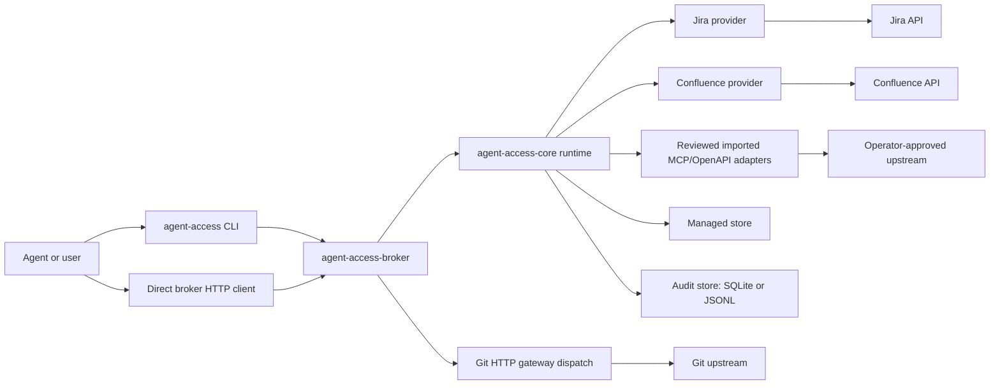
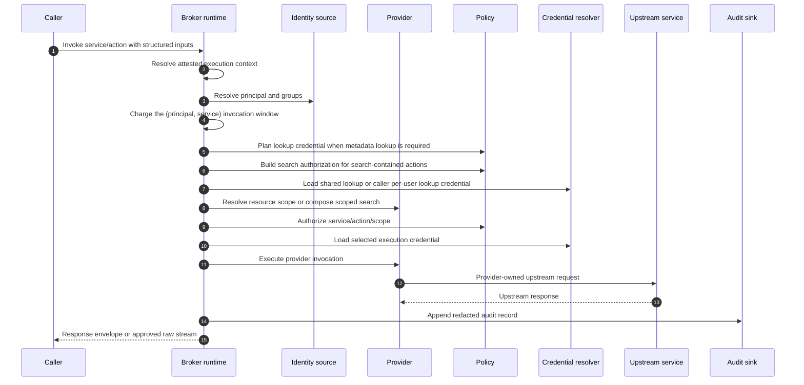

# Agent Access Broker — Architecture and runtime contract

For trusted username authentication on HTTP MCP, registered fingerprint identity
on existing invocation surfaces, explicit managed bindings and shared
identity-access pause, see [managed identity](managed-identity.md). Named callers
authenticate attesters; Broker resolves humans and applies current permissions.
Issued Broker tokens retain their independent authorization boundaries.

This document is the architecture and conceptual contract for the Agent Access
Broker. It describes the credential boundary, the request lifecycle, the split
between the core engine and the providers, the naming contracts, and the
identity, policy, credential, audit, limits, egress-proxy, gateway, and security
models.

HTTP routes and response envelopes are detailed in
[docs/http-api.md](http-api.md); the CLI is in [docs/cli.md](cli.md);
the local stdio MCP adapter is in [docs/mcp.md](mcp.md);
configuration keys are in [docs/configuration.md](configuration.md); per-provider
behavior is in [docs/providers.md](providers.md); the broader agent containment
and egress-boundary rationale is in [docs/security-model.md](security-model.md);
managed-store database, encryption, and audit database details are in
[docs/database.md](database.md).

## MCP connection views

Aggregate MCP and service-specific connections share one bounded registry for
listing, canonical dispatch targets and action details. `/mcp/<service>` and
`mcp serve --service <service>` select an immutable view and preserve raw provider
names; transport mode independently determines local-file capabilities. Pure
adapter naming hooks derive imported names from accepted metadata. Readiness is
computed before caller filtering and published with the immutable runtime,
without a name table, extra discovery or credential lookup. HTTP routes share
one endpoint and bind sessions to the view. Current authorization, credential
selection, revision fences, limits and audit remain in their existing owners.
See the [MCP contract](mcp.md) for connection setup, naming, readiness and transport
boundaries.

## Contents

- [Purpose and the credential boundary](#purpose-and-the-credential-boundary)
- [Workspace and crate responsibilities](#workspace-and-crate-responsibilities)
- [Naming contracts](#naming-contracts)
- [Provider model](#provider-model)
- [Request lifecycle](#request-lifecycle)
- [Identity model](#identity-model)
- [Policy model (deny-by-default)](#policy-model-deny-by-default)
- [Credential model (service, per_user, lookup)](#credential-model-service-per_user-lookup)
- [Persistent storage model](#persistent-storage-model)
- [Audit and redaction model](#audit-and-redaction-model)
- [Observability and correlation](#observability-and-correlation)
- [Operational limits](#operational-limits)
- [Egress proxy model](#egress-proxy-model)
- [Dynamic config reload](#dynamic-config-reload)
- [Process shutdown](#process-shutdown)
- [Security posture](#security-posture)

## Purpose and the credential boundary

The broker mediates agent and user access to upstream services — Jira,
Confluence, CloudBees CI, GitLab REST, Gmail, Teams, reviewed imported MCP/OpenAPI
services, and host-matched Git HTTP gateways — so that the caller never holds
the broker-selected execution credential. The broker
resolves and holds the secret material; the CLI and any other client receive
only the authorized result.

The broker also provides an agent-specific capability boundary. Native service
permissions answer which user or service account may access a project, space, or
API. Broker policy answers the additional agent question: which non-deterministic
tool may exercise which service action, on which resolved resource scope, with
which validation, limits, credential mode, and audit trail.

Agents use a stable service/action interface instead of choosing between vendor
CLIs, raw REST endpoints, tenant URLs, gateway URLs, and API versions. Provider
code owns service-specific `/v1/invoke` details and converts them into
broker-scoped operations. Gateway code owns host-matched protocol traffic such
as Git smart HTTP and classifies it into the same service/action/scope policy
model before upstream credentials are selected.

The execution credential exists only inside the `ProviderInvocation` handed to a
provider for a single call. It is never placed in the response to the caller, and
its `Debug` representation redacts the username and token (`ExecutionCredential`
prints `username` and `token` as `<redacted>`). The same redaction applies to
proxy credentials (`EgressProxyConfig`).

Execution credentials are resolved only **after** identity admission, scope
resolution, deny-by-default policy authorization, and credential-mode selection
have all succeeded. No credential is touched on a path that has not first cleared
authorization, except for the minimal pre-authorization metadata lookup used to
resolve Jira, Confluence, and GitLab REST scopes. That lookup uses either a
separate read-only lookup credential or the caller's per-user credential
according to the policy shape described under
[Credential model](#credential-model-service-per_user-lookup).

## Workspace and crate responsibilities

The Rust workspace's crates share one workspace version, and the repository
also includes a same-origin browser portal frontend:

- **`agent-access-provider`** — the backend contract: service descriptors
  (`descriptor.rs`), resource types (`resource.rs`), the `Provider` trait and
  its invocation, result, and error types, reason codes (`reason.rs`),
  upstream throttling (`upstream_rate_limit.rs`: bounded `Retry-After` parsing,
  the shared `upstream_rate_limited` error, and the applied-unverified
  `mutation_verification_failed` for throttling after an applied write), the
  OAuth dialect contract (`oauth_dialect.rs`), delegated credentials
  (`delegated.rs`), and the host services backends use: upstream HTTP clients
  (`upstream.rs`), egress declarations and sanitized routes
  (`egress_config.rs`), upstream allowlists, correlation headers, upstream
  trace events (`trace.rs`), and opaque token signing (`signing.rs`). Its
  public `host` module (`host.rs`) is the construction interface the host
  implements: the build context and the upstream client factory port. The SDK
  resolves no secret references, loads no TLS files and reads no process
  environment.
- **`agent-access-core`** — the library: the request runtime
  (`runtime.rs`), the audit writer and its storage backends
  (`runtime/audit_jsonl.rs`, `runtime/audit_sqlite/`), audit queries
  (`audit_query.rs`), the backend registry (`backends.rs`), the managed
  credential store (`managed_store.rs`), config parsing and validation, host
  secret-reference resolution (`config_error.rs`), host network construction
  (`network.rs`: outbound TLS trust, egress proxy selection and the per-caller
  upstream client factories), and the response envelope types (`lib.rs`). It
  contains no backend and does not re-export the backend contract; the host,
  the binary, and the CLI depend on `agent-access-provider` directly.
- **`agent-access-content`** — rich-content formats shared by backends:
  bounded ADF, Confluence storage, and GitLab Markdown rendering; bounded
  Markdown/plain-text conversion into those formats; and attribution footers.
- **Backend crates** — `agent-access-jira`, `agent-access-confluence`,
  `agent-access-gitlab`, `agent-access-cloudbees-ci`, `agent-access-gmail`,
  `agent-access-teams`, and the development
  `agent-access-fake` depend on `agent-access-provider` (Jira, Confluence, and
  GitLab also on `agent-access-content`; Jira and Confluence on
  `agent-access-atlassian`), never on core; the broker binary registers them.
- **`agent-access-conformance`** — a test-only backend (not published, not
  linked by the broker binary) that uses every extension point of the backend
  contract; broker acceptance tests register it to prove a backend needs no
  host changes. See [Adding a backend](#adding-a-backend).
- **`agent-access-atlassian`** — helpers shared by the Jira and Confluence
  backends: Atlassian gateway credential rules and request authorization.
- **`agent-access-broker-host`** — the broker host library: HTTP routers,
  request decoding, host-matched gateway dispatch, source/proxy-chain
  derivation, dynamic config reload, management routing, and HTTP MCP serving.
  It depends on core and never on a backend or import adapter.
- **`agent-access-broker`** — the service binary: process lifecycle, listeners,
  command dispatch, build stamping, and the backends it links (`main.rs`,
  `backends.rs`, and `build_info.rs`).
- **`agent-access`** — the CLI binary that lowers commands to broker HTTP calls
  (`main.rs` plus integration tests under `tests/`).
- **`apps/portal`** — the React browser management portal built into static
  assets and served from the broker public listener when `[portal]` is enabled.

Core owns the engine and the conceptual contract. The host owns the network
surface; the broker binary owns process lifecycle and backend selection. The CLI never sees broker-held execution
credentials and never makes authorization decisions; it is a thin client over the broker's HTTP API.

### Core vs provider responsibilities

The core runtime owns identity admission, the lookup-before-policy gate, scope
resolution orchestration, deny-by-default policy selection, credential
resolution, audit, redaction, limits, and the egress-proxy decision. A provider
owns its action catalog, its input schemas, its locator and key grammar, its
query-language parsing and canonical re-emission, and the construction and
execution of the upstream request given a resolved scope set and an execution
credential. The provider receives an already-resolved, already-authorized scope
set; it does not consult policy.

## Naming contracts

- **Service names** match `^[a-z][a-z0-9_-]{0,62}$`. The built-in providers are
  `jira`, `confluence`, `gitlab`, and `cloudbees_ci`; Git gateway services and the test-only
  `fake` provider use the same grammar.
- **Identity source names** match `^[A-Za-z0-9._-]{1,128}$` and must be unique.
- **Policy subjects** are `user:<principal>` or `group:<group>`;
  `user:anonymous` and `group:anonymous` are ordinary subjects with no special
  treatment.
- **Request-id header** `X-Agent-Access-Request-Id` is required on every `/v1`
  endpoint except `/v1/healthz` and `/v1/readyz`, and must be `1..=128` chars of
  `[A-Za-z0-9._-]`.
- **Provider keys/locators** follow per-provider grammars (Jira project/issue
  keys, Confluence page/space/attachment IDs); see
  [docs/providers.md](providers.md).

There are no `/v1/providers/*` typed routes. Typed CLI commands (for example
`jira issue view`) lower to `POST /v1/invoke/{service}/{action}`; no typed HTTP
routes are registered on the broker.

## Provider model

A provider advertises a set of **actions**, each carrying its **scope types**
and its **credential modes** (`service`, `per_user`). The runtime asks a provider
to resolve scopes for an action, then authorizes the resolved scope set against
policy, then asks the provider to execute.

### Backend registration

The broker binary lists the backends it links (`backend_registry()` in the
broker crate). Each `BackendRegistration` names a kind, the resource types the
backend defines, a strict parser for its `[providers.<kind>]` table, and whether
it is a development fixture. Parsing a configuration routes each provider table
to its backend's parser and rejects unregistered kinds; the registry also
supplies the resource type registry (the broker's own `git_repository` and
`oauth_collection` types plus every backend's types, in registration order).
A parsed table is a `BackendConfig`: it validates itself against a narrow view
of the rest of the configuration (deployment environment, broker limits, and
the credential kinds configured for its service), derives its service
descriptor, lists its egress proxies for startup preflight, and builds its
provider from a `BuildContext`: limits, the host's upstream client factory,
attribution, and the optional stable signing key, scoped to the backend's
service so one backend's tokens never verify for another. Building is
synchronous and offline: it prepares clients and capabilities but never
contacts an upstream, verifies a credential or refreshes OAuth. A failure is a
`ProviderBuildError` carrying safe configuration diagnostics; when the host's
own network construction failed, the host keeps its cause, such as a missing
proxy credential reference. Configuration parsing, validation, and provider
construction never name a backend kind; development fixtures additionally
require `deployment.enable_fake_service`.

Backends reach their upstream through `UpstreamClient`s built through that
factory, which apply the rules every backend shares. A backend declares each
client's label, base URL, egress declaration (ordinary routing with its
configured service proxy, or the literal-loopback request described under
[Egress proxy model](#egress-proxy-model)) and profile; core constructs the
client with the generation's outbound TLS trust and selected route, never
follows redirects on its own, and bounds time by profile: a whole-request
timeout for ordinary requests (with automatic retries disabled for
single-attempt and explicitly bounded clients), none for streamed downloads
(the backend bounds each chunk), and a connect timeout for uploads, whose
bodies fail after the streaming idle timeout without progress. Backends see
only the sanitized route (mode and proxy origin) for audit, never proxy
credentials. Every request, including each hop of
a redirect chain followed with `get_following_redirects`, must match the
backend's `allowed_upstream_hosts`. Credentials go only to the service's own
origin; redirect hops to other origins carry correlation headers only when the
backend opts in (Jira does, for Atlassian media hosts; CloudBees CI does not,
for artifact storage). Each request records one
`upstream_request_completed` trace, either when the backend has classified the
response or when the response is dropped. Backends keep their own protocol:
URLs, authentication schemes, status and body handling, and any extra checks
on redirect targets.

### Adding a backend

A backend is a crate that depends only on `agent-access-provider` and exports
one `BackendRegistration`; adding it to the broker's `backend_registry()` is the
only host change. The crate supplies:

- **Resource types**: `ResourceTypeDescriptor` statics with a canonical target
  grammar and, optionally, namespace selectors and private attributes (secret
  values on exact managed entries, such as a Teams webhook URL, which the host
  encrypts and resolves only for an authorized invocation of that entry).
  Policy validation, resource management, discovery, and the portal read the
  published metadata.
- **Typed configuration**: a strict `[providers.<kind>]` struct implementing
  `BackendConfig` (validation messages under `providers.<kind>`, egress proxies
  for preflight, and offline provider construction from a `BuildContext`).
- **A service descriptor**: actions with input schemas, resource scopes,
  credential modes and lookups, explicit read-only classification,
  raw-download or multipart-upload I/O,
  sensitive outputs, attribution, presentation (embedded bodies and a
  whole-result Markdown renderer), credential kinds and managed profiles, and,
  for services that accept delegated (OAuth) credentials, a description of
  what connecting an account allows.
  Descriptor validation rejects inconsistent declarations at startup; the
  catalog, OpenAPI, send schema, MCP tools, and managed credential forms are
  projected from it.
- **A provider**: scope resolution, optional body-part admission, and
  invocation through `UpstreamClient`s, returning JSON or a bounded stream.

`crates/agent-access-conformance` is the reference: a test-only backend with a
namespace-capable resource type, typed configuration, a managed profile, JSON,
raw-download, and upload actions, a presenter, and (with `endpoints = true`)
an endpoint type whose private key a single-attempt action consumes. The
host's `tests::conformance` suite registers it beside the linked backends and
drives configuration and validation, discovery, runtime specs, every invocation
shape, MCP, and the private-attribute lifecycle under managed policy (create,
encrypted storage, admin reveal, replacement, and resolution only for the
authorized endpoint); it also generates the fixture the portal's unit tests
use, so the portal is checked against a backend it was not written for.

### Service descriptors

Each service has one authoritative `ServiceDescriptor`. A built-in backend
derives it from its typed configuration alone (`jira_descriptor`,
`confluence_descriptor`, `gitlab_descriptor`, `cloudbees_ci_descriptor`,
`oauth_records_descriptor`, and the development fake provider); configured
Git gateways get a descriptor from their gateway configuration. Providers do
not describe themselves: the runtime pairs each provider it builds with its
configuration's descriptor (a `ServiceProvider`), so offline configuration
validation, TOML and managed policy validation, runtime admission, discovery,
the runtime catalog, OpenAPI, the send schema, and managed credential forms all
read the same descriptor instead of parallel per-service tables. The runtime
validates every descriptor once per configuration generation and caches it; the
per-request path never rebuilds an action catalog.

Validation rejects a descriptor before activation (and in offline `config
validate`) when an action's input schema is not an object schema that compiles
as JSON Schema, when an upload locator is not an input, when a sensitive output
is not a JSON pointer into `/result`, when an action resolves its scope by
lookup without declaring one, when a raw-download action declares a response
presentation, or when a scope binds an unregistered resource type or offers a
selector that type does not support.

An action's descriptor also carries its response presentation: the embedded
upstream bodies that `readContentFormat` normalizes (an owner path and a body
codec each) and, optionally, a whole-result Markdown renderer for
`responseFormat = "markdown"`. The presentation engine in
`agent-access-provider` applies them under one shared render budget and bounds
the serialized result; each backend supplies its codecs and templates, and the
rich-content format renderers live in `agent-access-content`. The catalog's
advertised read and response formats derive from the same presentation.

A descriptor declares the service's resource scopes and the resource type each
one authorizes, and for every action its input schema, resource scope (if any),
credential modes, lookup requirement (none, execution-time only, or before
policy to resolve scope), whether it is search-contained, upstream resource
ownership, JSON/multipart-upload/raw-download I/O, explicit `read_only`,
sensitive output pointers, optional extended `documentation`,
attribution capability, and whether it issues durable handles that need a stable
signing key. At service level it declares accepted service credential kinds,
managed credential profiles, whether invocations need a broker-selected
execution credential, and the embedded-body presentation limit. Responses from
actions that declare sensitive outputs are sent with `Cache-Control: no-store`.

Action `documentation` is a provider-owned JSON object for detailed usage,
grammar, limits, and examples. Capabilities, runtime catalogs, and detailed MCP
discovery (`actions_describe` and `services_describe`) expose it; OpenAPI/send
projections use `x-agent-access-documentation`. It stays outside MCP tool
definitions and input schemas. Initial tool descriptions remain concise and
point to `actions_describe` with canonical service/action arguments, independent
of tool names assigned by a client or connection view.

Read classification defaults to false and is explicitly opted into by reviewed
backend descriptors; action names and presentation capabilities do not infer it.
Runtime, discovery, and management catalogs publish `readOnly`, and OpenAPI/send
variants publish `x-agent-access-read-only`. This metadata classifies upstream
reads for grant selection; it does not change authorization or gate local output.
JSON and multipart-upload action responses support local file/metadata destinations,
including mutations. Dedicated raw downloads retain their streaming contract.

The grant picker separates Read-only and Write-capable actions, with independent
All/None controls for search matches. Grant listings derive a Write-capable
checkmark from their explicit action selections. Unreviewed actions are treated
as potentially writable. Neither filtering nor classification changes silently
modify grants, and future tools are not automatically selected.

CLI and stdio MCP output handling owns local paths; broker invoke schemas and
HTTP MCP accept none. The CLI renders its normal successful action representation;
`send` and MCP save complete JSON envelopes. The shared local writer uses a
private temporary file reserved before provider dispatch, including downloads,
and atomic replacement, returning a bounded receipt with
correlation/status identifiers plus path, byte count, digest, content type, and
declared sensitivity. Ordinary response content is omitted from that receipt;
raw-download receipts retain broker download metadata. Limits and pagination
remain unchanged, and file output never expands the resource/action grant.
Confirmed operation success followed by local output failure is reported as two
separate outcomes with request identifiers and a nonzero CLI/error MCP result.
The client never stores the payload for recovery or retries an operation to save
its response. A post-replacement directory-sync failure reports that the local
destination has already changed.
Invalid destinations fail before invocation. Unverified mutations retain their
unverified status through response and metadata output, with bounded,
non-sensitive reconciliation metadata rather than the full result. Exit code
alone never establishes whether a mutation was dispatched or is safe to retry.

An action may also advertise `upstreamResourceOwnership` as static capability
metadata. When a concealed `scope_unresolved` result repeats that value under
`hints`, it still describes only the action's ownership model. The value is
fixed independently of the requested locator and must never encode resource
existence, ownership of a particular object, or an authorization outcome.

- **Jira** (`jira`) — twenty-two actions: `issue_type.list`, `issue.view`, `issue.create`,
  `issue.child.create`, `issue.update`, `issue.parent.set`,
  `issue.dependency.add`, `search`,
  `comment.list`, `comment.view`, `comment.add`, `comment.reply`, `comment.update`,
  `comment.delete`, `comment.property.list`, `comment.property.get`,
  `comment.property.set`, `comment.property.delete`, `attachment.add`,
  `attachment.download`, `attachment.list`, `verify`. Policy scope is the
  containing `project`. `issue_type.list`, `issue.create`, and `search` do not
  require pre-authorization metadata lookup. `issue_type.list` returns one page
  of creation metadata using the execution credential, with IDs, names,
  descriptions, subtask flags, and explicit continuation offsets.
  `attachment.list` is a single fetch, not paginated. Issue
  description and comment writes use canonical `content` plus an explicit
  `contentFormat`. `issue.create`, `issue.child.create`, `issue.update`,
  `comment.add`, `comment.reply`, and `comment.update` accept `adf`, `markdown`,
  or `plain_text`; normalized input is converted to ADF (Atlassian Document
  Format, a `{ "type": "doc", "version": 1, "content": [...] }` JSON
  document). Comment property actions require an issue locator and are limited
  to broker-owned key prefixes.
  Jira normalized reads cover seven actions whose
  results declare ADF advertise `readContentFormats = [native, markdown, text]`:
  `issue.view`, `issue.create`, `issue.update`, `comment.view`, `comment.add`,
  `comment.reply`, and `comment.update`. Nine non-streaming retrieval actions
  advertise `responseFormats = [json, markdown]`: `issue_type.list`, `issue.view`, `search`,
  `comment.list`, `comment.view`, `comment.property.list`,
  `comment.property.get`, `attachment.list`, and `verify`.
- **Confluence** (`confluence`) — page, blog, attachment, verification, and
  comment actions. Page actions include `page.view`, `search`, `page.create`,
  `page.update`, the separately granted `page.move`, `attachment.add`,
  `attachment.download`, `attachment.list`, and `verify`; blog actions mirror
  them under `blog.*`; draft actions are
  explicit under `page.draft.*` and `blog.draft.*` for create, stage, view,
  update, publish, discard, verify, and new-draft attachment add/list/download;
  comment actions are split into `page.footer_comment.*`,
  `page.inline_comment.*`, `blog.footer_comment.*`, and
  `blog.inline_comment.*`, including list, view, add where supported, update,
  delete, and reply flows. Policy scope is the containing `space`. Current content
  actions remain current-only. Draft actions authorize their containing space,
  using signed broker draft handles after create/stage. Page search
  remains page-only and blog search is a separate action that injects
  `type = blogpost`. Page and page-draft creation optionally place content below
  a resolved same-space parent and use space-homepage placement otherwise.
  Existing page hierarchy changes use `page.move`, are same-space only,
  support `before`, `after`, and `append` placement, and verify the parent and
  direct-child order by readback. Create actions resolve
  the target space directly from inputs. Update actions are optimistic-concurrency.
  Attachment and comment list actions are cursor-paginated with broker-signed
  HMAC continuation tokens. Twenty current page/blog, draft, and comment
  mutations use canonical `content` plus explicit `contentFormat`. Markdown and
  plain text are converted to constrained storage HTML; native storage remains
  a string, and current page create/update also retain native
  `atlas_doc_format` JSON when enabled. Twenty-six Confluence actions whose
  results declare storage or ADF bodies advertise embedded `native`,
  `markdown`, and `text`: current page/blog view, page/blog draft view, every
  page/blog footer/inline comment list/view/reply-list read, footer-comment
  adds, footer/inline comment updates, and footer/inline reply adds. Twenty-six
  non-streaming retrieval actions advertise whole-result `json` and `markdown`:
  current page/blog view/search/verify, page/blog draft view/verify, current and
  draft attachment lists, and every page/blog footer/inline comment
  list/view/reply-list read. Body-free search and attachment results remain
  body-free, and formatting performs no additional provider call.
- **GitLab REST** (`gitlab`) — repository-scoped project, issue, merge-request,
  review discussion, current/historical diff, branch, protected branch, file,
  REST commit, CI pipeline, and CI job actions.
  The scope type is `repository`, expressed as a GitLab project path. Merge
  requires a caller-supplied current merge-request head SHA and delegates final
  branch protection, approval, and CI decisions to GitLab. Direct branch, file,
  and commit writes and CI execution actions reject default and protected
  branches, file mutations use last-commit checks when GitLab exposes them, and
  raw file/job-trace downloads use the broker raw-download stream path.
  Sixteen issue-description, merge-request-description, note, discussion,
  draft, and review-summary mutations use canonical `content` plus explicit
  `contentFormat`. Native
  Markdown is preserved before attribution; `plain_text` is deterministically
  escaped so CommonMark and GitLab-specific syntax remains literal.
  GitLab actions whose results declare issue/MR descriptions or note/
  discussion-note bodies advertise embedded `native`, `markdown`, and `text`:
  issue view/search/create/update and note list/add/update; merge-request
  view/search/create/update and note list/add/update; discussion
  list/add/inline-add/view/resolve/reopen and discussion-note add/update; and
  draft-note list/view/add/update. Non-streaming GitLab
  retrievals advertise whole-result `json` and `markdown`: project view; issue
  view/search/note list; merge-request view/search/note list/discussion
  list/view, reviewer/commit/pipeline lists, current structured diffs and diff
  version list/view and draft-note list/view;
  branch and protected-branch list/view; protected-branch verify; file view;
  commit list/view; pipeline list/view; and job list/view. Raw file and job-trace
  downloads, raw current-MR diff, and all mutations remain ineligible for
  whole-result Markdown. Review positions preserve the exact diff SHA triplet,
  paths, lines/range, and historical association rather than synthesizing a
  current-line mapping.
  Direct inline and positioned draft writes require a fresh expected head and
  complete non-null diff SHA triplet, derive native anchors from strict
  coordinates, and fail closed on stale or unprovable positions. Replies target
  a discussion ID and remain valid for outdated threads. Draft ownership follows
  the active upstream credential: per-user mode isolates a human reviewer,
  whereas service mode intentionally shares a bot-owned draft set.
  Draft CRUD and single/all publication are separate policy actions.
  A verified single-draft publication returns the exact resulting non-null
  `discussionId` and `noteId`, established by bounded before/after discussion
  readback rather than timestamp, ID ordering, or body-only guessing.
  `review.submit` requires GitLab 19.2+, publishes the current-owner snapshot,
  then verifies `reviewed` or `requested_changes`; neither state is formal
  approval, and zero-draft summary submission remains valid. An unassigned
  actor fails with `version_conflict` before publication.
- **Imported services** — reviewed MCP HTTP tools and OpenAPI operations use
  persisted action definitions, operator-approved destinations, ordinary
  action/context grants, and single-attempt execution. They have no broker
  resource scopes; the selected upstream credential sets the business-data
  boundary. MCP discovery, verification and invocation each prefer `2026-07-28`
  and permit one `2025-11-25` initialization attempt on a bounded startup
  rejection. The host transport owns selection, deadlines, credential fences
  and the single tool dispatch; the pinned SDK handles the selected lifecycle.
  Negotiated versions are recorded in existing metadata/audit fields. Legacy
  sessions are private to one operation, with best-effort cleanup of initialized
  and eligible rejected-probe sessions within a shared two-second budget and
  the parent deadline. Cleanup never changes a known outcome or rejects an OAuth
  token. Existing imports and OAuth connections require no migration or consent.
  The adapter supports bounded JSON and finite SSE responses; server requests
  (including legacy `ping`), stream resumption and tool replay are unsupported.
  A legacy disconnect does not prove upstream cancellation. Redirects are
  rejected. See
  [imported services](imported-services.md) and [OpenAPI imports](imported-openapi.md).

- **CloudBees CI** (`cloudbees_ci`) — typed actions to view jobs and builds,
  read bounded console-log head/tail/literal-search excerpts with verified
  continuation cursors and test summaries, list and download archived artifacts,
  inspect a queued build, and trigger a non-parameterized build.
  Additional reads expose Pipeline stages and nodes, bounded node logs, pending
  input prompts, and detailed test previews. Full console logs and JSON test
  reports use the broker's raw download stream path, as artifacts do. Each
  download requires its own action grant on the same job resource. Fixed
  controller aliases prevent caller-chosen origins. All actions authorize the
  combined `controller/full/job/name` resource; queue reads prove task identity
  before disclosure. See [the provider contract](providers-cloudbees-ci.md).

`bearer_token` credentials for Jira and Confluence route through the Atlassian
gateway (`api.atlassian.com`) and require `providers.<svc>.cloud_id` (a validated
UUID) plus `api.atlassian.com` in `allowed_upstream_hosts`; `basic_api_token`
credentials use the tenant base directly.

Response presentation is common invoke metadata, not provider input. JSON and
multipart `InvokeRequest` envelopes may carry top-level `readContentFormat`
(`native`, `markdown`, or `text`) and `responseFormat` (`json` or `markdown`)
beside `inputs`. Omission is identical to `native` plus `json`. The request is a
closed object, and neither field is forwarded upstream. A non-native embedded
format cannot be combined with whole-result Markdown. Unsupported
action/format combinations fail with `response_format_unsupported` before
authorization, credential selection, or provider execution.

Embedded formatting preserves the native field and adds `renderedBody` beside
its owning result entity. Whole-result formatting receives the already-produced
result, performs no additional fetch or pagination, and replaces `result` with
`{ "format": "markdown", "value": "..." }` inside the normal response
envelope. Its typed templates include every meaningful present field in stable
order and never expose raw ADF or Confluence storage HTML. GitLab embedded
Markdown is byte-for-byte native; its text renderer and whole-result composer
parse under fixed bounds, suppress active raw HTML, and close body structures
before rendering subsequent result metadata.

## Request lifecycle

Invocation preparation runs a fixed sequence. Each failure point produces one
terminal audit record and response. Ordinary JSON HTTP and HTTP MCP calls use a
shared supervised operation owner; preparation itself does not append a record,
so cancellation cannot race preparation failure into duplicate finalization.

The operation owner retains the admitted runtime snapshot and concurrency permits
through preparation, provider execution, verification and acknowledged audit.
Response delivery is separate: dropping the HTTP/MCP response waiter does not drop
the provider future. Explicit MCP cancellation has an atomic gate before provider
execution. Once execution starts, cancellation is advisory and bounded completion
continues. Preparation/provider panics are converted to sanitized operation errors;
a timeout before a result is ready, or forced shutdown after dispatch, reports an
unknown outcome without claiming rollback or retry safety. Mutations are never
automatically replayed.

HTTP MCP adds its own overall `mcp.operation_timeout_ms` deadline. The existing
`limits.request_timeout_ms` still bounds individual upstream requests; HTTP request bodies, including multipart uploads, also have the independent
`limits.request_body_timeout_ms` total receive deadline. Final audit
acknowledgement is outside cancellation selection so a queued terminal append
cannot be abandoned and then retried as a second terminal outcome.

Imported MCP passes the host deadline into its operation context and marks session
cleanup only after capturing the provider outcome. If the ordinary HTTP MCP
deadline expires during that cleanup phase, the supervisor polls the same provider
future once more without waiting. Cleanup stops at the deadline and returns the
captured outcome for the response and terminal audit. A still-pending future
retains the timeout outcome; this adds no grace period, detached cleanup task or
second dispatch. Forced shutdown retains the existing unknown-outcome behavior,
including when cleanup is in progress.

1. **Execution-context admission.** The broker resolves exactly one context from
   fixed `X-Agent-Access-Context` before token lookup. Missing strict-mode,
   malformed, duplicate, or unknown values fail closed without policy lookup or
   upstream work.
2. **Invocation rate admission.** After identity resolution and ingress
   concurrency admission, a request for a configured service is charged once to
   the caller's `(principal, service)` rolling window (see
   [operational limits](#operational-limits)). A rejection is `rate_limited`
   (429) with retry guidance and one audit record; it performs no policy,
   lookup, credential, or upstream work. Requests later denied by policy still
   count. Unknown services skip the charge and fail at the next step.
3. **Provider lookup.** An unknown service denies with `ServiceActionDenied`
   (403).
4. **Identity admission.** A broker-issued token must be of class `AgentInvoke`;
   a token of any other class is denied with `BrokerTokenClassDenied` (403). If
   `managed_store.require_registered_principal_for_invocation` is set, the
   principal must be registered.
5. **Broker-token caveats.** An `AgentInvoke` token's `allowedServices`, finite
   `allowedExecutionContexts`, and optional `serviceRestrictions` can narrow
   the service, context, action, and canonical resource set, but never create a
   grant. An absent caveat does not narrow its corresponding dimension.
   A malformed stored caveat fails closed. Action restrictions run before
   lookup or credential work; finite resources are checked after
   canonical resolution, and search authorization is intersected before the
   upstream query.
6. **Lookup-before-policy gate.** For actions that need metadata lookup to
   resolve scopes, the runtime first plans from grants matching the caller,
   service, action, and execution context. If no grant matches, it denies with
   `ScopeUnresolved` without performing any upstream lookup.
7. **Pre-scope lookup credential.** When required, the runtime uses the caller's
   `per_user` credential when no service-mode grant can be viable for the
   caller/action. If a service-mode grant can be viable, it uses the shared
   `credentials.lookup.<service>` credential for the pre-authorization metadata
   lookup.
8. **Scope resolution.** For search-contained actions, the runtime builds the
   search boundary from policy and hands it to the provider as the typed
   `ProviderInvocation.search_authorization` field (scope type, finite or
   all-except scope, and credential mode). The matched grants stay with the
   broker and appear only in the audit record's `searchAuthorization`. For
   other actions, the provider resolves scopes using the lookup credential;
   `provider_preflight` carries only provider-owned state from scope
   resolution or body-part admission to dispatch.
9. **Deny-by-default policy selection.** The resolved scope set is authorized;
   the credential mode is selected from the surviving grant.
10. **Execution-credential resolution.** The credential for the selected mode is
   loaded.
11. **Lookup-credential resolution.** If final policy selects `per_user`, any
   provider-side execution-time confirmation uses the caller's per-user
   credential. If final policy selects `service`, it uses the shared lookup
   credential.
12. **Provider invoke**, then **finalize/audit**.

The lookup credential is never returned to the caller; the execution credential
is placed only into the `ProviderInvocation`.

## Identity model

Identity has three **modes**, two **authority modes**, and two active source
kinds.

**Modes.**

- `anonymous` — returns `IdentityContext::anonymous()` immediately, before any
  source is consulted.
- `required` / `optional` — iterate the configured sources in config order; the
  first source that returns `Resolved` wins.

When a source header was present but no source resolved, the result is `Invalid`
(401, `identity_invalid`). When no header was present at all, `optional` falls
back to anonymous and `required` returns `Required` (401, `identity_required`).

**The anonymous principal** is `{ principal: "anonymous", principal_subject:
None, groups: ["anonymous"], authenticated: false, source: None }`. It never
receives configured or managed group memberships.

**Authority modes.**

- `identity.authority = "toml"` — static principals and named groups are
  declared in the broker TOML. Policy subjects that name `user:` or `group:`
  entries must reference declared TOML principals or groups, except for the
  anonymous subject.
- `identity.authority = "managed"` — principals, groups, and group memberships
  come from the managed store. Static TOML principals and TOML groups are
  rejected.

`policy.authority = "toml"` loads service policy grants from broker TOML.
`policy.authority = "managed"` requires managed identity authority and a managed
store, rejects TOML `[[policy.grants]]`, and loads active service policy grants
from the managed store at startup and reload. Managed grant write APIs, CLI
commands, and portal editing are separate management features.

**Source kinds.**

- `static_principals` — a raw token maps to exactly one principal; the subject
  equals the principal; there is no token class, id, or scopes.
- `broker_tokens` — attempted only when the token starts with `aab_`. It yields
  `token_class`, `token_id`, and `token_scopes`; the subject is `None`.

**Per-source scheme** is `raw` or `Bearer`. For `Bearer` the value must begin
with the literal `Bearer ` before trimming; an empty resulting token is
`Invalid`.

**Group membership.** In TOML authority, `[[identity.groups]]` declares named
groups with `id`, `status`, and a static `members` list. All group IDs are
visible in management catalogs, but only `active` group memberships are used for
policy matching. In managed authority, groups are first-class managed-store
rows. Effective managed membership is the union of explicit local membership and
current Microsoft-derived membership; policy matching uses only effective
memberships whose group row has `status = "active"`. Management views retain the
source and freshness of each contribution so removing a local membership can
truthfully report that a Microsoft contribution still keeps it effective.
Membership rows can be edited for disabled managed principals, but disabled
principals cannot authenticate or exercise group-derived policy until re-enabled.

Microsoft-derived membership comes only from group object IDs in a validated ID
token. Administrators map those IDs to managed groups. Each successful Microsoft
login replaces that login method's external membership evidence with a complete
snapshot that expires after the configured finite TTL (eight hours by default);
an empty complete snapshot is valid and removes earlier Microsoft contributions.
Claim overage or malformed group claims deny login rather than treating the list
as empty. A just-in-time principal is created only when at least one claimed
group maps to an active managed group.
Existing explicitly linked principals may sign in with no mapped groups and keep
any independent local membership. Microsoft group mappings never assign the
managed `admin` role.

## Trusted human identity and MCP admission

`X-Agent-Access-User` selects one typed username ingress mode before ordinary
principal authentication. A direct caller uses `Authorization` and fixed context;
a relayed caller uses `X-Agent-Access-Caller-Authorization` and its fixed/asserted
context contract. Both require an explicit namespace and exact managed name
binding. This mode is invocation-only on HTTP MCP; all other routes reject the
user header. The shared human gate controls both usernames and fingerprints,
independently of token inventory, issued tokens and browser sign-in.

MCP carries a private identity proof from initial resolution through body intake,
session ownership and final governed admission. It pins human incarnation/gate
version, identity kind, binding ID/version or inventory revision, and caller
security epoch. Final admission atomically checks current managed identity state
and current caller security before credential or provider work. A changed mapping
rejects the original request; it never changes its principal. Database and caller
versions prevent disable/enable, pause/resume and A→B→A changes from restoring old
session authority. Username proofs do not depend on inventory revisions.

Confirmed stale proofs are removed in background cleanup and before the session
cap, without cancelling independently admitted work. Unavailable state is not
proof of staleness. A completed pause prevents later admission but does not undo
operations already admitted. See [MCP lifetime](mcp.md#trusted-identity-and-session-lifetime)
and [database invariants](database.md#managed-identity-access-and-bindings).

## Execution-context boundary

The fixed `X-Agent-Access-Context` header is a trusted ingress attribute, not a
credential or ordinary caller-controlled policy input. Broker authenticates a
named trusted caller before accepting context or identity assertions on HTTP,
MCP and Git. Each caller has fixed or asserted context capabilities and a separate
identity-forwarding permission. Header-free clients use ordinary authentication
at the same endpoint. Unauthenticated context assertions are rejected, including
when no callers are configured. See [Trusted callers](trusted-callers.md).

Every governed request resolves to one concrete safe slug. With
`[execution_context]` absent, only a missing header is accepted and resolves to
built-in `default`; a present header is rejected. A configured
`default_context` is a conservative fallback for contextless callers, including
direct clients sharing a trusted-caller endpoint. Asserted callers cannot use
that fallback, and fixed callers receive their configured value. With no direct
default, missing direct-client context fails closed. Duplicate, list-shaped, malformed, or unknown values
always fail closed. The header is reserved from identity, CSRF, and configured
HTTP client-header settings and is never forwarded upstream.

Every normalized TOML or managed grant has a nonempty finite context list.
Context intersects subject, service, action, resource scope, and credential
mode. Agent-token issuance requires a finite `allowedExecutionContexts` caveat
containing one or more effective contexts; it can only narrow this grant set.
Resolution of a stored token without this caveat still enforces current grants,
but the token does not independently restrict execution context. Stored caveats
cannot be amended. When deployment security depends on copied-token containment,
revoke tokens without this caveat and issue replacements with finite contexts.

An agent token may additionally store one `serviceRestrictions` entry per
selected service. Each entry contains an action list and optional `resources`
references to catalog entries and groups. Omission follows grants; a present
empty selection permits no resource access. Group references are live, while
the token's selected IDs remain immutable. Resource context and enabled-state
changes take effect on subsequent requests. The token boundary intersects
current policy and does not participate in grant ranking or credential selection.

The principal-scoped agent-token options projection describes effective
services, actions, resource availability, and execution contexts without
creating a grant. It also names each configured service (display name and
gateway broker hosts) and classifies each action as reviewed read-only or not;
those properties of the configured service never depend on the caller's
execution context or grants. The portal uses it for **My access > Access** and selects all current
contexts by default when opening issuance. Simple issuance omits service,
action, and resource caveats and therefore follows later policy changes inside
the selected context ceiling. Advanced issuance deliberately adds those
immutable caveats and requires an explicit review before the token is revealed.

## Policy model (deny-by-default)

`policy.default_decision` must equal `deny`. An unknown service (no provider) and
an empty candidate set both deny with `ServiceActionDenied` (403).

**Candidate grants.** Active service policy grants carry a non-empty `subjects`
list and finite non-empty `executionContexts`, and expand to one concrete
candidate per subject. Disabled managed grants
may be temporarily subjectless, but subjectless grants never enter runtime
candidate evaluation. A candidate is a grant subject that matches the identity
(`subject_rank` 2 for a user match, 1 for a group match), whose `service` and
`action` and execution context match, and whose
`resources` selection authorizes **every** resolved target. Grants are not
stitched: a single authored grant and concrete subject candidate must authorize
the service, the action, and the entire resolved scope set on its own.

**Resource matching.** Resources have typed exact, namespace, or all selectors.
GitLab REST and Git HTTP use the same canonical repository names and resource
entries. Jira uses projects, Confluence uses spaces, and CloudBees CI uses
controller-alias/full-job-name resources. CloudBees job selectors use exact,
strict descendant namespace, or all. No issue/page policy
scopes are supported. An all or namespace entry covers matching upstream objects
without catalog registration.

A grant unions its direct selections and selected groups' inclusions, retains
enabled entries permitted in the request context, and subtracts all selected
groups' exclusions. Exclusions apply even if their entry is disabled or its
contexts do not include the request context. Their effect is local to that grant;
a separate grant can authorize the target. Tokens compile the same boundaries
and intersect them with grants. See [resources.md](resources.md).

**Effective access.** Concrete-operation previews retain separate clauses
covering complete requests. Optional `excludedRequests` boundaries encode
higher-band and conflicting-mode candidates: a condition suppresses a clause
only when it covers every target of the request. This differs from the clause's
ordinary exclusions, which reject any matching target. A higher grant for A
alone must not shadow a lower grant for A and B on a request that targets both.
Search retains its action-specific planning rules. See the
[preview response contract](http-api.md) for the wire shape.

**Precedence** (`top_policy_band`). Candidates are sorted by `subject_rank`
descending, then `priority` descending (default 0), then authored grant order
ascending, then subject order within that grant ascending; only candidates at
the best `subject_rank` **and** best `priority` survive. User grants always beat
group grants before priority is considered — a higher-priority group grant never
overrides a user grant.

**Ambiguity.** If the surviving top band yields more than one distinct
`credential_mode`, the request is denied as `ServiceActionDenied` with reason
"ambiguous credential mode precedence". Static config validation independently
rejects duplicate same-subject grants and overlapping containment-scope grants
with differing modes, except lookup-backed wildcard-vs-finite overlaps that can
be resolved after authoritative metadata lookup.

Lookup-backed actions still resolve authoritative scope before this final
ambiguity check. For example, a same-precedence Jira band with a `per_user`
project wildcard and a finite `service` project grant uses the shared lookup
credential for pre-authorization metadata lookup. If the resolved project
matches both grants, final policy denies as ambiguous. If it matches only the
wildcard grant, final policy selects `per_user`, and provider-side confirmation
uses the caller's per-user credential.

**Wildcards and empty access.** An explicit `all` resource selector covers
new upstream resources. Empty selections, empty groups, disabled positive
entries, and context-ineligible entries never create unrestricted access.

### Search authorization planning

Jira and Confluence search planning compiles each eligible grant's inclusion
minus exclusion boundary before combining grants under the existing precedence
and credential rules. Project and space scopes can be finite values or all
except finite exclusions. Token restrictions intersect the result. This is not
a global subtraction across grants: another eligible grant can restore access
excluded by the first grant.

The provider constrains JQL/CQL before upstream pagination and counts and checks
returned project/space containment against the same boundary. Missing or
ambiguous containment fails closed. Audit and effective access retain symbolic
exceptions rather than describing all-except as unrestricted all.

Omitted `projects` or `spaces` use this effective authorization boundary;
explicit selections only narrow it. The query AST represents an absent caller
filter explicitly, so empty and ordering-only JQL/CQL can browse authorized
resources. Finite boundaries inject an inclusion predicate, all-except retains
an exclusion predicate, and unrestricted all adds no resource predicate. Caller
filters remain grouped and ordering follows all injected predicates.

Jira's enhanced search endpoint requires a bounded query. Empty or ordering-only
JQL therefore requires finite authorized projects, either from policy or an
explicit selection; all/all-except access requires explicit projects or a caller
filter. Confluence always retains the action's page/blog content-type predicate,
including with unrestricted all-space access. Empty text-mode queries remain
invalid. Malformed syntax, unsupported grammar, and query complexity limits use
`input_invalid` with safe syntax guidance; authorization and returned-resource
containment failures retain their existing classifications.

### Discovery filtering

Caller discovery first evaluates current policy, execution context and token
restrictions, then inspects the credentials required by each effective action and
resource region. Missing or locally unusable execution or lookup material hides
that authority from service details, action/resource lists, runtime catalog,
OpenAPI/send schemas, and native MCP tools. An unavailable winning grant still
suppresses lower-ranked grants: discovery never falls back to shared authority.
Search actions retain their action-wide credential selection. Providers that do
not require a separate execution credential need no dummy secret.

Policy-visible services retain `availability` (`available`, `partial`,
`unavailable`, or `unknown`) and safe reason/mode/remediation requirements. An
unavailable service has no actions or resource scope metadata. Unknown local
availability also hides the affected authority. Unauthorized services remain
absent. Management, setup eligibility and policy/token previews use policy-only
metadata so absent credentials cannot prevent onboarding.

Checks read static file/environment references, personal file-store entries,
managed encrypted credentials and imported execution slots using their execution
validation rules. Managed checks do not record usage or verification. OAuth checks
the exact binding, current connection, consent/refresh blockers, scopes and target;
a locally eligible refreshable family can remain available with an expired access
token. Discovery never acquires or refreshes tokens or contacts upstream. Results
are reused within a service's discovery request and rechecked on the next request.

Registered resources and broad coverage use credential-filtered effective clauses
from one policy snapshot. These are advisory: invocation rechecks credentials,
upstream access and all targets together. Pagination binds identity, context,
policy/config state, filters, effective clauses and registered row content. Native
MCP lists are rebuilt when requested; no list-change push notification is sent,
so clients must refresh discovery or reconnect after credential changes.

CLI and the five local MCP discovery helpers share projection code over broker
capability sources. Provider descriptions and raw schemas are broker-owned;
local MCP wrapper schemas reuse the native tool projection. Full service
visibility includes separate execution surfaces, whereas native MCP execution
and augmented invoke-action detail use caller runtime catalog visibility.

### Service-scoped policy management

Managed principals hold one role and an independent self-service flag; see
[Account roles and self-service](roles.md) for the complete authorization matrix.
When identity and policy authority are both `managed`, an administrator assigns
one or more configured services directly to an account whose role is
`service_policy_manager`. A manager can inspect, create, validate, edit, enable,
disable, and delete otherwise-valid grants for those services. Only an admin
can change service assignments or move grants between services. Groups continue
to participate in invocation policy but cannot confer management authority.

A single store snapshot resolves role, principal status, self-service, and direct
service scopes for each admission. Read and write policy scopes are different
types. Auditors receive global read scopes and no write scopes. Assignments for
absent services are dormant; leaving the manager role deletes assignments,
while disabling the principal retains them. Management access does not grant
invocation access or credential access. Personal operations also require the
self-service flag, and token creation/resume, credential writes, and OAuth
connection writes recheck it transactionally.

## Credential model (service, per_user, lookup)

The execution credential **mode** comes from the matched policy grant
(`service` or `per_user`); it is never hardcoded per provider or per user. After
the mode is selected, availability checks consult the service's credential
descriptor. Services requiring execution credentials need the corresponding
`credentials.service.<svc>` or `credentials.per_user.<svc>` entry; absent material
denies with `CredentialNotProvisioned` (403). A backend explicitly declaring no
execution credential can use service mode without a dummy credential. Teams uses
this path with its admitted resource's signed endpoint.

**`service` / `per_user` credential kinds.**

- `basic_api_token` loads `username_ref` + `token_ref`.
- `bearer_token` loads `token_ref` only.
- `ExecutionCredential` redacts both username and token in `Debug`.

**`per_user` `secret_store`** (provider `local_file`) requires an authenticated
identity and matches the exact principal first, then the exact
`principal_subject`. An empty, unreadable, or invalid store fails closed
(`CredentialNotProvisioned` or `CredentialInvalid`).

**`per_user` `managed_store`** loads the authenticated principal's user
credential by `(principal, service, credential name)`, requires the stored
profile to match the configured profile, decrypts the secret with the credential
encryption key ring, and enforces metadata expiry (`CredentialExpired`) plus
active status. A missing row resolves to `CredentialNotFound` (404).

**`per_user` `oauth`** is a delegated credential: access the caller granted the
broker through an [OAuth connection](oauth.md). It applies only to services
whose descriptor declares `CredentialDescriptor::delegated`, with a short
description of what connecting allows; the portal's connected-accounts view shows
it under the service's display name, so it names no service itself. After policy
admits the invocation, the runtime acquires the caller's current access from
the OAuth manager (refreshing it when due) inside the invocation's correlation
context, so a denied invocation never obtains or refreshes upstream access. The
provider receives it as `ProviderInvocation::delegated_credential`, a lease it
can read (`access()`: token, target, audience, version, expiry) and, after an
upstream 401, replace once (`recover_after_unauthorized`). Immediately before
dispatch the runtime revalidates the lease: access revoked, disconnected, or
awaiting new consent since preparation stops the invocation, and access
superseded by another invocation's refresh moves to the current version.
Providers never hold the OAuth manager or refresh material.

**Lookup credentials** (`credentials.lookup.<service>`, `read_only = true`) are
separate read-only credentials used before authorization solely to resolve
scopes when service-mode lookup-backed policy can be viable. They are never
returned to the caller. In per-user-only Jira, Confluence, and GitLab REST
policy paths, the runtime uses the caller's `per_user` execution credential for
pre-authorization metadata lookup instead of requiring
`credentials.lookup.<service>`.

Static config validation is conservative: Jira, Confluence, and GitLab REST
configs require `credentials.lookup.<service>` when any lookup-backed grant for
that service uses `credential_mode = "service"`, even if a higher-priority
`per_user` grant would shadow it for a particular caller at runtime.

Config keys for every credential kind are in
[docs/configuration.md](configuration.md).

### Private resource execution attributes

Resource-type descriptors may declare private string attributes, their labels,
requiredness, and validation. Backend configuration validates deployment-specific
constraints such as the Teams environment-origin allowlist. Exact managed entries
hold encrypted values in separate rows; public resource definitions, exports, and
discovery contain no plaintext. Admin create/patch validates attributes and commits
their material versions with resource metadata and the policy revision.

Snapshots carry versioned private bindings. After ordinary authorization, the
runtime captures the exact resource identity/type/alias and versions. Dispatch
atomically rechecks that binding, configured material, enabled state, and context
before decrypting into a nonserialized, Debug-redacted invocation field. Providers
receive only that resource's values and cannot query the store for other secrets.
Changed bindings fail rather than adopting a replacement endpoint. Rewrap preserves
logical versions, and an already dispatched request cannot be recalled. See
[resource attributes](database.md#encrypted-resource-attributes).

## Persistent storage model

The managed store is an optional SQLite database configured by
`managed_store.type = "sqlite"` and an absolute `managed_store.path`. It is
opened with foreign keys enabled, a five-second busy timeout, and WAL journaling.
`auto_migrate` defaults to `false`, requiring the current schema at startup.
When explicitly enabled, startup may initialize an empty database or apply pending
forward migrations to a recognized, supported migration-ledger prefix. Admission
verifies migration identifiers, immutable checksums, and SQLite structure. Stores
predating the supported baseline, unknown migrations, and schema drift are rejected
without modification. Reload never creates or migrates a database. See the
[schema model](database.md#schema-model) for supported versions and the
[upgrade runbook](operator-guide.md#upgrade-and-rollback) for backup and rollback.

This section summarizes the conceptual model. The table-level schema, token
hashing, credential encryption, key readiness, rewrap, and backup model are
documented in [docs/database.md](database.md).

The durable tables are:

- `principals`, `groups`, and `principal_groups` - managed identities with a
  singular role and self-service flag, first-class groups, membership,
  active/disabled state, timestamps, and creator metadata. Direct service-policy
  assignments are held separately in `service_policy_management_assignments`.
- `broker_tokens` - HMAC-hashed broker tokens, token class
  (`agent_invoke`, `user_manage`, `admin`), scopes JSON, expiry/revocation
  fields, nullable pause metadata for `agent_invoke` tokens, `last_used_at`,
  and issuer. Raw broker token values are returned only at issue
  time and are not stored.
- `rights` - scoped management rights for self-service credential operations.
  Credential rights such as `credentials:self:write` support optional
  service and credential-name bounds, expiry, revocation, issuer, and reason.
  OAuth does not use these rights; personal setup uses current `per_user` grants.
- `credentials` - per-user credential metadata and lifecycle fields keyed by
  `(owner_kind, owner_principal_id, service, name)`. Public API responses omit
  `secret_backend`, `secret_ref`, and `material_version`.
- `credential_secret_material` - encrypted secret bytes, nonce, and key id for
  the credential's `sqlite_encrypted` secret reference. It is linked one-to-one
  to `credentials` and cascades when a credential row is deleted.
- `principal_login_methods` - local-password and Microsoft OIDC authenticators
  for managed principals. Local passwords use Argon2id PHC hashes over peppered
  password digests. A Microsoft method is uniquely and immutably bound to the
  configured tenant ID plus Microsoft user object ID.
- `local_password_failures` - failed local-password verifications and lockouts
  counted per `(principal, source)`, where the source is the client IPv4
  address or IPv6 /64 prefix (IPv4-mapped and `64:ff9b::/96` NAT64 addresses
  use their embedded IPv4 address), so a lockout never blocks the user's other
  sources. Each principal keeps at most 256 per-source rows plus one overflow
  row shared by further sources, and rows of unregistered principal IDs are
  evicted first under a global row cap, so rotating sources cannot avoid
  lockout or grow the table without bound.
- `browser_sessions` - browser cookie sessions linked to existing
  `broker_tokens` rows. A browser session is represented by a `user_manage`
  broker token plus login-method metadata; the raw token is carried only in an
  HttpOnly cookie and is not returned in JSON.
- `oidc_provider_state`, `oidc_authorization_flows`, and
  `oidc_subject_flow_watermarks` - the configured Microsoft provider generation,
  encrypted single-use browser flows, and ordering guards against stale callback
  replacement.
- `external_group_bindings`, `oidc_membership_refresh_state`, and
  `external_principal_groups` - Microsoft group-to-managed-group mappings and
  finite membership evidence used to compute effective groups.

The managed `credentials` table holds user-owned credentials; imported shared
execution/discovery/transport secrets use separate service-owned encrypted slots.
Identity tokens, OAuth state, and private resource attributes have their own
encrypted stores under the same key ring. Each credential
upsert validates non-secret metadata, creates a new `material_version`, encrypts
the JSON secret with AES-256-GCM, and authenticates the ciphertext with AAD that
binds the schema version, credential id, owner, service, name, profile,
credential kind, secret reference, material version, and key id. Updating a
secret preserves the `secret_ref` but replaces the ciphertext, nonce, key id,
and material version; verification updates attempt, success, status, and
sanitized failure-reason metadata only if the material version has not changed.
Successful verification sets `last_verified_at` and clears
`last_verification_error_code`; failed upstream verification sets
`verification_status = verification_failed` and `last_verification_attempt_at`
without changing `last_verified_at`. The admin rewrap operation decrypts active
credentials with one key id and rewrites their secret material under another key
without changing credential metadata or material versions.

Browser login is a human self-service entry point layered on the managed-store
model, not a replacement authorization system. It supports local passwords and
one configured, single-tenant Microsoft Entra OIDC provider. Either method
issues a browser session backed by a `user_manage` broker token. Admin-set local
passwords are temporary by default: a session with `passwordChangeRequired =
true` may only inspect session state, log out, or change the password.

Principal kind is a security boundary. A `user` may have login methods, browser
sessions, management tokens, and an admin role. A `service_account` is a
noninteractive workload identity: administrators manage it, and it may own
groups, grants, credentials, and `agent_invoke` tokens, but it cannot have a
local password or Microsoft login, start a browser session, receive an admin
role, or receive `user_manage`/`admin` tokens. These checks live in managed-store
issuance and resolution, so a stale login or management-token row cannot become
usable after a principal is changed to `service_account`.

Cookie-authenticated browser sessions may call read-only discovery,
self-service credential/token management, and own-record audit query routes
after that requirement is cleared; state-changing self-service calls require
CSRF protection. Browser sessions for active principals with DB role `admin`
may change broker state; sessions for `admin` or `auditor` may read administrative
metadata and safe previews. Sessions with current service policy
management scope may call the policy and admin audit query routes for assigned
services. State-changing calls require CSRF. Browser sessions cannot invoke
provider actions directly.

Microsoft login uses authorization code flow with PKCE and nonce verification.
The broker persists encrypted, expiring authorization-flow state, binds it to a
separate HttpOnly browser cookie, and claims it once before completing the code
exchange; replay, mismatched state/cookie, and stale callbacks fail closed. ID
token validation pins the configured tenant, client audience, issuer, signature,
nonce, and immutable `tid` plus `oid` identity. Email, preferred username, and
display name are attributes only: they never identify or merge a principal and
only initialize a newly created principal's profile. The broker does not query
Microsoft Graph.

An administrator can link a principal directly to a Microsoft user object ID or
unlink that method. Otherwise, a first successful login creates a principal only
when at least one claimed Microsoft group has an active mapping to an active
managed group. An existing binding may log in with a complete empty or unmapped
group list. Successful callbacks atomically refresh Microsoft-derived group
evidence for the configured finite TTL and create the browser session. The
resulting effective groups combine current Microsoft evidence with explicit
local memberships; neither an external mapping nor an OIDC login method grants
the managed `admin` role.

Microsoft discovery and key refresh are provider-scoped. If Microsoft is
unavailable, the session endpoint reports that login option unavailable and OIDC
login fails without making the broker globally unready or disabling local login.
Broker logout revokes only the broker browser session; it does not perform a
Microsoft federated logout.

The first-use path can be fully database-backed. When
`management.initial_admin.mode = "create_if_empty"` and the managed store has no
principals, startup creates the configured `user` principal, grants DB role
`admin`, and creates a local-password login method that must be changed on first
login. Once any principal exists, that bootstrap path no longer mutates the
store.

Local passwords and Microsoft bindings are independent authenticators on one
principal. Microsoft linking does not convert a local account, and JIT starts
with only a Microsoft method. Admin reset requires an active local method;
creating or re-enabling one requires the explicit enable operation and
acknowledgment of a separate Broker sign-in path. Reset cannot silently add or
reactivate local sign-in. Self-service requires the current local password and
an active local method, regardless of the method used by the current session.
A self-service change preserves a current Microsoft session; a local session
is replaced after the change. Sign-in method summaries expose only method
states, independently of principal disablement or source lockouts.

Local password reset or disable revokes existing browser sessions for that
principal and login method. The password pepper is loaded from
`browser_auth.local_password.pepper_ref`, and the CSRF key used to derive
per-session CSRF tokens is loaded from `browser_auth.csrf_key_ref`; neither key
is stored in SQLite. Microsoft client and flow-encryption secrets are likewise
loaded through secret references rather than stored in the managed database.

Lifecycle is stateful rather than append-only. Principals are disabled and
re-enabled in place. Owners and administrators may manually pause and resume
`agent_invoke` tokens without changing their secret, caveats, expiry, or
dynamically resolved grants; invocation checks pause state before policy or
upstream work.
Effective token state is derived in the order Revoked, Expired, Paused, Active.
Pause is reversible and does not protect a disclosed secret, while revocation
is permanent and wins concurrent transitions. A request admitted before pause
commits may finish; the next admission is denied. Broker tokens and rights are
revoked by setting `revoked_at`/`revoked_by` and are also checked for expiry at
use time. Credential
deletion removes the credential row and its encrypted material through the
foreign-key cascade. The store does not automatically prune expired or revoked
tokens or remove paused tokens, expired rights, disabled principals, or expired
credentials; those
records remain visible to management APIs until a management path changes or
deletes them.

Agent-token boundaries are immutable as well as lifecycle-independent. Pause
and resume preserve them exactly, and revocation remains terminal. There is no
boundary patch operation: issue a replacement token when its service, action,
resource, context, or expiry ceiling must change.

The managed store is not the audit log. Invocation, management, and reload audit
records are written through the audit store configured by `[audit]` (`type` and
`path`): a standalone SQLite audit database or size-rotated JSONL files. The
managed store has no audit or event table, and `audit.path` must not name the
managed-store database. Audit retention applies only to the audit store, while
the managed store keeps only operational state needed for identity, token
admission, management rights, and managed credentials.

## Audit and redaction model

The broker writes one redacted `AuditRecord` per outcome to the audit store
configured by `[audit]`. The record is camelCase and carries: `auditId`,
`nodeId`, `timestamp`, `agentRequestId`, `brokerRequestId`,
`configGeneration`, `policyGeneration`, `principal`, `principalSubject`,
`groups`, `service`, `action`, `resourceScopes`, `matchedGrant`,
`credentialMode` (`Option<Option<String>>`: `service`/`per_user` on allow, null
for admin records), `decision`, `reasonCode`, `upstreamStatus`,
`upstreamDurationMs`, `objectIds`, `identitySource`, optional `callerId`, `source`,
`executionContext`, `searchAuthorization` (search actions), and
`providerAudit`. When present, `matchedGrant` carries `subject`, `priority`,
`resources` (the grant's resource selection), `executionContexts`, and optional
grant metadata. TOML-backed grants include `configIndex`; managed-store grants
include `grantId` and `grantVersion`; all runtime-selected grants include the
`policyGeneration` for the snapshot used by the authorization decision. Search
records carry every grant of the matched band in
`searchAuthorization.matchedGrants`.

`callerId`, when present, names the authenticated trusted caller. It is separate
from the end principal and `identitySource`; an ordinary Broker token retains its
own token provenance. It never contains caller credentials or credential digests.
Username source name/kind is `trusted_user`, with `tokenHeader: "x-agent-access-user"`,
`tokenScheme: "asserted"`, invocation class, namespace and opaque binding ID.
Its token ID is absent. Raw failed usernames and private identity proofs never
appear in audit or ordinary traces.

**Record identity.** The audit writer assigns `auditId`, a UUIDv7 unique to the
record, and `nodeId`, the broker's effective node ID (`deployment.node_id`, or
the host name when unset), when it accepts a record for writing, not where the
record is built. Records of one request (a stream or gateway started record and
its terminal record, a management or auth preflight record and its outcome, and a
path-changing reload's records in the new and the old store) share
`brokerRequestId` but each has its own `auditId`. Together the two fields keep
records from several brokers distinguishable and safe to de-duplicate. Both
storage backends hold the same JSON: a SQLite row stores the record exactly as
the JSONL backend writes the line.

`identitySource` carries name, type, header, scheme, plus `tokenClass` and
`tokenId`. `token_scopes` is `serde(skip)` and is never serialized into audit;
raw token values are never logged.

**Outcome records.** Normal operations write one record per outcome. An allow is
recorded at status 200; a deny or error is recorded at
`reasonCode.http_status`. Identity failures are recorded with
`principal = "unknown"`. A failed `auth.local.login` records the submitted
principal ID only when it passes the principal key check; otherwise `principal`
is `anonymous`, `providerAudit.auth.claimedPrincipalInvalid` is `true`, and the
submitted value is not recorded. Mandatory audit admission is **fail-closed**,
whichever backend is configured: a required preflight append failure returns
`audit_unavailable` before mutation. A failure after an irreversible commit
must preserve the actual outcome rather than invite a retry. Password change
and authenticated logout persist `providerAudit.auth.phase = "preflight"` before
the store change and then append `phase = "success"`. If that supplemental
completion append fails, the successful response and normal replacement/cleared
cookie are preserved, the sink fault affects readiness, and a correlated
`auth_committed_write_audit_append_failed` event reports the missing completion.
Logout storage failure returns a sanitized error and leaves the cookie intact.
Streamed downloads append a started record before the response is returned and a
terminal record after the stream completes, fails, is dropped, or is canceled by
shutdown.

Credentialed gateway forwarding also uses paired audit records. A started record
with `decision = allow` and `providerAudit.gateway.phase = "started"` is
durably appended before upstream credentials are sent. The terminal record is
queued through reserved terminal-audit capacity and carries the upstream status,
duration, and gateway response-byte metadata. Audit consumers that count
completed gateway operations must distinguish the started phase from terminal
records. Matched-host classifier denials use synthetic
`action = "gateway.classify"`; that action is not policy-grantable and exists
only to classify pre-auth gateway denials.

**Management records.** Every management call is audited, including denials and
failures, except successful read-only operations. A successful plain read of
data the caller may see (no secret material returned, no upstream call, no
state change) writes no audit record and no replacement log event: session,
token, credential, and OAuth connection reads, status reads, principal, group,
right, token, and credential lists and inspections, policy status, catalog,
grant, resource, and service-manager reads, the effective-access and grant
validation dry runs, and audit queries. Auditing them would add records for
every portal page load and refresh, and because audit is fail-closed these
reads would stop working exactly when audit writes fail. The broker keeps one
explicit list of these operations, consulted by the shared success path, so
every other operation, including a new route, is audited until it is classified.
Some reads stay audited when they succeed: secret reveals
(`admin.principals.identity_token.reveal`,
`admin.policy.resources.attribute.reveal`), the whole-policy export
(`admin.policy.grants.export`), credential verification, which sends stored
secrets upstream (`credentials.verify`, `admin.credentials.verify`), and the
OAuth callback, which completes a connection. Denied and failed reads are
audited like other management errors, and mutations, logins, logouts, password
changes, OIDC, configuration reloads, and invocations are audited as before.
[http-api.md](http-api.md#management-audit) lists the unaudited operations.

Resource and resource-group create, update, and delete operations retain a
mandatory management preflight and append a supplemental `success` record after
the managed change commits and its policy is published. Their mutation owner
continues through completion emission after a client disconnect. The managed
transaction captures an allowlisted before/after snapshot, recorded names,
entity versions, policy revisions, and actual included/excluded membership
deltas. Private resource attributes and raw mutation bodies never enter this
projection. Bounded labels and member lists expose truncation flags and full
counts; see the
[change-record contract](http-api.md#resource-and-resource-group-change-records).

An allowed preflight is evidence of an attempt, not proof of mutation success.
Completion append failure preserves a committed HTTP success and emits the
correlated `management_committed_write_audit_append_failed` diagnostic. The
managed store and audit store commit separately; a process crash between them
can leave only preflight evidence. There is no transactional outbox or eventual
delivery guarantee for this supplemental record.

Portal labels remain historical; authorized catalog readers can follow them to
current objects at the ID. The existing audit JSON and full-text projection
accommodate these safe labels without a database migration or visibility change.

Audit storage I/O is isolated behind a dedicated writer thread, one per runtime
generation; writers for the same path in one process are serialized. Async
request handlers, stream polling, and stream `Drop` paths enqueue work and never
perform blocking audit storage calls directly. Normal audit appends wait for
writer acknowledgement and report writer errors, queue pressure, or enqueue
timeout. Mandatory preflights fail closed before dispatch or store mutation;
supplemental completion failures cannot undo a committed authentication or
resource-catalog change. Supervised JSON invocations probe audit readiness and reserve terminal
capacity before preparation/provider dispatch; their reserved append also waits
for acknowledgement. If finalization fails after execution, the error preserves
safe completion evidence and explicitly denies retry safety. Streaming responses
and credentialed gateway forwarding reserve terminal-audit queue capacity before the started audit record is accepted, so
terminal records have bounded writer capacity even when shutdown begins.
`audit.durability` controls whether records are ordinary page-cache-only writes,
`sync_data`, or `sync_all`; `write` is not crash-durable across an OS or host
failure. For JSONL the sync modes sync each record and also make rotation and
retained-file deletion metadata durable; for SQLite `write` maps to
`synchronous = NORMAL` and the sync modes to `synchronous = FULL`, which syncs
each batch commit.

**Redaction of the pre-authorization path.** On the lookup-before-policy path,
`redact_error_resource_scopes` empties the response envelope's `resourceScopes`
and normalizes the error to `ScopeUnresolved` (except input, locator, and
credential reason codes), while the audit record still records the real resolved
`resourceScopes`. Secrets never enter audit: `ExecutionCredential` and
`EgressProxyConfig` `Debug` impls redact, and only `tokenId` and `tokenClass`
appear in `identitySource`.

### Audit storage backends

`audit.type` selects one backend for the process; changing it requires a
restart. Only the storage step differs per backend: writing records, the health
probe, and retention. Queueing, acknowledgement, terminal capacity, and shutdown
drain are shared.

- **`jsonl`** appends one line per record to `audit.path`, rotates it to
  `<path>.<UTC timestamp>Z.<uuid>` at `rotate_bytes`, and at most once an hour
  deletes rotated files whose modification time is older than
  `retention_days`. Retention matches only that rotated-file name pattern, so
  it never deletes the state lock file or other files sharing the prefix. JSONL
  is not queryable; use it when a log shipper consumes the files.
- **`sqlite`** writes a standalone SQLite database at `audit.path`, separate
  from the managed store, with its own migration ledger and a random
  `database_id` fixed at creation. Startup creates and migrates it; reload never
  does. Each record is stored as its JSON plus derived query columns and a
  contentless full-text index entry. The writer commits batches of at most 256
  records and 16 MiB of prepared data (record JSON plus full-text text) in one
  transaction and acknowledges each record only after the commit that contains
  it. A record whose prepared size exceeds 16 MiB fails only its own append and
  logs `audit_record_too_large`; nothing is truncated. Retention deletes
  expired rows in slices of at most 2,000, followed by optional full-text merge,
  incremental vacuum, `PRAGMA optimize`, and a passive WAL checkpoint, each run
  as a bounded slice only when no audit work is queued. Optional slice failures
  are logged as `audit_maintenance_failed` and reported by admin
  `config.status`; they never affect readiness. The table-level schema is in
  [docs/database.md](database.md#audit-database).

**Writer health.** The writer records each failure class separately (append,
terminal write, JSONL rotation, retention prune, probe, and the sticky writer
exit) and readiness fails while any class is recorded. For JSONL, a successful
append clears append and terminal-write failures (and a rotation failure when
it rotates), a successful prune clears a prune failure, and a successful probe
clears every class except writer exit. For SQLite, a probe with nothing
recorded checks only file permissions, file identity, and the open connection,
and writes nothing. With a failure recorded, probes and successful commits
trigger a recovery attempt, at most once a second, and only the evidence for a
class clears it: append and terminal-write failures clear after a transaction
that re-inserts the largest failed batch inside a rolled-back savepoint and
then commits and syncs padding of the same size; a prune failure clears after
its delete slice succeeds on retry. A failed recovery attempt leaves the
recorded classes unchanged, and probes between attempts fail, so supervised
invocations are not dispatched. Failed records are never committed later,
because their requests have already failed.

### Audit queries

With `audit.type = "sqlite"` and management enabled, the audit store is also
queryable through `/v1/admin/audit/*` (admins, auditors, and service policy managers) and
`/v1/audit/*` (managed users with self-service enabled, for their own records), the matching
`agent-access admin audit` and `agent-access audit` commands, and the portal's
Audit and Activity pages. Each tier applies one visibility predicate inside
every query, and filters cannot widen it:

- global admins and auditors see every record;
- service policy managers see records whose scope service is one of the
  services they manage at the time of the request. A record's scope service is
  its `service`, except that `broker` records use
  `providerAudit.management.targetService` when present. Management
  admission rejections also use `broker` and have no scope service. The broker sets
  `targetService` on policy management that names a service or grant and on
  admin operations (`admin.*`) whose target names a service, such as manager
  assignments, credential changes, and service-limit overrides. Records
  without a scope service, such as users' own token, credential, and login
  activity, are never visible to this tier;
- managed users see records whose `principal` is their own, including records
  made with their agent tokens, whatever the scope service.

Agent-invoke tokens can use neither route family. Queries run on a
per-generation pool of read-only connections separate from the writer
connection, with bounded admission and a per-query deadline; in WAL mode they do
not block audit writes, although a long read can defer a WAL checkpoint.
Paging uses opaque cursors that carry the first request's normalized filters
and absolute time bounds and are bound to the route, the caller, and the audit
`database_id`; visibility is resolved again on every page. JSONL backends and
disabled audit leave the routes out of the runtime catalog, OpenAPI, and send
schema. The route contract is in [docs/http-api.md](http-api.md#audit-queries).

### Source and proxy-chain derivation

`SourceResolver` derives the audit `source` from the peer socket by default. A
single `Forwarded` header (else a single `X-Forwarded-For`) is consulted only
when the immediate peer matches a configured `trusted_proxies` entry, walking the
chain from the rightmost untrusted address. An untrusted peer ignores forwarded
headers and leaves `proxyChain` empty. Config validation rejects trusting all
proxies (`"*"` or a `/0` CIDR) in every environment.

## Observability and correlation

The production service observability surface is structured JSON tracing plus the
audit store. Only `agent-access-broker serve` installs the JSON subscriber;
CLI validation commands keep their human command-line output. The default
service filter is
`agent_access_broker=info,agent_access_core=info,agent_access_provider=info,axum=warn,tower=warn`, and
`RUST_LOG` can override it without adding broker config keys.

Every public and gateway HTTP request receives an `http.request` span. The span
carries the broker's `nodeId` and uses the listener label `public` or
`gateway`, method, matched route template when available, sanitized fixed
paths for health/readiness, peer address for TCP requests, request IDs,
service/action or operation, principal, decision, reason code, HTTP status, and
duration as they become known. Query strings are never
logged. Routes with caller-controlled values such as service, action, principal,
credential, token, group identifiers, or gateway repository paths use route
templates or sanitized fixed paths and omit the concrete path. HTTP config
reload/status events use `listener = "public"`; Unix `SIGUSR2` reload events use
`listener = "signal"`.

Stable structured events are emitted for startup/listener/shutdown, invokes,
stream start/terminal state, gateway forwarding, reload admission/outcome, audit
append failures, audit writer and maintenance problems, audit query failures
(`audit_query_failed`), ingress rate/concurrency rejections
(`request_limited`), and upstream HTTP outcomes. The `broker_listening`,
`config_reload_completed`, audit writer, and audit query failure events carry
`nodeId`.
Event fields use camelCase for broker concepts and dotted HTTP names such as
`http.statusCode` where that matches common tracing conventions. Events never
log upstream credentials, broker identity tokens, authorization headers,
cookies, request/response bodies, raw scope values, query strings, filenames, or
sensitive concrete path values. Confluence draft audit metadata also excludes
raw draft handles, page/blog body content, caller-supplied title mismatch
values, attachment filenames, attachment content hashes, and raw download URLs.

Native rich bodies, review summaries, patches, native line codes,
`renderedBody` values, whole-result Markdown, arbitrary comment-property
values, and pagination tokens are likewise excluded from
audit, tracing, logs, errors, and object identifiers. Audit may record bounded
format names, byte counts, and stable conversion outcomes without receiving the
rendered string.

The correlation model is the same pair of IDs used by envelopes and audit:
`agentRequestId` from the validated `X-Agent-Access-Request-Id` header and the
broker-generated `brokerRequestId`. `ProviderInvocation` carries those IDs in a
non-serialized correlation context. Broker-owned upstream Jira, Confluence, GitLab REST, and
CloudBees CI requests add `X-Agent-Access-Request-Id` and
`X-Agent-Access-Broker-Request-Id` after caller headers and before provider
authentication/signing. These headers belong to the host transport rather than
provider input; the broker writes the validated correlation values before
dispatch.

`InternalDiagnosticCode` is a closed, log-only classification for bounded
operator diagnostics. When present it is emitted as `diagnosticCode` only on
the terminal `invoke_completed` event, or on `audit_append_failed` when the
mandatory audit append prevents that completion event. It is correlated by the
same request-ID pair. The code is never serialized into a `ResponseEnvelope`,
provider result, HTTP header, request span, or durable audit record. Diagnostic
codes classify a parser or protocol stage without logging the rejected body,
locator, position values, credential, or other sensitive source data.

Jira, Confluence, and GitLab rich-content writes use a fixed security pipeline: validate
the closed input shape, explicit action-specific format, source type, source
structure, and source byte limit; validate native input or convert
Markdown/plain text under bounded parser and output budgets; append attribution
in the provider-native representation where that action already supports it;
validate the complete native document; enforce the final serialized native-body
byte limit; then submit upstream. Confluence normalized input targets a strict,
allowlisted storage-HTML subset and never trusts raw Markdown HTML. GitLab
Markdown stays native, while plain text is escaped so CommonMark and
GitLab-specific syntax remains literal. Neither
conversion nor limit enforcement truncates content. Oversized source or final
rich-content writes return
`body_size_denied` (HTTP 413), while an unsupported action/format pair returns
`body_format_unsupported` (HTTP 415).
GitLab additionally rejects deterministic command-like quick-action lines
outside fenced code and suggestion blocks before any rich-content write, so
ordinary prose cannot trigger hidden provider mutations or be stripped on
submission while fenced examples remain literal content.

GitLab review mutations add a readback proof step and are never retried
automatically. If the upstream write may have applied but the expected draft,
discussion, publication, or reviewer state cannot be proven, the broker returns
HTTP 409 with `decision = error`, `mutation_verification_failed`, a closed safe
locator result, and `retrySafe = false`. Callers refresh that state before
deciding whether another mutation is needed. Direct and single-item review
mutations treat an upstream 5xx after the request as applied-unverified.
Publish-all and review-submit re-read the owner-draft snapshot and reviewer
state; they may return an ordinary sanitized upstream failure only when that
readback proves the operation made no change, and otherwise use the 409
contract.

For `merge_request.draft_note.publish`, verified success specifically requires
and returns the exact resulting `discussionId` and `noteId`. If publication may
have applied but bounded readback cannot identify exactly one new note matching
the acting actor, normalized body, and semantic position, the response uses
`mutationStatus = "applied_unverified"`,
`verificationStage = "published_note_readback"`, and `retrySafe = false`;
initially only the original draft ID is safe to expose. The broker never guesses
the published locators and the caller must refresh rather than automatically
retry.

When content attribution is enabled, provider body-write paths append a visible
broker-owned footer after conversion and before final native validation and
upstream serialization. The footer uses the broker-generated
`brokerRequestId` as its human `Request ID`, and audit records redacted
attribution metadata without logging source, converted, or mutation-readback
body text. Attribution is part of the final body sent upstream, so provider
body byte caps are enforced after dedupe and append.

There is intentionally no `/metrics` route, metrics exporter, metrics config, or
metrics dependency in this surface. A later metrics design should decide the
listener, format, authentication model, and cardinality policy.

## Operational limits

`LimitsConfig` defaults:

| Limit | Default |
| --- | --- |
| `invocations.default` | 100 requests per `1m` (built in) |
| `auth_requests_per_principal_per_minute` | 100 |
| `auth_requests_per_source_per_minute` | 300 |
| `max_concurrent_requests` | 100 |
| `max_concurrent_requests_per_principal` | 10 |
| `max_http_body_bytes` | 536870912 (512 MiB) |
| `max_download_bytes` | 104857600 (100 MiB) |
| `max_upstream_response_bytes` | 536870912 (512 MiB) |
| `request_timeout_ms` | 30000 |
| `request_body_timeout_ms` | 300000 (five-minute receive deadline) |
| `streaming_idle_timeout_ms` | 30000 |
| `upload_spool_dir` | `<cwd>/target/agent-access-upload-spool` |
| `upload_spool_max_bytes` | 2147483648 (2 GiB = `max_http_body_bytes` × 4) |

**Service invocation limits.** Each principal's use of each backend service
is rate limited independently of transport admission and authentication budgets. Every `(principal, service)` pair
has one rolling window of at most `requests` admitted requests per `window`,
resolved on each admission from the principal's override (TOML
`principal_overrides` or the managed store, by identity authority), then
`[limits.invocations.services.<service>]`, then `[limits.invocations].default`,
then the built-in 100 per `1m`. Counted requests are `POST /v1/invoke` in every
IO form, HTTP MCP action tool calls, and Git gateway pack POSTs, each charged
once at admission. Every pack POST counts, including protocol v2 `ls-refs`
POSTs, additional fetch negotiation rounds, and a push's probe POST, so one Git
fetch or clone typically costs two or more and gateway limits need room for
that (a limit of 1 makes v2 fetches impossible). Discovery, specs, `/v1/me`,
management, MCP protocol messages, and Git ref discovery (`GET .../info/refs`)
are not counted. Service invocation limits are not keyed on the source address, because many
principals commonly share one (for example behind a shared ingress proxy).

The window is 60 sub-buckets of `window / 60`, each counted until its last
admitted request leaves the trailing window. It never admits more than
`requests` in any trailing window, is conservative by at most `window / 60`,
records only admitted requests, and keeps memory per key independent of
`requests`. Idle keys are pruned by an amortized sweep; there is no global key
capacity that could reject other principals. Limits apply to the next request
after a reload or managed-store override change; history survives reloads and
resets for a key only when its window length changes. Global administrators
manage managed-store overrides through
`/v1/admin/principals/{principal}/service-limits`, which reports each configured
service's effective limit and whether an override supplies it; callers see
their own effective limits, without that distinction, as `/v1/me`
`serviceLimits`, filtered to the services `/v1/services` would show them.

A rejection is HTTP 429 `rate_limited` with a complete message, a
`Retry-After` header, and the reserved `broker/request.admit` envelope without
a `result`. The correlated tuple establishes nonapplication; see
[trusted callers](trusted-callers.md#http-failures-before-provider-dispatch).
Other broker errors with `result.retryAfterSeconds` also carry `Retry-After`. The rejected
request's audit record carries `providerAudit.rateLimit`, and the
`request_limited` event carries the same detail plus the broker token ID.

**Authentication budgets.** Login, password changes, OIDC, unauthenticated
calls, invalid-session traffic, and anonymous access use independent
fixed 60-second authentication counters and the
`auth_requests_per_*_per_minute` settings. The source budget keys on the same
grouped source as local-password lockout (full IPv4 address, IPv6 /64 prefix,
embedded IPv4 for IPv4-mapped and NAT64 addresses), and the local-login
principal budget on `(principal, source)`. Ordinary control-plane routes check
identity before body extraction, charging anonymous/invalid identities once per
request. Verified identities remain exempt except for password login/change.
Authenticated API, browser, discovery, spec, and management traffic does not
consume authentication budgets. Global and
per-principal concurrency protection applies to every caller. All rate state is
local to the broker process; reloads retain it.

**HTTP bodies.** Global concurrency admission precedes body extraction; handlers
and supervised operations share the same lease. Health/readiness probes and
bodiless portal assets bypass this lease. Anonymous control-plane body reads are
limited to a quarter of global capacity (minimum one) and a source slot; verified
management identities instead use a separate per-principal body pool until
extraction finishes, capped by `max_concurrent_requests_per_principal`. Bodiless writes skip body
slots, keeping owner pause/revoke available during body saturation. Browser-auth bodies
have a 16 KiB cap and five-second receive ceiling, other control-plane bodies
1 MiB and fifteen seconds. A smaller configured receive deadline still applies.
Invocation JSON and streamed files retain the configured transfer cap, while
multipart JSON metadata is capped at 1 MiB. Invocation and Git bodies use the
total `request_body_timeout_ms` deadline; public idle timing uses the global
streaming setting and Git uses its matched gateway setting. HTTP MCP retains its
independent intake admission. Local-password hashes run outside the managed
SQLite mutex with two login/change jobs and one reserved administrative job per
store, plus a fresh account/password-state check before commit.

All numeric limits must be non-zero; invocation limits accept 1 to 1,000,000
requests and windows from `1s` to `1d`.

Git HTTP gateway transfers use `request_timeout_ms` for upstream connection
liveness and `streaming_idle_timeout_ms` for stalled request uploads, upstream
response header waits, and response body streaming. Inbound packs also have the
total `request_body_timeout_ms` receive deadline. Outbound pack responses remain
bounded by idle timeout, byte caps, rate limits, and concurrency limits rather
than a total download deadline.

**Cross-section consistency.** Per-provider `attachments.max_total_bytes` and
`attachments.max_bytes` must not exceed `limits.max_http_body_bytes` (with
`max_bytes <= max_total_bytes`); `attachments.max_download_bytes` must not exceed
`limits.max_download_bytes`; and an HTTP route's `max_response_body_bytes` must
not exceed `limits.max_upstream_response_bytes`.

**Audit limits.** `[audit]` is optional (absent means audit is disabled); when
present, `type` (`sqlite` or `jsonl`) and `path` are required. `rotate_bytes`
is valid only for `jsonl` and defaults to 104857600 (100 MiB) there;
`retention_days` defaults to 30; `queue_capacity` defaults to 1024;
`terminal_queue_capacity` defaults to `limits.max_concurrent_requests`;
`enqueue_timeout_ms` defaults to 1000; and `durability` defaults to `write`.
Numeric audit limits must be non-zero, and an explicit terminal queue capacity
must be at least `limits.max_concurrent_requests` when audit is enabled. The full limits and
audit config tables are in [docs/configuration.md](configuration.md).

### Single-node deployment contract

Local-state broker deployments are single-node. Rate and concurrency buckets,
audit writes (JSONL append/rotation or the SQLite audit database's single
writer connection), upload-spool byte accounting, and the SQLite managed store
are local to one broker process.

Before `serve` binds the public listener, the broker creates or validates
broker-owned local state directories, derives canonical lock
identities, and acquires non-blocking exclusive advisory locks for every
configured managed store, the configured audit path (JSONL file or SQLite audit
database), and the upload spool directory. Lock identity is based on canonical
local paths, not config string spelling, and stale unlocked lock files left by
dead processes are reused. Lock holder metadata includes the node ID. The
offline `agent-access-broker audit verify` command takes the same audit lock,
so it runs only while no broker owns that database.

Two broker processes may run on the same host only when their managed-store,
audit, and upload-spool lock sets are disjoint. Sharing any one of those
paths fails closed at startup or reload admission. The lock files are local
guardrails for this deployment contract, not a distributed consensus mechanism
or an active-active clustering design.

Dynamic reload preserves the same ownership model. Candidate state locks are
acquired before candidate runtime state is opened or probed. Unchanged lock
targets reuse the active generation's handles; old snapshots retain their lock
handles until in-flight requests that cloned those snapshots complete.

## Egress proxy model

Resolution precedence is exactly:

1. `NO_PROXY` / `no_proxy` match → **Direct**.
2. Environment proxy for the upstream scheme (`HTTPS_PROXY` / `HTTP_PROXY`) →
   **Environment**.
3. Per-provider or per-service `egress_proxy` block → **Service**.
4. Global `network.egress_proxy` → **Global**.
5. Otherwise → **Direct**.

Environment proxy variables are snapshotted once at startup; `HTTPS_PROXY` and
`NO_PROXY` prefer the uppercase variant, while `http_proxy` resolution prefers
the lowercase variant over `HTTP_PROXY`. TOML proxy blocks reload with config.

Proxy URLs are origins only: `http`/`https`, a required host, no path beyond `/`,
no query, no fragment, and no embedded userinfo. `username_ref` and
`password_ref` must both be present together and be `env:` or `file:` refs. An
`http` (non-`https`) proxy URL combined with either credential ref is rejected.

The egress proxy is applied to Jira, Confluence, GitLab REST, CloudBees CI, attachment
streaming, Git HTTP gateways, and the
`api.atlassian.com` gateway.
The audit `egressProxy` value records the mode plus a sanitized origin.

Core owns route selection. Every client a provider, import adapter or the OAuth
manager uses comes from a client factory that core constructs for one caller
category and runtime generation: the host's OAuth manager, a particular native
registration together with its development-only marker, or an import adapter.
A client's label or provider identity never changes its category. A client
declares either ordinary routing (the precedence above, with its configured
service proxy) or a request for a direct route to a literal IPv4/IPv6 loopback
base URL. Core grants that request only to OAuth clients and to development-only
native registrations the deployment enables (`deployment.enable_fake_service`
outside production), and only for a literal loopback IP address; it fails the
client's construction otherwise. Production native providers and shipped import
adapters therefore use ordinary proxy and `NO_PROXY` selection even for loopback
destinations, and host names such as `localhost` never receive the exception.
Startup preflights every configured proxy, including credential references,
even when a captured environment proxy would take precedence.

## Outbound TLS trust

`network.outbound_tls` selects `system` (the default), `custom`, or
`system_plus_custom` for every Broker-owned HTTPS client. Custom modes require
one PEM bundle; system mode forbids a bundle. The core prepares an immutable
Rustls client configuration during runtime construction and gives Reqwest that
preconfigured backend. Parsed roots and the verifier are shared across clients;
Reqwest's TLS builder options and implicit root selection are bypassed. The core
owns the ring crypto provider, safe TLS 1.2/1.3 defaults, chain and hostname
verification, and HTTP/1.1 ALPN. Cargo feature unification cannot add WebPKI
or native roots to the selected policy. Provider request and streaming clients, Git gateway
clients created later, and Microsoft OIDC all use the same runtime snapshot.
HTTPS egress proxies share that client trust. CLI-to-Broker TLS remains configured
by the CLI's separate `service.tls` block.

Trust loading and client construction must succeed before a candidate can be
published. A reload refreshes root material even when the configured path is
unchanged; a failed candidate preserves the active roots. Request paths never
read certificate files. See [configuration](configuration.md#networkoutbound_tls)
for the native-store and custom-bundle contracts.

## Dynamic config reload

Two triggers run the same reload admission path:

- `POST /v1/admin/config/reload` on the public admin-management API.
- On Unix, the `SIGUSR2` signal (`SignalKind::user_defined2`), via
  `reload_from_signal` — suitable for systemd `ExecReload`. The signal task is a
  no-op on non-Unix platforms.

HTTP reload and status use normal admin-management identity, authorization,
CSRF, response-envelope, and audit rules. Managed admin tokens and browser
sessions require the managed store; explicit classless static TOML admin
identities can use config reload/status without a managed store only when that
bootstrap/recovery mode is explicitly enabled. The reload/status request and
response shapes are in [docs/http-api.md](http-api.md).

Reload is atomic and execution-context admission is generation-coherent with
the candidate runtime snapshot. Removing a value still referenced by an active
TOML or managed grant rejects the candidate. Disabled or deleted managed grants
do not block reload; they remain visible with stale contexts and cannot be
enabled until repaired. Token caveats do not block reload either: a token bound
only to a retired value becomes stale and unusable. Removing
`[execution_context]` after active grants use explicit contexts is not a
rollback path.

The audit backend and node identity are fixed for the process. Reload rejects a
change of `audit.type` (including adding or removing `[audit]`) or of the
effective node ID with `config_admission_failed`; those changes require a
restart. A new `audit.path` with the same type is opened and validated before
activation, and the reload record is written to the new store (required) and
the old store (best effort). Reload never creates or migrates a SQLite audit
database, so a new SQLite path must name a current database that a broker
startup created. Other `[audit]` settings apply to the new generation's writer.
Audit queries use the reader pool of the generation that admitted the request.

## Process shutdown

On `SIGTERM` or `SIGINT`, the broker enters a single graceful shutdown path. The
public listener stops accepting new connections, in-flight HTTP work drains
within `--shutdown-timeout-ms`, and `SIGUSR2` reload handling exits. If listener
drain exceeds the timeout, the remaining listener tasks are aborted and open
streaming downloads are marked
canceled so their writer-backed terminal audit records are queued when the
stream wrappers drop. The audit writer registry then receives the remaining
shutdown budget to drain and join its writer threads; terminal audit durability
after a forced timeout is best-effort if that final writer drain also expires.
The JSON-operation supervisor preserves admission for requests accepted before
shutdown while the listeners drain, including requests still reading their bodies.
It closes operation admission after listener drain, or when the shutdown budget
reaches its reserved final phase (the final quarter, capped at one second). That
phase bounds forced-stop unknown-outcome finalization without extending the hard
shutdown deadline. Disconnected operations
remain tracked and keep permits until finalization; shutdown does not overlook
them merely because their response connection disappeared. The audit writer shuts
down after operation draining. Unfinished finalization is reported explicitly;
process kill, host loss, or unavailable audit storage cannot be made durable by
an in-memory supervisor.

Startup rejects a zero shutdown timeout or a timeout above 300 seconds, and
admin config status reports the active `shutdownTimeoutMs`.

## Security posture

- **Agent egress boundary.** The intended deployment path is agent-to-broker and
  broker-to-upstream. Direct agent egress to protected upstreams is outside the
  normal brokered path and should be treated as a migration or break-glass
  exception by deployment policy.
- **Redirects.** All three providers follow redirects manually, limited to
  allowlisted hosts, and drop upstream auth on cross-origin hops. Both Atlassian
  providers reject redirect responses on non-content (body) endpoints.
- **Atlassian gateway.** `bearer_token` Jira/Confluence credentials route through
  the Atlassian gateway and require `providers.<svc>.cloud_id` (validated UUID)
  plus `api.atlassian.com` in `allowed_upstream_hosts`.
- **Query languages.** Provider-supplied JQL and CQL are parsed into broker-owned
  ASTs and re-emitted canonically with broker-injected scope predicates. Results
  are revalidated against the authorized scope, and no partial results are
  returned — a single result outside the authorized scope fails the whole
  response.
- **Credential boundary.** The execution credential, or the delegated
  credential lease, lives only inside the `ProviderInvocation`, never in a
  response and never in audit.

The security rationale and direct-token comparison are in
[docs/security-model.md](security-model.md). Per-provider details are in
[docs/providers.md](providers.md).

## GitLab downstream credential issuance

The [bot provisioning contract](gitlab-bot-provisioning.md) adds project-scoped
identity/token operations to the existing provider runtime. Execution
credentials remain Broker-held. Newly issued credentials are deliberate secret
outputs, annotated in runtime specs and omitted from metadata reads and audit.
Their subsequent direct use is governed by GitLab, independently of Broker grants.

## Delegated upstream connections

[The OAuth foundation](oauth.md) adds browser-owned connection consent and
on-demand versioned token leases beneath typed per-user actions. Refresh
material remains encrypted in the managed store, outside invocation tokens and
agent containers. Production integrations include Google for Gmail and approved
imported MCP OAuth registrations. An independent development-only test provider
exercises collection resources and lifecycle fault recovery.

Personal OAuth setup requires self-service, a configured binding, and a matching
active `per_user` action grant for the owner or their current groups. Resource and
execution-context availability and invocation precedence do not govern setup;
invocation still evaluates them independently. Existing bound connections remain
inspectable and locally disconnectable after grant loss.

Core's OAuth manager owns consent flows, credential encryption, refresh
coordination, refresh fences and retry budgets. Consent start, claim and install
resolve the current runtime and check the exact service/registration/profile
binding. Managed grants and current effective membership are read within the
slot transaction, using the same setup predicate as TOML-backed runtime policy.
A denied matching flow is retired without clearing the previous connection's
revalidation requirements. Credential rights do not participate in OAuth.

The wire protocol of one family of authorization servers is an `OAuthDialect`
from the backend contract crate:
it validates registrations, lists the URLs a registration may reach, builds
authorization URLs, names the callback issuer, and performs code exchange,
refresh, identity and target discovery, sending each request at most once and
classifying failures. The manager's fences rely on that classification: a
dialect reports a retry-after, permission, or request rejection only when the
authorization server guarantees the grant was not consumed. Dialects register
with the binary through the backend registry, like backends; the host registers
the development-only `stub` dialect, and this binary links `google` and
`mcp_oauth`. Dialect requests go through an
`UpstreamClient` with OAuth's own bounds (15 seconds total, 5 seconds to
connect), the registration's allowlist, and upstream traces. The manager
builds them through its host OAuth client factory, one client per approved
destination origin, so egress proxy resolution is independent for each origin;
only literal loopback IP destinations connect directly, without affecting other
hosts. Host names, including `localhost`, never receive that exception. The manager
validates every grant's bounds, scopes and targets regardless of dialect.

The Gmail backend is a separately linked provider crate. Its Google OAuth dialect
declares reusable refresh material; the shared manager retains recovery budgets,
persistence and fences. Delegated invocations retain their original connection
across renewal. See [Gmail](providers-gmail.md) and [OAuth](oauth.md).
