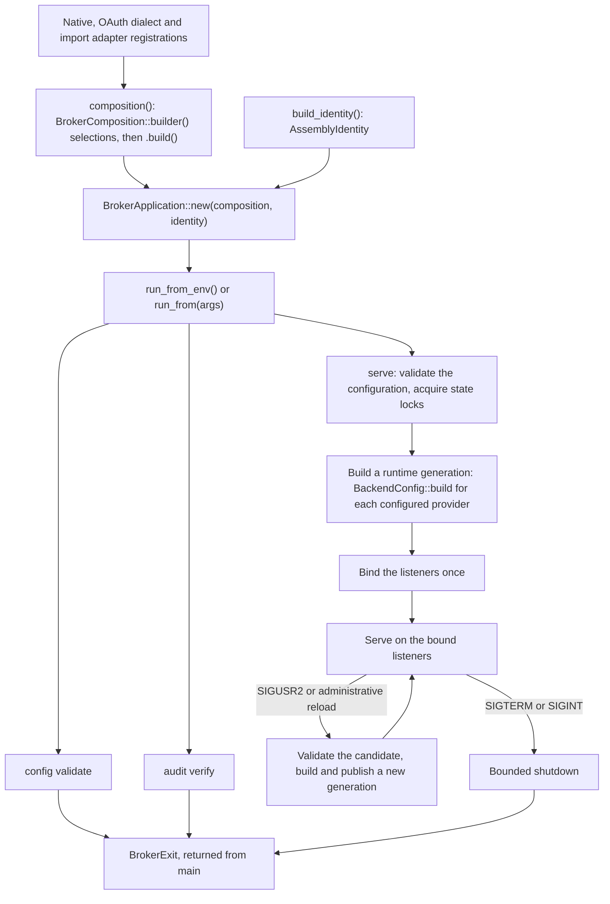

# Downstream assembly guide

An assembly is the executable crate that selects Broker modules and runs the
Broker host application. The upstream `agent-access-broker` executable is one
assembly. A team that needs providers upstream does not ship can build its own
distribution, linking the upstream host, the upstream modules it wants and its
own provider crates. That team owns the distribution's Cargo dependencies,
module selection, source revisions, qualification and deployment. Upstream never
references downstream crates.

This guide covers composition, assembly identity, dependency pinning,
distribution assets and qualification. Writing a provider crate is covered by
the [provider SDK guide](provider-sdk.md), and the trust each linked module
receives is described in its [trust model](provider-sdk.md#trust-model).

## Contents

- [Composition](#composition)
- [Identity](#identity)
- [Example assembly](#example-assembly)
- [Dependencies](#dependencies)
- [Distribution](#distribution)
- [Qualification](#qualification)

## Composition

### Selecting modules

`BrokerComposition::builder()` collects the assembly's selections:

- `.native(&REGISTRATION)` selects a native provider's `BackendRegistration`
  static, such as `agent_access_cloudbees_ci::CLOUDBEES_CI_BACKEND` or a
  downstream provider's registration. Selection order is the order resource
  types are listed in.
- `.oauth(&DIALECT)` selects an OAuth companion, such as
  `agent_access_gmail::GOOGLE_OAUTH_DIALECT`. Several providers can share one
  dialect.
- `.import_adapter(registration())` selects a shipped import adapter through
  the opaque handle its crate returns: `agent_access_mcp_upstream::registration()`
  or `agent_access_openapi_upstream::registration()`. The MCP registration also
  contributes its `mcp_oauth` companion dialect; selecting that dialect again is a
  duplicate. Custom import adapters are not supported.
- `.build()` validates the selections together and returns the immutable
  `BrokerComposition`, or a `CompositionError` whose `problems()` name the
  conflicting module identities.

Building rejects invalid identifiers, the reserved native kind `broker`, and
duplicate native kinds, resource types, dialects (including import companions),
adapters and domain reason codes. The host's own `git_repository` resource type
is always registered. Development fixtures, such as the `fake` provider, may be
selected in any assembly. Configuring one still requires a non-production
deployment with `deployment.enable_fake_service = true`.

Selection makes a module available to configure. It enables no service and
creates no grants, resources, credentials, imports or OAuth consent. Startup and
every reload also check that no configured Git gateway and no retained imported
service in the managed store uses a selected native kind; a collision fails with a
diagnostic that names both owners.

The composition exposes a read-only projection for tests: `native_kinds()`,
`oauth_dialect_ids()`, `import_kinds()`, `resource_types()`,
`http_route_specs()` and `configured_service_descriptors(document)`, which parses
a configuration document through the selected strict parsers without
validating it.

### Running the application

`BrokerApplication::new(composition, identity)` checks the
[assembly identity](#identity) against the composition. `run_from_env()`, or
`run_from(args)` for an explicit argument list, then runs the command line and
returns a `BrokerExit`, which `main` returns. The application owns command
parsing, logging, the Tokio runtime, `config validate`, `audit verify` and
`serve`. Serving covers the public and gateway listeners, state locks,
readiness, reload on `SIGUSR2` or the administrative reload, and bounded
shutdown on `SIGTERM` or `SIGINT`. Library code never exits the process itself.

From module selection to the exit status `main` returns:



| Exit status | Meaning |
| --- | --- |
| `0` | Success, including `--help`. |
| `1` | A failed `audit verify` check, or a startup or runtime failure. |
| `2` | Invalid arguments, or a command that does not apply to the configuration. |
| `3` | An invalid composition, assembly identity or configuration. |

The configuration file comes from `--config`, then `AGENT_ACCESS_BROKER_CONFIG`,
then `/etc/agent-access/broker.toml`, whatever the executable is called.
Renaming the executable never moves configuration, state, keys or locks, and
state locks still exclude a differently named executable on the same state. The
default log filter includes `agent_access_broker_host`; lifecycle events log
under `agent_access_broker_host::lifecycle`. The
[operator guide](operator-guide.md) covers serving options and operations.

The composition is fixed when the executable is built. A reload rebuilds
providers from changed configuration within it; changing what is linked needs a
new build and a restart.

## Identity

`AssemblyIdentity` describes the executable, not the host crate it links:

| Builder | Supplies |
| --- | --- |
| `AssemblyIdentity::new(name, version)` | The command name and version. |
| `.with_about(text)` | The description in command-line help. |
| `.with_source(revision)` | The assembly's own source revision. |
| `.with_host_source(revision)`, `.with_sdk_source(revision)` | The revisions of the linked host and SDK packages. |
| `.with_qualification(label)` | The qualification label; `unqualified` when none is declared. |
| `.with_module_provenance(&MAP)` | The source revisions of registered module packages. |

A `SourceRevision` is a full lowercase 40- or 64-hex Git object ID. Use
`SourceRevision::evidence` for a revision backed by recorded build evidence,
such as the verified clean checkout a release build ran from or a locked Git
source in the resolved dependency graph. Use `SourceRevision::declared` for a
revision the assembler only states. A revision that is not supplied is reported
as unavailable; the host never infers one from a checkout.

The module provenance map has one `ModuleProvenance::new(crate_name,
crate_version, revision)` entry per registered module package, keyed by the
crate name and version its registrations' `module_metadata!()` captured. Every
role a package registers shares its entry; Gmail's backend and its Google
dialect, for example, are one package. `BrokerApplication::new` rejects, with
exit status `3`:

- a name or qualification label that is not 1 to 64 ASCII letters, digits,
  `.`, `_` or `-` starting with a letter or digit;
- a version that is not 1 to 64 ASCII letters, digits, `.`, `+` or `-`;
- a revision that is not a full object ID;
- a map entry naming a package that registers no module, including the host or
  the SDK themselves;
- a package listed twice, or given conflicting revisions.

The host and SDK revisions belong in their own fields. Revisions of helper
crates and other dependencies belong in the build evidence of the resolved
graph, not in the map.

The identity labels the command line, the build status, the `broker_starting`
event, the HTTP MCP server information and state-lock holder metadata.
`GET /v1/broker/status` reports the assembly (name, version, qualification and
source), the host and SDK packages, and every compiled module package with its
roles and source, plus an inventory fingerprint; see
[the HTTP API](http-api.md) for its shape. The module list is what is compiled
in, not what is configured, and it does not change on reload. Imported MCP
connections identify the client as `agent-access-broker-host` and its version.

The qualification label is the assembler's statement about these exact
assembled sources. Declare one only for a build that your own qualification
process produced. Linking qualified upstream code never confers upstream's label,
and the upstream executable itself declares none.

## Example assembly

This assembly, `team-broker`, links production CloudBees CI, Gmail with its
Google OAuth dialect and the MCP import adapter from upstream, together with the
`example-notes` provider from the
[SDK guide's worked example](provider-sdk.md#worked-example), which a separate
repository owns. Its manifest pins both repositories by full revision:

```toml file=team-broker/Cargo.toml
[package]
name = "team-broker"
version = "1.4.0"
edition = "2024"
publish = false

[dependencies]
agent-access-broker-host = { git = "https://github.com/kcosr/agent-access-broker.git", rev = "<full upstream commit>" }
agent-access-cloudbees-ci = { git = "https://github.com/kcosr/agent-access-broker.git", rev = "<full upstream commit>" }
agent-access-gmail = { git = "https://github.com/kcosr/agent-access-broker.git", rev = "<full upstream commit>" }
agent-access-mcp-upstream = { git = "https://github.com/kcosr/agent-access-broker.git", rev = "<full upstream commit>" }
example-notes = { git = "https://git.example.com/notes-team/notes-provider.git", rev = "<full provider commit>" }

[dev-dependencies]
serde_json = "1.0"
```

`src/lib.rs` exports the two functions an assembly library needs:
`composition()` selects the modules and `build_identity()` describes the
executable, the same pattern the upstream `agent-access-broker` assembly uses.
The binary and the assembly's acceptance tests both start from them. The
assembly's own build script reads its `Cargo.lock` and emits
`TEAM_BROKER_UPSTREAM_REVISION`, `TEAM_BROKER_UPSTREAM_VERSION`,
`TEAM_BROKER_NOTES_REVISION` and `TEAM_BROKER_NOTES_VERSION`
(`cargo:rustc-env=...`) from the locked upstream and provider sources. It is
the [`build.rs`](../tests/downstream-consumer/assembly-repo/build.rs) of
upstream's [downstream consumer fixture](#qualification) with the `TEAM_BROKER_`
prefix in place of `DOWNSTREAM_BROKER_` and `("NOTES", "example-notes")` as its
provider repository entry. The release pipeline sets `TEAM_BROKER_REVISION` and
`TEAM_BROKER_QUALIFICATION` only for a build from a verified clean checkout that
it qualifies.

```rust file=team-broker/src/lib.rs
//! The modules this distribution links, and its identity.
use agent_access_broker_host::{
    AssemblyIdentity, BrokerComposition, CompositionError, ModuleProvenance, SourceRevision,
};
use agent_access_cloudbees_ci::CLOUDBEES_CI_BACKEND;
use agent_access_gmail::{GMAIL_BACKEND, GOOGLE_OAUTH_DIALECT};
use example_notes::NOTES_BACKEND;

/// Every module this distribution can configure, in resource-type listing order.
pub fn composition() -> Result<BrokerComposition, CompositionError> {
    BrokerComposition::builder()
        .native(&CLOUDBEES_CI_BACKEND)
        .native(&GMAIL_BACKEND)
        .native(&NOTES_BACKEND)
        .oauth(&GOOGLE_OAUTH_DIALECT)
        .import_adapter(agent_access_mcp_upstream::registration())
        .build()
}

/// The locked upstream revision: the host, the SDK and every upstream module.
const UPSTREAM: SourceRevision = SourceRevision::evidence(env!("TEAM_BROKER_UPSTREAM_REVISION"));

/// The locked revision of the notes provider repository.
const NOTES: SourceRevision = SourceRevision::evidence(env!("TEAM_BROKER_NOTES_REVISION"));

/// An upstream module package. Upstream packages share one release version.
const fn upstream(crate_name: &'static str) -> ModuleProvenance {
    ModuleProvenance::new(crate_name, env!("TEAM_BROKER_UPSTREAM_VERSION"), UPSTREAM)
}

/// One entry per registered module package. Gmail's backend and Google dialect
/// share a package, as do the MCP adapter and its OAuth companion.
static MODULES: [ModuleProvenance; 4] = [
    upstream("agent-access-cloudbees-ci"),
    upstream("agent-access-gmail"),
    upstream("agent-access-mcp-upstream"),
    ModuleProvenance::new("example-notes", env!("TEAM_BROKER_NOTES_VERSION"), NOTES),
];

/// This executable's identity.
pub fn build_identity() -> AssemblyIdentity {
    let identity = AssemblyIdentity::new("team-broker", env!("CARGO_PKG_VERSION"))
        .with_about("Team broker distribution")
        .with_host_source(UPSTREAM)
        .with_sdk_source(UPSTREAM)
        .with_module_provenance(&MODULES);
    let identity = match option_env!("TEAM_BROKER_REVISION") {
        Some(revision) => identity.with_source(SourceRevision::evidence(revision)),
        None => identity,
    };
    match option_env!("TEAM_BROKER_QUALIFICATION") {
        Some(label) => identity.with_qualification(label),
        None => identity,
    }
}

#[cfg(test)]
mod tests {
    use super::*;
    use agent_access_broker_host::BrokerApplication;

    #[test]
    fn the_identity_describes_the_composition() {
        let application = BrokerApplication::new(composition().unwrap(), build_identity()).unwrap();
        let status = serde_json::to_value(application.status()).unwrap();
        assert_eq!(status["assembly"]["name"], "team-broker");
        assert_eq!(status["modules"].as_array().unwrap().len(), MODULES.len());
    }
}
```

`src/main.rs` runs the application; a rejected composition or identity exits
`3` with its problems on standard error. It is the fixture's
[`main.rs`](../tests/downstream-consumer/assembly-repo/src/main.rs) with this
crate's name:

```rust file=team-broker/src/main.rs
use agent_access_broker_host::{BrokerApplication, BrokerExit};
use team_broker::{build_identity, composition};

fn main() -> BrokerExit {
    match composition()
        .and_then(|composition| BrokerApplication::new(composition, build_identity()))
    {
        Ok(application) => application.run_from_env(),
        Err(error) => error.into(),
    }
}
```

## Dependencies

### Canonical pins

Upstream crates are distributed from
`https://github.com/kcosr/agent-access-broker.git`. Every repository that names
an upstream crate, whether the assembly or a separately owned provider
repository, uses exactly that URL with `rev` set to the full 40-character commit.
Do not mix branches, tags, abbreviated revisions or alternate spellings of the
URL, even when they resolve to the same commit. Cargo's source identity includes
the Git reference, so two spellings produce two copies of the SDK whose types do
not match.

The resolved graph must contain exactly one `agent-access-provider` package, and
every upstream package must resolve to the same URL, reference and commit. A
provider repository pins the SDK the same way, and its own release records the
commit it pinned.

### Coordinated upgrades

Every repository that names an upstream crate pins its own revision, so an
upstream upgrade is coordinated:

1. Update the pin in each participating provider repository, adapt to any
   documented source changes, run its tests, and commit.
2. Update the assembly's upstream pins and each provider's `rev` together.
3. Resolve the assembly's lockfile, [review it](#lockfile-review), qualify the
   whole graph, and from then on build with `--locked`.

Within a compatible line, a patch release keeps supported source contracts; a
minor release on the 0.x line may require source changes, which the changelog
documents. See the [compatibility policy](provider-sdk.md#compatibility-policy).

### Source overrides

For a controlled local upgrade, such as testing an unpublished upstream commit,
the consuming root may patch the upstream packages to one distinct source: a
local clone or a maintained mirror.

```toml
[patch."https://github.com/kcosr/agent-access-broker.git"]
agent-access-broker-host = { path = "../agent-access-broker/crates/agent-access-broker-host" }
agent-access-cloudbees-ci = { path = "../agent-access-broker/crates/agent-access-cloudbees-ci" }
agent-access-core = { path = "../agent-access-broker/crates/agent-access-core" }
agent-access-gmail = { path = "../agent-access-broker/crates/agent-access-gmail" }
agent-access-mcp-upstream = { path = "../agent-access-broker/crates/agent-access-mcp-upstream" }
agent-access-provider = { path = "../agent-access-broker/crates/agent-access-provider" }
```

- Patch every upstream package the consumer graph reaches, including ones it
  does not name directly, such as `agent-access-core` and the SDK that provider
  repositories depend on. Every `[[package]]` in `Cargo.lock` whose `source`
  starts with `git+https://github.com/kcosr/agent-access-broker.git` must be
  covered.
- A Git patch cannot redirect to another revision at the same canonical URL.
  Use a path or a distinct mirror URL.
- Patch tables in a dependency's own manifest do not apply to its consumers; only
  the consuming root's patches do.
- Check that the patched versions satisfy every requirement and that the graph
  still has one SDK package, record the override with the build, and never
  claim that a locally overridden graph proves the canonical pins work. Never
  bridge two SDK copies with adapters.

### Lockfile review

Review the assembly's `Cargo.lock` before qualifying it, and again whenever it
changes:

```bash
cargo tree --locked -i agent-access-provider -e normal,build,dev
```

This fails as ambiguous when more than one `agent-access-provider` package is
resolved. Then check that:

- every upstream package has `source =
  "git+https://github.com/kcosr/agent-access-broker.git?rev=<sha>#<sha>"` with
  the same full commit, and none resolves from a path, a registry or another
  URL;
- each provider package resolves only to its own repository at its pinned
  commit;
- the third-party versions are the ones you intend to qualify. Starting from
  the entries in upstream's `Cargo.lock` at the pinned commit reproduces the
  third-party graph upstream qualified; any difference is yours to qualify.

## Distribution

### CLI and portal assets

A Cargo dependency on the host contains neither the CLI nor the built portal.

- **CLI.** The `agent-access` CLI is independent of the assembly: generic
  `invoke`, `send`, HTTP and MCP commands serve every module, and typed wrappers
  for services an assembly omits fail through ordinary catalog errors. Build it
  from a checkout of the same upstream commit with
  `cargo build --locked --release -p agent-access`.
- **Portal.** Build `apps/portal` from that same upstream commit with
  `npm --prefix apps/portal ci` and `npm --prefix apps/portal run build`, or
  consume a qualified asset artifact built from exactly that commit. Ship the
  complete `dist` directory, including its `licenses` directory, and point
  `[portal].static_dir` at it. Provider forms are metadata-driven, so selected
  native modules need no frontend extension.
- **Notices.** Ship upstream's `LICENSE` and `NOTICE`, the portal's notices, and
  third-party notices for your own executables' resolved graphs. Upstream's
  `scripts/generate-rust-notices.py` covers only upstream's release
  executables, so generate an inventory for your own executable with your own
  tooling.

Record the source revisions, the platform and toolchain, the checksums and the
validation results with the package.
[Release readiness](release-readiness.md#build-and-distribute) lists what
upstream's own distribution contains.

### Release-feature check

Release executables must not enable a `test-support` feature, and a production
distribution must not link the test-only conformance reference,
`agent-access-conformance`. Cargo can unify development features into test
binaries; release builds of the executable must not include them. Inspect the
release graph of the assembly package for your target:

```bash
cargo tree --locked --target <rust-target-triple> -p team-broker -e normal,build \
  --prefix none --format '{p}\t{f}'
```

No line may list `test-support` among a package's features, and a production
graph has no `agent-access-conformance` line. Upstream's
`scripts/verify-release-provenance.mjs` applies the same rules to its own
executables.

## Qualification

Upstream qualification runs `node scripts/verify-release.mjs` on one upstream
commit. It runs that commit's own required gates: the Rust suites, crate
boundaries, the public API inventory, portal, documentation and sample checks,
the Unix signal fixture, native release provenance and notices. It qualifies
upstream's own executables and assets at that commit.

It does not qualify a downstream distribution, which has a different module
selection, dependency graph, lockfile, features and assets. A downstream
distribution qualifies its exact assembled sources and assets itself:

- the lockfile review and the release-feature check above;
- its provider repositories' own tests, with SDK test support;
- the assembly's tests, including the identity check in the example;
- startup with a representative configuration, `config validate`, the
  authenticated `/v1/broker/status` identity and a representative invocation
  through the CLI;
- the CLI and portal assets built from the pinned upstream commit, and the
  notices.

The resulting qualification label is the assembler's declaration. Module
metadata, provenance maps and labels are honest labeling backed by the
assembler's build evidence, not cryptographic attestation; whoever builds the
executable controls them.

Upstream's independent downstream consumer fixture is the reference for this
process. Its templates in
[`tests/downstream-consumer/`](../tests/downstream-consumer/README.md) stage a
separately owned provider repository, containing the conformance provider as a
stand-in for a downstream provider, and a downstream assembly that links
production CloudBees CI and that provider. Each is staged as its own local Git
repository with its own manifest, lockfile and full-revision pins.
`scripts/verify-downstream-consumer.mjs` builds them `--locked --offline`,
reviews the lockfiles for one SDK package identity and exact sources, runs the
provider's tests with SDK test support, checks the release feature graph, and
starts the assembled executable against a synthetic CloudBees CI controller,
exercising it with the candidate's CLI. In the same stage, pinned the same way,
it builds and tests this guide's [example assembly](#example-assembly) and the
code of the [provider SDK guide](provider-sdk.md), including its worked example,
and checks the files the example shares with the fixture. Upstream release
qualification runs it as the `downstream-consumer` gate; after publication,
`--source canonical` qualifies the canonical remote pins.

For in-process acceptance tests, enable the host's `test-support` feature in
development dependencies only and start the assembly's own
`composition()` and `build_identity()` with
`test_support::IsolatedBroker::new`; see
[host acceptance tests](provider-sdk.md#host-acceptance-tests).
