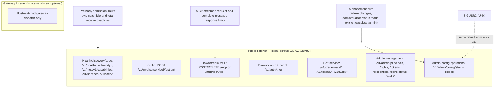
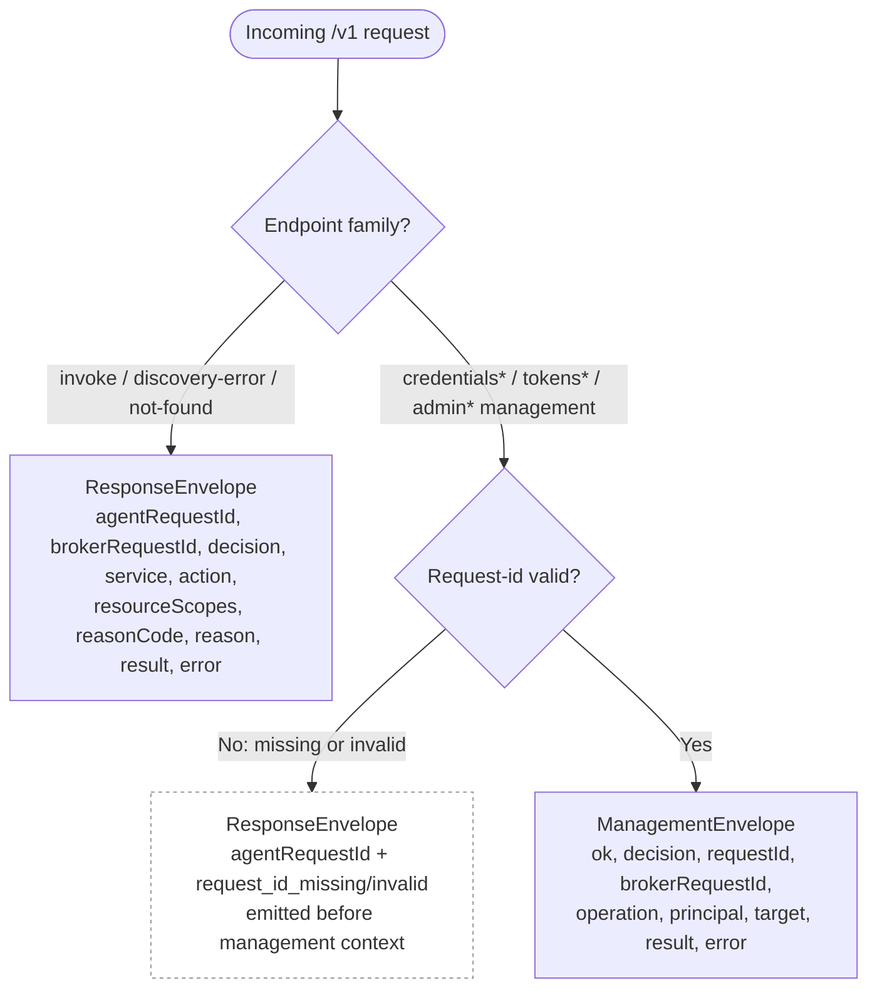
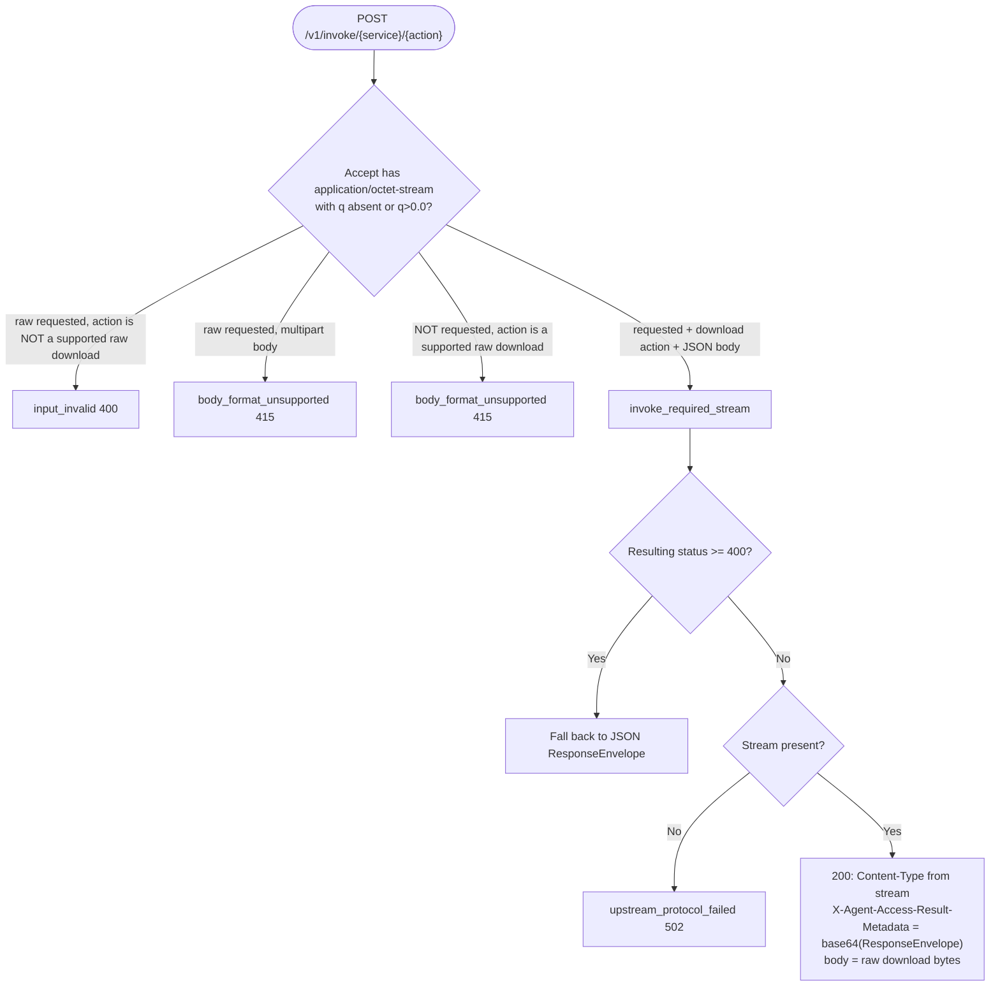

# HTTP API reference

Runtime catalogs use `agent-access.catalog.v2`. Every service includes
`scopedMcpReady`; every action includes `scopedMcpName` as an exact name or null.
These fields describe service-specific MCP projection only; canonical action IDs,
grants, invoke routes, and send envelopes are independent of that projection.
Catalog-dependent clients must support `agent-access.catalog.v2`. Missing required
metadata is a contract error.

This document describes the Agent Access Broker's HTTP surface: the listeners
and routes, the request-id requirement, the response envelopes, decision
semantics, the full reason-code table, the HTTP-status to outcome to CLI-exit
mapping, and raw-download negotiation.

The broker is the only component that holds upstream credentials; the HTTP
responses do not return broker-held execution credentials. Deliberate GitLab
token issuance/rotation actions return the newly issued token under explicit
sensitive-output contracts; see [issued credentials](#deliberately-issued-gitlab-credentials). For the
request lifecycle, identity, policy, credential, and audit models, see
[design.md](design.md). For the CLI that calls these endpoints, see
[cli.md](cli.md).

## Listeners and route surface

The broker always runs one public HTTP listener. It can also bind an optional
gateway listener with `agent-access-broker serve --gateway-listen <addr>` for
host-matched protocol traffic.



*The public listener carries both the data-management routes and config
reload/status routes; Unix `SIGUSR2` is the non-HTTP reload trigger for
service-manager integration.*

### Public listener

The public listener serves health, discovery, authenticated runtime specs,
invoke, self-service credential and token management, and the entire
admin-management family under `/v1`. Portal assets use `/ui`; the independently
enabled downstream MCP interface uses `/mcp` and `/mcp/{service}`. A
pre-extraction admission layer holds the global concurrency permit through the
request, except for health/readiness probes, bodiless portal assets, and MCP's
independent admission. Anonymous control-plane bodies use at most one quarter of
global capacity (minimum one); verified management callers bypass that pool and
its source slots, with a per-principal body limit before extraction instead. Bodiless writes
skip body slots, including owner token pause/revoke. Browser-auth bodies are capped at 16 KiB and control-plane
JSON/management bodies at 1 MiB, additionally bounded by the configured transfer
and startup hard caps. Invocation JSON retains the transfer cap for supported
inline content. Auth and other control-plane bodies have five- and fifteen-second
receive ceilings; a smaller configured deadline still applies. Their timeouts
return HTTP 408 with a deadline message. Invocation timeouts retain
`body_malformed` with `request body receive deadline exceeded`. Management responses
include `Cache-Control: no-store`; internal store diagnostics stay in server logs.
MCP additionally
bounds streamed request intake and serialized protocol responses directly around
the SDK transport.

### Downstream HTTP MCP

Enable `[mcp]` with a canonical public URL such as `https://broker.example.com/mcp`.
The same public listener serves the endpoint behind trusted HTTPS ingress. It is
reserved and returns 404 when disabled; there is no `/v1/mcp` alias or separate
MCP port. Existing local stdio MCP remains the interface for local request files,
uploads, downloads and environment/file secret sources.

`/mcp/{service}` selects one canonical service ID and exposes raw provider names.
All routes share the same endpoint, quotas and admission machinery. Paths must
use the exact canonical spelling: encoded aliases, query strings, trailing
slashes and extra segments are rejected without redirects. Unknown, hidden,
disabled, unready and gateway targets receive the same unavailable diagnostic
after authentication. Session bindings include the selected view; cross-view
POST/cancellation/DELETE cannot use or close the original session. Existing
authenticated sessions retain ping, cancellation and DELETE after a service
becomes unavailable; list/call/helper requests use current authorization.

The HTTP endpoint uses MCP `2025-11-25` Streamable HTTP. POST handles
initialization, discovery, tool calls and cancellation notifications. DELETE
closes the caller's session and returns 202 without a response body; it does not
roll back admitted operations. GET returns
405 with `Allow: POST, DELETE`; there is no standalone notification stream or
response replay. Successful messages use JSON-RPC JSON or request-scoped SSE;
notifications receive 202 without a response body. They are not REST broker
envelopes. Provider envelopes are carried inside MCP tool results.

Every request authenticates an invocation identity using either
`Authorization: Bearer <token>` from a configured machine-identity source or
[managed workspace identity](managed-identity.md) through a named trusted caller.
Trusted username mode uses `X-Agent-Access-User` plus either a direct caller bearer
in `Authorization` or a relayed caller bearer in
`X-Agent-Access-Caller-Authorization`. The caller selects the namespace; an enabled
exact-name binding selects an active unpaused human. The user header selects this
mode before ordinary credentials and is rejected outside HTTP MCP. Both fields
must be repeated on every request. All request trailer declarations and actual
trailers are rejected before dispatch; see [MCP](mcp.md#request-header-and-body-restrictions).
Managed `agent_invoke` tokens and static bearer principals are supported; browser cookies and management token classes
are not MCP identities. Missing/invalid credentials return 401. Unknown, expired,
and wrong-owner sessions return the same 404. Session IDs are routing state,
not bearer authority. Clients should send the negotiated `MCP-Protocol-Version`
after initialization; a conflicting supplied version is rejected. A session-bound
request may omit the version header because the selected profile is known.

Only JSON provider actions are executable tools on this transport, alongside the
five discovery helpers. Discovery may describe other Broker capabilities, but
multipart/raw actions have no HTTP `mcpTool`. Resource grants are checked again
on invocation. Each action tool call counts once against the caller's
[service invocation limit](#rate-limits); protocol messages and discovery
helpers do not count. MCP generates Broker correlation IDs when the caller does not
supply `X-Agent-Access-Request-Id`.

Native MCP operations retain their originating `http.request` span through
admission and terminal audit, including service/action, principal and Broker
correlation fields. The span's `http.statusCode` describes the MCP HTTP carrier
(200 for delivered tool outcomes); `broker.statusCode` separately describes the
canonical Broker outcome, such as 403 for a denied invocation. The shared core
`invoke_completed` event continues to report the canonical Broker status.

Caller-visible OpenAPI describes `/mcp` and `/mcp/{service}` when enabled. The REST action catalog's
route list and JSON `send` schema intentionally exclude it: use an MCP client,
not a generic REST response-envelope operation. See [MCP setup](mcp.md) for client
configuration, file-workflow boundaries, sensitive inputs and response budgets.

### Trusted execution-context ingress

`X-Agent-Access-Context` is an attested attribute supplied by a configured
[trusted caller](trusted-callers.md), authenticated with
`X-Agent-Access-Caller-Authorization: Bearer <credential>`. Any context or
`X-AW-Identity-Token-SHA256` assertion requires a valid caller. Every supplied
caller credential is validated, including alongside ordinary Broker tokens and
on public/browser routes. It never supplies a principal by itself. Transport-aware
matching rejects a direct-only caller secret in this dedicated header on every
route. Direct username MCP callers use fixed context and omit the context header.

Asserted callers must provide one approved context on governed requests; fixed
callers receive their configured context and must omit the context header.
Header-free direct clients retain the configured direct default (or built-in
`default` if the section is absent). Context is never inferred as `internal`.

The [pre-dispatch failure contract](trusted-callers.md#http-failures-before-provider-dispatch)
defines correlated `broker/caller.authenticate`, `broker/identity.authenticate`,
`broker/context.authorize`, and `broker/request.admit` responses. Only the exact
documented decision/status/reason combinations prove that provider dispatch did
not occur; an arbitrary HTTP 401, 429 or 503 does not. Service ID `broker` is
reserved against provider, imported-service and Git gateway registration.

Execution context is resolved for invoke, HTTP MCP, the Git gateway,
`/v1/capabilities`, all `/v1/services` discovery routes, and caller-visible runtime
specs. It is deliberately not resolved for health/readiness, browser
auth/OIDC, `/v1/broker/status`, portal assets, ordinary credential/token/admin
management, or admin `visibility=all` specs. `/v1/me` never requires it: it
resolves the context only to filter `serviceLimits`, which is empty when the
context is missing, invalid, or denied by the caller's token. Policy-dependent
management helpers use a context-independent union of the target principal's
active grants.

### Gateway listener

The optional gateway listener serves only gateway dispatch for configured
`gateways.<service>.broker_hosts`. It does not mount `/v1`, `/ui`, browser
auth, self-service, or admin management routes. Unknown gateway hosts and
matched hosts whose paths do not classify to a gateway action return plain-text
gateway errors rather than `ResponseEnvelope` JSON.

The gateway listener does not expose gateway-local health or readiness routes.
There is no `/gateway-healthz` or `/gateway-readyz`; use the public
`/v1/healthz` and `/v1/readyz` endpoints for process/runtime state and TCP or
edge-proxy checks for gateway-port reachability.

Gateway requests may omit `X-Agent-Access-Request-Id`; the broker generates a
synthetic agent request id when it is absent. If the header is present, it must
use the same request-id grammar as public invoke requests. Gateway responses
include `X-Agent-Access-Broker-Request-Id`; broker-denied gateway errors also
include `X-Agent-Access-Reason-Code` when a stable reason code is available.
Audited gateway operations include `source.agentRequestIdGenerated` to
distinguish caller-provided request IDs from broker-generated request IDs.
Git HTTP gateway authentication uses Basic auth with the configured sentinel
username and a broker `agent_invoke` token as the password.
The gateway listener is a distinct trusted-ingress surface and resolves
`X-Agent-Access-Context` before Basic-token lookup or Git policy planning. Its
edge proxy must be a [named trusted caller](trusted-callers.md): an asserted
caller supplies its private `X-Agent-Access-Caller-Authorization` credential and
replaces client context values with one approved assertion. A fixed caller supplies
its credential and omits the context header. Configure gateway ingress separately
from public-listener ingress. Broker consumes caller/context headers locally and
never forwards them to the upstream Git server.
For `git_http`, `GET /<repo>.git/info/refs?service=git-upload-pack` and
`POST /<repo>.git/git-upload-pack` are authorized as `repo.fetch`, forwarded to
the configured upstream base URL after final allowlist validation, and returned
as bounded raw Git smart HTTP responses. Omitted gateway body, response, and
idle-timeout settings inherit the global broker limits. Git discovery `GET`
requests with bodies are rejected before upstream forwarding. Upload-pack POSTs
may forward a single canonical `Content-Encoding: gzip` header while preserving
the body as opaque bytes; other encodings and duplicate encoding headers are
rejected. For `repo.push`, push discovery uses
`GET /<repo>.git/info/refs?service=git-receive-pack`, and
`POST /<repo>.git/git-receive-pack` parses the receive-pack command prefix
before resolving upstream credentials. Receive-pack `Content-Encoding` and all
gateway `Trailer` headers are rejected before credential resolution. Malformed
pkt-lines, denied capabilities, tag updates, delete-ref updates, and configured
denied ref patterns return plain-text gateway errors without opening a
credentialed upstream request.

All four routes also accept repository paths without `.git`. The broker uses
the same canonical repository for authorization and adds `.git` when building
the upstream path, preserving any configured base path prefix. Upstreams must
serve `.git` smart HTTP endpoints; redirects are not followed. See
[Git gateway paths](git-http-gateway.md#paths-queries-and-scopes).

Credentialed gateway forwarding is audit-gated. The broker appends a durable
started audit record with `decision = allow` and
`providerAudit.gateway.phase = "started"` before sending upstream credentials,
then appends a terminal record with upstream status, duration, and response-byte
metadata through reserved terminal audit capacity. Classifier denials for
matched gateway hosts use synthetic `action = "gateway.classify"`; this action
is not grantable policy and exists only to classify pre-auth gateway denials.
Authenticated gateway header denials after a Git action is known, including
`Content-Encoding` and `Trailer` representation-header denials, use the resolved
principal and real gateway action such as `repo.fetch` or `repo.push` with
`reasonCode = "gateway_header_denied"`.
Gateway classifier traffic is source-rate-gated before those denial audits are
enqueued, so malformed unauthenticated floods cannot bypass the source-rate
window by forcing audit appends. Every upload-pack and receive-pack POST is
charged once to the caller's [service invocation limit](#rate-limits) for the
gateway service after authentication and before policy or credential work,
including protocol v2 `ls-refs` POSTs, additional fetch negotiation rounds, and
a push's probe POST, so one fetch or clone typically costs two or more; ref
discovery `GET`s are not charged. A limit of 1 makes protocol v2 fetches
impossible. A limited pack POST returns 429 with `Retry-After` and the
rejection message as the plain-text body. An upstream 429 is passed through to
the Git client with a bounded whole-second `Retry-After`, and that request's
terminal audit record reports `upstream_rate_limited`.

After search authorization succeeds, broker audit records include
`searchAuthorization`, even when credential resolution fails before upstream
dispatch. This object contains `scopeType`, `credentialMode`, `matchedGrants`, and
`scope`. The scope is a union of clauses, each with `included` and `excluded`
resource selectors. For example, `{"clauses":[{"included":[{"kind":"all"}],
"excluded":[{"kind":"namespace","value":"engineering/private"}]}]}` permits
all repositories except descendants of that namespace. Exclusions apply only to
their own clause; a separate clause can restore an exact repository. An empty
clause list denies all resources. Selectors use `exact`, `namespace`, or `all`;
exact and namespace selectors carry `value`.

The envelope's descriptive `resourceScopes` summary is `["*"]` if any normalized
clause has an all or namespace positive selector. Otherwise it contains sorted,
deduplicated exact values accepted by the complete predicate. A wildcard summary
can still have exclusions and never authorizes a resource. Audit retains the
complete clauses. Historical audit records remain their original stored JSON.
Command audit authority retains its separate exact resources/any-except shape.

Health and discovery:

| Method | Path | Purpose |
| --- | --- | --- |
| `GET` | `/v1/healthz` | Liveness probe (no request-id, no auth) |
| `GET` | `/v1/readyz` | Readiness probe (no request-id, no auth) |
| `GET` | `/v1/me` | Resolved identity summary and the caller's service invocation limits |
| `GET` | `/v1/broker/status` | Immutable assembly, host, SDK and compiled module identity, and contract versions |
| `GET` | `/v1/resource-types` | Registered resource types, labels, examples, supported selectors, and exclusion capability |
| `GET` | `/v1/capabilities` | Capability bundle (identity summary plus visible services) |
| `GET` | `/v1/services` | Visible services |
| `GET` | `/v1/services/{service}` | One service's visible capabilities |
| `GET` | `/v1/services/{service}/resource-access` | Effective local access per action/type, paginated registered references, and explicit live-listing hints |
| `GET` | `/v1/services/{service}/actions` | Action names, optionally filtered to one concrete resource |

`GET /v1/me` returns the identity summary (`principal`, `groups`,
`policyGroups` when non-empty, `authenticated`, and `readOnlyAccess` for an
attested identity) plus `serviceLimits`: the
caller's effective [service invocation limit](#rate-limits) for each service
`GET /v1/services` would list for the same request (identity, agent-token
caveats, grants, and execution context), ordered by service:

```json
{
  "principal": "alice",
  "groups": ["agent-users"],
  "authenticated": true,
  "serviceLimits": [
    {"service": "jira", "requests": 20, "windowSeconds": 60}
  ]
}
```

It does not say whether a value comes from a principal override or a default.
It is returned for every caller that can use `/v1/me`, including browser
sessions and anonymous callers, under both identity authorities, and `/v1/me`
is not counted as an invocation.

When the caller's principal has a Microsoft login method, the response also
carries `microsoftMembership`: `validUntil`, when the method's current
Microsoft group evidence expires (`null` when it has none), and `renewal`, its
[renewal status](#microsoft-membership-renewal) or `null` when the method has no
renewal record. `/v1/me` itself passes renewal admission, so after expired
evidence it reports the window of the renewal it waited for:

```json
{
  "principal": "alice",
  "groups": ["agent-users"],
  "authenticated": true,
  "serviceLimits": [],
  "microsoftMembership": {
    "validUntil": "2026-10-21T18:00:00Z",
    "renewal": {
      "state": "active",
      "lastRenewedAt": "2026-10-21T10:00:00Z",
      "nextAttemptAfter": null,
      "lastFailure": null
    }
  }
}
```

`readOnlyAccess` appears only for a [trusted fingerprint identity](managed-identity.md),
the attested path REST accepts. `true` means the identity token is
[read-only](managed-identity.md#read-only-paths): discovery lists only actions
classified as reads, and a write returns 403 `service_action_denied` with reason
`identity access is read-only`. Issued Broker tokens, browser sessions and other
identity sources omit it. The identity summaries in `/v1/capabilities` and the
caller-filtered runtime catalog carry the same field.

`GET /v1/resource-types` requires an authenticated caller (anonymous callers
receive `identity_required`, as on the spec routes) and a valid
`X-Agent-Access-Request-Id`, but no admin right, provider grant, or execution
context. It returns `{"resourceTypes":[...]}` in registration order. Every entry
includes the resolved `supportsExclusions` boolean, which defaults to `true`.
When `false`, resources of that type cannot be excluded by resource groups;
see [resource groups](resources.md#groups-and-exclusions). A type a
command import declares carries its `importedService`; one that import no
longer declares, kept for its remaining resources, is marked `removed: true`
and accepts no new resources.

`GET /v1/broker/status` requires normal Broker identity and a valid
`X-Agent-Access-Request-Id`, but no admin right, provider grant, or execution
context. Its successful response is raw JSON with `Cache-Control: no-store`
describing the running executable. This example is a release build; the module
list is shortened:

```json
{
  "assembly": {
    "name": "agent-access-broker",
    "version": "0.1.0",
    "qualification": "unqualified",
    "source": {"revision": "3c14665eb32caf14e21373a762da328ea78b79a2", "provenance": "evidence"}
  },
  "host": {
    "crate": "agent-access-broker-host",
    "version": "0.1.0",
    "source": {"revision": "3c14665eb32caf14e21373a762da328ea78b79a2", "provenance": "evidence"}
  },
  "sdk": {
    "crate": "agent-access-provider",
    "version": "0.1.0",
    "source": {"revision": "3c14665eb32caf14e21373a762da328ea78b79a2", "provenance": "evidence"}
  },
  "modules": [
    {
      "crate": "agent-access-gmail",
      "version": "0.1.0",
      "roles": [{"role": "native", "id": "gmail"}, {"role": "oauth", "id": "google"}],
      "source": {"revision": "3c14665eb32caf14e21373a762da328ea78b79a2", "provenance": "evidence"}
    },
    {
      "crate": "agent-access-mcp-upstream",
      "version": "0.1.0",
      "roles": [{"role": "oauth", "id": "mcp_oauth"}, {"role": "import", "id": "mcp_http"}],
      "source": {"revision": "3c14665eb32caf14e21373a762da328ea78b79a2", "provenance": "evidence"}
    }
  ],
  "inventoryFingerprint": "sha256:6f1c9d0e2b7a4c58e93d1f60a2b4c7e8d9f0a1b2c3d4e5f60718293a4b5c6d7e",
  "catalogVersion": "agent-access.catalog.v2",
  "sendSchemaVersion": "agent-access.send.v1"
}
```

- `assembly` is the executable that links the Broker host: its `name` and
  `version`, the `qualification` label its assembler declares (`unqualified`
  when it declares none; linking a qualified upstream host never confers that
  label), and its own `source`.
- `host` and `sdk` are the linked `agent-access-broker-host` and
  `agent-access-provider` packages, each with its `crate` name, `version` and
  `source`.
- `modules` lists every compiled module package, sorted by `crate` and
  `version`. It is the compiled inventory, not the current configuration: a
  module is listed whether or not any provider, OAuth registration or import
  uses it. `roles` lists what the package registers, sorted: a `native`
  provider kind, an `oauth` dialect ID (including an import's companion
  dialect), or an `import` adapter kind.
- Every `source` has a `revision` and a `provenance`. `provenance` is
  `evidence` when the assembler's recorded build evidence backs the revision,
  `declared` when the assembler only states it, or `unavailable` with
  `revision: null` when none was supplied. The Broker never infers a revision.
  A revision is a full lowercase 40- or 64-hex Git object ID. Revisions are the
  assembler's labels, not cryptographic attestation.
- `inventoryFingerprint` is `sha256:` and the hexadecimal SHA-256 of a
  length-delimited encoding of the host and SDK packages and the module
  inventory, including each revision and provenance. The assembly fields are
  not part of it. The same value appears in the `broker_starting` log event.
- `catalogVersion` and `sendSchemaVersion` are the runtime contract versions.

A local or otherwise unstamped build of the upstream `agent-access-broker`
reports every `source` as `{"revision": null, "provenance": "unavailable"}`;
the shape is otherwise the same. The status never changes while the process
runs, including across configuration reloads. It contains no secret
references, credentials, local paths, branch, dirty state, build time or host
name. The route records the ordinary request-span operation `broker.status`,
but does not create a provider or management audit event. Liveness and
readiness remain the minimal, unauthenticated probes documented below.

Authenticated runtime specs:

| Method | Path | Purpose |
| --- | --- | --- |
| `GET` | `/v1/spec/catalog` | Broker-specific caller-filtered catalog for actions, HTTP routes, I/O hints, response kinds, registered `resourceTypes`, and CLI `send` metadata |
| `GET` | `/v1/spec/openapi.json` | OpenAPI 3.1 projection for direct HTTP clients |
| `GET` | `/v1/spec/send-schema.json` | JSON Schema projection for the `agent-access send` envelope |

Spec routes require normal identity admission and the normal
`X-Agent-Access-Request-Id`; anonymous callers receive the generic
identity-required envelope. Success responses are raw JSON, not
`ResponseEnvelope`, and set `Cache-Control: no-store` plus `Vary` over the
configured identity source headers, `Authorization`, `Cookie`, and
`X-Agent-Access-Context`.

Supported query parameters are `auth=include|omit`, `visibility=caller|all`,
and `format=json`. `auth=omit` removes rendered auth descriptions but does not
make the route public. `visibility=caller` is the default and filters provider
actions and HTTP routes to what the caller can invoke or manage, including
token class, broker-token service allowlists, non-invoke surface exclusion,
broker-token action restrictions, provider policy visibility, and management access. Finite token resource restrictions remain
request-time authorization and do not rewrite input schemas.
`visibility=all` permits admins and auditors with administrative read access and emits a structured security log entry.
Caller-visible catalogs include the resolved canonical `executionContext`; all
advertised services and actions are filtered through it. Administrative
`visibility=all` is context-independent and omits `executionContext`, so it is
configuration inventory rather than proof of caller authorization.
Gateway services and gateway broker hosts are not included in invoke/send specs.
Provider action capabilities and catalog entries may include `documentation`, a
provider-owned JSON object containing extended usage guidance. It is metadata,
never an invocation input. Runtime OpenAPI operations and action-specific send
schema variants expose it as `x-agent-access-documentation`. MCP action details
return it while initial MCP tool definitions include only concise guidance.

Jira JQL and Confluence CQL syntax, unsupported fields/operators/functions, and
query complexity limits return `input_invalid`. Scope resolution and returned
resource containment failures remain scope errors.

For provider actions, catalog entries advertise optional `readContentFormats`
and `responseFormats` arrays. The OpenAPI invoke body and the matching
action-specific send-schema variant always allow the explicit protocol defaults
`readContentFormat = native` and `responseFormat = json`. Their enums add
non-default values only when the action advertises the corresponding capability;
the provider `inputs` schema never contains these fields. Capability discovery
is authoritative for non-default representations. An action that advertises
`readContentFormats` also lists `renderedBodyOwners`: JSON pointers into the
response envelope, such as `/result` or `/result/comments/*`, to the objects
that carry a `renderedBody` companion beside their native body. A `*` segment
matches every element of an array. Clients inspect companions only at these
owners; any other `renderedBody` key belongs to upstream content.

Sensitive input metadata applies to provider actions and management routes:

- An input schema can mark a value with `x-agent-access-sensitive: true`.
  OpenAPI request schemas preserve that annotation. Provider catalog actions
  expose the derived `sensitiveInputPointers`; route entries expose
  `sensitiveRequestPointers`. These are JSON pointers into the corresponding
  request envelope, such as `/inputs/headers/X-Api-Key` or `/body/token`.
  Pointer segments escape `~` as `~0` and `/` as `~1`. A sensitive array item
  marks the whole array, so clients do not need an index-specific catalog.
- Generated JSON-send variants expose these request pointers as
  `x-agent-access-sensitive-pointers` and offer `secretSources` when the
  operation has sensitive inputs. `agent-access send --request-json` rejects
  inline values at declared sensitive locations; use local environment, file
  or stdin sources instead. Source bindings may address a declared pointer or
  its descendants and are resolved locally before sending the HTTP request.
  `secretSources` is CLI metadata, not a field of the direct HTTP API.
- Actions and routes advertise sensitive result locations through
  `sensitiveOutputPointers` and `sensitiveResponsePointers`, respectively.
  OpenAPI operations and JSON-send variants expose
  `x-agent-access-sensitive-output-pointers`, with pointers into the response
  envelope. These markers also cover private imported data; they are not
  limited to credentials or token issuance.

Clients should use the current caller-filtered metadata to locate sensitive
fields. Direct HTTP clients supply required secret values in the protected
request body; the annotations do not replace authentication or authorization.
See [JSON send](cli.md#send-json-envelope) for local secret-source syntax.

Browser authentication and same-origin portal:

| Method | Path | Purpose |
| --- | --- | --- |
| `GET` | `/v1/auth/session` | Inspect the browser cookie session, if present |
| `POST` | `/v1/auth/local/login` | Local principal/password login; sets an HttpOnly browser-session cookie |
| `POST` | `/v1/auth/local/password/change` | Change the current principal's local password and rotate the browser session |
| `GET` | `/v1/auth/oidc/microsoft/start` | Start single-tenant Microsoft login and redirect to Microsoft |
| `GET` | `/v1/auth/oidc/microsoft/callback` | Complete the Microsoft authorization-code callback and set the browser-session cookie |
| `POST` | `/v1/auth/logout` | Revoke the browser session and clear the cookie |
| `GET` | `/ui` | Portal static app entrypoint when `[portal]` is enabled |
| `GET` | `/ui/{*path}` | Portal static asset or app fallback |

Authenticated browser-session responses include `authenticated`, the immutable
`principal`, nullable profile attributes `displayName` and `email`, `groups`,
`role`, `selfServiceEnabled`, `tokenClass = "user_manage"`, `loginMethod`, `expiresAt`,
`passwordChangeRequired`, `csrfHeader`, `csrfToken`, the caller-filtered
`tokenIssuancePolicy`, and `auditQueryable` (true when `audit.type = "sqlite"`
and management is enabled, so the [audit query routes](#audit-queries) work).
They also include sorted `policyManagementServices` for
a manager's currently configured direct service assignments; admins and auditors
receive an empty list because the global role already conveys their unrestricted
scope. Profile attributes are presentation data and never replace
the principal for identity or authorization. The raw browser-session token is
never returned in JSON; it is only set as an HttpOnly cookie scoped to `/v1`.

Authenticated session responses and managed principal records include
`signInMethods: {"localPassword":"active","microsoft":"absent"}`. Each value is
`absent`, `active`, or `disabled`, derived from the configured method records.
This summary does not contain hashes or secrets and is separate from the
current session's `loginMethod`, principal status, source lockout, and provider
availability. Password self-service requires an active local method and its
current password, including when the current session uses Microsoft. Changing
the local password preserves a current Microsoft session and revokes local
sessions; a local caller receives a replacement local session.

Both authenticated and unauthenticated `GET /v1/auth/session` responses include
`loginOptions`. `localPassword.enabled` reports whether local-password login is
enabled. `microsoft` contains `enabled`, current runtime `available`, the fixed
`displayName = "Microsoft"`, and
`startPath = "/v1/auth/oidc/microsoft/start"`. It does not disclose tenant or
client IDs, endpoints, secret references, or provider errors. A configured but
temporarily unreachable provider is enabled but unavailable; this does not
disable local login or make the broker unready.

Failed local-password logins return 401 with `local_login_failed`, or
`local_login_locked` once the caller's source has reached
`browser_auth.local_password.max_failed_attempts` for that principal. Password
changes count against the same source lockout, but preserve the generic
401 `local_login_failed` response for both incorrect passwords and locked
sources. Both authentication failures use the message `login failed`.
Password-change store, schema, and key failures retain their classified error
status and reason but return the fixed message `password change is unavailable`;
input validation errors remain actionable. Login store-operation failures retain
their classified status and reason with the fixed message `login is unavailable`,
rather than masquerading as incorrect credentials. Missing store, password-hasher,
or token-hash-key configuration returns its own sanitized availability message.
Password verification and session issuance share one store transaction, so administrator
password reset or disable cannot race an old password into a new session.

All browser-authentication JSON envelopes, including session reads and errors,
set `Cache-Control: no-store`. Password change and authenticated logout require
a persisted audit preflight (`providerAudit.auth.phase = "preflight"`) before
changing the store. On success, a supplemental completion uses `phase =
"success"`. A preflight failure returns 503 `audit_unavailable` without changing
the password, session, or cookie. If completion audit fails after commit, HTTP
200 and the normal replacement/cleared cookie are preserved; the broker logs
`auth_committed_write_audit_append_failed` with both request IDs and reports the
audit sink fault through readiness. Do not repeat the committed change to
recover the completion record. A logout store failure retains the cookie and
returns the classified reason with `browser session could not be revoked`.

Lockout is tracked per `(principal, source)`, where the source is the resolved
client IPv4 address or IPv6 /64 prefix (IPv4-mapped and `64:ff9b::/96` NAT64
addresses use their embedded IPv4 address), so a lockout at one source does not
block login from another. Once failures for a principal are recorded from 256
sources, further sources share one overflow counter that locks them together.
Both reason codes use the same envelope and the message `login failed`;
unknown principal IDs lock out the same way, and responses never name the
locked sources. Password-change responses report
`local_login_failed` in both cases.

`GET /v1/auth/oidc/microsoft/start` accepts at most one bounded `returnTo`
parameter and ignores other bounded query keys. A disallowed return path is
sanitized to the configured fallback; a duplicate or oversized `returnTo`, or
an oversized query, returns `oidc_flow_invalid`. The broker creates a durable
one-use flow protected by state, nonce, a browser-binding cookie, and PKCE S256,
then returns HTTP 303 to the tenant-specific Microsoft authorization endpoint.

The callback requires exactly one valid `state` plus exactly one nonempty
`code` or `error`. Duplicate `state`/`code`/`error`, both result fields, or an
invalid value produce the fixed failure redirect
`/ui/login?error=oidc_flow_invalid&requestId={requestId}`; other bounded keys are
ignored. A successful callback validates the ID token and returns HTTP 303 to
the stored return path after setting the normal browser-session cookie. Other
callback failures use the same fixed portal path with their sanitized reason
code. Start failures use the normal JSON error envelope. Both routes synthesize
a request ID when the header is absent; a supplied malformed request ID is the
exception that returns HTTP 400 JSON before callback processing. Both set
`Cache-Control: no-store` and are intentionally outside the authenticated
runtime action catalog. The callback does not use the ordinary same-origin CSRF
header; the single-use state and browser-binding cookie protect that
cross-origin navigation.

Microsoft group claims are consumed only from a validated ID token, from a
sign-in or a [membership renewal](#microsoft-membership-renewal). The
broker never follows distributed-claim URLs and never calls Microsoft Graph.
An explicit group overage marker, a claim with more than 200 group entries, or a
malformed group claim returns `oidc_group_claims_incomplete`; it is not
interpreted as an empty group set. An absent groups claim with no overage marker
is a valid, authoritative empty set.
For an already-bound principal, a complete empty or unmapped set still permits
login and removes prior Microsoft-derived contributions; local memberships,
roles, and direct grants remain. An unbound subject can be JIT-created only when
JIT is enabled and at least one claimed Microsoft group has an active binding
to an active broker group. After this admission check, account creation adds
ordinary local membership in every active managed group with
`autoEnrollNewMicrosoftUsers = true`, in the same transaction as the principal
and browser session. Existing accounts, including previously linked accounts
on their first Microsoft login, are not enrolled. Later sign-ins never restore
removed local memberships. The successful Microsoft login audit includes
`autoEnrolledGroupIds`, a sorted array of the groups enrolled by that
transaction, beside `jitCreated`; the array is empty when no groups were
enrolled, including logins of existing accounts. These local memberships
persist independently of Microsoft evidence expiry or removal.
OIDC logout is broker-local: `/v1/auth/logout`
revokes the broker session but does not end the user's Microsoft SSO session.

`tokenIssuancePolicy.selfAgentInvoke` is present for every authenticated
session. Admin sessions additionally receive `tokenIssuancePolicy.administered`
with `agentInvoke`, `userManage`, and `admin` policies; that object is omitted
for non-admins. Each policy contains the ordered `options` projected from the
corresponding `[broker_tokens]` list, a `defaultTtl` string or `null`, and a
`maxTtl` string or `null`:

```json
{
  "selfAgentInvoke": {
    "defaultTtl": "8h",
    "maxTtl": "30d",
    "options": ["8h", "7d", "30d"]
  },
  "administered": {
    "agentInvoke": {
      "defaultTtl": "8h",
      "maxTtl": null,
      "options": ["8h", "7d", "30d", "never"]
    },
    "userManage": {
      "defaultTtl": "8h",
      "maxTtl": null,
      "options": ["30m", "2h", "8h", "1d"]
    },
    "admin": {
      "defaultTtl": "2h",
      "maxTtl": null,
      "options": ["30m", "2h", "8h", "1d"]
    }
  }
}
```

This is a safe issuance-capability projection rather than a dump of broker
configuration. It exposes only the choices needed by the portal and withholds
administrator issuance policy from non-admin sessions.

Browser-session cookies are also accepted for read-only discovery routes when no
configured identity header is present. Discovery remains raw JSON on success;
sessions with `passwordChangeRequired = true` receive
`reasonCode = password_change_required` until the password is changed.

Login and password-change requests require JSON bodies. State-changing
browser-auth requests require same-origin browser metadata: cross-site
`Sec-Fetch-Site`, mismatched `Origin`/`Referer`, and requests whose origin cannot
be established return HTTP 403 with `reasonCode = csrf_invalid`.

Invoke:

| Method | Path | Purpose |
| --- | --- | --- |
| `POST` | `/v1/invoke/{service}/{action}` | Authorize and execute one action |

Self-service credential management:

| Method | Path |
| --- | --- |
| `GET` | `/v1/credentials` |
| `GET` | `/v1/credentials/targets` |
| `GET` `PUT` `DELETE` | `/v1/credentials/connections/{connection}` |
| `POST` | `/v1/credentials/connections/{connection}/verify` |
| `GET` | `/v1/credentials/connections/{connection}/input-schema` |
| `DELETE` | `/v1/credentials/retained/{credentialId}` |

Personal credentials are managed per credential connection, the
`[credentials.connections.<id>]` slot that one or more services consume (see
[configuration](configuration.md)). The fixed `connections/` and `retained/`
segments keep a connection ID such as `targets` from shadowing the collection
routes. A connection's method for the caller comes from configuration and the
caller's principal kind: `token` (a stored token), `oauth` (an OAuth connection,
managed through the [OAuth routes](#upstream-oauth-browser-connections)), or
`unavailable` (no personal method for this kind of principal). The
`connections/{connection}` routes manage only the `token` method; any other
method returns HTTP 400 `input_invalid`.

A connection lists its *consumers*: the consuming services the caller holds an
active `per_user` grant on, each with `service`, `displayName`, and
`credentialVerificationInputs` (inputs verifying through that service needs
besides the credential, such as `["repository"]` for a Git gateway; `[]` when it
needs none). `otherConsumers` counts the consuming services the caller is not
entitled to, which the connection serves too.

`GET /v1/credentials` returns the caller's connections and retained rows:

```json
{
  "connections": [
    {
      "connection": "gitlab",
      "displayName": "GitLab",
      "method": "token",
      "consumers": [
        {"service": "gitlab", "displayName": "GitLab REST", "credentialVerificationInputs": []},
        {"service": "gitlab_git", "displayName": "GitLab Git", "credentialVerificationInputs": ["repository"]}
      ],
      "otherConsumers": 0,
      "tokenProfiles": [
        {
          "profile": "gitlab-access-token",
          "label": null,
          "credentialKind": "bearer_token",
          "inputSchema": {"connection": "gitlab", "profile": "gitlab-access-token", "credentialKind": "bearer_token", "fields": ["…"]}
        }
      ],
      "registration": null,
      "remoteRevocation": null,
      "credential": {
        "credentialId": "6f1c…",
        "connection": "gitlab",
        "ownerPrincipal": "alice",
        "ownerKind": "user",
        "profile": "gitlab-access-token",
        "label": null,
        "credentialKind": "bearer_token",
        "metadata": {},
        "status": "active",
        "verificationStatus": "upstream_verified",
        "…": "…"
      }
    },
    {
      "connection": "gmail",
      "displayName": "Gmail",
      "method": "oauth",
      "consumers": [{"service": "gmail", "displayName": "Gmail", "credentialVerificationInputs": []}],
      "otherConsumers": 0,
      "tokenProfiles": [],
      "registration": "google",
      "remoteRevocation": "not_requested",
      "credential": null
    }
  ],
  "retained": [
    {
      "credentialId": "0b9e…",
      "ownerPrincipal": "alice",
      "ownerKind": "user",
      "service": "gitlab_git",
      "name": "default",
      "profile": "git-basic-api-token",
      "label": null,
      "credentialKind": "basic_api_token",
      "…": "…"
    }
  ]
}
```

`connections` lists every connection the caller is entitled to through a
consumer, whatever its method and whether or not a token is stored, plus any
connection whose active token the caller still owns after losing its grants, so
the owner can delete it. `tokenProfiles` lists the token profiles (token types)
the caller may store for a `token`-method connection, in configuration order,
each with its `label` (the name a consuming service declares, or `null`; show
the profile then), its `credentialKind` and the `inputSchema` storing it takes;
it is empty for the other methods. They come from the connection's
`token_profiles`, or its implicit type when it sets neither a list nor `oauth`;
a service account's or `system` principal's come from its
`service_account_token_profiles` instead when set. `credential` is the active
token's metadata, keyed by `connection` instead of a stored service and name, with its stored
`profile` and that profile's `label`, or `null` until a token is stored. An OAuth-method row's `remoteRevocation` is its registration's
[remote revocation](oauth.md#remote-revocation) state, as
`GET /v1/oauth/connections` reports it; it is `null` for other methods and while
OAuth is inactive. An OAuth connection whose `remoteRevocation` is `pending`,
`failed` or `unconfirmed` stays listed after its owner lost every grant on it.
`retained` lists the caller's stored rows the current configuration does not
select, read-only, with their stored `service` value, `name`, `profile` and the
profile's `label`: for example a row with a non-default name, a row of a profile
the caller's list no longer accepts, a row of a service that no longer has its
own connection, or a token row of a connection that now uses OAuth for the
caller. A row becomes the active token again, without re-entry, when the
configuration accepts its profile again. `DELETE /v1/credentials/retained/{credentialId}`
deletes one of them; it returns HTTP 404 `credential_not_found` for another
owner's row and HTTP 403 `credential_invalid` for a connection's active token,
which is deleted through its connection. The check runs inside the deleting
transaction, so a concurrent replacement cannot turn it into a delete of the
active token.

`GET /v1/credentials/targets` returns the connections whose token the caller can
store now, with the schema-driven input form:

```json
[
  {
    "connection": "gitlab",
    "displayName": "GitLab",
    "consumers": [{"service": "gitlab", "displayName": "GitLab REST", "credentialVerificationInputs": []}],
    "otherConsumers": 1,
    "tokenProfiles": [
      {
        "profile": "gitlab-access-token",
        "label": null,
        "credentialKind": "bearer_token",
        "inputSchema": {
          "connection": "gitlab",
          "profile": "gitlab-access-token",
          "credentialKind": "bearer_token",
          "fields": [{"name": "token", "required": true, "secret": true, "prompt": "GitLab bearer token", "inputMethods": ["prompt", "env", "file", "stdin"]}]
        }
      }
    ]
  }
]
```

`tokenProfiles` has the shape the credential list uses: one entry per token
profile the caller may store, in configuration order. A `basic_api_token`
profile's form takes `username` (the account name, such as an email) and
`token`; a `bearer_token` profile's takes `token`.

`displayName` is the connection's configured `display_name`, or its ID; a
consumer's name never stands in for it, since the caller may not be entitled to
that consumer. A target needs the token method for the caller's
principal kind. Broker-issued `user_manage` callers and browser sessions see
targets for connections where they hold an active `per_user` grant on a
consumer; classless self-service callers see targets where they hold the
`credentials:self:write` right on `(connection, default)`. These are read-only
management routes, so cookie-authenticated browser sessions may call them
without a CSRF header. `GET /v1/admin/principals/{principal}/credentials/targets`
returns the same target shape for the target principal: connections selecting
the token method for its kind with a consumer it holds a `per_user` grant on.

`GET`, `PUT` and `DELETE /v1/credentials/connections/{connection}` read, store
and delete the caller's active token, and return its connection-keyed metadata.
`PUT` takes `{"profile": "…", "secret": {…}, "metadata": {…}}` with the fields
of `GET …/input-schema?profile=…`. `profile` chooses the token profile to store
among the caller's `tokenProfiles`: it is required when there are several, and
may be omitted when there is one, which it must then equal. The same rule
applies to the input-schema `profile` query. A profile the caller's list does
not accept is refused with HTTP 400 `input_invalid`, naming the accepted
profiles. A put replaces the stored token in place, including its profile. Storing and reading the input
schema need a current `per_user` grant on a consumer (or, for classless callers,
`credentials:self:write`); reading metadata and deleting stay available to the
owner after grant loss (classless callers need `credentials:self:read_metadata`
and `credentials:self:delete`). Every personal route also requires self-service
to be enabled. Credential rights are read as `(connection, default)`: a right on
another credential name, or on a service that no longer names its own
connection, no longer applies. `POST /v1/admin/rights` grants one with the
connection ID as `service` and `default` as `credentialName`, for example
`{"principalId": "alice", "right": "credentials:self:write", "service": "jira", "credentialName": "default"}`.

A classless self-service caller (`management.allow_classless_user_management`)
is a configured static principal. Personal management requires its managed
principal row, whose `kind` selects each connection's method for it, as for any
managed principal; a classless identity without a managed row is denied. A
connection that selects OAuth for the caller, or no method, refuses the token
routes with HTTP 400 `input_invalid`, whatever rights the caller holds.

Credential metadata responses include `verificationStatus`,
`lastVerificationAttemptAt`, `lastVerifiedAt`, and
`lastVerificationErrorCode`. A newly saved or replaced credential reports
`verificationStatus = not_verified`. A successful verify reports
`local_verified` or `upstream_verified`, sets both verification timestamps, and
clears the failure code. A failed verify returns the provider failure's own
`decision`, `reasonCode`, and HTTP status, and its audit record keeps that
decision and `reasonCode`. A failed upstream verify also records
`verification_failed`, `lastVerificationAttemptAt`, and a sanitized broker
`reasonCode` in `lastVerificationErrorCode`; stored secret material is never
returned. A failed upstream verify is one reporting `upstream_unauthorized`,
`upstream_forbidden`, `upstream_failed`, `upstream_rate_limited`,
`upstream_connection_failed`, or `upstream_timeout`, or a provider domain reason
with HTTP status 424, 502, 503, or 504.

`POST /v1/credentials/connections/{connection}/verify` accepts an optional JSON
body `{"service": "…", "repository": "…"}`. Verification is authorized like
storing the token, and its probe always runs as the credential owner, through a
consumer the owner holds a `per_user` grant on; an administrator's own grants
never authorize a probe. `service` names the consumer to probe. Without it, the
broker probes the owner's entitled consumers in service ID order, other than
those needing a `repository`, until one whose backend has an identity probe
answers (GitLab REST `/user`, Jira `myself`, Confluence `user/current`); when
none has a probe, the token is checked locally only (`local_verified`). A
`repository` selects a Git gateway consumer: the broker authorizes that
repository against the owner's `repo.fetch` policy before issuing a minimal
read-only Git smart-HTTP discovery request upstream, for example
`{"service": "gitlab_git", "repository": "team/project"}`. The verified
credential's response adds `probeService`, the consumer whose probe answered
(`null` for a local check), which the audit target records too.

An imported service's connection has the import as its only consumer. Verifying
it through a command import whose accepted manifest declares `verify` runs the
command's `verify` operation with that credential under the command's
concurrency budget: `{"ok": true}` reports `upstream_verified`, and a command
error fails with its mapped reason. Without `verify`, the credential is checked
locally only (`local_verified`). The verification audit, of a failed
verification too, records the command's process facts under
`providerAudit.verification.command`, with `upstreamStatus` `null`. A
verification queued for the command's concurrency slot is rejected with
`service_action_denied`, without running the command, when a change or reload
retired the import or its command entry in the meantime.

Credential management audit targets name `{"principal": …, "connection": …}`
(verification adds `probeService`); retained-row deletes name
`{"principal": …, "credentialId": …}`. Records of connection operations also
list the connection's consuming services in
`providerAudit.management.targetServices`, in service ID order. An administrator
operation on a connection with exactly one consumer names it as `targetService`,
its scope service; one on a connection several services share has no scope
service, so no service policy manager sees it.

Self-service token management:

| Method | Path |
| --- | --- |
| `GET` | `/v1/tokens/options` |
| `GET` `POST` | `/v1/tokens` |
| `GET` `DELETE` | `/v1/tokens/{token_id}` |
| `POST` | `/v1/tokens/{token_id}/pause` |
| `POST` | `/v1/tokens/{token_id}/resume` |

`GET /v1/tokens/options` returns ordered execution-context and service choices
from the calling principal's effective policy. Each service reports its
`service` ID, configured `displayName` (built-in or imported), `brokerHosts`
(the hosts agents use to reach a gateway service such as Git; `[]` for other
services), eligible contexts, and its currently eligible actions. Each action
reports its description, `readOnly`, required scope types, eligible contexts,
and typed resource-scope availability by context. `readOnly` is true only when
the backend, or the administrator's reviewed import selection, explicitly
classifies the action as read-only, as for `readOnly` in the runtime catalog; it
classifies upstream effects and never grants access. `displayName`,
`brokerHosts`, and `readOnly` describe the configured service and action, so
they do not depend on the caller's execution context or grants. This
effective-policy projection also backs the portal's **Your Access** page.

The response also contains `mcp`, where an issued token connects MCP clients:
`{"url": "https://broker.example.com/mcp"}` with the configured
[`mcp.public_url`](configuration.md#mcp) when the HTTP MCP endpoint is enabled
and a `broker_tokens` identity source reads `Authorization` with scheme
`Bearer`, otherwise `null`. The URL is serialized as the broker parses it, with
an ASCII (punycode) host and normalized separators. Like `brokerHosts`, it is configuration rather than
policy. The portal uses it for client setup after issuing an agent token.

`POST /v1/tokens` requires `allowedExecutionContexts` with one or
more unique configured contexts. Optional `allowedServices` and
`serviceRestrictions` only narrow the token; requested contexts, services,
and actions must belong to the effective target-principal options. Resource
selections reference the shared catalog; an ineffective selection is allowed
and never creates permission.

Omitting `allowedServices` and `serviceRestrictions` is the normal
policy-following form: the token remains subject to the principal's current
effective policy and picks up later policy changes within its selected context
ceiling. The portal uses this form for simple issuance. Its **Advanced** flow
adds the optional immutable restrictions described below.

The specialized issue body accepts the canonical restriction shape:

```json
{
  "name": "confluence-reader",
  "allowedServices": ["confluence"],
  "allowedExecutionContexts": ["internal"],
  "serviceRestrictions": {
    "confluence": {
      "actions": ["page.view", "search"],
      "resources": { "resourceIds": ["confluence-eng", "confluence-research"], "resourceGroupIds": [] }
    }
  }
}
```

`serviceRestrictions` requires `allowedServices`; every restriction service
must be selected there. Actions are unprefixed configured action names.
Optional `resources` contains `resourceIds` and `resourceGroupIds`. Unknown IDs
and duplicate authored references are invalid. An absent selection follows
current grants; a present empty selection permits no resource access. Selected
groups retain live membership. Resource contexts and group exclusions apply
when the token is used, intersected with current grants. Selections may be saved
with no current effective access. Raw scope values and `resourceScopes` input
are not accepted.

`POST /v1/tokens` accepts at most one of `ttl`, `expiresAt`, or
`never = true`. A finite `ttl` must match
`broker_tokens.self_agent_invoke_ttl_options` by duration. `never = true` is
accepted only when that list explicitly contains `never`. An omitted expiry
uses `default_agent_invoke_ttl`, falling back to the effective self-service
maximum. `expiresAt` remains the advanced absolute-timestamp input: it must be a
future RFC3339 timestamp no farther away than
`max_self_issued_agent_invoke_ttl`, but need not correspond to a listed duration.

The bodyless pause and resume actions operate only on an owned `agent_invoke`
token. They preserve the token value, caveats, expiry, and name.
Both are idempotent while
the target is nonterminal; an expired or revoked target returns
`broker_token_state_conflict`. Unknown, non-agent, or other-principal targets
use the existing disclosure-safe 404 `credential_not_found` response. Paused
tokens remain in the default list and expose `pausedAt` and `pausedBy`.

Self-service audit queries (SQLite audit store only; see
[Audit queries](#audit-queries)):

| Method | Path |
| --- | --- |
| `GET` | `/v1/audit/options` |
| `GET` | `/v1/audit/events` |
| `GET` | `/v1/audit/requests/{brokerRequestId}` |

Admin management (also on the public listener):

| Method | Path |
| --- | --- |
| `GET` | `/v1/admin/store/status` |
| `GET` | `/v1/admin/config/status` |
| `POST` | `/v1/admin/config/reload` |
| `GET` | `/v1/admin/policy/status` |
| `GET` | `/v1/admin/policy/catalog` |
| `GET` `POST` | `/v1/admin/policy/grants` |
| `GET` | `/v1/admin/policy/grants/export` |
| `POST` | `/v1/admin/policy/grants/validate` |
| `GET` `PATCH` `DELETE` | `/v1/admin/policy/grants/{grant_ref}` |
| `POST` | `/v1/admin/policy/grants/{grant_ref}/subjects` |
| `POST` | `/v1/admin/policy/grants/{grant_ref}/subjects/remove` |
| `POST` | `/v1/admin/policy/grants/{grant_ref}/enable` |
| `POST` | `/v1/admin/policy/grants/{grant_ref}/disable` |
| `GET` | `/v1/admin/policy/service-managers` |
| `PUT` `DELETE` | `/v1/admin/policy/services/{service}/managers/{principal}` |
| `GET` `POST` | `/v1/admin/principals` |
| `GET` `PATCH` | `/v1/admin/principals/{principal}` |
| `GET` `POST` | `/v1/admin/groups` |
| `GET` `PATCH` | `/v1/admin/groups/{group}` |
| `GET` | `/v1/admin/groups/{group}/members` |
| `PUT` `DELETE` | `/v1/admin/groups/{group}/members/{principal}` |
| `GET` | `/v1/admin/groups/{group}/external-group-bindings` |
| `POST` | `/v1/admin/groups/{group}/external-group-bindings` |
| `PATCH` | `/v1/admin/groups/{group}/external-group-bindings/{binding}` |
| `DELETE` | `/v1/admin/groups/{group}/external-group-bindings/{binding}` |
| `PATCH` | `/v1/admin/principals/{principal}/access` |
| `PUT` `DELETE` | `/v1/admin/principals/{principal}/groups/{group}` |
| `GET` | `/v1/admin/principals/{principal}/login-methods` |
| `PUT` | `/v1/admin/principals/{principal}/login-methods/oidc/microsoft` |
| `DELETE` | `/v1/admin/principals/{principal}/login-methods/oidc/microsoft` |
| `PUT` `DELETE` | `/v1/admin/principals/{principal}/login-methods/local-password` |
| `POST` | `/v1/admin/principals/{principal}/login-methods/local-password/enable` |
| `POST` | `/v1/admin/principals/{principal}/login-methods/local-password/unlock` |
| `GET` | `/v1/admin/principals/{principal}/services` |
| `GET` | `/v1/admin/principals/{principal}/service-limits` |
| `PUT` `DELETE` | `/v1/admin/principals/{principal}/service-limits/{service}` |
| `GET` | `/v1/admin/principals/{principal}/credentials` |
| `GET` | `/v1/admin/principals/{principal}/credentials/targets` |
| `GET` | `/v1/admin/principals/{principal}/agent-token-options` |
| `GET` `POST` | `/v1/admin/principals/{principal}/agent-tokens` |
| `GET` `DELETE` | `/v1/admin/principals/{principal}/agent-tokens/{token_id}` |
| `POST` | `/v1/admin/principals/{principal}/agent-tokens/{token_id}/pause` |
| `POST` | `/v1/admin/principals/{principal}/agent-tokens/{token_id}/resume` |
| `POST` | `/v1/admin/principals/{principal}/tokens` |
| `GET` `PUT` `DELETE` | `/v1/admin/principals/{principal}/credentials/connections/{connection}` |
| `POST` | `/v1/admin/principals/{principal}/credentials/connections/{connection}/verify` |
| `GET` | `/v1/admin/principals/{principal}/credentials/connections/{connection}/input-schema` |
| `GET` `POST` | `/v1/admin/rights` |
| `DELETE` | `/v1/admin/rights/{right_id}` |
| `GET` | `/v1/admin/tokens` or `/v1/admin/tokens?principal={principal}` |
| `GET` `DELETE` | `/v1/admin/tokens/{token_id}` |
| `POST` | `/v1/admin/tokens/{token_id}/pause` |
| `POST` | `/v1/admin/tokens/{token_id}/resume` |
| `GET` | `/v1/admin/credentials` or `/v1/admin/credentials?principal={principal}` |
| `POST` | `/v1/admin/credentials/rewrap` |
| `GET` `DELETE` | `/v1/admin/credentials/{credential_id}` |
| `GET` | `/v1/admin/audit/options` |
| `GET` | `/v1/admin/audit/events` |
| `GET` | `/v1/admin/audit/requests/{brokerRequestId}` |

`GET /v1/admin/principals/{principal}/credentials` returns the principal's
credential list in the shape of its own `GET /v1/credentials`, evaluated for
the principal's kind, `per_user` grants and stored rows. An active token whose
owner lost every grant on its connection stays listed as the connection's
`credential`, with empty `consumers`, and so does an OAuth connection whose
`remoteRevocation` still needs attention:

```json
{
  "connections": [
    {
      "connection": "atlassian",
      "displayName": "Atlassian",
      "method": "token",
      "consumers": [],
      "otherConsumers": 2,
      "tokenProfiles": [
        {
          "profile": "atlassian-api-token",
          "label": "Classic API token (site)",
          "credentialKind": "basic_api_token",
          "inputSchema": {"connection": "atlassian", "profile": "atlassian-api-token", "credentialKind": "basic_api_token", "fields": ["…"]}
        }
      ],
      "registration": null,
      "remoteRevocation": null,
      "credential": {
        "credentialId": "5d0e…",
        "connection": "atlassian",
        "ownerPrincipal": "bob",
        "ownerKind": "user",
        "profile": "atlassian-api-token",
        "label": "Classic API token (site)",
        "credentialKind": "basic_api_token",
        "metadata": {},
        "status": "active",
        "createdAt": "2026-10-16T09:00:00Z",
        "updatedAt": "2026-10-16T09:00:00Z",
        "createdBy": "admin",
        "updatedBy": "admin",
        "lastUsedAt": null,
        "lastVerifiedAt": null,
        "verificationStatus": "not_verified",
        "lastVerificationAttemptAt": null,
        "lastVerificationErrorCode": null
      }
    }
  ],
  "retained": []
}
```

Administrators and auditors may read it; its success is not audited.

The per-principal credential routes manage a principal's active token for a
credential connection, with the request, response and verification shapes of the
self-service routes. They apply only when the connection selects the token method
for the principal's kind, such as a service account's administrator-provisioned
token; for a user whose connection uses OAuth they return HTTP 400
`input_invalid`. Auditors may read metadata and input schemas but never store,
verify or delete. Verification probes as the principal, through a consumer it
holds a `per_user` grant on, so an administrator without invocation grants can
verify a service account. `GET /v1/admin/credentials` lists stored rows, active
and retained alike, with their stored `service` and `name`;
`GET` and `DELETE /v1/admin/credentials/{credential_id}` inspect and delete any
row by ID, for cleanup.

`POST /v1/admin/principals` accepts the managed-store principal kinds `user`,
`service_account`, and `system`; the portal exposes creation of users and
service accounts. A service account is noninteractive: local-password and
Microsoft-link writes, admin-role grants, browser-session creation, and
`user_manage`/`admin` token issuance are rejected. Its principal-scoped
services, credential, policy, and `agent-tokens` routes remain available to
global administrators. Management-class tokens owned by service accounts fail
with `broker_token_class_denied` at resolution and cannot enable login.

`PUT /v1/admin/principals/{principal}/login-methods/local-password` resets an
existing active local password. It accepts
`{"password":"...","mustChangePassword":true}`; the second field defaults to
`true`. An absent or disabled method returns 409 `local_password_not_enabled`.
Reset never creates or enables a login method.

`POST /v1/admin/principals/{principal}/login-methods/local-password/enable`
accepts `{"password":"...","mustChangePassword":true,"acknowledgeSeparateSignIn":true}`.
It creates an absent method or re-enables a disabled one with a fresh password.
Acknowledgment must be explicitly `true` (otherwise 400 `input_invalid`);
an already active method returns 409 `local_password_already_enabled`.
The response contains the standard login-method fields plus `previousStatus`
(`absent` or `disabled`). A mandatory audit preflight must succeed before any
change. A supplemental completion audit records the transaction's actual
`previousStatus`; if that append fails after commit, the response still reports
success so the caller can retain the newly issued password. The broker emits a
secret-free `management_committed_write_audit_append_failed` diagnostic. This
adds an independent Broker authentication path; Microsoft authentication policies do
not apply to local sign-in. Both operations remain admin-only, with CSRF for
browser sessions, and perform their state checks atomically.

Admin local-password reset, enable, disable, unlock, and list operations can
target active or disabled user principals, but never enable a disabled
principal. Login remains denied for disabled principals. Service accounts
cannot configure this method.

`POST /v1/admin/principals/{principal}/login-methods/local-password/unlock`
clears the local-password lockout and failure counts of every source for the
principal; resetting, enabling, or disabling the local password also clears them. Login
method records returned by the list, reset, enable, disable, and unlock routes include
`locked` (whether any source is currently locked out of the local password) and
`lockedUntil` (the latest active lockout expiry, or `null`). They never include
source addresses. `status` is `active` or `disabled`; a per-source lockout does
not change it. OIDC methods always report `locked = false`.

`GET /v1/admin/principals/{principal}/service-limits` and `PUT`/`DELETE`
`/v1/admin/principals/{principal}/service-limits/{service}` list, set, and
remove a principal's service invocation limit overrides under managed identity
authority; see [per-principal overrides](#per-principal-overrides).

The six Microsoft management operations are:

- `GET /v1/admin/groups/{group}/external-group-bindings` returns the group's
  bindings as an array. Each record contains `bindingId`, `externalGroupId`,
  `groupId`, `status`, and create/update actor and timestamp fields.
- `POST /v1/admin/groups/{group}/external-group-bindings` accepts exactly
  `{"externalGroupId":"<Microsoft-group-object-UUID>"}` and returns the new
  binding record. The broker group must already exist. An external group Object
  ID can have only one binding, while several external groups may target the
  same broker group.
- `PATCH /v1/admin/groups/{group}/external-group-bindings/{binding}` accepts
  exactly `{"status":"active"}` or `{"status":"disabled"}` and returns the
  updated record. Group and external IDs are immutable. Disabling a binding
  immediately removes its Microsoft contribution from effective membership.
- `DELETE /v1/admin/groups/{group}/external-group-bindings/{binding}` accepts no
  body and returns `{"deleted":true}`. The binding must first be disabled;
  deletion removes its cached Microsoft contributions. It never changes local
  membership.
- `PUT /v1/admin/principals/{principal}/login-methods/oidc/microsoft` accepts
  exactly `{"userObjectId":"<Microsoft-user-object-UUID>"}` and returns the
  structured login-method record. The server supplies the configured tenant.
  One Microsoft object can belong to only one broker principal, and a principal
  can have only one Microsoft login method; a conflicting link returns
  `oidc_login_method_conflict`. Repeating the link for the identity already
  linked succeeds and keeps the method's renewal record, whose status the
  response reports as the listing below does.
- `DELETE /v1/admin/principals/{principal}/login-methods/oidc/microsoft` accepts
  no body and returns `{"unlinked":true}`. It revokes browser sessions backed
  by that login method and removes its Microsoft membership evidence and any
  stored Microsoft refresh token. It does
  not remove local passwords, local group membership, roles, credentials, or
  independently issued broker tokens.

These routes require a managed store and normal admin authorization, audit, and
management envelopes. OIDC enablement is separately restricted to managed
identity authority. Linking also requires reconciled Microsoft provider state
so the server can supply the tenant. All writes require the browser CSRF header
when cookie-authenticated. External group and user Object IDs must use canonical
lowercase hyphenated UUID form. Binding paths should use the lowercase ID
returned by the create/list API. There is no provider-management API, tenant
override, account lookup by email, or automatic account merge.

Malformed UUIDs and unsupported status values return `input_invalid`; a missing
managed store returns `managed_store_unavailable`. Missing groups or bindings
return `group_not_found` or `external_group_binding_not_found`. Link to a
missing principal returns `principal_not_found`; unlink of a missing principal
or principal without a Microsoft method returns `oidc_login_method_conflict`.
Duplicate mappings and attempts to delete an active mapping return
`external_group_binding_conflict`. Link ownership conflicts or a different
Microsoft object already linked to the principal also return
`oidc_login_method_conflict`. Missing durable provider state returns
`oidc_unavailable`.

OIDC entries returned by
`GET /v1/admin/principals/{principal}/login-methods` and by the Microsoft link
do not expose the internal encoded external subject. They contain an `oidc`
projection instead, whose `membershipRenewal` is the method's
[renewal status](#microsoft-membership-renewal), or `null` when it has no
renewal record:

```json
{
  "loginMethodId": "...",
  "principalId": "usr-...",
  "method": "oidc",
  "oidc": {
    "provider": "microsoft",
    "tenantId": "00000000-0000-0000-0000-000000000000",
    "userObjectId": "aaaaaaaa-bbbb-cccc-dddd-eeeeeeeeeeee",
    "membershipRenewal": {
      "state": "retrying",
      "lastRenewedAt": "2026-10-21T10:00:00Z",
      "nextAttemptAfter": "2026-10-21T16:02:00Z",
      "lastFailure": {"code": "unavailable", "at": "2026-10-21T16:01:00Z"}
    }
  },
  "status": "active",
  "passwordSetAt": null,
  "mustChangePassword": false,
  "locked": false,
  "lockedUntil": null,
  "createdAt": "2026-08-10T12:00:00Z",
  "updatedAt": "2026-08-10T12:00:00Z",
  "createdBy": "admin",
  "updatedBy": "admin"
}
```

`PATCH /v1/admin/principals/{principal}` accepts any non-empty subset of
`displayName`, `email`, and `status`. `displayName` or `email` set to `null`
clears the value; `status` is `active` or `disabled`. Principal id, kind, and
external subject are not patchable through this route.

Administrative changes require either an explicitly permitted classless static
TOML admin identity or an active human account with role `admin`, using an `admin`
broker token or browser session. Metadata reads also permit the `auditor` role.
Policy/audit routes additionally accept `user_manage` bearers with the current
global or directly assigned service scope. Each request rechecks live account
authority; token class alone does not grant administration. See [account roles
and self-service](roles.md) for the credential-class matrix.

The admin-managed user portal uses the principal-scoped `services`,
`credentials/targets`, and `agent-tokens` routes so the signed-in admin remains
the audit actor while the selected principal is the managed subject. Read-only
principal-scoped services, credential targets, agent-token list/inspect, and
read-only `/v1/admin/groups` requests are callable by administrator or auditor
browser sessions without a CSRF header. State-changing credential writes,
credential verify/delete, agent-token issue/pause/resume/revoke, principal
edits, and group writes require the browser CSRF header. Principal-scoped
`agent-tokens` routes are limited to `agent_invoke` tokens; generic admin token
issue/inspect/pause/resume/revoke remains available through the broader
`/tokens` admin routes.

`POST /v1/admin/principals/{principal}/agent-tokens` accepts at most one of
`ttl`, `expiresAt`, or `never = true`. Finite `ttl` values must match
`broker_tokens.admin_agent_invoke_ttl_options`; `never = true` is accepted only
when that list contains `never`. An explicit future `expiresAt` is an advanced
timestamp input and is not constrained to the duration choices. When all
expiry inputs are omitted, `broker_tokens.default_agent_invoke_ttl` must be
configured. First call
`GET /v1/admin/principals/{principal}/agent-token-options`; issuance requires
one or more unique `allowedExecutionContexts` from its context-independent
effective choices, while optional `allowedServices` and
`serviceRestrictions` may only narrow access. Options and subset validation
are calculated for the target principal, not the administrative actor. The
response has the same shape as `GET /v1/tokens/options`, including each
service's `displayName` and `brokerHosts` and each action's `readOnly`. Its
`mcp` is `null` for auditors, who cannot issue the token.

`POST /v1/admin/principals/{principal}/tokens` is the generic admin broker-token
issue route. It accepts `tokenClass`, optional `scopes`, and at most one of
`ttl`, `ttlSeconds`, `expiresAt`, or `never = true`. Finite
`ttl` and `ttlSeconds` values must match the option list for the selected class:
`admin_agent_invoke_ttl_options`, `user_manage_ttl_options`, or
`admin_ttl_options`. Invalid TTL strings, zero or unrepresentable `ttlSeconds`,
malformed or past `expiresAt`, conflicting inputs, disallowed choices, and
`never = true` for a non-agent class return `input_invalid`. A future
`expiresAt` is not constrained to the duration choices. For
`tokenClass = "agent_invoke"`, `scopes` is required and uses the same typed
`allowedExecutionContexts`, optional `allowedServices`, and optional canonical
`serviceRestrictions` caveat; arbitrary or unknown caveat keys are rejected.
Management token classes retain their
existing scope shape, including an omitted scope object, but reject the
agent-only `allowedExecutionContexts`, `allowedServices`, and
`serviceRestrictions` keys so management
tokens cannot be mislabeled as context- or service-bound. Omitted expiry uses
the configured default for the selected class; if that default is absent,
explicit expiry input is required. Issuing
`tokenClass = "admin"` also requires the target principal to be active and to
have a human DB role of `admin` or `auditor`; an ineligible target returns `input_invalid`, while
disabled principals keep `principal_disabled`.

These controls apply only to new issuance. Changing an option list does not
alter stored `expiresAt` values, and existing finite or non-expiring tokens keep
the same inspection, pause/resume, and revocation behavior.

List, inspect, issue, pause, and resume results return a stored boundary under
`record.scopes.serviceRestrictions`. It cannot be patched. Current grant or
group changes may make stored values unavailable without deleting them; a
matching restoration makes them usable again. Audit records include the
canonical safe boundary, actor, target owner, token metadata, and sanitized
result, but never the raw token secret.

Principal-scoped and general-admin pause/resume routes accept only
`agent_invoke` tokens; browser-session, `user_manage`, and `admin` tokens cannot
be paused. The principal-scoped runtime operations are
`admin.principals.agent_tokens.pause` and `.resume`; the general operations are
`admin.tokens.pause` and `.resume`. The owner operations are `tokens.pause` and
`tokens.resume`. All are CSRF-protected writes for cookie callers. A terminal
target returns `broker_token_state_conflict`; admin not-found/class/scope
mismatches retain `broker_token_not_found`.

Admin token list, inspect, issue, pause/resume, and revoke responses include
normal broker token metadata plus a derived `browserSession` boolean. It is
`true` for broker-token rows that back browser sessions and `false` for normal
setup, admin, and agent tokens, so the portal can keep setup/admin management
tokens separate from browser-session management.

`GET /v1/admin/groups` returns explicit group objects from the active identity
authority, sorted by `groupId`. In TOML authority mode, the source is static
`[[identity.groups]]` config and group write routes return `input_invalid`
because TOML groups are edited by changing config and reloading. In managed
authority mode, the source is the managed-store `groups` table. Empty groups are
returned. `GET /v1/admin/groups/{group}` returns group metadata, members, and
`policyReferenceSections`; the initial `direct_group` section lists references
for `group:{group}`. `GET /v1/admin/principals/{principal}` returns principal
metadata, role, selfServiceEnabled, effective deduplicated `groups`, `groupMemberships`,
`activePolicyGroupSubjects`, and
`policyReferenceSections`; `direct_user` lists refs for `user:{principal}`, and
`group_derived` lists refs reached through active group memberships. Section
objects include `kind`, `title`, `subjectRuntimeEligible`, optional
`runtimeIneligibleReason`, and references. Direct user/group sections include
the exact `subject`; the `group_derived` section omits `subject` because it can
represent several active group subjects. An active user with no active policy
groups reports `runtimeIneligibleReason = "not_applicable"` on the
`group_derived` section. Section rows expose `grantRef`, `writable`, `subjects`,
`service`, `actions`, `resources`, `credentialMode`, `priority`, `status`,
description, version, update metadata, and optional
`derivedViaSubjects`/`derivedViaGroups`. In TOML policy authority, policy
references are read-only synthetic refs such as `toml:0`. In managed policy
authority, policy references are writable managed grant refs with durable
versions. Deleted managed grants are omitted from group and principal detail
references. `GET /v1/admin/groups/{group}/members` returns distinct effective
members sorted by `principalId`; each row includes the same source-aware
membership object. Group `memberCount` likewise counts distinct effective
principals.

Each `groupMemberships`/member `membership` object contains `groupId`,
`effective`, and `source` (`local`, `microsoft`, or
`local_and_microsoft`). `local` is either null or contains `addedAt` and
`addedBy`. `microsoft` is an array of contributing mappings with `bindingId`,
`externalGroupId`, `observedAt`, `validUntil`, and `current`. Microsoft evidence
is finite; its configured default is eight hours. Expired or disabled external
evidence is not effective and is omitted
from the effective-only management views.

Managed group writes require `identity.authority = "managed"` and a managed
store. `POST /v1/admin/groups` accepts `groupId`, `displayName`, and
`description`, plus optional boolean `autoEnrollNewMicrosoftUsers` (default
`false`); duplicate group IDs return `version_conflict`. `PATCH
/v1/admin/groups/{group}` accepts any non-empty subset of `displayName`,
`description`, `status`, and boolean `autoEnrollNewMicrosoftUsers`;
`displayName` or `description` set to `null` clears the value, and `status` is
`active` or `disabled`. Group records expose `autoEnrollNewMicrosoftUsers` in
list, detail, and mutation responses; TOML-owned groups report `false`.
Disabled groups remain visible and keep memberships but do not satisfy policy
grants.

`autoEnrollNewMicrosoftUsers` selects the group for local membership when
Microsoft JIT creates an account, after the existing mapped-group admission
check. It has no effect on existing accounts, account roles, or later logins.
Disabled groups retain the flag but skip enrollment; re-enabling resumes it
for future accounts without backfill. Clearing the flag leaves prior local
memberships intact. If the group is also mapped from Microsoft, an enrolled
user has `local_and_microsoft` provenance while both contributions are current
and keeps local membership when Microsoft evidence expires or is removed.

Group create and patch retain mandatory audit preflight, including the requested
`autoEnrollNewMicrosoftUsers` boolean when supplied. Actual flag changes also
emit a supplemental record under `admin.groups.create` or `admin.groups.patch`
with `phase = "success"` and a target containing `group` plus
`autoEnrollNewMicrosoftUsers: {previous, current}`, captured inside the mutation
transaction. Creation emits that record when the flag is enabled. A flag-only
patch to the current value changes no row metadata and emits no supplemental
record. The mutation owner completes the write and supplemental audit even if
the client disconnects; failure of that supplemental audit does not change a
committed mutation's response. The audit and managed stores are separate, so
completion records are not crash-atomic with the write.

`PUT /v1/admin/groups/{group}/members/{principal}` and the equivalent principal-owned
`PUT /v1/admin/principals/{principal}/groups/{group}` require both resources to
exist; missing groups return `group_not_found` and missing principals return
`principal_not_found`. The principal may be active or disabled; disabled
principals cannot authenticate or exercise membership-derived policy until
re-enabled. Membership delete is idempotent for missing local membership rows
but still requires existing group and principal resources. Both the group-owned
and principal-owned DELETE routes return
`{"removed":boolean,"effectiveMembershipRemains":boolean}`. `removed` reports
whether a local membership row was deleted, while `effectiveMembershipRemains`
is true when a current Microsoft
contribution still keeps the principal in the raw group set. It may therefore be
true for a disabled managed group that does not currently authorize policy.

### Admin policy management

Policy management routes use the normal management request-id, envelope, CSRF,
and audit rules. Global DB administrators have unrestricted read and write policy
scope. Auditors have global read scope, including safe grant-validation and
effective-access previews, without write authority. With managed identity and
managed policy authority, an active account with role `service_policy_manager`
presenting an ordinary `user_manage` token or browser session may also use these
routes for directly assigned configured services. Groups never supply management
assignments. An `agent_invoke` token cannot call them. Read-only
policy status, catalog, grant list, and grant inspect routes do not require CSRF;
mutating browser-session requests do.

A scoped manager sees only assigned services and grants. Status counts and the
catalog are filtered and status includes `managementScope` as either
`{"kind":"global"}` or `{"kind":"services","services":[...]}`. Grant list
first applies the caller's service scope and then its query filters. Inspect or
mutation of an out-of-scope grant returns `policy_grant_not_found`, matching an
unknown grant. A scoped manager can author any otherwise-valid grant shape for
an assigned service, including granting themselves access, but cannot move a
grant to another service. Global grant export requires administrative read access
(admin or auditor), remains audited, and does not reveal stored secrets.

`GET /v1/admin/policy/status` returns identity authority, policy authority,
writability, config generation, policy generation, grant counts, and managed
policy revision metadata when available. `GET /v1/admin/policy/catalog` returns
configured service/action/scope metadata plus known policy subjects so UIs can
build grant forms without hardcoding provider- or gateway-specific fields.
A command import's actions also carry `resourcesCheckedBy`: `broker` when the
Broker checks the resources an action names before it runs, `command` when the
command enforces the caller's grants itself, including for an action without a
resource type. Other actions omit it.
Resource forms take type choices from `GET /v1/resource-types`.
It also returns configured execution-context choices and default/required
metadata. Every grant create requires a non-empty unique `executionContexts`
array; patch and validate accept it as a full replacement. Grant list supports
an additional exact `executionContext` filter, and inspect/export preserve the
configured order.
Action entries include required boolean `readOnly`, supported `credentialModes`,
and `lookupRequired`; service
entries include currently configured credential modes, lookup credential
availability, and scope editor metadata such as token-list or repository
selector controls.

`GET /v1/admin/policy/grants` lists grants. Query parameters `subject`,
`service`, `executionContext`, and `status` are optional exact filters; the
`subject` and context queries match exact values in the returned grant arrays.
In TOML policy authority,
the route returns read-only synthetic refs such as `toml:0`; clients must
percent-encode those refs in paths, for example `toml%3A0`. In managed policy
authority, it returns DB-authored grants with durable `grantId` and `version`.
Deleted managed grants are excluded from the default list and returned only when
filtered with `status=deleted`; deleted rows are read-only and return
`writable = false`, while active and disabled managed grants return
`writable = true`.

Resource catalog administration uses these routes:

- `GET` / `POST /v1/admin/policy/resources`: list or create resource entries.
- `GET` / `PATCH` / `DELETE /v1/admin/policy/resources/{id}`: inspect, edit, or delete.
- `GET /v1/admin/policy/resources/{id}/used-by`: inspect references.
- `POST /v1/admin/policy/resources/{id}/attributes/{attribute}/reveal`: reveal one
  private attribute to a global administrator.
- The same routes under `/v1/admin/policy/resource-groups` manage resource groups.

Resource creation accepts optional `id` and `displayName`, required
`resourceType`, `selector`, and `allowedExecutionContexts`, and optional
`enabled` (default true). Group creation accepts optional `id`, required `name`,
and `includedResourceIds` / `excludedResourceIds`. PATCH uses `expectedVersion`
and full replacements of supplied fields; DELETE uses `?expectedVersion=N`.
Mutations return `result.record`; list and Used by results are arrays. Used by
rows contain `kind`, `id`, and applicable `service`, `principalId`, `viaGroupId`,
and `effect` fields. Catalog mutation and full reference inspection require
global administrator authority for changes and administrative read access
(admin or auditor) for full reference inspection.

Resource uniqueness is the pair of resource type and selector, independent of
display name, execution contexts, or enabled state. A create or PATCH that
duplicates this pair returns `input_invalid`, with a readable existing-resource
name and `target.conflict` containing the safe entity reference described in
[management audit](#resource-and-resource-group-change-records). PATCH retains
the requested `target.id`; `target.conflict.id` identifies the existing entry.
Use that ID to inspect and reuse the existing resource rather than retrying
creation with a different name.

Registered resource types may declare private string attributes on exact managed
resources. Create and PATCH accept an `attributes` object, for example
`{"attributes":{"webhookUrl":"<signed Workflow URL>"}}` on a Teams destination.
Required attributes must be supplied on creation; omitting an attribute on PATCH
preserves its current value. Blank or null replacements are rejected. Attribute
values and resource metadata commit atomically under the same expected-version
check. Replacing a value increments the resource version. Resources with private
attributes cannot change type or selector kind; use deliberate delete/recreate
after unlinking references. All selectors have no private attributes.

Ordinary admin reads and mutation responses contain only `configuredAttributes`,
an array of configured attribute names. Values remain absent from exports and
agent discovery. Reveal returns `result.value`, requires admin authorization and
browser CSRF when using a session, and audits resource ID and attribute name
before decryption. Every reveal response has `Cache-Control: no-store`; a failed
required audit prevents disclosure. Runtime schemas mark attribute write input
and reveal output sensitive. Reveal is a management route, never an agent action.

Deletion is blocked while group, grant, or live restricted-token references
remain. Paused tokens still count; expired and revoked tokens do not. Unlink
references manually or revoke tokens. Resource disable removes only positive
permission and preserves its effect in exclusions. See [resources.md](resources.md).

`POST /v1/admin/policy/effective-access` previews a grant selection from
`{service, actions, executionContexts, resources}`. `POST
/v1/tokens/effective-access` previews the calling principal's token caveats;
`POST /v1/admin/principals/{principal}/agent-token-effective-access` previews
for an administered principal. Token previews accept `allowedExecutionContexts`
and optional `allowedServices` / `serviceRestrictions`. Responses contain
`policyGeneration` and `access`, with service/action/context/resource-type rows
and separate `clauses`. Each clause contains `included` / `excluded` selectors
and may also contain `excludedRequests`, an array of boundaries with their own
`included` / `excluded` selectors.

One clause must cover every resource targeted by the request. Its `excluded`
selectors deny matching individual targets. In contrast, an `excludedRequests`
boundary suppresses that clause only if the boundary covers every target in the
request. These conditions preserve higher-ranked and conflicting-credential
candidate behavior after whole-request resource matching. They are derived
preview conditions, not an additional administrator-authored deny mechanism.
Do not flatten them into global resource exclusions or combine partial clauses.
Search and grant-selection previews ordinarily need only included/excluded
selectors; token previews can carry whole-request conditions.

An empty access array describes no current access. Symbolic all-except coverage
is preserved. Grant previews describe the proposed resource selection; token
previews additionally evaluate the target principal's current grants and caveats.
Neither performs an upstream permission check.

`POST /v1/admin/policy/grants` creates a managed policy grant. `PATCH
/v1/admin/policy/grants/{grant_ref}` accepts full-field replacements for
`subjects`, `service`, `actions`, `resources`, `credentialMode`, `priority`,
`status`, and `description`; `priority = null` or `description = null` clears
the field. `subjects` is required on create and is a full-list replacement on
patch when present. Active grants must have at least one subject; disabled grants
may be temporarily subjectless as draft/staging records. `expectedVersion` is
required on patch, enable, disable, delete, and single-subject mutations;
supplying a stale version returns `version_conflict`. Enable, disable, and delete
use the dedicated action routes. `POST
/v1/admin/policy/grants/{grant_ref}/subjects` accepts
`{"expectedVersion":N,"subject":"user:..."}` and appends one subject. `POST
/v1/admin/policy/grants/{grant_ref}/subjects/remove` accepts the same fields and
optional `lastSubjectBehavior = "reject" | "disable_grant"`. Removing the last
subject from an active grant is rejected unless `disable_grant` is supplied, in
which case the grant is disabled and left subjectless. `GET
/v1/admin/policy/grants/export` returns the managed policy generation and all
managed grant rows for backup/review.
Create requests may omit `grantId`; the broker then generates a UUID. If
supplied, `grantId` must be a durable safe slug: 1-128 characters using letters,
numbers, dots, underscores, or hyphens, excluding `.`, `..`, `export`, and
`validate`. Colon-bearing TOML refs such as `toml:0` are synthetic read-only
refs and are not valid managed `grantId` values.

Managed writes require `policy.authority = "managed"` and validate the full
resource/group/grant graph before commit and runtime publication. TOML refs and TOML
policy authority are read-only through these routes and return
`policy_authority_unavailable` for writes or managed-only export. `POST
/v1/admin/policy/grants/validate` validates a create-shaped body, including an
optional explicit `grantId`; when both `grantId` and `expectedVersion` are
present, it validates a patch-shaped body instead. The route does not save;
candidate validation failures and unavailable managed policy authority return
HTTP 200 with `result.valid = false`. Validation `errors[]` and `warnings[]`
use route-local `field` and `code` values, such as `actions/action_unknown`,
`subjects[0]/subject_not_found`, `subjects[1]/subject_duplicate`, or
`resources/resource_reference_invalid`; these are distinct
from envelope `reasonCode` values used by failed write requests.

For a scoped manager, create and create-shaped validation of a service outside
the caller's scope return envelope-level HTTP 403 `management_denied` before
candidate validation. Patch-shaped validation loads the existing grant first;
an unknown or out-of-scope reference returns `policy_grant_not_found`, matching
real patch. Changing an in-scope grant's service returns envelope-level HTTP 403
`management_denied` from both patch and patch-shaped validation.

Administrators change service manager assignments; administrators and auditors
can list them. The account must have role `service_policy_manager`.

| Method | Path | Purpose |
| --- | --- | --- |
| `GET` | `/v1/admin/policy/service-managers?service={service}` | List assignments, optionally for one service |
| `PUT` | `/v1/admin/policy/services/{service}/managers/{principal}` | Assign one configured service to an active account |
| `DELETE` | `/v1/admin/policy/services/{service}/managers/{principal}` | Revoke one assignment |

PUT has no body and is idempotent. Repeat it for multiple services. DELETE
returns `{"removed":true|false}`. Assignment records contain `assignmentId`,
`service`, `principalId`, `displayName`, `principalStatus`, `serviceConfigured`,
`createdAt`, and `createdBy`. Absent services remain visible as dormant
assignments; new assignments require a configured service. Groups cannot hold
management assignments.

See [Account roles and self-service](roles.md) for the access PATCH schema,
role changes, token revocation, credential classes, and database operations.

An assignment is management authority only. It does not create an invocation
grant or permit issuing tokens for another principal. Managers retain normal
self-service token issuance, but a self-issued `agent_invoke` token still
requires at least one effective invocation grant; the assignment alone is not
enough.

### Config reload and status

Config reload and status are public-listener admin-management routes:

| Method | Path | Purpose |
| --- | --- | --- |
| `POST` | `/v1/admin/config/reload` | Trigger a config reload |
| `GET` | `/v1/admin/config/status` | Report the active config generation |

They use the same request-id, identity, management envelope, CSRF, and audit
rules as the rest of `/v1/admin/*`. Status permits administrators and auditors;
reload requires administrator write authority. Browser-session reload
requests require the CSRF header; browser-session status requests do not.

Managed admin tokens and browser sessions require the managed store and fail
closed with `managed_store_unavailable` when it is absent. Explicit classless
static TOML admin identities may call config status and reload without a managed
store only when `[management].allow_classless_admin_identities = true`, at least
one configured admin principal or group exists, and
`management.initial_admin.mode = "disabled"`.

Reload can also be triggered on Unix by `SIGUSR2`, which runs the same admission
path without an HTTP actor. See [design.md](design.md) for the reload model.

### Audit queries

The audit query routes read the SQLite audit store. They work only when
`audit.type = "sqlite"` and management is enabled:

| Method | Path | Operation | Who |
| --- | --- | --- | --- |
| `GET` | `/v1/admin/audit/options` | `admin.audit.options` | Admins, auditors, and service policy managers (visible records) |
| `GET` | `/v1/admin/audit/events` | `admin.audit.events.list` | Admins and auditors (every record), service policy managers (their services) |
| `GET` | `/v1/admin/audit/requests/{brokerRequestId}` | `admin.audit.requests.inspect` | Same |
| `GET` | `/v1/audit/options` | `audit.options` | Managed users with self-service enabled (own records) |
| `GET` | `/v1/audit/events` | `audit.events.list` | Managed users with self-service enabled (own records) |
| `GET` | `/v1/audit/requests/{brokerRequestId}` | `audit.requests.inspect` | Same |

The catalog operation IDs are the operation names recorded in audit.

**Availability.** With management disabled the routes return the
management-disabled response (404 `management_denied`). With audit disabled or
`type = "jsonl"` they are absent from the caller-filtered catalog (including
`visibility=all`), the OpenAPI projection, and the send schema, and
authenticated, authorized requests return 404 `audit_query_unavailable`. The
catalog entries carry `requiredFeature = "audit_query"`. Browser sessions report
the same condition as `auditQueryable`.

**Access and visibility.** `/v1/admin/audit/*` uses the admin policy routes'
caller rules and `/v1/audit/*` the rules of `/v1/tokens` (`user_manage` tokens
and browser sessions of active managed principals). Agent-invoke tokens can use
neither (`broker_token_class_denied`); other callers get the usual policy
management denial. Every list and timeline query applies one visibility
predicate that filters cannot widen:

| Caller | Visible records |
| --- | --- |
| Admins and auditors, their admin-class tokens, classless configured admins | Every record |
| Service policy managers | Records whose scope service is one of the services they manage now, resolved on every request, including admin actions on those services; records without a scope service (such as users' own token, credential, and login activity) are never visible |
| Managed users with self-service enabled (`/v1/audit/*`) | Records whose `principal` is the caller, whatever the scope service, including records made with their agent tokens |

A record's scope service is its `service`, except that `broker` records use
`providerAudit.management.targetService` (set on policy management that names a
service or grant, and on admin operations (`admin.*`) whose target names a
service or a credential connection with a single consuming service).
Management admission rejections also use `service = "broker"` but have no scope
service. Self-service operations never carry `targetService`.

**Filter suggestions.** `GET …/options` takes no query parameters and returns
`result = {"services": [{"service": "broker", "actions": ["auth.local.login", …]}]}`.
These are canonical broker audit action names, independent of retained history,
list pagination, and time filters. The endpoint does not use audit readers or
scan the database, and works before the first record is written. Global admins, auditors,
and self-service callers receive all known broker actions, including operations
whose denied attempts can appear in their history. Service managers receive
only actions that can carry a related service. This is not a list of operations
the caller is authorized to invoke. The portal combines these names with its
configured provider actions; manual exact and prefix filters remain available
for historical or other values. Successful options reads are unaudited.

**List filters.** Query parameters are camelCase, optional, and combine with
AND. Unknown, empty, or repeated parameters return 400 `input_invalid`.

| Parameter | Meaning |
| --- | --- |
| `from`, `to` | RFC 3339 instants; `from` inclusive, `to` exclusive, `from` not after `to`. Percent-encode a `+` offset. |
| `principal` | Exact principal ID. Admin route only; `/v1/audit/events` rejects it. |
| `service` | Exact record `service` (for example `jira` or `broker`). |
| `scopeService` | Exact scope service. |
| `action` | Exact action, or every action with a prefix when the value ends in `.*` (`admin.policy.*`). |
| `decision` | `allow`, `deny`, or `error`. |
| `reasonCode` | Exact snake_case reason code. |
| `phase` | `started`, `completed`, `failed`, `canceled`, `preflight`, `upstream_verification`, or `success`. |
| `tokenId` | Exact `identitySource.tokenId`. |
| `grantId` | Exact matched grant ID (the first grant of a search band). |
| `node` | Exact node ID. |
| `requestId` | Matches `brokerRequestId` or `agentRequestId`. |
| `q` | Full-text search, at most 256 characters, split on whitespace into at most 16 terms; a double-quoted segment is one phrase (an unmatched quote runs to the end). Every term or phrase must match; a trailing `*` makes a term a prefix. Text is matched literally: full-text operators (`AND`, `OR`, `NOT`, `NEAR`, `^`) and column syntax are never interpreted. |
| `limit` | 1 to 200, default 50. |
| `cursor` | A previous page's `nextCursor`. Only `limit` may accompany it. |

Exact-match values are at most 256 bytes without control characters. Results
are newest first by record timestamp, then insertion order. The full-text index
covers the principal, subject, groups, identity source and token ID, source
addresses, service, action, reason code, execution context, resource scopes,
object IDs, matched grants and subjects, search scopes, and `providerAudit`
string values (not hashes). Filters so long that their cursor would exceed 4096
characters are rejected with `input_invalid`.

**Response.** A successful list returns the management envelope with
`result = {"items": [...], "nextCursor": "..." | null}`. Each item is the stored
record exactly as written (the JSONL line). `nextCursor` is `null` on the last
page.

**Cursors.** A cursor is opaque base64url JSON of at most 4096 characters. It
holds the route, the caller's principal ID, the audit `database_id`, the first
request's normalized filters (time bounds as absolute instants), and the last
returned position. A continuation sends `cursor` and optionally `limit`; any
other parameter returns 400 `input_invalid`. A malformed cursor, or one issued
for another route, another caller, or another audit database (for example after
a reload changed `audit.path`) returns 400 `input_invalid` with the message
`cursor is invalid or stale; repeat the request without cursor`. Filters decoded
from a cursor are validated like query parameters. Cursors for the same
database stay valid across reloads and restarts. They carry no scope: the
caller's visibility is resolved again on every page. Paging is by position, so
records written after the first page with newer timestamps do not appear in
later pages, while late records with older timestamps can.

**Request timeline.** `GET …/requests/{brokerRequestId}` takes no query
parameters and returns every record visible to the caller with that
`brokerRequestId`, oldest first, at most 100:
`result = {"brokerRequestId": "...", "items": [...]}`. A value that is not a
UUID returns 400 `input_invalid`; when the caller can see no records for it,
whether none exist or they are out of scope, the response is 404
`audit_request_not_found`.

**Limits.** Each runtime generation reads through its own pool of read-only
connections: at most 4 queries run and 16 wait; the next returns 429
`concurrency_limited`. A query has 5 seconds from admission, including waiting;
past it the query does not start or is interrupted, and the response is 503
`audit_query_timeout` (narrow the filters). Other read failures return 500
`operation_failed`. A client disconnect interrupts its query.

**Audit queries are not audited.** Like other
[management reads](#management-audit), a successful list or timeline writes no
audit record and no log event, so the viewer keeps working while audit writes
fail. Denied and failed audit queries (authorization and token-class denials,
invalid input, stale cursors, `audit_query_unavailable`,
`audit_request_not_found`, `concurrency_limited`, `audit_query_timeout`) are
audited like any other management error; list errors carry no `target`, so
neither the search text nor a cursor reaches the audit store.

All four operations are reads that browser sessions may call without the CSRF
header.

### No typed provider routes

There are no `/v1/providers/jira/...`, `/v1/providers/confluence/...`, or
`/v1/providers/gitlab/...` typed routes. The CLI's typed commands (for example
`jira issue view`, `confluence page create`, or `gitlab issue search`) lower to
`POST /v1/invoke/{service}/{action}`; no typed HTTP routes exist on the broker.

### GitLab project upload

`POST /v1/invoke/gitlab/project.upload` accepts the standard metadata-first
multipart contract with exactly one file. Its `request.inputs` contains
`project` or `url` and one `attachments` metadata entry; the matching file part
carries the bytes. JSON alone cannot carry the file. Repository grant and token
checks precede spooling. The result includes `upload.url`, `upload.fullPath`
and `upload.markdown`. See the [complete upload contract](providers-gitlab-rest.md#project-uploads).

### Invoke response formats

JSON and multipart invoke envelopes are closed objects. In addition to
`inputs`, an action may accept these common top-level fields:

```json
{
  "inputs": { "issue": "PROJ-123" },
  "readContentFormat": "markdown",
  "responseFormat": "json"
}
```

`readContentFormat` is `native`, `markdown`, or `text` and defaults to
`native`. Non-native values preserve the provider-native field and add a
companion beside its owning entity:

```json
{
  "description": { "type": "doc", "version": 1, "content": [] },
  "renderedBody": { "format": "markdown", "value": "" }
}
```

`responseFormat` is `json` or `markdown` and defaults to `json`. Markdown
formats the already-produced complete result without another provider request,
changed fields, or pagination. HTTP still returns `application/json` and the
normal `ResponseEnvelope`; a successful formatted result is:

```json
{
  "decision": "allow",
  "service": "jira",
  "action": "issue.view",
  "result": { "format": "markdown", "value": "# PROJ-123 — Title\n" }
}
```

Explicit non-native `readContentFormat` and `responseFormat = "markdown"` are
mutually exclusive and return `input_invalid`/400. A valid representation not
advertised for the selected action returns
`response_format_unsupported`/415 with `decision = "deny"`. Identity and token
admission occur first; capability validation then occurs after action resolution
but before policy authorization, credential selection, or provider access.
Unknown top-level fields also return `input_invalid`/400. Neither response field
is forwarded upstream.

Jira advertises embedded formats on `issue.view`, `issue.create`,
`issue.update`, `comment.view`, `comment.add`, `comment.reply`, and
`comment.update`. Jira whole-result Markdown is advertised on `project.list`, `project.view`, `issue_type.list`, `issue.view`,
`search`, `comment.list`, `comment.view`, `comment.property.list`,
`comment.property.get`, `attachment.list`, and `verify`.

Confluence advertises embedded formats on these 26 actions:

- `page.view`, `blog.view`, `page.draft.view`, and `blog.draft.view`;
- each `{page,blog}.{footer_comment,inline_comment}.list` and `.reply.list`;
- each `{page,blog}.{footer_comment,inline_comment}.view`;
- `page.footer_comment.add` and `blog.footer_comment.add`;
- each `{page,blog}.{footer_comment,inline_comment}.update`; and
- each `{page,blog}.{footer_comment,inline_comment}.reply.add`.

The companion is beside the owning entity's `body`, not inside its native
representation map. For a current page body containing both formats, the
selected source is present `atlas_doc_format` first, otherwise present
`storage`; malformed selected ADF fails without storage fallback. Draft and
comment reads convert the representation selected by native input
`inputs.bodyFormat`, and `blog.view` handles its current bare
`body.storage` string shape.

Confluence advertises whole-result Markdown on these 27 retrievals:

- `space.list`;
- `page.view`, `search`, `verify`, `blog.view`, `blog.search`, and
  `blog.verify`;
- `{page,blog}.draft.view` and `{page,blog}.draft.verify`;
- `attachment.list`, `blog.attachment.list`,
  `page.draft.attachment.list`, and `blog.draft.attachment.list`; and
- each `{page,blog}.{footer_comment,inline_comment}.{list,view,reply.list}`.

Search and attachment-list results remain body-free. Comment and reply lists
convert only bodies already present in the result, with no additional upstream
request. Raw downloads advertise neither feature.

GitLab advertises embedded formats on these action families:

- `issue.view`, `issue.search`, `issue.create`, and `issue.update`;
- `issue.note.list`, `issue.note.add`, and `issue.note.update`;
- `merge_request.view`, `merge_request.search`, `merge_request.create`, and
  `merge_request.update`;
- `merge_request.note.list`, `merge_request.note.add`, and
  `merge_request.note.update`; and
- `merge_request.discussion.list`, `merge_request.discussion.add`,
  `merge_request.discussion.view`,
  `merge_request.discussion.inline.add`,
  `merge_request.discussion.note.add`,
  `merge_request.discussion.note.update`, `merge_request.discussion.resolve`,
  and `merge_request.discussion.reopen`; and
- `merge_request.draft_note.list/view/add/update`.

Issue and merge-request owners use `description`, note owners use `body`, and
discussion results normalize every returned nested note body. Embedded
Markdown preserves GitLab's native string byte-for-byte; embedded `text` is a
bounded readable rendering that suppresses active raw HTML.

GitLab advertises whole-result Markdown on these retrieval families:

- `project.view`;
- issue view, search, and note list;
- merge-request view, search, note list, discussion list/view, reviewer list,
  MR commit list, MR pipeline list, current structured diff list, and diff
  version list/view, draft-note list/view, approval summary/state, and
  approval-rule list/view;
- branch list/view and protected-branch list/view/verify;
- file view and commit list/view; and
- pipeline list/view and job list/view.

The semantic templates render the already-produced result rather than dumping
JSON. They preserve meaningful present metadata, collection order, opaque
pagination tokens, file-view `contentBase64`, and literal commit messages.
Issue/MR search and note/discussion collections include only native bodies that
were already returned. Raw file and job-trace downloads advertise neither
feature; raw MR diff is also a stream and advertises neither feature. Mutation
results never advertise whole-result Markdown.

Every GitLab review collection uses the same signed opaque `nextPageToken`
contract as existing GitLab searches and note lists. The token is bound to the
action, caller, credential mode, project/MR identity, page size, filters, and
`unidiff` choice where applicable. Direct HTTP callers must preserve those
inputs when sending `pageToken` on the next request.

### Jira normalized write inputs

The six Jira rich-content mutations `issue.create`, `issue.child.create`,
`issue.update`, `comment.add`, `comment.reply`, and `comment.update` accept the
canonical pair `content` and `contentFormat`. The format enum is `adf`,
`markdown`, or `plain_text`; ADF content is a JSON object and normalized
content is a JSON string. Description content is optional on create/child
create and optional when update changes another field. Comment actions require
both fields. The pair is otherwise both-present or both-absent.

```json
{
  "inputs": {
    "issue": "PROJ-123",
    "content": "## Update\n\nDeployment completed.",
    "contentFormat": "markdown"
  }
}
```

Clients inspect the exact action's caller-filtered catalog `contentFormat.enum`
for supported write representations. Jira comment write actions are omitted
from the catalog when operator configuration enables no usable comment format.

Jira writes validate and source-limit input, convert normalized content to ADF,
append configured attribution in ADF, validate the complete native document,
enforce its final serialized size, and only then submit upstream. Source and
converted bodies never appear in audit, tracing, or errors.

### Confluence normalized write inputs

Twenty Confluence rich-content mutations use canonical `content` and
`contentFormat`: current page create/update; current blog create/update; page
and blog draft create/stage/update; page and blog footer-comment add/update and
reply add; and page and blog inline-comment update and reply add. All twenty
require both fields.

Current page create/update accept configured native `storage` strings and
`atlas_doc_format` JSON objects; they advertise `markdown` and `plain_text`
only when `storage` is enabled. The other eighteen actions accept `storage`,
`markdown`, and `plain_text` when their storage target is enabled. Page drafts
use their hardcoded storage target. Current blogs, blog drafts, and comment
actions follow the corresponding native format allowlist. A required-content
action with no effective format is omitted from the caller-filtered catalog.

```json
{
  "inputs": {
    "pageId": "123456789",
    "baseVersion": 7,
    "content": "## Updated runbook\n\nDeployment completed.",
    "contentFormat": "markdown"
  }
}
```

Read-side body representation selectors and response fields named `bodyFormat`
are provider-native read behavior and are distinct from write `contentFormat`.
Clients detect write support from the exact action's catalog enum.

The Broker validates and source-limits input, validates native content or
converts normalized content to constrained storage HTML, applies existing
attribution in native form where supported, validates the complete native body,
enforces its final serialized size, and only then submits upstream. Submitted,
converted, and mutation-readback bodies are excluded from audit, tracing, and
errors. Review summaries, patches, native line codes, and continuation tokens
are excluded as well; audit may retain bounded position type and numeric-line
metadata. Oversized content returns
`body_size_denied`/413; an unsupported format
returns `body_format_unsupported`/415.

### GitLab normalized write inputs

GitLab body-bearing mutations use canonical `content` and `contentFormat`:
`issue.create`, `issue.update`, `issue.note.add`, `issue.note.update`,
`merge_request.create`, `merge_request.update`, `merge_request.note.add`,
`merge_request.note.update`, `merge_request.discussion.add`, and
`merge_request.discussion.note.update`, plus
`merge_request.discussion.inline.add`, `merge_request.discussion.note.add`,
`merge_request.draft_note.add/update`, and optional summaries on
`merge_request.draft_note.publish_all` and `merge_request.review.submit`. Both
formats are always advertised:
`markdown` preserves GitLab's native Markdown before attribution, while
`plain_text` is escaped so CommonMark and GitLab-specific syntax remains
literal.
All GitLab rich-content writes reject command-like quick-action lines outside
fenced code and suggestion blocks before the upstream request to prevent
hidden side effects or body stripping; fenced examples remain literal content.
The exact deterministic line grammar is documented in
[providers-gitlab-rest.md](providers-gitlab-rest.md).

Positioned inputs are closed unions for text single-line/multiline,
whole-file, and image coordinates. They require `expectedHeadSha`; callers do
not send the diff SHA triplet, line codes, or derived multiline anchor. A stale
or incomplete current triplet returns `version_conflict`/409 before mutation.
Permanent multiline coordinate failures return `input_invalid`/400 with a
closed result whose `inputCategory` is `coordinates_unresolved` or
`patch_unavailable`; `overflow` and `without_files` versions use
`patch_unavailable`. Image x/y require nonnegative integers. GitLab's REST prose
describes floats, but its executable Grape parameter contract rejects fractions,
so the Broker rejects them before mutation. Exact shapes are in
[providers-gitlab-rest.md](providers-gitlab-rest.md).

`merge_request.discussion.note.add` targets a proven discussion ID and can
reply to a general, current, or outdated thread. Draft-note actions list/view,
create, update, delete, publish one, or publish the current credential owner's
snapshot through `merge_request.draft_note.publish_all`. Adds are exactly one of
general, positioned, or reply; only reply drafts may request thread resolution.
Per-user credentials isolate human drafts. A service credential intentionally
shares one bot-owned draft set among every granted broker principal using it.
Although `merge_request.draft_note.list` exposes `maxResults`, `pageToken`, and
`nextPageToken`, GitLab's endpoint returns one non-paginated array. Each Broker
request performs one response-byte-bounded upstream fetch and applies a signed
local offset slice. The token is not a snapshot; concurrent draft mutations can
cause repeats or omissions on later pages.

`merge_request.review.submit` requires GitLab 19.2 or newer and an assigned
acting reviewer without a formal approval or state `approved`. It publishes the
current-owner draft snapshot, accepts required `reviewerState = reviewed` or
`requestedChanges`, verifies that state, and may add a summary. Zero drafts are
valid. `requestedChanges` is reviewer workflow state, not formal approval.
An unassigned acting reviewer returns `version_conflict` before publication.
Nor does `requestedChanges` alone prove merging is blocked: GitLab's blocking
behavior requires Premium/Ultimate and project configuration. Consumers must
inspect current merge status and applicable project policy before inferring
merge eligibility.
The fixed five review-attribution actions are direct inline add, reply add,
draft add, publish-all summary, and review-submit summary; draft-note update
does not append attribution.

Formal approvals are independent actions. `merge_request.approval.view`
returns the free-tier aggregate summary; `merge_request.approval_state.view`
and approval-rule list/view expose Premium/Ultimate rule details. Summary
fields include `userHasApproved` and `userCanApprove` when GitLab returns them.
Rule results preserve `approvalRulesOverwritten`, `codeOwner`, nullable
`section`, and nullable `sourceRule.approvalsRequired`. GitLab's aggregate
`approved` meaning is edition-dependent and is never actor-specific proof.

`merge_request.approve` requires an exact full `headSha`. It resolves the
acting upstream user and requires current head/diff refs, a collected matching
diff version, non-preparing/non-checking/non-`approvals_syncing` merge status,
and non-null `patchIdSha` before mutation. A null patch ID is a hard block; an
empty diff or a diff whose upstream version has no patch ID can remain blocked
until a branch change creates a new prepared version. Approve/unapprove success is verified against
`approvedBy` and `userHasApproved` when present, never aggregate `approved`.
If a fresh actor-specific approval summary proves the actor is already approved
for `approve`, or has no approval for `unapprove`, the Broker returns
`version_conflict` (HTTP 409) before any GitLab approval POST.

Suggestion apply inputs include the target `project`/`iid`, current
`expectedHeadSha`, and exact `discussionId`, `noteId`, and `suggestionId`.
Batch apply accepts 1 to 100 unique locator objects. Optional `commitMessage`
is bounded Git commit-message template text; GitLab expands `%{...}`
placeholders, and a supplied template replaces its default message and default
`Co-authored-by` trailer. It is not rich content and receives no attribution.
The Broker proves each suggestion through a scoped discussion reread, requires
it to be unapplied/applicable at that position head, and sends no expected SHA
to GitLab because the Suggestions API has no such parameter. GitLab's live
source-head check is the final atomic race guard.

For fork MRs, suggestion apply resolves both the target and source canonical
repositories. One selected grant must cover the entire deduplicated scope set
through repository and/or namespace selectors; multiple grants are not
combined. The selected credential must be able to push the source branch.
Suggestion apply never resolves the discussion. Accepted responses are not
proof because GitLab may immediately return stale `applied = false`; the Broker
re-reads each scoped discussion/note and requires applied state. Success
contains verified IDs/state only, with no commit metadata because GitLab
returns none.

```json
{
  "inputs": {
    "project": "team/project",
    "iid": 123,
    "content": "Looks good; notify @release only separately.",
    "contentFormat": "plain_text",
    "confidential": false
  }
}
```

Issue and merge-request descriptions accept both fields or neither. An
explicitly empty update clears the description when attribution is disabled
for that action; when attribution is enabled, the native attribution footer is
the resulting description. Notes and discussion notes require both and reject
whitespace-only content. Repository file and commit content is outside this
rich-content contract. Clients inspect the exact action's caller-filtered
`contentFormat.enum`; no configuration, environment, filename, or default selects
a format.

The Broker applies source and final native byte limits around conversion and
native attribution, validates before submitting, and excludes source,
converted, attributed, and mutation-readback bodies from audit, tracing, and
errors. Oversized content returns `body_size_denied`/413; unsupported formats
return `body_format_unsupported`/415.

## Request-id requirement

Every `/v1` endpoint except `GET /v1/healthz`, `GET /v1/readyz`, and
`/v1/auth/*` requires the header:

```text
X-Agent-Access-Request-Id: <id>
```

The value must be 1 to 128 characters drawn from `[A-Za-z0-9._-]`.

- A missing header returns `request_id_missing` (HTTP 400).
- A value that is empty, longer than 128 characters, or contains any other
  character returns `request_id_invalid` (HTTP 400).

The CLI sets `X-Agent-Access-Request-Id` to a fresh UUID v4 on every request; a
client integrating directly must supply its own conforming value.

Browser-auth routes synthesize a request id when this header is absent so the
portal can make unauthenticated session/login requests without client-side id
plumbing. If the header is supplied, it is still validated and malformed values
return `request_id_invalid`.

### GitLab project webhook inputs

Direct HTTP exposes the same ten caller-filtered actions under
`POST /v1/invoke/gitlab/webhook.*`: list, view, create, update, delete, test,
event list/resend, and custom-header set/delete. Inputs are closed canonical
camelCase schemas and always include the repository path as `project`.

```json
{
  "inputs": {
    "project": "team/project",
    "url": "https://hooks.example.com/gitlab/events",
    "events": ["push", "merge_requests"]
  }
}
```

Webhook secrets (`token`, `signingToken`, and custom-header `value`) are marked
sensitive in runtime schemas. Direct HTTP necessarily carries them in the TLS
body; they are never returned or audited. Use catalog discovery for the exact
schema and omit unsupported fields on older GitLab versions.

Destination policy is TOML-only and is applied before create or an actual URL
change. It does not block URL-preserving operations on an existing
out-of-policy hook. A denied introduction returns
`webhook_destination_denied`/403 without echoing the URL or allowlist. Test and
resend cause delivery and are non-retry-safe. Event list is a distinct
content-disclosing read; normalized delivery rows omit GitLab's upstream `url`
field because URL-variable interpolation can contain secrets, independently
redact sensitive headers, and mark bounded request/response truncation.

### Upstream correlation headers

The broker does not add new response headers for tracing. Response envelopes and
raw-download metadata already carry both `agentRequestId` and `brokerRequestId`.

For broker-owned upstream HTTP requests, Jira, Confluence, GitLab REST, and
CloudBees CI providers propagate:

```text
X-Agent-Access-Request-Id: <agentRequestId>
X-Agent-Access-Broker-Request-Id: <brokerRequestId>
```

These headers use the already validated/generated request IDs and are intended
for joining broker JSON logs to upstream service logs. They are not caller
credentials and must not be confused with `Authorization`,
`X-Agent-Access-Identity-Token`, cookies, or upstream tokens; those sensitive
values are not forwarded for correlation.

When content attribution is enabled for a provider body-write action, the same
`brokerRequestId` appears in the visible upstream footer as `Request ID`. The
HTTP invoke contract does not add attribution inputs; attribution is controlled
only by broker config.

## Response envelopes

The broker returns a response or management JSON envelope depending on the
endpoint. Both serialize their fields in `camelCase`.



*How the broker chooses `ResponseEnvelope` vs `ManagementEnvelope`, including the
subtlety that request-id failures on management routes still emit the generic
`ResponseEnvelope` because they fire before the management context exists.*

### ResponseEnvelope (invoke and discovery errors)

`ResponseEnvelope` is used by `POST /v1/invoke/...`, by discovery-error paths,
and by request-id / input / not-found errors. Its fields:

| Field | Notes |
| --- | --- |
| `agentRequestId` | Echoes the request-id header |
| `brokerRequestId` | Broker-generated id |
| `decision` | `allow`, `deny`, or `error` |
| `service` | Resolved service name |
| `action` | Resolved action name |
| `resourceScopes` | Authorized scopes for this request |
| `reasonCode` | Omitted when none |
| `reason` | Omitted when none |
| `result` | Omitted when none |
| `error` | Object `{ "message": ... }`; omitted when none |

Error responses whose `result.retryAfterSeconds` is a positive integer also
carry a `Retry-After` header with that value (see [rate limits](#rate-limits)).

Broker-local `body_malformed` and `body_format_unsupported` failures remain
actionable even when an action performs metadata lookup before authorization;
they are not normalized to `scope_unresolved`. For an already-authorized Jira,
Confluence, or GitLab REST mutation, a provider HTTP 400 or 422 response may
produce a bounded, sanitized `error.message` only when its JSON matches the
provider's structured validation schema and its field or error code is on the
action's allowlist. The broker does not return the raw upstream body. It does
not inspect or expose response bodies for lookup and read phases, or for
authentication, permission, existence, scope, conflict, throttling, or server
failures. Unrecognized validation shapes retain the generic upstream failure.

`body_size_denied` is specific to oversized rich-content writes (including
conversion or attribution expansion) and returns HTTP 413. It does not replace
existing read-body or attachment failure reasons. Unsupported rich-content
`contentFormat` values return `body_format_unsupported` with HTTP 415.

This REST validation behavior does not apply to Git smart HTTP gateway routes.
Those routes return bounded Git protocol responses and plain-text gateway
errors rather than `ResponseEnvelope` JSON, as described above and in
[git-http-gateway.md](git-http-gateway.md).

The discovery success bodies are NOT wrapped in `ResponseEnvelope`. The success
responses for `GET /v1/me` (identity summary and `serviceLimits`),
`GET /v1/broker/status` (immutable build metadata), `GET /v1/capabilities`
(capability bundle), `GET /v1/services` (visible services),
`GET /v1/services/{service}`, and the service resource/action lists are raw
JSON. Only their errors use the envelope.

### Live service limits

`GET /v1/services/{service}`, `agent-access services describe SERVICE`, and the
existing `services_describe` helper in HTTP and local stdio MCP add `limits` for
an authenticated caller. Visibility, context, token restrictions and credential
usability are checked first. Anonymous detail omits `limits`. The detail also
includes `scopedMcpReady`, the current service-scoped MCP readiness from the same
runtime, so scoped clients can validate that view through detail alone. For example:

```json
{
  "limits": {
    "scope": "principal_service",
    "stateScope": "broker_process",
    "instanceId": "06df372d-7b7f-4ab9-a460-cc6751d783d6",
    "observedAt": "2026-10-24T12:00:00Z",
    "invocations": {
      "requests": 2,
      "windowSeconds": 10,
      "maxWaitSeconds": 10,
      "countedRequests": 2,
      "queuedRequests": 2,
      "availableImmediately": 0,
      "nextAdmissionAfterSeconds": 20,
      "nextAdmissionAt": "2026-10-24T12:00:20Z"
    },
    "capacity": {
      "maxConcurrentRequests": 100,
      "maxConcurrentRequestsPerPrincipal": 10,
      "principalInFlightRequests": 4
    }
  }
}
```

The allowance is shared across the principal's tokens and transports.
`countedRequests` is conservative rolling history and can exceed a newly lowered
limit until old admissions expire. `queuedRequests` counts uncharged pending
requests. `availableImmediately` is unreserved capacity after FIFO precedence;
`nextAdmissionAfterSeconds` and `nextAdmissionAt` forecast one additional request
at the tail, including accepted waiters. Zero means rate admission is possible
now. These values neither reserve capacity nor promise authorization, concurrency,
execution or delivery. There is no single window reset time.

`maxWaitSeconds` is configured policy; a request's remaining transport/operation
budget may be shorter. Compare it with client/proxy timeouts and allow useful
execution time. Discovery is optional guidance, not a required preflight on every
invocation. `capacity` reports shared request caps and this principal's
occupancy across services, including waiters; its separate sample is approximate.
It excludes other principals' usage and does not summarize separate MCP
response/control or command-worker pools. `instanceId` is an opaque process
limiter identifier retained across reloads and changed at restart. No aggregate
service-wide or distributed quota is implied.

HTTP detail responses use `Cache-Control: no-store`. Observations can become
stale immediately; repeated describe calls do not charge quota, reorder the queue,
change history, contact an upstream, refresh OAuth or record credential use.
Service lists, action catalogs and `/v1/me.serviceLimits` retain their static
shapes. There is no separate status endpoint or new MCP helper.

Single-service REST detail has an independent pool using the configured global
and per-principal request caps with separate counters, so full invocation slots
do not by themselves block describe. HTTP MCP uses its existing control pool.
Each pool can still fill and reject discovery. Other REST discovery routes retain
their existing capacity. REST detail assembly has a deadline of the smaller of
`request_body_timeout_ms` and 15 seconds from ingress. If current settings cannot
be resolved, the deadline expires or the runtime is replaced, it fails with the
existing HTTP 503 discovery error (`local discovery could not complete`), without
partial limits or an invocation charge. HTTP MCP retains its existing discovery
error/deadline contract.

### Credential availability

Caller service objects in `/v1/services`, service detail, `/v1/capabilities`,
and `/v1/spec/catalog` include `availability`. Administrative `visibility=all`
catalogs omit this caller-specific field. For example, an authorized service
with a missing personal credential returns:

```json
{"service":"jira","displayName":"Jira","surface":"invoke","scopeTypes":[],"actions":[],"availability":{"state":"unavailable","requirements":[{"reason":"credential_not_provisioned","credentialMode":"per_user","resolution":"user"}],"message":"Capabilities are hidden because required credentials are unavailable. Resolve the requirements, then refresh discovery."}}
```

States are `available` (local checks pass), `partial` (some authority remains),
`unavailable` (known missing or unusable material), and `unknown` (the local check
could not complete). Requirements identify a sanitized reason code, credential
mode (`per_user`, `service`, or `lookup`), and resolution (`user` or
`administrator`). Unknown availability hides affected capabilities too. Checks
include required lookup credentials; they never borrow a lower-ranked grant's
credential. No check contacts upstream or refreshes OAuth. A refreshable OAuth
connection can pass locally even if its access token has expired. Local availability
does not guarantee upstream acceptance.

A token-only action, whose upstream accepts only a token, is omitted without a
requirement wherever the winning grant is `per_user` and the caller's credential
connection selects OAuth; regions a `service` grant wins keep it. Invoking it
there is denied with `credential_not_provisioned` before any OAuth acquisition
or lookup, or with `scope_unresolved` when a shared lookup resolved its resources
before policy.

A refresh running in this process keeps eligible OAuth capabilities visible:
execution waits for the existing refresh. An interrupted refresh without a live
owner remains hidden; its status identifies a transient provider failure for
reusable tokens or a reconnect requirement for consuming tokens. Discovery does
not repair persisted refresh attempts. Reload transitions and temporary OAuth
coordination failures report `unknown` and advise retrying discovery.

Unavailable action definitions, resource rows and broad coverage are omitted,
including from native MCP lists and caller OpenAPI/send schemas. An authorized
unavailable service retains its summary with empty actions; its action/resource
lists are empty. Services without policy access stay hidden. Setup and management
inventories remain independent. Refresh discovery after resolving a requirement.

### Resource and action discovery

`GET /v1/services/{service}/resource-access` accepts optional `action`
(an exact canonical action name), `resourceType`, `prefix`, `limit` (default 50,
range 1–100), and opaque `cursor`. The JSON send operation is
`resource_access.describe`. Without `resourceType`, all action-bound types and
unscoped actions are described. The response separates policy access from
registered references. `executionContext` identifies the admitted context;
`availability` uses the service list's credential-readiness and remediation shape,
so missing credentials are explained when `access` is empty:

```json
{"service":"jira","executionContext":"default","availability":{"state":"available","requirements":[],"message":"Required credentials are locally available; upstream access has not been verified."},"coverageSemantics":"single_target","access":[{"action":"issue.view","scope":"resource","enforcement":"request","resourceType":"jira_project","coverage":[{"selector":{"kind":"exact","value":"ENG"},"restricted":false}]}],"registeredResources":{"source":"broker_configuration","items":[{"id":"jira-eng","type":"jira_project","value":"ENG","displayName":"Engineering"}],"nextCursor":null}}
```

A scoped `access` entry has `action`, `scope: "resource"`, `resourceType`,
`enforcement`, and `coverage`. `enforcement` is `request` for Broker checks of
resolved request targets, `results` for native query/result containment, or
`command` for grants handed to the approved command, which must check and filter
its own results. Unscoped entries omit `enforcement`. Coverage entries carry `selector` (`exact`, `namespace`, or `all`),
optional `inputs`, and `restricted`. Exact and namespace selectors carry `value`.
`restricted: true` means some values inside the selector are withheld; denied
identities are never named. Restricted broad entries retain useful exact/narrower
granted entries; containment removes an entry only under unrestricted coverage.
Unscoped entries are `{action,scope:"unscoped"}`.
MCP and OpenAPI imports currently use this form. Local credential checks filter
all access; discovery does not contact the backend or refresh OAuth. This is a
single-target summary, not full-request authorization. A compound-only action
can have empty singleton coverage while a complete request is permitted. Native
search/list actions choose credentials for the collection as a whole, which can
produce different coverage from ordinary reads that select grants per resource.

`registeredResources.items` contains registered, enabled, context-eligible exact
references covered by a selected action. Optional `displayName` is configured
metadata, and optional `inputs` addresses the value. No private attributes are
returned. Sort order is `(type,value,id)`; `prefix` is a literal case-sensitive
filter on these values only. An empty collection does not establish no access.
The collection's `source` is always `broker_configuration`, not live inventory.

Optional `liveListings` contains `{service,action,resourceType}` hints for
explicitly declared, currently available enumeration actions. Several actions can
list the same type; every hint's `service` is the described service. Each listing has
its own coverage and enforcement entry. With an `action` filter, describe the
listing action itself to inspect that entry. Neither one listing nor their union
establishes another action's complete inventory. See
[caller discovery](resources.md#caller-discovery) for
coverage, provider-root expansion, and listing declarations.

Only registered references are paginated. Repeat identical service, action,
resource type, prefix, and limit with `registeredResources.nextCursor`. Each page
repeats the complete `access` and optional `liveListings`; `prefix` does not
filter either. Cursors bind caller/context, policy/config generations,
credential-filtered clauses, filters, and row content; stale or mismatched
cursors fail.
A cursor belongs to the Broker runtime that issued it and becomes invalid after
reload or restart. Multi-instance deployments need session affinity so every
page reaches the issuing instance; otherwise restart without the cursor.

The access summary is complete and unpaginated on every page. The reference
`limit` does not bound the whole response. Action and resource-type filters can
reduce its size, but even a single action is not guaranteed to fit. MCP and CLI
transport size limits fail closed rather than return partial access.
See [caller discovery](resources.md#caller-discovery) for oversized-response alternatives.


`GET /v1/services/{service}/actions` accepts optional `resource`,
`resourceType`, and `prefix`; `resourceType` requires `resource`.
It returns sorted action names, with `resource` included only when supplied:

```json
{"service":"jira","resource":"ENG","actions":["issue.view","search"]}
```

Use a canonical Jira project key, Confluence space key, or repository path, not
a broker catalog ID. Query-encode repository paths and other parameter values.
A known unregistered locator can be covered by broad policy. A valid locator
with no policy access returns an empty action array. A prefix matches action
names. Resource-qualified results are single-target checks; actual invocation
still validates credentials, upstream access, and all request targets together.

These routes use existing service visibility, identity/context resolution, and
admission. Hidden and missing services both return 403 `service_action_denied` before query
semantics are interpreted. For visible services invalid filters/cursors return
400 `input_invalid`. For the exact `action` filter, unknown and unavailable names
uniformly return `action is not available`; invalid syntax returns
`action name is invalid`. No-resource-scope services report unscoped access and
empty registered references, and reject resource action filters. A service that advertises several
resource types requires `resourceType` only for resource-qualified action queries;
a qualified action query returns only actions bound to that type. A `resourceType`
the service does not use is rejected, as is an `action`/`resourceType` combination
whose action is not bound to that type. Service/action detail and
unqualified action listing remain available.

The original service capability endpoints retain their full response shapes;
compact CLI/MCP service lists are projections of those canonical definitions.


Visible service entries include `surface`. Provider services report
`"invoke"`. Gateway services report `"gateway"` and may also include
`gatewayKind`, `brokerHosts`, `credentialVerificationInputs`, and
`resourceScopes`; these actions are grantable policy actions and are not
callable through `/v1/invoke`.

### ManagementEnvelope (self-service and admin management)

`ManagementEnvelope` is a different shape used by `/v1/credentials*`,
`/v1/tokens*`, and all `/v1/admin/*` management endpoints. Note that its
request-id field is named `requestId`, not `agentRequestId`.

Missing or invalid request-id failures are emitted before management context is
built, so those pre-context errors use the generic `ResponseEnvelope` shape with
`agentRequestId`. Once request-id validation succeeds, management success and
error responses use `ManagementEnvelope`.

| Field | Notes |
| --- | --- |
| `ok` | Boolean |
| `decision` | `allow`, `deny`, or `error` |
| `reasonCode` | Omitted when none |
| `requestId` | Echoes the request-id header (NOT `agentRequestId`) |
| `brokerRequestId` | Broker-generated id |
| `operation` | The management operation name |
| `principal` | Acting principal |
| `target` | Omitted when none |
| `result` | Omitted when none |
| `error` | Object `{ "message": ... }`; omitted when none |

Management successes return HTTP 200. There is no 201 or 204: created
principals, tokens, and credentials all return 200.

### Management audit

Every management call is audited, including denials and failures, except
successful read-only operations. A successful plain read of data the caller may
see (no secret material returned, no upstream call, no state change) writes no
audit record and emits no replacement log event, so page loads and refreshes do
not fill the audit store and these reads keep working while audit writes fail.
Mandatory mutation preflights fail closed with `audit_unavailable` before the
store changes. If a supplemental completion append fails after a committed
password change, authenticated logout, local-password enable operation, or
resource/resource-group create, PATCH, or DELETE, the
response preserves the completed outcome and any cookie or issued password;
the broker logs the correlated completion failure instead of inviting a retry.
Other post-execution failures preserve their documented operation-outcome
evidence; an audit error does not prove that a mutation was unapplied.

#### Resource and resource-group change records

The six create, PATCH, and DELETE operations on resources and resource groups
first persist `providerAudit.management.phase = "preflight"`. This records an
allowed attempt, not a committed mutation. After the managed transaction and
policy publication succeed, a supplemental record has `phase = "success"` and
the same `brokerRequestId`. Denials and failed mutations do not emit a success
record. Each record remains a separate event in list and timeline responses.

Success `providerAudit.management.target` is a safe entity reference:

| Field | Meaning |
| --- | --- |
| `kind` | `resource` or `resource_group` |
| `id` | Full stable resource or group ID |
| `displayName` | Resource's configured display name, or null when unset; group references record the group name |
| `displayNameTruncated` | Whether the recorded name was limited |
| `version` | Recorded entity version |
| `resourceType`, `selector`, `selectorTruncated` | Resource references only; registered type, safe selector, and whether its value was limited |

For an unnamed resource, the portal derives a readable label from the recorded
selector. `displayName` remains null and the snapshot's name field shows
**Not set**; a derived label is not stored as a configured name.

`providerAudit.management.change` describes the transaction's actual change:

| Field | Meaning |
| --- | --- |
| `before`, `after` | Safe snapshots; `before` is null on creation and `after` is null on deletion |
| `changedFields` | Fields whose stored values changed; no-op edits do not invent membership changes |
| `previousRevision`, `revision` | Managed policy revisions before and after the transaction |
| `membership` | Group changes only: `includedAdded`, `includedRemoved`, `excludedAdded`, and `excludedRemoved` |

Each revision is `{generation, updatedAt, updatedBy}`. `changedFields` uses
`displayName`, `resourceType`, `selector`, `enabled`,
`allowedExecutionContexts`, `privateAttributes`, `name`, `includedResourceIds`,
and `excludedResourceIds` as applicable. `privateAttributes` indicates that
private configuration changed; no attribute values are included. The HTTP
success `result` remains `{record, previousRevision, revision}`; `change` is
audit metadata, not a new mutation-response field.

Snapshots include the entity-reference fields above. Resource snapshots add
`enabled`, `allowedExecutionContexts`, `allowedExecutionContextsCount`, and
`allowedExecutionContextsTruncated`. Group snapshots add `includedCount` and
`excludedCount`. Each membership delta is `{count, items, truncated}`, where
`items` contains resource entity references captured in the same transaction.
Included members and exclusions remain distinct, including moves between them.

Labels and selector values are limited to 512 Unicode characters. Each delta
includes at most 50 member references; context snapshots include at most 50
values, each limited to 512 characters. Counts and truncation flags state when
details are incomplete. IDs are retained in full. These allowlisted snapshots
never include private resource attributes, credential material, or raw mutation
bodies. They do not add `targetService` to global resource/group events or alter
their visibility.

The mutation owner attempts completion even if the HTTP client disconnects.
If the completion append fails, HTTP success is preserved and
`management_committed_write_audit_append_failed` logs the correlated failure.
The managed and audit stores are separate transactions: a process crash between
commit and completion can leave only the preflight. This is not an outbox or a
guarantee that every committed mutation has a completion record.

Stored names remain historical after renames or deletion. The portal's
capability-gated links open current state at the recorded ID; IDs may be reused,
so links do not certify the historical object's identity. Older records are
unchanged and cannot supply names or deltas never recorded. SQLite full-text
search indexes the new safe string fields through the existing audit JSON
projection; no audit database migration is required. Indexed text remains
limited to 32 KiB per record, so some stored names in a large change may fall
outside the searchable projection.

These operations are not audited when they succeed:

| Area | Operations |
| --- | --- |
| Self-service | `auth.session` (with a valid session or no session cookie), `tokens.list`, `tokens.inspect`, `tokens.options`, `tokens.effective_access`, `credentials.list`, `credentials.inspect`, `credentials.targets`, `credentials.input_schema`, `oauth.connections.list`, `audit.options`, `audit.events.list`, `audit.requests.inspect` |
| Administration and status | `config.status`, `admin.store.status`, `admin.principals.list`, `admin.principals.inspect`, `admin.principals.services`, `admin.principals.login_methods.list`, `admin.principals.service_limits.list`, `admin.principals.identity_token.inspect` (metadata only), `admin.principals.identity_access.inspect`, `admin.principals.identity_bindings.list`, `admin.groups.list`, `admin.groups.inspect`, `admin.groups.members.list`, `admin.groups.external_group_bindings.list`, `admin.rights.list`, `admin.tokens.list`, `admin.tokens.inspect`, `admin.tokens.list_principal_agent`, `admin.tokens.inspect_principal_agent`, `admin.tokens.options_principal_agent`, `admin.tokens.effective_access_principal_agent`, `admin.credentials.list`, `admin.credentials.list_principal`, `admin.credentials.inspect`, `admin.credentials.targets`, `admin.credentials.input_schema` |
| Imports | `admin.imports.list`, `admin.imports.inspect`, `admin.imports.preview` (saved previews only; discovery remains a write operation) |
| Policy | `admin.policy.status`, `admin.policy.catalog`, `admin.policy.grants.list`, `admin.policy.grants.inspect`, `admin.policy.service_managers.list`, `admin.policy.resources.list`, `admin.policy.resources.get`, `admin.policy.resources.used_by`, `admin.policy.resource_groups.list`, `admin.policy.resource_groups.get`, `admin.policy.resource_groups.used_by`, `admin.audit.options`, `admin.audit.events.list`, `admin.audit.requests.inspect`, and the POST dry runs `admin.policy.effective_access` and `admin.policy.grants.validate` (a `valid: false` result is a successful response) |

These are the operation names in responses and audit records. A few differ from
the catalog operation IDs of their routes: `GET /v1/admin/config/status`
answers as `config.status`, `POST /v1/admin/config/reload` as `config.reload`,
and `POST /v1/admin/principals/{principal}/tokens` as `admin.tokens.issue`.
The per-principal agent-token routes answer as
`admin.tokens.*_principal_agent`, and the per-principal credential routes as
`admin.credentials.*`, with `GET /v1/admin/principals/{principal}/credentials`
answering as `admin.credentials.list_principal`.

Some reads stay audited when they succeed:
`admin.principals.identity_token.reveal` and
`admin.policy.resources.attribute.reveal` return plaintext secrets and are
audited before decryption; `admin.policy.grants.export` returns the whole
policy; `credentials.verify` and `admin.credentials.verify` send stored secrets
upstream; and `oauth.connections.callback` completes a connection.

Denied and failed attempts of every read (authorization and token-class
denials, CSRF failures, invalid input, not found, store errors, and so on) are
audited like any other management error. An ordinary `GET /v1/auth/session`
with no session cookie is an unaudited read and still passes authentication
admission limits. Presented invalid, expired,
empty, duplicate, or malformed broker cookies remain audited as the anonymous
caller; unrelated malformed cookies do not invalidate a broker session.
Admission rejections remain audited too.

### Microsoft membership renewal

With `browser_auth.oidc.microsoft.membership_renewal` enabled, requests renew
a person's Microsoft group evidence on demand (see the
[operator guide](operator-guide.md#microsoft-membership-renewal)). One status
shape describes a login method's renewal everywhere it appears (`/v1/me`
`microsoftMembership.renewal` and the login-method listing's
`oidc.membershipRenewal`):

| Field | Meaning |
| --- | --- |
| `state` | `active`, `retrying`, `blocked`, or, once renewal has ended until the next Microsoft sign-in, the reason it ended: `sign_in_required`, `not_issued` or `identity_mismatch`. |
| `lastRenewedAt` | The last successful renewal, or `null`. A sign-in does not reset it. |
| `nextAttemptAfter` | The earliest next attempt of a `retrying` or `blocked` renewal; `null` otherwise. |
| `lastFailure` | `{code, at}` for a `retrying` or `blocked` renewal, `null` otherwise. `code` is `throttled` or `unavailable` (`retrying`), or `groups_incomplete`, `client_rejected`, `request_rejected` or `invalid_response` (`blocked`). |

There are no renewal routes: unlinking the Microsoft method, disabling the
principal or turning the setting off stops renewal.

Each renewal attempt that reaches its outcome appends one audit record with
`service = "broker"`, the person as `principal`, their effective `groups` after
the outcome, `source.listener = "membership_renewal"`, `source.remote =
"process"`, Microsoft's HTTP status as `upstreamStatus` and the redemption time
as `upstreamDurationMs`. Its `brokerRequestId` is the renewal's own; its
`agentRequestId` is that of the request that triggered the renewal when it sent
a valid `X-Agent-Access-Request-Id`, and otherwise repeats the `brokerRequestId`
with `source.agentRequestIdGenerated = true`. `providerAudit.oidc` carries
`provider = "microsoft"`, `loginMethodId` and `trigger` (`expired`, or `ahead`
for a renewal started before expiry):

- `oidc.membership.renewed` (`decision = allow`) adds `effectiveGroupCount`,
  `policyGroups`, `validUntil` (the evidence window afterwards),
  `membershipChanged` (whether the matched group bindings changed) and
  `evidence`: `replaced`, or `kept_newer` when evidence from a token at least as
  new was already stored.
- `oidc.membership.renewal_failed` (`decision = deny`) adds `classification`
  and `nextAttemptAfter` (`null` when renewal ended), with this `reasonCode`:

| `classification` | `reasonCode` |
| --- | --- |
| `sign_in_required` | `oidc_sign_in_required` |
| `client_rejected` | `oidc_client_rejected` |
| `groups_incomplete` | `oidc_group_claims_incomplete` |
| `invalid_response`, `identity_mismatch` | `oidc_identity_invalid` |
| `request_rejected` | `oidc_provider_denied` |
| `unavailable`, `throttled` | `oidc_unavailable` |

`oidc_sign_in_required` and `oidc_client_rejected` appear only in these audit
records; renewal never fails the request that triggered it. Superseded and
skipped renewals are logged, not audited. Neither record carries tokens,
Microsoft's `error_description` or Microsoft group IDs. A self-service user
sees their own records in **Activity**.

The `oidc.login.succeeded` record of a Microsoft sign-in reports
`providerAudit.oidc.membershipEvidence`: `replaced`, or `kept_newer` when a
renewal had already stored evidence from a newer token, in which case the
sign-in still succeeds and records its refresh token.

### Decision semantics

`decision` serializes in `snake_case` as one of:

- `allow` — the request was authorized and executed; HTTP 200.
- `deny` — the request was rejected by policy, identity, or input validation.
- `error` — the broker or an upstream produced a failure outcome.

The decision is set at the call site. Some reason codes can appear with more
than one decision: a `verification_mismatch` from a verify action returns
`decision = allow` (the verify succeeded and reports a mismatch), while a
`version_conflict` returns `decision = error`. Both map to HTTP 409; the HTTP
status is fixed by the reason code, but the decision is not.

`mutation_verification_failed` is always `decision = error`: GitLab may have
accepted a mutation, or Jira or Confluence applied one before throttling or a
failed OAuth connection stopped the requests that verify it, but the Broker
could not prove its final state. Its
HTTP status is 409 and CLI exit is 2. The closed result reports
`mutationStatus = "applied_unverified"`, `retrySafe = false`, a fixed
`verificationStage`, and only proven IDs under `safeLocators`; a partial Jira
or Confluence attachment batch also keeps its `status`, `attachments`, and
`failures`. GitLab provisioning
uses `userId`, `tokenId`, and `previousTokenId` when available. It never carries
submitted bodies, paths, patches, messages, user names, or tokens. Callers must
refresh by the returned IDs and must not automatically retry.
A direct or single-item review mutation's upstream 5xx after the request uses
this applied-unverified 409 contract rather than an ordinary retryable upstream
error. CloudBees CI `build.trigger` does the same when its POST may have reached
the controller without a confirming response (a timeout or transport failure
after sending, or a 5xx); its `safeLocators` are the `controller` and `job`
inputs. A trigger proven not to have been sent keeps its ordinary upstream
error and reports `mutationStatus = "not_applied"`, `retrySafe = true`. `merge_request.draft_note.publish_all` and
`merge_request.review.submit` re-read the owner-draft snapshot and reviewer
state; they may return an ordinary sanitized upstream failure only when that
readback proves the operation made no change, and otherwise use this 409
contract.

Verified `merge_request.draft_note.publish` success always includes the input
`draftNoteId`, `published = true`, and required non-null `discussionId` and
`noteId` for the resulting GitLab note. GitLab's publish endpoint returns no
created-note body, so the Broker establishes these locators with bounded
before/after discussion snapshots, requires exactly one new actor/body/position
match, and revalidates that exact discussion. It does not guess among zero or
multiple candidates.

If that post-publication proof fails, the HTTP 409 error uses
`verificationStage = "published_note_readback"` and initially exposes only the
original `draftNoteIds` under `safeLocators`. If the Broker proves the
`discussionId` and `noteId` but cannot complete the final draft-absence check,
the existing `draft_absence_readback` stage includes all three proven locator
types. Both are `mutationStatus = "applied_unverified"`, `retrySafe = false`,
and unsafe to retry automatically. Failures while taking the pre-publication
snapshot occur before the mutation and retain the ordinary sanitized upstream
or protocol contract.

### Mutation receipts

A write action's `result` can carry a mutation receipt: `mutationStatus` and
`retrySafe`, which say whether the write took effect and whether repeating it
is safe. The receipt describes the whole operation and never claims a retry is
safe when anything may have applied. Reads never carry one. A failure keeps its
ordinary reason code, HTTP status and message; the receipt only adds what is
known about the write:

| `mutationStatus` | `retrySafe` | Meaning |
| --- | --- | --- |
| `not_applied` | `true` | The Broker proved the write's request never reached the upstream, for example because no connection was established. Nothing changed, and the request may be repeated. Native providers, Teams and imported MCP and OpenAPI writes report it with the failure's ordinary reason: usually `upstream_connection_failed` or `upstream_timeout`, but `upstream_failed` for a Jira or Confluence attachment batch whose first upload was never sent. |
| `unknown` | `false` | The request may have reached the upstream, but nothing confirmed what happened: it timed out or failed after sending, its upload stalled, the client reported an unclassified failure, or the upstream answered a redirect (3xx), which the Broker never follows on a write and which can follow a committed write, or a 5xx, which a proxy can return after the upstream committed the write. Jira, Confluence, Gmail and Teams writes, GitLab writes without a verification contract, other CloudBees CI trigger failures and dispatched imported MCP and OpenAPI writes report it, and so does an attachment batch in which an upload may have applied, alongside its partial result. Inspect the target before repeating the write. |
| `applied_unverified` | `false` | The upstream accepted the write, or may have, but the Broker could not verify it. `mutation_verification_failed` reports it (see above), and so does a failure that keeps its own reason after the upstream answered with a success status: an unreadable, oversized, unparseable or mismatched response, or a failed read-back. It then carries `verificationStage`, such as `mutation_response` or `post_update_readback`, and `safeLocators` from the request. A success can also report it, such as an imported write or a CloudBees CI trigger without a queue location. |
| `applied` | `false` | The write succeeded; repeating it would apply it again. |

A 4xx rejection, throttling of the write itself and a local failure before
anything was sent carry no receipt. Any other failed write without a receipt
makes no claim either way: treat it as possibly applied, and inspect the target
before repeating it. Imported writes also report `toolDispatched` (MCP) or
`operationDispatched` (OpenAPI and command imports). A command import's write
reports the receipt its command gave: `applied_unverified` with the command's
`safeLocators` on success, the command's `not_applied`, `unknown` or
`applied_unverified` (with `verificationStage`, default `command_response`) on
failure, and `unknown` when the command gave none or broke the command
contract; a call whose process never started reports `not_applied`.

## Reason-code table

`reasonCode` is a `snake_case` identifier of at most 64 bytes
(`^[a-z][a-z0-9_]{0,63}$`). It is either a standard reason, listed below with
its fixed HTTP status, or a [domain reason](#provider-owned-domain-reasons) a
native provider defines for itself with its own fixed status. Responses, audit
records, audit filters, and stored audit history carry the same string, so a
record naming a domain reason stays readable after that provider is no longer
linked. JSON error responses use the reason's HTTP status. The Microsoft
callback is the deliberate exception: it returns HTTP 303 and carries the
reason code in the sanitized portal error URL.

| HTTP status | Reason codes |
| --- | --- |
| 400 | `identity_assertion_invalid`, `identity_assertion_unsupported`, `request_id_missing`, `request_id_invalid`, `input_invalid`, `oidc_flow_invalid`, `oidc_flow_expired`, `invalid_draft_handle`, `policy_authority_unavailable`, `policy_validation_failed`, `body_malformed`, `gateway_host_invalid`, `gateway_query_denied`, `gateway_header_denied`, `gateway_request_body_denied`, `git_service_denied`, `git_pkt_line_malformed`, `config_parse_failed`, `config_validation_failed` |
| 401 | `caller_authentication_required`, `caller_authentication_invalid`, `identity_required`, `identity_invalid`, `broker_token_not_found`, `broker_token_expired`, `broker_token_revoked`, `broker_token_paused`, `gateway_auth_required`, `gateway_auth_invalid`, `local_login_failed`, `local_login_locked`, `oidc_provider_denied`, `oidc_identity_invalid`, `oidc_sign_in_required` |
| 404 | `identity_binding_not_found`, `principal_not_found`, `group_not_found`, `external_group_binding_not_found`, `policy_grant_not_found`, `resource_not_found`, `resource_group_not_found`, `credential_not_found`, `gateway_host_unmatched`, `gateway_rule_not_found`, `audit_query_unavailable`, `audit_request_not_found` |
| 403 | `caller_user_assertion_denied`, `identity_assertion_denied`, `caller_identity_forwarding_denied`, `execution_context_required`, `execution_context_invalid`, `execution_context_denied`, `service_action_denied`, `webhook_destination_denied`, `principal_required`, `principal_disabled`, `broker_token_class_denied`, `management_denied`, `csrf_invalid`, `password_change_required`, `self_service_disabled`, `oidc_group_claims_incomplete`, `oidc_admission_denied`, `right_missing`, `scope_unresolved`, `gateway_scope_unresolved`, `locator_invalid`, `lookup_failed`, `credential_not_provisioned`, `credential_invalid`, `credential_expired`, `git_ref_denied`, `git_capability_denied` |
| 409 | `identity_binding_conflict`, `identity_version_conflict`, `resource_in_use`, `local_password_not_enabled`, `local_password_already_enabled`, `version_conflict`, `mutation_verification_failed`, `broker_token_state_conflict`, `oidc_login_method_conflict`, `external_group_binding_conflict`, `verification_mismatch`, `reload_in_progress` |
| 405 | `gateway_method_denied` |
| 408 | `operation_cancelled` |
| 413 | `body_size_denied`, `attachment_size_denied`, `attachment_integrity_mismatch`, `gateway_request_cap_exceeded`, `git_prefix_cap_exceeded` |
| 415 | `body_format_unsupported`, `response_format_unsupported`, `attachment_media_type_denied`, `gateway_content_type_denied` |
| 429 | `rate_limited`, `concurrency_limited`, `upstream_rate_limited` |
| 424 | `upstream_unauthorized`, `upstream_forbidden`, `upstream_failed` |
| 500 | `operation_failed`, `broker_provider_contract_failed` |
| 502 | `upstream_connection_failed`, `upstream_protocol_failed`, `gateway_response_cap_exceeded`, `gateway_upstream_denied` |
| 504 | `upstream_timeout`, `operation_timeout` |
| 503 | `identity_unavailable`, `cursor_signing_unavailable`, `oidc_unavailable`, `oidc_client_rejected`, `credential_encrypt_failed`, `credential_decrypt_failed`, `managed_store_unavailable`, `managed_store_migration_required`, `encryption_key_missing`, `encryption_key_invalid`, `audit_unavailable`, `audit_query_timeout`, `config_read_failed`, `config_admission_failed` |

`broker_provider_contract_failed` (`decision = error`) means a provider
reported an outcome its contract does not allow: a standard reason, decision,
or hook outside the [provider-reported subset](#provider-reported-standard-reasons),
or a domain reason its own registration does not define with that outcome. It
also reports a provider that finds its own operation state missing or asks for
an authority its action was not admitted with. The Broker never forwards the
provider's own code or message in that case; the response carries only a safe
diagnostic. New standard reasons use the reserved
`broker_` namespace; existing standard reasons keep their spellings.

### Provider-reported standard reasons

Providers report failures from four hooks: scope resolution (S, including any
pre-authorization lookup), body admission (A), the invocation result (I), and
credential verification (V). The Broker supplies the hook; it never infers it,
or a decision, from a reason's spelling or HTTP status. A provider may report
only the standard reasons below, with the listed decisions and in the listed
hooks. Every other standard reason is reported only by the Broker itself.

| Reason codes | HTTP | Decisions | Hooks |
| --- | --- | --- | --- |
| `input_invalid`, `body_malformed` | 400 | deny, error | S, A, I, V |
| `invalid_draft_handle` | 400 | deny | S, A, I |
| `service_action_denied`, `scope_unresolved`, `locator_invalid`, `credential_not_provisioned`, `git_ref_denied`, `webhook_destination_denied` | 403 | deny | S, A, I, V |
| `credential_invalid` | 403 | deny, error | S, A, I, V |
| `resource_not_found` | 404 | deny, error | S, A, I, V |
| `verification_mismatch` | 409 | deny | S, A, I, V |
| `verification_mismatch` with its verification result | 409 | allow | I |
| `version_conflict` | 409 | deny, error | S, A, I, V |
| `mutation_verification_failed` | 409 | error | I |
| `body_size_denied`, `attachment_size_denied`, `attachment_integrity_mismatch` | 413 | deny | S, A, I, V |
| `body_format_unsupported`, `response_format_unsupported`, `attachment_media_type_denied` | 415 | deny | S, A, I, V |
| `upstream_unauthorized`, `upstream_forbidden` | 424 | deny, error | S, A, I, V |
| `upstream_failed` | 424 | error | S, A, I, V |
| `upstream_rate_limited` | 429 | error | S, A, I, V |
| `upstream_connection_failed` | 502 | error | S, A, I, V |
| `upstream_protocol_failed` | 502 | deny, error | S, A, I, V |
| `cursor_signing_unavailable` | 503 | error | S, A, I |
| `upstream_timeout` | 504 | error | S, A, I, V |
| `operation_failed` | 500 | error | S, A, I, V |
| `operation_cancelled` | 408 | error | S, A, I, V |

A listed hook does not authorize upstream work in that hook, and a failed
pre-authorization lookup keeps its concealment: the caller sees the lookup
denial rather than details about the concealed resource. `verification_mismatch`
with `decision = allow` keeps HTTP 409 and carries no error message, as the Jira
and Confluence verification receipts do. MCP derives `isError` from the HTTP
status and the CLI exit code follows the
[status mapping](#http-status-to-cli-exit-mapping); neither is derived from the
decision.

A raw download stream that fails after its response started reports only a
reason code; the provider chooses no decision. The code is one of
`attachment_size_denied`, `upstream_connection_failed`,
`upstream_protocol_failed`, or `upstream_timeout`, or one of the provider's own
domain reasons. The Broker keeps its committed response and records the
failure in the stream's terminal audit record with `decision = error`. The
Broker fails a download that would pass `limits.max_download_bytes` the same
way, with `attachment_size_denied`, whatever bound the provider applied: it
delivers only the bytes within the limit.

A delegated OAuth credential's own failures pass through providers unchanged.
In particular, a refresh already in progress for the same connection reports
`concurrency_limited` (HTTP 429, `decision = error`) through Gmail, GitLab REST,
Jira, Confluence and imported MCP actions, although providers cannot report
that reason themselves. A GitLab, Jira or Confluence write that the upstream
already applied when such a failure stopped its read-back reports
`mutation_verification_failed` with an `applied_unverified` receipt instead. The same
applies to the SDK's own contract failures: a provider that finds its operation
state missing or of another type, or asks for an authority its action was not
admitted with, reports `broker_provider_contract_failed`.

The Broker checks each outcome at the hook that reported it, imported services
included (their administrative discovery is checked like credential
verification): a standard reason against the table above, a domain reason against
the provider's own registration, and a delegated credential's failure against
the credential's own outcomes. An `upstream_rate_limited` failure must carry
its upstream rate-limit `result`, described below, naming the invoked service.
Any other outcome becomes the Broker's own
`broker_provider_contract_failed` (HTTP 500, `decision = error`) with a fixed
message: the provider's code, message, and result are not returned, and the
Broker logs a `provider_contract_failed` event with the hook and a diagnostic
code. An invocation's contract failure reports
`result.executionState = "unknown"` and `result.retrySafe = false`, because
the provider may already have acted upstream. A failed pre-authorization
lookup keeps its concealment and shows the lookup denial. A late stream failure
with any other code, including a delegated credential's, is recorded as
`broker_provider_contract_failed` with a fixed message in its terminal audit
record.

### Provider-owned domain reasons

A native provider may define failure reasons for its own domain. Each fixes one
decision, `deny` or `error`, and one HTTP status from 400, 403, 404, 409, 413,
415, 424, 500, 502, 503, and 504, which drives the CLI exit code as for any
reason. Invocation and management responses, such as credential verification,
report that decision and status, and their audit records keep the decision. A
domain reason never reports `allow` or upstream throttling, which always uses
`upstream_rate_limited`, and its status alone never adds an authentication
challenge or a `Retry-After` header.

A domain reason code starts with the provider's kind, with hyphens written as
underscores, followed by `_` and a name. Before serving, the Broker checks the
selected providers' domain reasons: each complete code has exactly one owning
provider and is not a standard reason. Kinds whose prefixes overlap, such as
`gitlab` and `gitlab_dedicated`, coexist while their codes differ. A provider
whose kind leaves no room for a name within 64 bytes, or whose prefix starts
`broker_`, registers only without domain reasons.

| Reason code | Provider | Decision | HTTP |
| --- | --- | --- | --- |
| `cloudbees_ci_log_chunk_exceeded` | CloudBees CI | deny | 413 |
| `cloudbees_ci_log_scan_exceeded` | CloudBees CI | deny | 413 |

See [CloudBees CI errors](providers-cloudbees-ci.md#errors) for when they occur.

`upstream_rate_limited` means the upstream service throttled the request; the
Broker's own limits use `rate_limited`. Jira, Confluence, GitLab REST, CloudBees
CI, Gmail, and Teams report it for an upstream HTTP 429 and for rate-limit
signals the provider recognizes (Gmail's 403 `rateLimitExceeded`,
`userRateLimitExceeded`, and `dailyLimitExceeded`). Delegated OAuth token
refresh reports it when the authorization server throttles refresh, including
during the cooldown that follows; a refresh cooldown after any other failure
reports that failure's class, such as `upstream_connection_failed` or
`upstream_protocol_failed`, with `result.retryAfterSeconds` and `result.retryAt`
and a message saying refresh is paused after a failed attempt. Git gateway
credential verification reports it for an upstream 429. Git smart HTTP routes pass an
upstream 429 through to the Git client instead, with only a bounded
whole-second `Retry-After`, and audit that request as `upstream_rate_limited`
(see [git-http-gateway.md](git-http-gateway.md)).
It is always `decision = error`.
The error `result` contains:

| Field | Meaning |
| --- | --- |
| `limitScope` | Always `upstream` |
| `service` | The invoked service, such as `jira` or `cloudbees_ci` |
| `retryAfterSeconds` | Whole seconds to wait, from 1 to 86400; present only when the upstream sent a valid `Retry-After` (delta-seconds or HTTP-date) or the throttled OAuth refresh's cooldown is known |
| `retryAt` | RFC 3339 UTC time with seconds precision, such as `2026-09-25T14:03:30Z`; present with `retryAfterSeconds` |

Upstream waits longer than one day are capped at one day. Like any error whose
result carries `retryAfterSeconds`, the response sets `Retry-After` from it.
The message names the service and the wait, for example
`jira is rate limiting requests. Retry after 30s (at 2026-09-25T14:03:30Z).`, or
ends `Retry later.` when the wait is unknown. The result never claims
`retrySafe: true` or `executionState: "not_dispatched"`, because a multi-step
action may already have completed earlier upstream calls. Wait before
retrying, and inspect any reported outcome first. The Broker does not retry
automatically.

Throttling after a mutation was applied, such as a read-back or verification
after a successful create, update, move, publish, discard, or upload, or a
later upload in an attachment batch after earlier files were created, is never
reported as `upstream_rate_limited`, because waiting and retrying would repeat
the write. The action reports `mutation_verification_failed` with
`mutationStatus: "applied_unverified"`, `retrySafe: false`, its
`verificationStage`, and `safeLocators` identifying what was created or
changed; a partial batch keeps its `status`, `attachments`, and `failures`. The
result carries no `retryAfterSeconds`, so the response has no `Retry-After`.
Inspect the reported objects instead of repeating the mutation.

JSON provider invocations have a supervised operation owner independent of the
HTTP response connection. Disconnecting does not roll back or replay an operation.
For HTTP MCP, explicit cancellation prevents dispatch only if it wins the dispatch
gate. After dispatch, the operation continues under its deadline so verification
and terminal audit can finish. The shared owner also protects ordinary JSON HTTP
invocation, without adding the MCP deadline to existing HTTP/stdio calls.

`operation_cancelled` identifies cancellation before dispatch or forced shutdown;
`operation_timeout` identifies the HTTP MCP overall deadline; `operation_failed`
identifies an unexpected preparation/provider failure. Interrupted results include
`executionState` (`not_dispatched` or `unknown`) and normally `retrySafe: false`.
Removal proven to precede rate admission is one exception: it returns
`operation_cancelled` for the original service/action, `executionState:
"not_dispatched"` and `retrySafe: true`. A hard deadline already elapsed during
initial admission, before a grant or queue insertion, also carries that proof
plus `deadlineKind`; it retains the surface's timeout reason and status. See
[rate limits](#rate-limits). These proofs establish no dispatch for this attempt;
they do not guarantee unchanged identity, configuration or authorization for a
later attempt. Cancellation and timeout after dispatch do not prove that a
mutation failed. An audit failure
after provider completion remains `audit_unavailable` and includes bounded
completion evidence with `retrySafe: false`; it never returns execution success
before the required audit acknowledgement. Inspect operation state and audit
correlations before considering another attempt. No action is automatically retried.

## Rate limits

The broker API itself is not rate limited. Each principal's use of each backend
service is: one rolling window per `(principal, service)`, resolved from the
principal's override, the service limit, the configured default, or the
built-in 100 requests per `1m` (see
[configuration](configuration.md#service-invocation-limits)). Tokens of one
principal share its windows. No authenticated limit is keyed on the source
address.

A request is counted once, when it is admitted, after identity resolution and
after the service is known to be configured, and before policy evaluation,
credential selection, pre-policy lookups, or any upstream call:

- `POST /v1/invoke/{service}/{action}` in every IO form (JSON, raw download,
  multipart upload). The CLI and local stdio MCP count here.
- Downstream HTTP MCP `tools/call` for action tools.
- Git gateway `git-upload-pack` and `git-receive-pack` POSTs, for the gateway's
  service name. Every pack POST counts, including protocol v2 `ls-refs` POSTs,
  additional fetch negotiation rounds, and a push's probe POST, so one fetch or
  clone typically costs two or more (see
  [git-http-gateway.md](git-http-gateway.md) for sizing gateway limits).

Not counted: discovery (`/v1/services*`, `/v1/capabilities`), runtime specs,
`/v1/me`, MCP protocol messages (`initialize`, `tools/list`, `ping`,
notifications, session deletion, cancellation) and MCP discovery helper tools,
self-service and admin management, Git ref discovery (`GET .../info/refs`), and
authentication routes. Requests later denied by policy still count; a rejected
request is never added to rate history. Unknown services fail existing validation without
limiter state.

When configured `max_wait` is positive, admission may hold the original request
open in FIFO order before provider work. REST and Git wait before body parsing;
HTTP MCP has already parsed its protocol message. The queue shares the
principal/service allowance across tokens and transports and retains existing
request slots. Only admission charges quota. A queued request is one attempt;
do not resubmit pending calls. If slots fill, new requests can instead receive
`concurrency_limited`, including requests for another service.

If a hard deadline has already elapsed before a rate grant or queue insertion,
the initial admission check retains the surface's timeout outcome. This applies
whether expiry is noticed before, during or just after the initial rate-settings
read, including with `max_wait = "0s"`:

| Surface | Broker status | Reason code | `deadlineKind` |
| --- | --- | --- | --- |
| REST invoke, including CLI and local stdio MCP | 400 | `body_malformed` | `body` |
| Git pack POST | 400 | `gateway_request_body_denied` | `body` |
| HTTP MCP action call | 504 | `operation_timeout` | `operation` |

HTTP MCP delivers this failure through its existing HTTP 200 JSON-RPC tool error,
with `operation_timeout` in structured content; its underlying Broker status is 504.
No rate unit is charged. The original service/action's response result and audit
carry host-owned `executionState: "not_dispatched"`, `retrySafe: true` and the
`deadlineKind` above; Git preserves its plain-text response and records this
structured proof in audit. These outcomes have no rate retry forecast. Validate
the response correlation and complete proof before concluding this attempt did
not dispatch; a timeout status or reason alone is insufficient. A later attempt
still needs current identity, configuration and authorization, and is never
retried automatically.

A rate refusal, an infeasible FIFO turn or a request deadline reached while still
queued returns HTTP 429 with `reasonCode = "rate_limited"`
and a `Retry-After` header in whole seconds. A future projected turn that cannot
fit the remaining deadline remains a rate refusal, even before queue insertion.
The reserved admission envelope proves that the provider was not dispatched
(correlation fields abridged):

```http
HTTP/1.1 429 Too Many Requests
Retry-After: 12
Content-Type: application/json
```

```json
{
  "decision": "error",
  "service": "broker",
  "action": "request.admit",
  "resourceScopes": {},
  "reasonCode": "rate_limited",
  "reason": "Rate limit reached for service \"jira\": 20 requests per 1m. This request was not queued or executed. Configured maximum wait: 0s; limiting bound: configured rate-wait budget, with 0ms remaining after 0ms waiting. 0 requests for this principal and service are already queued and remain pending. The next unreserved admission is estimated in 12s. Do not resubmit requests that are already pending. Retry after 12s (at 2026-09-25T14:03:12Z).",
  "error": {
    "message": "Rate limit reached for service \"jira\": 20 requests per 1m. This request was not queued or executed. Configured maximum wait: 0s; limiting bound: configured rate-wait budget, with 0ms remaining after 0ms waiting. 0 requests for this principal and service are already queued and remain pending. The next unreserved admission is estimated in 12s. Do not resubmit requests that are already pending. Retry after 12s (at 2026-09-25T14:03:12Z)."
  }
}
```

There is no `result` on these reserved responses. Consumers validate the complete
[pre-dispatch contract](trusted-callers.md#http-failures-before-provider-dispatch),
including request correlation, before treating a request as not applied.
The message identifies the service, effective limit/window, configured maximum
wait, limiting rate/body/operation deadline and remaining budget, queued count,
and projected next unreserved admission. It says whether this request was never
queued or was removed, and that it did not execute. Other accepted requests
remain pending. Counts cover this principal/service across tokens without
revealing request IDs, actions or inputs.

`Retry-After` and the RFC 3339 retry time forecast an additional request after
honoring the accepted queue, rounded up to whole seconds. They may change as
settings and competing arrivals change. Wait at least that duration before
retrying a rejected request; do not repeat calls that are still pending.

Observed cancellation, owner abandonment, shutdown or runtime publication before
rate admission removes the request without a charge and returns the original
service/action's `operation_cancelled` envelope with `executionState:
"not_dispatched"` and `retrySafe: true`. This only proves that resubmission cannot
duplicate this attempt's effects. A client timeout alone proves no such outcome:
unread bodies, proxies and network loss can delay close detection, so the request
may later be admitted. Reconcile a mutation before retrying. If admission wins
the cancellation race, its charge remains and existing operation semantics apply.

Other broker errors with a positive `result.retryAfterSeconds` continue to set
`Retry-After` from that value. Git gateway rejections keep their plain-text body,
429 status, `Retry-After`, and `X-Agent-Access-Reason-Code: rate_limited` header.
HTTP MCP tool calls retain the admission-failure tool error: its text contains
the message and its structured content contains the reserved envelope.

The rejected request's audit record carries `decision = "error"`,
`reasonCode = "rate_limited"`, and `providerAudit.rateLimit` with `limitScope`,
`service`, `limit`, `windowSeconds`, and `retryAfterSeconds`. The
`request_limited` service event (`limitKind = "invocation_rate"`) carries the
same fields plus `principal` and `tokenId` when a broker token was used.
Final audit records carry host-owned `providerAudit.admission` with `waited`,
`waitedMilliseconds` and `outcome` (`admitted`, `rejected` or `cancelled`). An
admitted outcome stays `admitted` if later identity, policy or provider work
fails. Ordinary completion and stream/Git lifecycle service events expose
`admissionWaited`, `admissionWaitedMilliseconds` and `admissionOutcome`.
Rate rejections additionally include configured wait, queue projection and the
limiting deadline/budget in `providerAudit.rateLimit`. Successful waiting produces
no rate-rejection record. Each request retains its original correlation
identifiers and terminal outcome ownership even if response delivery disappears.

### Per-principal overrides

With `identity.authority = "managed"`, global administrators manage
per-principal overrides stored in the managed store:

| Method | Path | Purpose |
| --- | --- | --- |
| `GET` | `/v1/admin/principals/{principal}/service-limits` | Effective limit for every configured service |
| `PUT` | `/v1/admin/principals/{principal}/service-limits/{service}` | Set the override: `{"requests":10,"windowSeconds":60}` |
| `DELETE` | `/v1/admin/principals/{principal}/service-limits/{service}` | Remove the override |

The `GET` result is an array ordered by service with one item per configured
service (provider services and gateway service names):

```json
[
  {"service": "gitlab_git", "requests": 100, "windowSeconds": 60, "overridden": false},
  {"service": "jira", "requests": 10, "windowSeconds": 60, "overridden": true}
]
```

`overridden` is true when the principal's override supplies the limit. `PUT`
accepts exactly `{"requests":N,"windowSeconds":S}`, with `requests` from 1 to
1,000,000 and `windowSeconds` from 1 to 86,400, and returns the new effective
item (`overridden = true`). `DELETE` accepts no body, removes the override if
there is one, and returns the effective item that now applies (the service
limit or default, `overridden = false`); it is idempotent. Changes apply to the
principal's next counted request and reforecast its pending queue without a
reload or deadline extension. Overrides select only requests/window; the
service/default `max_wait` applies independently. Overrides apply to users,
service accounts, and system principals, active or disabled.

These routes use management envelopes and audit. `GET` permits an active human
administrator or auditor through an `admin` broker token or browser session.
`PUT` and `DELETE` require the `admin` role. Browser-session `PUT` and `DELETE`
require the CSRF header; `GET` does not. Writes are audited before the store
changes with the target `principal`, `service`, and, for `PUT`, the new
`requests` and `windowSeconds`; a successful `GET` is an
[unaudited read](#management-audit). Operations are
`admin.principals.service_limits.list`, `.set`, and `.clear`.

A malformed body, out-of-range values, a malformed service name, or a service
that is not configured returns 400 `input_invalid`; a missing principal returns
404 `principal_not_found`. Overrides for a service later removed from config
stay stored but dormant: they are not listed and cannot be changed until the
service is configured again, and are deleted with the principal. With
`identity.authority = "toml"` all three routes return 400 `input_invalid`;
TOML deployments set `[[limits.invocations.principal_overrides]]` instead.

Authentication operations, anonymous traffic, and invalid credentials or
sessions additionally use separate fixed-window abuse-protection budgets that
also reject with `rate_limited`, without retry guidance.
`concurrency_limited` means request capacity is full, including any waiting
requests. The rejected request was not queued or executed; existing calls remain
pending. It has no `Retry-After` because completion timing is unknown. Wait for
capacity without resubmitting pending calls. See [configuration](configuration.md#limits).

## HTTP status to CLI exit mapping

The broker's HTTP status drives the CLI exit code. The mapping is:

| HTTP status | CLI exit code |
| --- | --- |
| 200 | 0 |
| 400 | 3 |
| 401 | 6 |
| 403, 409, 413, 415 | 2 |
| 424, 502, 504 | 4 |
| 429 | 7 |
| 503 | 5 |
| any other status >= 500 | 5 |
| any other status >= 400 | 3 |
| anything else | 1 |

CLI-local failures map separately: input errors the CLI catches before any
broker call exit 3, and network, timeout, malformed-response, and format errors
exit 5. See [cli.md](cli.md) for the full CLI exit-code semantics.

## Health endpoints

`GET /v1/healthz` returns HTTP 200 with `{"status":"ok"}` unconditionally. It
requires no request-id and no authentication.

`GET /v1/readyz` returns HTTP 200 with `{"status":"ready"}` when the cached
readiness check passes; otherwise it returns HTTP 503 with
`{"status":"not_ready","reason":"active runtime is not ready"}`. The readiness
result is cached for one second.

These endpoints are mounted only on the public listener. The optional gateway
listener does not expose `/gateway-healthz` or `/gateway-readyz`; check gateway
reachability with TCP or edge-proxy probes while using `/v1/readyz` for runtime
readiness.

## Management disabled and not-configured outcomes

These outcomes apply to the self-service and admin-management endpoints:

- **Management disabled** (`management.enabled = false`): every management
  endpoint fails closed with HTTP 404 carrying `reasonCode = management_denied`.
  The 404 overrides `management_denied`'s normal 403 status because the handler
  hard-codes `NOT_FOUND` to keep the management surface invisible when disabled.
- **Unauthenticated**: HTTP 401 with `reasonCode = identity_required`.
- **Wrong token class for management**: an authenticated token of a class not
  accepted by the selected route returns HTTP 403 with
  `reasonCode = broker_token_class_denied`. For managed-token callers,
  global-admin routes require an `admin` token or admin browser session. Scoped
  policy routes also accept an ordinary `user_manage` token or browser session
  with current assigned scope. Explicitly enabled classless administration
  remains the separate configured recovery path described below.
- **Managed store not configured**: DB-backed browser sessions, managed broker
  tokens, and store-backed management operations fail with HTTP 503 and
  `reasonCode = managed_store_unavailable`. Config status and reload are the
  only admin routes that can be used without a managed store, and only by
  explicitly configured classless static TOML admin identities.

Cookie-authenticated browser sessions are accepted for read-only discovery,
personal management when self-service is enabled, and administrative routes
authorized by the current account role. Administrators may change broker state,
auditors may read metadata and safe previews, and directly assigned service
policy managers may read and change policy for their services. State-changing cookie-authenticated
management requests must include the configured CSRF header returned by
`/v1/auth/session` or `/v1/auth/local/login`; missing or mismatched values
return HTTP 403 with `reasonCode = csrf_invalid`. Sessions with
`passwordChangeRequired = true` return HTTP 403 with
`reasonCode = password_change_required` for discovery and management routes
until `/v1/auth/local/password/change` succeeds.

## Admin config reload and status

`GET /v1/admin/config/status` and `POST /v1/admin/config/reload` use
`ManagementEnvelope`. A valid request-id is required before the management
context is built; missing or malformed request IDs therefore still use the
generic `ResponseEnvelope` shape like other management routes.

`POST /v1/admin/config/reload` requires an empty body. Non-empty bodies return
HTTP 400 with `reasonCode = body_malformed` and do not record a reload attempt.

A successful reload returns HTTP 200 with `operation = "config.reload"` and
`result` containing:

```text
nodeId, audit, previousGeneration, generation, policyGeneration, previousConfigHash,
configHash, loadedAt, identityAuthority, policyAuthority, bodyHardCapBytes,
reloadTimeoutMs, shutdownTimeoutMs, lastReloadAttempt
```

Failed reload admission returns the mapped HTTP status and `reasonCode` in the
management envelope. Candidate config parse and validation failures return
`config_parse_failed` or `config_validation_failed`; candidate state-lock,
runtime-admission, timeout, and audit-append failures return
`config_admission_failed` unless the audit failure occurs while writing the
terminal management response, in which case the response uses
`audit_unavailable`.

`GET /v1/admin/config/status` (after authentication) returns HTTP 200 with
`operation = "config.status"` and `result` containing:

```text
nodeId, audit, generation, policyGeneration, configHash, loadedAt, identityAuthority,
policyAuthority, bodyHardCapBytes, reloadTimeoutMs, shutdownTimeoutMs, lastReloadAttempt
```

`nodeId` is the broker's effective node ID. `audit` describes the audit store
of the active generation (for reload, the new one): `null` when audit is
disabled, `{"type": "jsonl"}`, or `{"type": "sqlite", "maintenanceFailure":
...}`, where `maintenanceFailure` is the most recent failure of an optional
SQLite maintenance slice, `{"slice", "errorCode", "at"}`, kept until that slice
next succeeds, or `null`.

Successful HTTP reload requests append `providerAudit.admin` audit records; a
successful config status request is an [unaudited read](#management-audit).
The config path and the audit path are intentionally omitted from both
responses.

## Local action output versus HTTP downloads

The runtime action catalog includes required boolean `readOnly`, explicitly set
by each backend; OpenAPI operations and generated send-schema variants expose
`x-agent-access-read-only`. This flag classifies upstream effects, independently
of response destinations. It also limits
[read-only identity paths](managed-identity.md#read-only-paths) to actions with
`readOnly: true`, without changing grant selection. Local CLI and stdio MCP can
save JSON and multipart-upload responses, including mutations. The send schema permits `output` and
`metadataOutput` on these actions and dedicated raw downloads; these fields are
client instructions, not broker invoke fields.

Direct HTTP action responses remain ordinary JSON envelopes, and clients can save
them locally. The broker accepts no `outputPath` or server filesystem destination;
HTTP MCP likewise rejects local paths. Saving JSON keeps its existing bounds and
pagination. It does not invoke a dedicated download action or enable raw stream
negotiation on an ordinary read.

## Raw download negotiation

Supported download actions can be returned as a raw byte stream instead of a
JSON envelope. Raw mode is negotiated through the `Accept` header.



*The `Accept`-based raw-download negotiation, its three negotiation-error
branches, and the fallback to a JSON envelope when the broker would otherwise
return >= 400 or has no stream.*

### Requesting raw mode

Send:

```text
Accept: application/octet-stream
```

The broker scans every `Accept` value (each split on commas) and enables raw
mode when an entry case-insensitively equals `application/octet-stream` and
either carries no `q` parameter or has a `q` that parses as greater than 0.0.

Raw mode follows the catalog action's raw-download I/O declaration. Supported
actions include accepted command actions declaring `download: true`, plus:

- `service = "jira", action = "attachment.download"`
- `service = "confluence", action = "attachment.download"`
- `service = "confluence", action = "blog.attachment.download"`
- `service = "confluence", action = "page.draft.attachment.download"`
- `service = "confluence", action = "blog.draft.attachment.download"`
- `service = "gitlab", action = "file.raw.download"`
- `service = "gitlab", action = "merge_request.diff.raw.download"`
- `service = "gitlab", action = "job.trace.download"`
- `service = "cloudbees_ci", action = "build.artifact.download"`
- `service = "cloudbees_ci", action = "build.log.download"`
- `service = "cloudbees_ci", action = "build.tests.download"`

### Negotiation errors

| Condition | Reason code | HTTP status |
| --- | --- | --- |
| Raw requested on a non-download action | `input_invalid` | 400 |
| A download action without the `Accept` header | `body_format_unsupported` | 415 |
| A download action sent with a multipart body | `body_format_unsupported` | 415 |

There is no 406 / Not Acceptable code; download-negotiation failures reuse the
existing reason codes above.

### Raw success response

On success the broker:

- sets `Content-Type` from the stream (falling back to
  `application/octet-stream`),
- sets `X-Agent-Access-Result-Metadata` to the base64-encoded JSON of the
  `ResponseEnvelope` (so the metadata that would have been the body is still
  available), and
- streams the raw download bytes as the response body.

Catalog-marked sensitive downloads also carry `Cache-Control: no-store`.
The encoded metadata header is limited to 16,384 bytes for every raw download,
including native providers. Bounded serialization accepts at most 12,288 bytes
of envelope JSON. Oversized or invalid header construction returns a normal JSON
`operation_failed` response instead of an empty header or file. Validated explicit
write outcomes are preserved. The unused stream records a canceled terminal
audit after its started record; this transport refusal is not a command contract
violation. A static `raw_download_metadata_refused` warning identifies the request,
service/action, refusal category, cap and encoded length or a labeled lower
bound without recording metadata contents.

Command download metadata includes root `filename`, `contentType`, computed
`size` and `sha256`, and bounded command metadata under `upstreamCommand`.
The command's base64 payload never appears in the HTTP metadata or receipt.
An explicit command error uses the ordinary JSON error envelope and status.

If the broker would otherwise produce a status >= 400, it falls back to the JSON
envelope instead of a raw stream. A response that should carry a stream but has
none returns `upstream_protocol_failed` (HTTP 502).

A stream that fails after the 200 response started, including one stopped at
`limits.max_download_bytes`, ends without completing its body: the transfer is
aborted before the body's end. Treat such a body as a failed download, never as
a complete file; the CLI and stdio MCP report it as failed and leave an existing
destination unchanged. The failure's reason is in the stream's terminal audit
record.

## Deliberately issued GitLab credentials

GitLab token create/rotate actions return the newly issued secret at
`/result/issuedToken`; the selected upstream execution credential stays private.
The catalog marks this as `sensitiveOutputPointers`, and OpenAPI operations and
JSON send variants expose `x-agent-access-sensitive-output-pointers`. The
pointers address the response envelope, not request inputs. Secret-bearing HTTP
responses use `Cache-Control: no-store`. See [GitLab bot provisioning](gitlab-bot-provisioning.md)
for exact actions, grant boundaries, reconciliation, and downstream use.

## Administrator identity access and bindings

Metadata reads permit administrators and auditors with an `admin` Broker token
or browser session. Mutations and secret reveal require the administrator role,
with CSRF for cookie-authenticated requests. Trusted username and fingerprint
identities never authorize management. Responses use the management envelope and
`Cache-Control: no-store`; mutations require audit preflight and safe completion
audit. Successful metadata reads are [unaudited reads](#management-audit).

| Method | Suffix under `/v1/admin/principals/{principal}` | Body / result |
| --- | --- | --- |
| GET | `/identity-access` | Current gate |
| PATCH | `/identity-access` | `{"paused":true,"expectedVersion":3}`; current gate |
| GET | `/identity-bindings` | `{bindings, configuredNamespaces}` |
| POST | `/identity-bindings` | `{"namespace":"managed_workspace","username":"alice","readOnly":true}`; created enabled binding at version 1 |
| PATCH | `/identity-bindings/{bindingId}` | `{"enabled":false,"readOnly":true,"expectedVersion":1}`; current binding |
| DELETE | `/identity-bindings/{bindingId}?expectedVersion=2` | Version-checked removal |

Gate metadata is `{principalId, incarnation, paused, version, updatedAt, updatedBy}`.
Binding metadata is `{bindingId, principalId, namespace, username, enabled, readOnly,
version, createdAt, createdBy, updatedAt, updatedBy, namespaceAvailable}`. Binding
IDs are server-assigned and immutable. Namespace and username cannot be edited:
delete and create to reassign or rename. Disabled bindings reserve the pair.
Targets must be humans, and nested operations validate principal ownership of the
binding.

Creation accepts optional `readOnly`, default `false`. The binding PATCH takes
optional `enabled` and `readOnly` with the required `expectedVersion`; at least one
setting is required and unknown fields are rejected. A change to either setting
advances the version once and ends the binding's MCP sessions; a PATCH that
changes nothing returns the binding unchanged at the same version and still
writes a success audit record whose `before` equals `after`. Success audit
targets are `{principal, bindingId, namespace, before, after}`, where `before` and
`after` are `{enabled, readOnly, version}` read inside the transaction (`before`
is null on creation and `after` is null on deletion).

`configuredNamespaces` entries contain `{namespace, credentialTransports}`, with
transport values `authorization_user` or `caller_authorization`; no caller secrets
or private security bindings are exposed. Creation requires a currently configured
namespace. Existing records survive namespace removal with
`namespaceAvailable: false`. Duplicate namespace/name and stale-version mutations
return 409 `identity_binding_conflict` and `identity_version_conflict` respectively.
Invalid fields return 400; unknown bindings return 404 `identity_binding_not_found`
and unknown principals retain their normal not-found response. Users cannot
self-enroll.

Identity-access pause blocks both trusted usernames and fingerprints. It preserves
browser login, separately issued Broker tokens and inventory. Every actual
pause/resume or principal status transition advances the gate version; a new
human with a reused principal ID gets a new incarnation. Changes affect final
invocation admission, not cancellation of already admitted work.

## Administrator identity tokens

Identity inventory uses the same role, CSRF, audit and envelope rules above.

| Method | Suffix under `/v1/admin/principals/{principal}/identity-token` | Result |
| --- | --- | --- |
| GET | (none) | Metadata |
| PUT | (none) | Import/replace exact `{"token":"…"}` bytes; metadata |
| PATCH | (none) | `{"enabled":false,"readOnly":true,"expectedRevision":3}`; metadata |
| DELETE | (none) | Remove value; metadata |
| POST | `/generate` | Generate UUID v4; metadata |
| POST | `/reveal` | `{"token":"…"}`; explicit sensitive response |

Metadata is `{principalId, configured, enabled, readOnly, revision, updatedAt}`.
Every human has exactly one identity-token record, so every field is always
present; `configured` is false when no secret is stored. The positive revision
advances on set, generation, removal and settings changes; removal retains the
record and its settings.

The PATCH (operation `admin.principals.identity_token.patch`, administrator
write) takes optional `enabled` and `readOnly` with the required
`expectedRevision`; at least one setting is required and unknown fields are
rejected. A stale revision returns 409 `identity_version_conflict`. A change
advances the revision once and ends fingerprint MCP sessions; a PATCH that
changes nothing returns the metadata unchanged at the same revision and still
writes a success audit record whose `before` equals `after`. Its audit preflight
target is `{principal}`; its success target is `{principal, before, after}` with
`{enabled, readOnly, revision}` read inside the transaction. Set, generation and
removal keep both settings, and their success records' `after` includes
`configured`, `enabled`, `readOnly` and `revision`. A disabled token is denied
like an unknown fingerprint and keeps its secret, so reveal, replace, generate
and remove still work. Inventory operations preserve the separate
identity-access gate and username bindings.
The runtime catalog and send schema mark import `/body/token` as sensitive and
reveal `/result/token` as sensitive output. See [managed identity](managed-identity.md)
for trust, provisioning and rotation.

## Upstream OAuth browser connections

The browser-only `/v1/oauth/connections`, `/v1/oauth/connect`, and
`/v1/oauth/callback/{registration}` contracts, CSRF/state rules and lifecycle
errors are defined in [oauth.md](oauth.md#browser-management-api). Agent tokens
cannot use these routes. The caller-filtered specification labels the JSON
routes `browser_management`; the callback is not a JSON-send operation. Validated
authorization or cancellation returns HTTP 200 HTML with a minimal completion
page. Only successful authorization attempts automatic tab closure; a Close
button and a link to open Broker in a new tab remain available. Callback errors
retain their non-success JSON responses. Completion pages use `Cache-Control:
no-store`, `Referrer-Policy: no-referrer`, a nonce-based content security policy,
and remove callback parameters from the browser address bar. A signed-in visit
with no query, including reload, returns a neutral status-check page without
processing consent or recording an outcome. Queries with missing or invalid flow
parameters remain errors. Provider `access_denied` uses cancellation wording;
other provider errors use a fixed authorization-not-completed message.
Connect accepts an optional `returnPath` of `/ui/credentials` or
`/ui/admin/catalog`; this selects the completion page's Broker link. The latter
links to the initiating imported service's Import tab in the portal Catalog.
The broker binds the destination to the pending flow and rejects other paths.

`POST /v1/oauth/connect` takes
`{"registration": "gitlab", "intent": "connect", "returnPath": "/ui/credentials"}`.
`registration` names an OAuth registration one of the caller's credential
connections selects. Consent is admitted for the registration as a whole: the
caller needs self-service enabled and an active `per_user` action grant, for the
user or their current groups, on at least one consuming service whose connection
selects OAuth for the user. The broker rechecks this against current runtime
policy and group membership when the flow starts, when the callback claims it,
and inside the transaction installing the tokens. Credential rights do not
authorize these routes. An imported consumer also admits an administrator
through its service-keyed import-discovery admission, and counts only at the
imported version it had when the flow started; a consumer rebound to another
registration or profile makes the flow stale. `importedService` names the
imported consumer whose catalog Import tab the completion page links to, and is
required with `returnPath` `/ui/admin/catalog`, for example
`{"registration": "tickets-oauth", "importedService": "tickets", "returnPath": "/ui/admin/catalog"}`.
A consent flow left pending by an earlier Broker version is discarded, as if it
had expired; its user starts consent again, and the stored connection is
unaffected. Connect/Reconnect without current
Broker setup authority returns HTTP 403 with `reasonCode: "service_action_denied"`
and `error.message: "oauth_setup_denied"`. Upstream permission or scope rejection
remains HTTP 400 with `reasonCode: "credential_invalid"` and
`error.message: "oauth_permission_denied"`. A registration's
[login binding](oauth.md#gitlab-login-binding) returns HTTP 400 with
`reasonCode: "credential_invalid"` and `error.message:
"oauth_login_binding_required"` when the caller has no linked sign-in, at
connect or callback, or `"oauth_login_binding_mismatch"` from the callback when
the upstream account is not linked to it. Setup does not require an invocable
resource/context or change invocation authorization. Audit targets name
`{"registration": …}`, with `importedService` when supplied.

`DELETE /v1/oauth/connections/{registration}` is idempotent for a configured
registration: it returns HTTP 200 with `disconnected: true` and
`remoteRevocation` even when the owner has no remaining connection. Without an
owned connection, the request is a no-op and leaves pending consent unchanged.
Browser, self-service and CSRF gates still apply; no setup grant is required for
local cleanup. Disconnecting affects every service whose connection uses the
registration. It ends the connection locally first; for a dialect that revokes,
such as GitLab, it then makes one [remote revocation](oauth.md#remote-revocation)
pass before responding:

```json
{"disconnected": true, "remoteRevocation": "revoked"}
```

`remoteRevocation` reports every revocation of the owner's ended families for
the registration, the most severe first: `unconfirmed` (a successor the Broker
never learned may exist; revoke the application at the provider), `failed` (a
known token could not be revoked), `pending` (in progress; the revocation worker
retries), `revoked` (every known token revoked and no unknown successor can
exist) or `not_requested` (nothing was kept for revocation, as for every dialect
that does not revoke). Local access has ended whatever it reports.

`GET /v1/oauth/connections` returns one row per registration the caller's
connections select:

```json
[
  {
    "registration": "gitlab",
    "displayName": "GitLab",
    "connectionDescription": "Read and change GitLab projects as you",
    "consumers": [
      {"service": "gitlab", "displayName": "GitLab REST", "credentialVerificationInputs": []},
      {"service": "gitlab_git", "displayName": "GitLab Git", "credentialVerificationInputs": ["repository"]}
    ],
    "otherConsumers": 0,
    "permissionProfile": "default",
    "scopeMode": "explicit",
    "requestedScopes": ["api", "write_repository"],
    "target": "https://gitlab.example.com",
    "canConnect": true,
    "connectUnavailableReason": null,
    "canDisconnect": false,
    "remoteRevocation": "not_requested",
    "connection": null
  }
]
```

`consumers` lists the consuming services the caller may set up through (an
active `per_user` grant, or administrator discovery of an imported service);
`otherConsumers` counts the rest, which the connection serves too. A row appears
when the caller may set up at least one consumer, and an owned connection stays
listed after grant loss for local disconnect, with `consumers: []`. A
registration whose `remoteRevocation` is `pending`, `failed` or `unconfirmed`
also stays listed whatever the caller's entitlement or ownership, as a
cleanup-only row with `consumers: []`, `canConnect: false` and
`canDisconnect: false`, so provider-side cleanup stays visible after the owner
lost the last grant and disconnected.
`displayName` is the configured `display_name` of the first connection, by
connection ID, that selects the registration for the caller, or that
connection's ID; connections sharing a registration should set the same
`display_name`. `connectionDescription` comes from an entitled consumer's
backend.
An owned connection whose registration no credential connection selects for the
caller any more, because its last consumer was removed or rebound, is still
listed for local disconnect on ownership alone: its `displayName` is the
registration ID, and it has `permissionProfile: null`, `scopeMode: null`,
`target: null` and `requestedScopes: []`, since no binding names its profile and
the Broker keeps no durable record of the consented one, as well as
`consumers: []`, `otherConsumers: 0`, `connectionDescription: null`,
`canConnect: false`, `connectUnavailableReason: "no_personal_access"` and
`canDisconnect: true`. Such a registration, and one no longer configured at
all, also stays listed with `canDisconnect: false` while its `remoteRevocation`
is `pending`, `failed` or `unconfirmed`; a registration no longer configured
then has a disconnected `connection`. Every row carries the registration's
`remoteRevocation`, as the disconnect response reports it: it concerns the
owner's ended families (disconnected, superseded by a reconnect or account
replacement, ended by an uncertain refresh or by disablement), never the
current connection, which can be a different account.
`canConnect`, `canDisconnect` and required nullable `connectUnavailableReason`
are as follows: `connectUnavailableReason` is `null` when setup is available,
`no_personal_access` for missing grant authority, `service_unavailable` for an
imported service that cannot currently accept setup, or `login_binding_required`
when the registration's [login binding](oauth.md#gitlab-login-binding) needs a
Broker sign-in the caller has not linked. Owners retain metadata and
local disconnect for existing connections after grant loss. Rows and flags follow
the [OAuth ownership rules](oauth.md#browser-management-api).

Each row also includes `scopeMode` with value `explicit` or `server_default`,
or `null` on a cleanup-only row whose profile is unknown. `requestedScopes`
remains an array and is empty for server-default targets and unknown profiles. `connection.targets[].scopes` contains current known
scope evidence from token responses or the adapter's documented rules for omitted
`scope`; see [MCP permission modes](imported-oauth.md#permission-modes) and
[Gmail OAuth](providers-gmail.md). An empty array in server-default mode means
scope details are unavailable, not that the token has no authority. Clients must
use `scopeMode` to describe the permission policy and must not interpret these
arrays as an enforced scope ceiling or proof of what the latest token response
reported.

Gmail uses the existing invoke route (`/v1/invoke/gmail/{action}`) and Google account
linking uses `/v1/oauth/callback/google` for a registration named `google`. Callback
parsing tolerates bounded provider extension fields but rejects duplicate parameters;
a supplied Google issuer must match. See [Gmail](providers-gmail.md).

Agent-token action options and effective-access previews use `resourceType: null` for actions that have no
resource selector (including Gmail). Their `executionContexts` describe explicit
action grants; their resource-clause lists are empty. Caller-filtered discovery
uses ordinary grant selection for these actions and excludes them when a token
tries to impose a resource restriction on that service.


## Imported MCP actions

Import management routes live under `/v1/admin/imports`. Administrators and
auditors may list, inspect, and read saved previews. Discovery, acceptance,
credential writes, and every state change require administrator write authority.
They cover list/create, inspect/update, discover/preview/accept, service/action
status, and encrypted execution/discovery/transport token writes and deletion.
See the [management route table](imported-services.md#cli-and-http-management).
Mutations use expected service/catalog versions and normal browser CSRF checks;
token input is marked sensitive and plaintext is never returned. These routes are
excluded from agent MCP tools. Restoring retained grants requires confirmation.
Preview results include grant IDs by action, so reviewing one changed action need
not confirm unrelated grants on the same service.

Command import type reviews also report exclusion-capability changes in
`resourceTypeChanges`: `exclusions_supported` or `exclusions_unsupported` in
`details`, and `blockingGroups: [{id, resourceIds}]` when group exclusions prevent
an opt-out. A rejected acceptance reports those references as
`target.resourceGroups: [{type, id, resourceIds}]`, where `type` is the Broker
resource type ID and `id` is the group ID. Lists and resource memberships are
bounded at 100. Remove the indicated exclusions before retrying; the check runs
again inside acceptance. See [imported resource types](imported-services.md#imported-resource-types).

The `POST /v1/admin/imports/{service}/accept` result always includes
`classificationChanges: [{action, from, to}]`, with `from` `"read"`, `"write"` or
`null` (a newly accepted action) and `to` `"read"` or `"write"`: each selected
action whose `readOnly` differs from its current accepted definition, and each
action the acceptance adds. The list is empty when nothing is reclassified. A
refusal for a missing `confirmAffectedGrants` is a 400 `input_invalid` whose
`target.classificationChanges` carries the same list. Preview, settings and status
results do not include it. A reclassification limits
[read-only identity paths](managed-identity.md#read-only-paths) for requests
admitted after it is published; see
[classification review](imported-services.md#classification-and-read-only-identity-access).

Approved OAuth registrations returned by `GET /v1/admin/imports` include
`scopeMode` on each `permissionProfiles` entry, alongside its `id` and `scopes`
array. Server-default profiles have an empty array and must be presented as
**Server-default permissions**. These operator-owned profiles cannot be edited
through import management routes.

Use the caller-filtered catalog for the service/action names and accepted schemas of
imported MCP tools. These are action-only grants without resource scopes. Results
preserve MCP content as JSON under `result.upstreamMcp`; images/audio remain bounded
JSON and resource links are not fetched. The entire opaque payload is catalog-marked
sensitive, including reads, so output markers cover private data as well as secret
exports. Writes are reported as applied but unverified on upstream success; failures
after dispatch may be uncertain and are never automatically replayed. Saving a local
response is separate from operation success. See the imported-services guide in
`docs/imported-services.md` for administrative setup and supported protocol limits.

Import service result objects include `scopedMcp: {ready, issues, truncated}`.
Each issue has a `code` and canonical `actions`. Import preview results also
include `scopedMcpWarnings: [{toolIndex, proposedAction, codes}]`, independently
of the persisted manifest/hash. These warnings describe possible scoped MCP
name conflicts, not unsupported aggregate operations. See
[imported service readiness](imported-services.md#service-specific-mcp-readiness).
