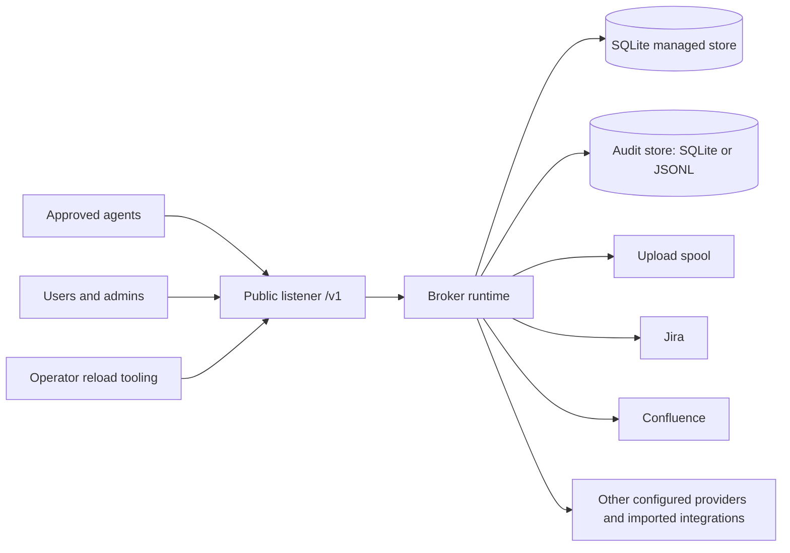

# Operator guide

Use this guide to install and operate a managed production deployment. Start with
[the production sample](../agent-access-broker.production.sample.toml), then follow
[installation](#installation-and-first-start), [start and validate](#start-and-validate),
and [administrator onboarding](administrator-guide.md). The baseline denies all
provider access until integrations and grants are configured.

For daily operation, use [health and readiness](#health-and-readiness),
[reloads](#config-reload-operations), [audit](#audit-operations), and
[common failures](#common-failures). Before changing releases, read
[upgrade and rollback](#upgrade-and-rollback) and
[backup and restore](#backup-and-restore).

The [configuration reference](configuration.md) defines exact fields and bounds;
[design](design.md) explains the request model. The
[administrator guide](administrator-guide.md) covers principals, roles, resources,
grants, delegation, and offboarding. The [end-user guide](end-user-guide.md) is
suitable to hand to users after onboarding.

## Operating model

The broker has two pieces of durable state:

| State | Location | Notes |
| --- | --- | --- |
| Managed store | `[managed_store].path` SQLite database | Principals, groups, rights, broker-token hashes, credential metadata, and encrypted credential material. |
| Audit store | `[audit].path`: a SQLite audit database (`type = "sqlite"`) or JSONL files (`type = "jsonl"`) | Invocation, management, and reload audit records, separate from the managed store. The SQLite backend also serves audit queries (portal Audit and Activity pages, `agent-access audit`, `/v1/audit/*`). |

The managed store keeps operational state until an operator or principal deletes
it. Expired, paused, or revoked broker tokens remain inspectable; revocation does
not delete their metadata. Deleting a principal removes its dependent records.
Audit retention applies only to the audit store: the SQLite backend deletes
records older than `audit.retention_days`, and the JSONL backend deletes rotated
files older than it.



## Installation and first start

Prepare a supported host with the release `agent-access-broker` and `agent-access`
executables, the matching portal assets, native certificate roots, and a service
supervisor. Keep the broker, CLI/MCP agent images, and portal from the same reviewed
source revision. The broker has no built-in inbound TLS listener; terminate HTTPS
at controlled ingress and restrict direct access to the loopback/backend port.

1. Provision a dedicated service account and broker-owned directories for managed
   state, audit, and upload spool. Use owner-only directory permissions (`0700`)
   and owner-only secret/database files (`0600`). Install code and portal assets
   separately, readable by the broker and writable only by deployment owners.
2. Copy the [production sample](../agent-access-broker.production.sample.toml) to
   `/etc/agent-access-broker/config.toml`. Set the stable node ID, public HTTPS
   browser origin, state paths, secret paths, and portal static directory. Set
   `network.trusted_proxies` to the exact ingress peer addresses; the sample uses
   `127.0.0.1/32`. Ingress must strip client-supplied `Forwarded` and
   `X-Forwarded-For`, then set the verified client address. Keep direct access to
   the backend restricted. Without proxy trust, clients share the ingress's
   authentication budgets and password-lockout source, and audit records its
   address. Address forwarding grants no principal or execution-context authority.
3. Generate four independent keys for credential encryption, token hashing,
   browser CSRF, and local-password pepper. The sample uses protected files under
   `/etc/agent-access-broker/secrets`. See [secret keys](#secret-keys). Supply any
   provider/OIDC/OAuth secrets through configured secret references as well.
4. For a new empty store only, set `managed_store.auto_migrate = true` and replace
   the initial-admin table with `mode = "create_if_empty"`, a principal ID, and a
   unique generated initial password. Replace the sample placeholder; configuration
   validation rejects it. Keep ingress restricted during bootstrap.
5. Run offline config validation as the intended service user, start one broker,
   and check readiness. Validation checks the config contract; it does not create
   databases, resolve every runtime dependency, test permissions/locks, or contact
   an upstream provider.
6. Complete the first password change in `/ui`, verify administrator access,
   then set `auto_migrate = false`. Disable initial-admin mode and remove both
   `principal_id` and `initial_password`; disabled mode rejects those fields.
   Validate and reload the steady-state config.
7. Configure provider integrations and onboard principals/resources/grants using
   the [administrator guide](administrator-guide.md). Verify a read with a bounded
   invocation token through the intended ingress before handing the service over.

A Rust release build does not include portal assets automatically. From source,
use the locked Rust build and explicit production provenance described below,
then build assets with `npm --prefix apps/portal ci` and
`npm --prefix apps/portal run build`. Install the complete `apps/portal/dist`
directory, including its hashed assets. `portal.static_dir` should contain only
public built assets; symlinks resolving outside its deployment root are not served.
Do not place secrets or private configuration in that directory.

### Service supervision example

Adapt this systemd unit to your installed paths and service account. Provision
its writable directories before enabling it. The example follows the production
sample's state root; if paths differ, update `ReadWritePaths` to cover each one.

```ini
[Unit]
Description=Agent Access Broker
After=network-online.target
Wants=network-online.target

[Service]
Type=simple
User=agent-access-broker
Group=agent-access-broker
UMask=0077
ExecStart=/opt/agent-access-broker/bin/agent-access-broker --config /etc/agent-access-broker/config.toml serve --listen 127.0.0.1:8787 --shutdown-timeout-ms 30000
ExecReload=/bin/kill -USR2 $MAINPID
Restart=on-failure
RestartSec=5s
TimeoutStopSec=70s
NoNewPrivileges=true
ProtectSystem=strict
ProtectHome=true
ReadWritePaths=/var/lib/agent-access-broker

[Install]
WantedBy=multi-user.target
```

`ExecReload` signals admission; it does not wait for or prove reload success.
Inspect the `config_reload_completed` event or authenticated config status afterward.
Point service health checks at the public listener, and collect JSON stderr in
the service journal. A repeated state-lock startup failure needs ownership repair,
not a restart loop. Other supervisors should preserve the same user, working
paths, secret availability, signal handling, and shutdown budget.

## Production checklist

Before starting a managed deployment:

- Set `deployment.environment = "production"`.
- Use `identity.mode = "required"`.
- Configure `network.trusted_proxies` for the exact ingress peers and verify that
  ingress replaces untrusted forwarded-address headers with verified client
  addresses. Check distinct client sources in audit and authentication limits.
  See [network configuration](configuration.md#network).
- For context-aware authorization, configure `[execution_context]` and named
  `[identity.trusted_callers.<id>]` entries for each attesting service. Protected
  headers always require that caller's credential on public and Git listeners.
  Asserted ingress replaces client context values; fixed callers omit the context
  header. Header-free direct clients use only the configured direct default.
- For trusted username MCP, configure distinct direct/relayed caller transports
  and a namespace, then explicitly bind names to managed humans. Protect the
  launcher-selected username as well as its secret. Direct callers need fixed
  context; the user header is rejected outside `/mcp` and `/mcp/{service}`.
  Verify both authorized and unknown-name cases and shared identity-access pause.
- Configure a `broker_tokens` identity source when users and agents will
  authenticate with managed broker tokens.
- Configure `[managed_store]` with an absolute SQLite path.
- Configure `[broker_tokens]` with a 32-byte base64url hash key secret.
- Configure `[credential_encryption]` with at least one 32-byte base64url
  encryption key whenever `[managed_store]` is configured. Managed identity
  inventory requires it even before users save upstream credentials.
- Enable `[management]` only when the managed administration API is intended to
  be reachable on the public listener.
- For first-use browser administration, configure
  `[management.initial_admin] mode = "create_if_empty"` with a unique generated
  password kept in private configuration, only for an empty managed store. The
  broker forces password reset on
  first login and will not mutate that admin after any principal exists. Use
  this mode only for controlled first deployment or local development; do not
  expose a fresh broker to an untrusted network before the initial password is
  reset.
- For browser login, configure `[browser_auth]` with `public_origin`,
  `csrf_key_ref`, `[browser_auth.local_password].pepper_ref`, and the same
  managed-store/broker-token foundation used by management APIs. Admin-set
  local passwords default to temporary and require a user password change before
  self-service credential/token management unless explicitly overridden.
- For Microsoft login, use one single-tenant Entra Web app, keep local-password
  login enabled, register the broker's exact callback URI, request Security
  Group Object IDs in ID tokens, and keep Microsoft Graph permissions absent.
  Store the Entra client secret and the broker's dedicated OIDC flow key in the
  configured secret manager.
- Local and Microsoft sign-in may coexist on one user. Enable or re-enable local
  sign-in explicitly with a fresh password and the separate-sign-in acknowledgment;
  reset works only on an active local method. A local password does not use
  Microsoft sign-in policies. Disabling the Microsoft directory account does not
  immediately disable the Broker principal or its existing sessions/tokens:
  Microsoft-derived group evidence expires at its configured TTL, while local
  groups, roles, and direct grants remain independent. Disable the Broker
  principal when immediate Broker access denial is required.
- Local sign-in enablement requires a successful audit preflight. If its extra
  completion audit fails after the password commits, the API still reports
  success and the portal reveals the temporary password. Investigate
  `management_committed_write_audit_append_failed` using its request IDs; do not
  repeat enrollment after a successful response.
- Keep at least one active managed principal with DB role `admin`. The store
  rejects disabling the last active admin, revoking its admin role, or disabling
  its local password; disabled users' token rows are retained but do not
  authenticate until the user is re-enabled.
- Create long-lived application identities as `service_account` principals in
  **Admin > Principals > Service accounts > Create service account** (or with `admin principals create
  <id> --kind service_account`). Administrators then assign groups, grants,
  credentials, and `agent_invoke` tokens through the same principal-management
  surfaces. Do not create a human password or Microsoft binding: the store
  rejects those operations and all management-token classes for service
  accounts.
- For the same-origin portal, configure `[portal]` with `mount_path = "/ui"`
  and an absolute `static_dir` containing the built `apps/portal` assets.
  From a repository checkout, build those assets with:

  ```bash
  npm --prefix apps/portal ci
  npm --prefix apps/portal run build
  ```

  The generated asset directory is `apps/portal/dist`; copy, sync, or point
  `[portal].static_dir` at that directory for the deployed broker. For local
  development or smoke evaluation, `scripts/start-admin-portal-fresh.sh` builds
  the portal and starts a disposable broker with portal config wired in.
  This launcher supports macOS and Linux and requires Python 3. Set
  `AAB_BROKER_BIN` to reuse a prebuilt broker or a custom Cargo target directory.
- Configure `[audit]` with `type = "sqlite"` to query audit records from the
  portal, CLI, and API, or `type = "jsonl"` when a log shipper consumes the
  files, and a `path` in a broker-owned directory.
- Set `deployment.node_id` explicitly wherever host names are not stable
  (containers) or not unique. It names the broker in every audit record and
  defaults to the host name; uniqueness across brokers is the operator's
  responsibility.
- Use dedicated broker-owned directories for the managed store, audit store, and
  upload spool. The broker creates new managed-store, audit, and spool paths with
  owner-only permissions on Unix (`0700` directories and `0600` files). Existing
  configured directories must already be broker-owned, owner-only, real
  directories; do not place managed-store, audit, or spool files directly in
  shared locations such as `/tmp`.
- Run one broker service instance for each managed-store/audit/spool state set.
  Multiple instances may run on the same host only when all three local state
  paths are disjoint.
- Before personal OAuth onboarding, enable the owner's self-service setting,
  configure a personal binding and assign a matching active `per_user` action
  grant directly or through a current group. See
  [personal OAuth setup](administrator-guide.md#enable-personal-oauth-connections).
- Keep `policy.default_decision = "deny"`.
- Configure `credentials.lookup.<service>` for Jira or Confluence whenever any
  lookup-backed grant for that service uses `credential_mode = "service"`.
  Per-user-only lookup-backed policy configurations use the caller's stored
  upstream credential for metadata lookup.
- Avoid anonymous identity in production unless this is an intentional and
  documented exception.

## Managed-store configuration

### Execution-context configuration

Configure a finite context registry and a conservative direct-client default.
The production sample uses exactly `default`; that value is a concrete context,
not a wildcard. Set the grant and resource contexts to the values intended for
each ingress path. Every new invocation token requires one or more effective
contexts; these caveats narrow access and do not authenticate the ingress.

For context-aware ingress, configure named [trusted callers](trusted-callers.md)
separately on public and Git paths. Asserted callers replace client context headers
with an approved value. Fixed callers omit the context header and receive their
configured context. Protected context/fingerprint headers always require the
caller credential. Header-free direct clients receive only `default_context`;
omitting it makes governed direct traffic fail with `execution_context_required`.
An asserted caller never inherits the direct default.

Before removing a context, repair active grants that reference it and review
existing token caveats. Active references block reload; tokens bound only to
retired contexts become stale. Stored token caveats cannot be amended. When
environment containment is required, revoke tokens that omit
`allowedExecutionContexts` and issue context-bound replacements. Validate
representative allowed/denied discovery, invocation, MCP,
Git, and audit behavior for every ingress path. See [resources](resources.md) for
resource/group exclusions and live context semantics.

## Secret keys

The broker token hash key and credential encryption keys are different secrets.
Generate them independently and store them in your platform secret manager.

For a new deployment using the production sample's file references, provision
`/etc/agent-access-broker/secrets` with owner-only permissions and broker-readable
ownership, then generate each key independently as the service user or assign the
new files to that user afterward. Run this only when initializing
new secret files; overwriting existing keys can invalidate tokens or destroy
access to stored credentials/passwords.

```bash
umask 077
for broker_key_name in credential-k1 token-hash-key browser-csrf-key password-pepper; do
  openssl rand -base64 32 | tr '+/' '-_' | tr -d '=' \
    > "/etc/agent-access-broker/secrets/$broker_key_name"
done
```

Each value must decode to exactly 32 bytes using unpadded base64url. Do not reuse
the broker token hash key as a credential encryption key, CSRF key, or local
password pepper.

The Microsoft client secret is an opaque nonempty string, not a generated
32-byte broker key. Put the secret **value** issued by Entra in the referenced
environment variable or file. Secret-ref values are trimmed when loaded. The
OIDC flow key, by contrast, must be an independent unpadded base64url value that
decodes to exactly 32 random bytes. Generate it independently with the same base64url recipe.

When rotating credential encryption keys:

1. Add the new key to `[[credential_encryption.keys]]`.
2. Set `[credential_encryption].active_key` to the new key id.
3. Reload or restart the broker.
4. Run `agent-access admin credentials rewrap --from-key <old-id> --to-key <new-id>`
   for each retained old key. Inspect the result and current used-key inventory.
5. Keep old keys configured until all credential material has been rewrapped and
   verified.

This operation also rewraps identity inventory, OAuth state, and private resource
attributes. Disabled Teams destinations still retain encrypted URLs and require
their keys for readiness and reveal. Rewrap preserves destination versions and
does not change the upstream Workflow URL. Replacing an actual URL is a separate
admin resource edit.

Broker token hash-key rotation is different: stored broker-token hashes depend
on that key. Rotating it invalidates lookup for existing token records. Plan replacement
token issuance as part of that change; credential rewrap does not convert hashes.

## Start and validate

Validate configs before shipping them:

```bash
agent-access-broker --config /etc/agent-access-broker/config.toml config validate
agent-access --config /etc/agent-access/config.toml config validate
```

Start the broker:

```bash
agent-access-broker --config /etc/agent-access-broker/config.toml serve \
  --listen 127.0.0.1:8787
```

Without `--config`, broker commands read the file named by
`AGENT_ACCESS_BROKER_CONFIG`, or else `/etc/agent-access/broker.toml`. Commands,
including `serve` and the default command, exit:

- `0` on success;
- `3` when the configuration cannot be read, parsed, or validated, or the
  compiled module composition is invalid;
- `2` for command-line syntax errors, or for `audit verify` without a SQLite
  audit store;
- `1` for any other failure, such as a held state lock, a listener that cannot
  bind, an out-of-range timeout or body-cap option, or a runtime error.

`serve` reports its failure on stderr as an `Error: …` line after the JSON
startup events.

The public listener exposes health, discovery, authenticated runtime specs,
invoke, self-service management, browser auth, and admin management routes under
`/v1`; when `[portal]` is enabled it also serves the same-origin portal under
`/ui`. Put TLS, external authentication, and network exposure policy at the
deployment boundary around this listener.

### Build provenance and deployed status

Production builds should inject immutable source provenance at compile time:

```text
AGENT_ACCESS_BUILD_COMMIT=<full lowercase 40- or 64-hex object ID>
AGENT_ACCESS_BUILD_PROVENANCE=release
AGENT_ACCESS_REQUIRE_BUILD_PROVENANCE=1
```

The build fails when release provenance is missing or inconsistent. Set
`AGENT_ACCESS_BUILD_PROVENANCE=release` only for a build from a clean checkout of
that exact commit, as the verifier below does: the `agent-access-broker`
executable then reports the commit as `evidence`-backed for itself, the host,
the SDK and every module it registers, which all come from this repository.
Without injected provenance, development builds are valid but report every
source revision as `unavailable` (`revision: null`).

An authenticated caller can verify the running binary with `agent-access broker
status` or `GET /v1/broker/status`. It requires a normal identity and request ID
but no admin right, provider grant, or execution context. The response names
the assembly (name, version, qualification label and source revision), the
linked host and SDK packages, and every compiled module package with its roles,
each with a source revision and its provenance, plus an inventory fingerprint
and the contract versions; see [the HTTP API](http-api.md) for the exact shape.
The module list is the compiled inventory, not the enabled configuration. The
upstream executable declares no qualification label, so it reports
`unqualified`; qualification evidence is the separate qualification receipt.

The `broker_starting` JSON event identifies the same executable with
`assemblyName`, `assemblyVersion`, `assemblyProvenance` (`evidence`,
`declared` or `unavailable`), `qualification`, and `inventoryFingerprint`, and
includes `assemblyRevision` only when a revision was supplied. The fingerprint
is the status's `inventoryFingerprint`: it covers the host, SDK and module
inventory with their revisions and provenance, and it does not change on reload.
The event also reports `configPath`, `publicListen`, `gatewayListen`,
`reloadTimeoutMs`, `shutdownTimeoutMs`, and `bodyHardCapBytes` when that cap is
set.

A distribution that assembles its own executable from the Broker host supplies
its own identity: its executable name and version, its qualification label,
its source revision and the revisions of the host and SDK it links, and a
provenance map keyed by the crate name and version of each registered module
package, each marked as declared or backed by its build evidence. The executable
exits `3` at startup, like an invalid composition, when that identity is
malformed or its map names an unregistered package, lists a package twice or
gives one conflicting revisions. Renaming the executable never changes where
the configuration, state, keys or locks are found, and its state locks still
exclude a differently named executable on the same state.

A source release follows the separate [prepare, qualify, and publish
workflow](release-readiness.md). Full qualification runs the native provenance
check below along with the other required gates. To verify a production binary
independently, use a clean checkout at a full commit or exact tag. As with the
other release entrypoints, inherited Git location/configuration overrides are
rejected and the actual repository root must match the verifier's source checkout:

```bash
node scripts/verify-release-provenance.mjs "<full-commit-or-exact-tag>"
```

The local verifier resolves the immutable commit and package version, then
checks `rustc -vV` and `cargo -V` against the exact `rust-toolchain.toml` pin.
It resolves the physical compiler and Cargo binaries from the reported sysroot,
rechecks their versions, and uses those absolute paths with Rust compiler
wrappers and extra Rust flags disabled. Nonempty ambient Rust/compiler/flag/
profile overrides are rejected, including common `CC`, `CXX`, `AR`, `CFLAGS`,
`CXXFLAGS`, `CPPFLAGS`, and `LDFLAGS` overrides and their host/target variants.
Unset rejected overrides before running this production check.

The build uses locked dependencies, the three provenance variables above, and
an explicit native host target under `target/<host-triple>/release`. The verifier
prints compiler/Cargo versions and paths plus paths and SHA-256 digests of
discovered Cargo configuration files. Before building, it runs
`cargo tree --locked --target <host-triple> -p agent-access-broker -p agent-access
-e normal,build --format '{p}\t{f}'` with the validated Cargo. Without dev edges
Cargo resolves no dev units, and `{f}` lists each package's resolved features,
including those a release package's default features enable. The check fails
when any package has the `test-support` feature or the graph links a workspace
crate whose `[package.metadata.agent-access] role` is `reference`. The verifier
also keeps each selected package's identity from that output, including its
source origin, so an optional dependency that only development features
activate is never counted. After
the build it rechecks the clean, unchanged `HEAD`, checks CLI startup with
`--help`, and starts the Broker on loopback with a temporary static identity.
Authenticated status must name the `agent-access-broker` assembly at the expected
version and report the expected commit as `evidence` for the assembly, host, SDK
and every module. Each stamped host, SDK and module package must resolve to
exactly one origin, a path package whose manifest Git tracks in the qualified
checkout; a same-version package from another source, or two origins sharing a
crate name and version, fails the check. Temporary processes and files are
cleaned up.

These checks do not establish a hermetic build. Cargo configuration includes,
profile/linker settings, native tools, build scripts, and system libraries are
not fully attested and can affect the output. Preserve the reported toolchain
and configuration inventory alongside qualification evidence and package metadata.

A configured remote build service is optional and selected explicitly:

```bash
BUILD_SERVICE_ENDPOINT="${BUILD_SERVICE_ENDPOINT:?Set BUILD_SERVICE_ENDPOINT}" \
node scripts/verify-release-provenance.mjs "<full-commit-or-exact-tag>" --build-service
```

The remote service must allowlist all three provenance variables for explicit
`build-cli --env` forwarding. This mode verifies copied-back executable startup
and Broker status, but the remote compiler, Cargo, and service configuration are
unverified. The checked local toolchain supplies metadata and the native target
only. An inherited `BUILD_SERVICE_ENABLED` alone does not select remote builds.
This separate remote check cannot substitute for native local release
qualification. Neither provenance mode creates archives, commits, tags, GitHub
releases, or uploads.

Runtime specs under `/v1/spec/*` require normal broker authentication, are
caller-filtered by token class, policy, service/action caveats, and management
rights, and return `Cache-Control: no-store`. Finite token resource values
remain request-time checks. Admin-only `visibility=all`
requests are intended for operator tooling and emit a structured security log
entry; monitor those events the same way you monitor other management surface
inspection.

If `[gateways]` are configured, bind protocol traffic on a separate listener:

```bash
agent-access-broker --config /etc/agent-access-broker/config.toml serve \
  --listen 127.0.0.1:8787 \
  --gateway-listen 127.0.0.1:8788
```

The gateway listener matches only configured gateway `broker_hosts`; it does
not serve public `/v1`, `/ui`, browser auth, self-service, or admin routes. Git
HTTP fetch and push forwarding are available for configured `repo.fetch` and
`repo.push` grants. Push receive-pack command prefixes are parsed before
upstream credential use so unsafe refs and capabilities are denied before
forwarding.

The gateway listener does not mount health or readiness endpoints. Use the
public listener's `/v1/healthz` and `/v1/readyz` routes for process/runtime
state, and use TCP or edge-proxy checks for gateway-port reachability.

Optional `serve` flags tune request, reload, and shutdown behavior:

| Flag | Default | Notes |
| --- | --- | --- |
| `--gateway-listen` | unset | Optional dedicated listener for host-matched gateway traffic. When unset, gateway config can validate but no gateway traffic listener is bound. |
| `--max-http-body-hard-cap-bytes` | `limits.max_http_body_bytes` | Transfer byte ceiling applied to public invoke and gateway readers, alongside smaller control-plane caps. Must be at least `limits.max_http_body_bytes` or the broker refuses to start. Surfaces as `bodyHardCapBytes` in the admin status response. |
| `--reload-timeout-ms` | `30000` | Bounds reload admission. Must be non-zero and no greater than `300000`. Surfaces as `reloadTimeoutMs` in the admin status response. |
| `--shutdown-timeout-ms` | `30000` | Bounds graceful process shutdown after `SIGTERM` or `SIGINT`. Must be non-zero and no greater than `300000`. Surfaces as `shutdownTimeoutMs` in the admin status response. |

The startup body hard cap defaults to the configured body limit. Set an explicit
larger `--max-http-body-hard-cap-bytes` only when a future reload needs a larger
transfer limit. Authentication bodies have a separate 16 KiB ceiling and
five-second receive maximum; control-plane JSON and management bodies use 1 MiB
and fifteen seconds. A smaller `limits.request_body_timeout_ms` applies too.
Invocation JSON, multipart files and Git uploads retain the configured transfer
cap and total receive deadline (five minutes by default). Public idle timing uses
`limits.streaming_idle_timeout_ms`; Git uses its matched gateway idle setting.
Health/readiness probes remain available when global concurrency is saturated.
Anonymous control-plane body reads can occupy at most a quarter of global slots
(minimum one), leaving capacity for authenticated traffic when the global limit
exceeds one.

Revocation, account disablement, and policy or ordinary credential changes apply
to newly admitted work. Already prepared requests retain their captured authority
and may complete after the change; several requests may already be prepared, up
to the concurrency limits. Upload deadlines bound caller-controlled delay but do
not cancel work already dispatched. If incident response requires stopping all
prepared work, stop ingress and terminate the Broker process before resuming with
the changed state; graceful draining permits admitted work to finish. Inspect
audit and upstream state for operations whose completion is uncertain. Delegated
OAuth and private-resource dispatch checks remain independently enforced.

On `SIGTERM` or `SIGINT`, the broker stops accepting new public and gateway connections, lets in-flight work drain within `--shutdown-timeout-ms`,
then forces any remaining listener tasks closed. If the timeout is reached while
streaming downloads are still open, those streams are canceled and their
terminal audit records are queued through the audit writer before final writer
drain. Unix `SIGUSR2` reloads continue to work before shutdown starts; once
shutdown has started, reload signal handling exits and no new reload is
admitted. The broker also gives Tokio blocking tasks up to another
`--shutdown-timeout-ms` after the in-runtime drain completes. For systemd, set
`TimeoutStopSec` to at least `2 * --shutdown-timeout-ms` plus a small scheduler
and process-exit margin so the broker can finish both bounded phases.

## Outbound certificate trust

The Broker defaults to the native CA store visible to its service process.
For an internal service such as CloudBees, install the issuing CA in that store
and reload the Broker. If managing a separate bundle is preferable, configure
`network.outbound_tls.trust = "system_plus_custom"` with an absolute
`ca_certificate` path. Use `custom` only when the bundle contains all roots
needed by every outbound service, including Microsoft sign-in if enabled.
See [outbound TLS configuration](configuration.md#networkoutbound_tls).

Run `agent-access-broker --config /path/to/broker.toml config validate` as the
service account with its certificate environment before reloading. Check
`SSL_CERT_FILE` and `SSL_CERT_DIR` if host `curl` works but Broker TLS fails.
They can change which roots the native loader sees. A changed bundle at the
same path is picked up by reload; a missing or malformed bundle rejects the
candidate and preserves the active trust snapshot.
Native-store read errors reject admission and identify the underlying error.
Unusable individual native certificates are skipped; startup and reload log a
warning with their count. `config validate` does not print this warning, but
rejects an empty usable native store. Custom bundles reject any invalid
certificate.

## Health and readiness

Use liveness for process supervision:

```bash
curl -fsS http://127.0.0.1:8787/v1/healthz
```

`GET /v1/healthz` always returns HTTP 200 with `{"status":"ok"}` when the
process can answer the route.

Use readiness before routing invoke traffic:

```bash
curl -fsS http://127.0.0.1:8787/v1/readyz
```

`GET /v1/readyz` returns HTTP 200 when runtime dependencies are ready and HTTP
503 when they are not. Readiness checks include the audit writer, upload spool,
managed store, encryption keys, identity source readiness, and configured
credentials. The audit writer is not ready while any recorded failure is
unrecovered (see [Writer health and recovery](#writer-health-and-recovery)).

The optional gateway listener has no `/gateway-healthz` or `/gateway-readyz`
routes today. Do not point health probes at the gateway listener; use TCP or
edge reachability there and the public `/v1/readyz` route for broker readiness.

## Single-node ownership locks

`serve` fails closed before binding listeners unless it owns exclusive advisory
state locks for:

- `[managed_store].path`, when `[managed_store]` is configured;
- `[audit].path`, when `[audit]` is configured;
- `[limits].upload_spool_dir`, always.

The broker uses small sibling lock files for managed-store and audit files
(`<file>.agent-access.lock`) and `.agent-access-broker.spool.lock` inside the
upload spool directory. Lock files are owner-only regular files and contain
non-secret diagnostic metadata such as the holding executable's assembly name
and version (`program`, `programVersion`), PID, hostname, node ID, config path,
target paths, and lock file path. Lock file names do not depend on the
executable, so differently named broker executables cannot own the same state
at once. The offline
`agent-access-broker audit verify` command takes the audit lock too, so it
fails while a broker owns the audit database.

Lock-file existence alone is not a failure. If a broker exits or the host is
restored from backup, stale unlocked lock files can remain and the next broker
that acquires the advisory lock overwrites their metadata. When startup or
reload reports that a state lock is held, first find and stop the other live
broker process or correct the config so the two processes use disjoint state
sets. Deleting a lock file is not the normal recovery action and does not
release a lock held by a live process.

For systemd, configure one service unit per state set. Avoid restart loops that
hide a persistent lock conflict; a repeated state-lock startup failure usually
means another broker instance already owns the configured local state.

## Config reload operations

Config reload and status are admin-management routes on the public listener:

| Method | Path |
| --- | --- |
| `POST` | `/v1/admin/config/reload` |
| `GET` | `/v1/admin/config/status` |

Use the CLI with an admin-capable identity:

```bash
agent-access admin config status
agent-access admin config reload
```

Browser admins can also use the portal's **System** page (the gear in the Admin
top bar), which shows the runtime and the last reload attempt. The reload action
is state-changing, so browser requests require the CSRF token issued with the
session.

For headless service-manager reloads on Unix, send `SIGUSR2` to the broker
process. This is the preferred hook for `systemd` `ExecReload` because it does
not require an HTTP client.

Reload is atomic for new requests: a successful reload swaps in a new snapshot,
and a failed reload leaves the active snapshot unchanged. Concurrent reload
attempts return `reload_in_progress`.

Reload cannot change the audit backend or the node ID. Changing `audit.type`
(including adding or removing `[audit]`) or the effective
`deployment.node_id` fails with `config_admission_failed`; restart the broker
instead. A new `audit.path` with the same type is opened and validated before
activation, and the reload record goes to the new store (required) and the old
one (best effort). Reload never creates or migrates a SQLite audit database, so
point a SQLite `path` change only at a database a broker startup already
created and migrated. Other `[audit]` settings apply to the new generation.
Audit query cursors stay valid across a reload unless `audit.path` now names a
different database.

A reload that removes a context referenced by an active TOML or managed grant
fails admission and leaves the active snapshot unchanged. Disabled or deleted
managed grants do not block removal, but remain visibly stale and cannot be
enabled until repaired. Stored token caveats do not block reload; tokens bound
only to retired values become stale and unusable.

## Service logs and correlation

`agent-access-broker serve` writes structured JSON tracing events to stderr.
`agent-access-broker config validate` keeps its human stdout/stderr behavior and
does not install the service subscriber.

The default service filter is:

```text
agent_access_broker=info,agent_access_broker_host=info,agent_access_core=info,agent_access_provider=info,axum=warn,tower=warn
```

Override it with `RUST_LOG` using standard `tracing_subscriber::EnvFilter`
syntax. An invalid `RUST_LOG` does not prevent startup; the broker falls back to
the default and emits one `logging_filter_invalid` warning event. Process
lifecycle (`agent_access_broker_host::lifecycle`), HTTP, MCP, management,
gateway, and reload events use `agent_access_broker_host::…` targets. Target
directives match by prefix, so an `agent_access_broker` directive also covers
them; use the full module path to select one host module.

Microsoft OIDC exposes a permanent, opt-in identity diagnostic at the narrow
`agent_access_broker::handlers::oidc=debug` target. Enable it without enabling
debug output from dependencies or the rest of the broker:

```text
RUST_LOG=agent_access_broker=info,agent_access_broker_host=info,agent_access_core=info,agent_access_provider=info,agent_access_broker::handlers::oidc=debug,axum=warn,tower=warn
```

For systemd, set that value in an `Environment="RUST_LOG=..."` service drop-in,
then run `systemctl daemon-reload` and restart the broker. Follow and filter the
JSON events with, for example:

```bash
sudo journalctl -u agent-access-broker -f -o cat \
  | jq 'select(.event == "oidc_claims_observed")'
```

The `oidc_claims_observed` event is emitted only after the ID token and stable
Microsoft identity have been cryptographically validated. It covers successful
callbacks, JIT admission denials, incomplete group claims, and store/conflict
outcomes. Fields include the request IDs, canonical tenant and user Object IDs,
sanitized `name`, `preferredUsername`, and `email`, group-claim status, the
deduplicated claimed group Object IDs, admission outcome, and—on success—the
matched external groups and resulting broker/policy groups. These fields are
directory metadata and PII; apply appropriate journal access and retention.
The event never contains an ID/access token, authorization code, client secret,
flow key, state, nonce, PKCE value, cookie, session token, or raw JWT payload.
Durable audit records are unchanged.

Example event:

```json
{"level":"INFO","target":"agent_access_broker_host::lifecycle","event":"broker_listening","nodeId":"broker-prod-1","listener":"public","address":"127.0.0.1:8787"}
```

The `http.request` span, the `broker_listening` and `config_reload_completed`
events, and audit writer, maintenance, and query failure events carry the broker's
`nodeId`, so logs from several brokers can be told apart.

Request spans and invoke/reload/audit/upstream events include
`agentRequestId`, `brokerRequestId`, `listener`, `service`, `action`,
`operation`, `principal`, `decision`, `reasonCode`, `http.statusCode`, and
`durationMs` when those values are known. Paths are logged as route templates
where possible; query strings, credentials, tokens, cookies, request/response
bodies, resource-scope values, and sensitive path values are not logged.

A failed provider parser or protocol stage may add the optional closed
`diagnosticCode` field to the terminal `invoke_completed` event. For example,
`draft_position_shape_invalid` identifies a malformed GitLab draft-position
readback without logging the position or draft body. If the mandatory durable
audit append fails, the code instead appears on `audit_append_failed`, because
no `invoke_completed` event is emitted for that request. Correlate either event
with the response using its `agentRequestId` and `brokerRequestId`.

`diagnosticCode` is strictly an operator-log field. It is never returned in a
response envelope or result, set in an HTTP header or request span, or written
to durable audit records. Keep using the public `reasonCode` and safe result for
caller behavior; the internal code must not be copied into caller-visible or
audit records.

A provider outcome its contract does not allow logs a `provider_contract_failed`
warning with `service`, `action`, `phase` (`scope_resolution`,
`body_admission`, `invocation`, or `credential_verification`), `emission`
(`hook_failure`, `late_stream`, or `upstream_trace`) and a `diagnosticCode`
such as `provider_reason_host_only` or `provider_domain_reason_unregistered`.
The caller, stream audit record, or trace sees `broker_provider_contract_failed`
instead of the provider's reason, and the operation's `invoke_completed` event
carries the same `diagnosticCode` when an invocation hook was rejected. A trace classified
outside any provider hook logs `provider_hook_context_missing`.

For Jira search result denials, `jira_search_issue_key_invalid`,
`jira_search_issue_project_mismatch`, and `jira_search_project_unauthorized`
distinguish metadata validation from project containment. The raw audit's
`providerAudit.searchResultValidation` supplies bounded masked identifier shapes,
fingerprints, and independent check results. See
[Jira search diagnostics](providers-jira.md#diagnosing-rejected-search-results)
for the fields and reproduction collection steps; debug logging is unnecessary.

For correlation troubleshooting, start with the `agentRequestId` and
`brokerRequestId` in the CLI or HTTP response envelope, then search broker JSON
logs for either ID. Broker-owned upstream Jira, Confluence, GitLab REST, and
Provider requests also carry those IDs in `X-Agent-Access-Request-Id` and
`X-Agent-Access-Broker-Request-Id`, so upstream service logs can be joined to
broker events without forwarding authorization, identity-token, cookie, or
credential material. This release does not expose `/metrics` or a metrics
exporter; use JSON tracing plus the audit store until a dedicated metrics
surface is added.

## Audit operations

Agent-token issuance audit includes the authenticated actor, target owner,
token ID/class/name/expiry, allowed services and contexts, and
canonical per-service action/resource restrictions. It never includes the raw
token secret. Runtime denial continues to use existing reason codes:
`service_action_denied` for service/action/resource caveat rejection,
`scope_unresolved` when a restricted canonical scope cannot be resolved, and
`execution_context_denied` for context caveat rejection.

Configure the audit store explicitly. The SQLite backend is a standalone
database that the portal, CLI, and API can query:

```toml
[deployment]
node_id = "broker-prod-1" # recommended; defaults to the host name

[audit]
type = "sqlite"
path = "/var/lib/agent-access-broker/audit/audit.sqlite"
retention_days = 30
queue_capacity = 1024
# terminal_queue_capacity defaults to limits.max_concurrent_requests.
enqueue_timeout_ms = 1000
durability = "write" # write | sync_data | sync_all
```

Use the JSONL backend instead when a log shipper consumes the files. JSONL
records cannot be queried through the broker:

```toml
[audit]
type = "jsonl"
path = "/var/log/agent-access/audit.jsonl"
rotate_bytes = 104857600 # JSONL only; 100 MiB default
retention_days = 30
durability = "write"
```

The backends are alternatives, not a pipeline: records go to exactly one, the
broker does not import JSONL history into SQLite, and changing `type` requires
a restart. Both write the same record JSON, and every record carries `auditId`
(unique per record) and `nodeId`, so records from several brokers can later be
merged without collisions.

Required audit append is fail-closed for invocations and management writes. If
the broker cannot append required evidence, the request fails with
`audit_unavailable`.
Password changes and authenticated logout first require a durable audit preflight.
If it fails, the broker denies the operation without changing the password/session
or removing the cookie. After a successful state change, failure to append the
completion record preserves the committed success and logs
`auth_committed_write_audit_append_failed` with request IDs; readiness reports the
writer failure. Investigate the audit store and correlate the preflight and service
log before taking further action. Do not repeat a confirmed password change or
logout merely because completion audit failed. A failed persisted session
revocation returns a sanitized error and retains the cookie/session for retry.

Resource and resource-group create, edit, and delete similarly require a
preflight before changing the managed store and append a supplemental success
record after commit and policy publication. The success record contains safe
event-time names and changes, searchable with SQLite audit. See the
[change-record contract](http-api.md#resource-and-resource-group-change-records)
and [portal walkthrough](portal-guide/auditor.md#follow-resource-and-resource-group-changes).

For these resource mutations, a failed completion append preserves HTTP success
and logs `management_committed_write_audit_append_failed`. Investigate the
writer fault, correlate both request IDs, and inspect current state before
retrying a mutation. Client disconnects do not cancel completion emission,
but the separate managed and audit stores cannot commit atomically: a broker
crash after the state change can leave only the preflight. **Allowed** on that
preflight confirms an admitted attempt, not its final outcome.

Audit storage operations run on a dedicated writer thread so request polling,
stream polling, and stream drop paths do not perform blocking filesystem work.
Normal audit records wait for writer acknowledgement before a request is allowed
to succeed; the SQLite writer commits queued records in batches of up to 256
records and 16 MiB and acknowledges each record after its batch commits.
Streamed downloads reserve terminal-audit capacity before the
started record is accepted; completion, error, shutdown cancellation, or client
drop then queues one terminal audit record through that reserved capacity.
`queue_capacity` bounds ordinary writer work, `terminal_queue_capacity` bounds
reserved terminal records, and `enqueue_timeout_ms` bounds the fail-closed wait
for capacity. When `terminal_queue_capacity` is omitted, it derives from
`limits.max_concurrent_requests`; when set explicitly, it must be at least
`limits.max_concurrent_requests`, and operators must raise it when raising
global request concurrency above the configured terminal queue value.

Choose `sync_data` or `sync_all` when the audit log must be durable across host
crashes. The default `write` durability is page-cache-only and is not
crash-durable across an OS or host failure. For JSONL the sync modes cost one
sync per record. For SQLite, `write` uses `synchronous = NORMAL` (it survives a
broker crash, but the latest commits may be lost on power loss), and both sync
modes use `synchronous = FULL`, which syncs every batch commit; `sync_all` also
syncs the parent directory after creating the database.

Use a dedicated parent directory for the audit store. On Unix, the broker
creates the parent directory owner-only and creates the JSONL file or SQLite
database with owner read/write permissions; it never follows a symlinked audit
path. Existing parent directories must already be broker-owned and owner-only,
and a SQLite database and its `-wal`/`-shm` sidecars must stay `0600` and owned
by the broker user. Permission or ownership drift while the broker is running
causes later JSONL appends, or the SQLite writer's health probe that runs before
supervised invocations and on readiness, to fail closed with
`audit_unavailable`.

### Retention and maintenance

Both backends run retention at most once an hour on the writer thread.

- **JSONL** deletes rotated files (`<path>.<UTC timestamp>Z.<uuid>`) whose
  modification time is older than `retention_days`. Retention counts from a
  file's last write, so records stay until their file has rotated and then aged
  past `retention_days`. Only names that rotation produces are deleted, never
  the `.agent-access.lock` file or other files sharing the prefix. A failed
  prune fails readiness until a later prune or probe succeeds.
- **SQLite** deletes rows older than `retention_days` in transactions of at most
  2,000 rows, then runs optional compaction: full-text index merges, incremental
  vacuum when more than 25% of pages are free, `PRAGMA optimize`, and a passive
  WAL checkpoint. Every step is a bounded slice that runs only when no audit
  work is queued, so maintenance does not delay acknowledgements. A failed
  delete fails readiness until the same delete succeeds on retry. A failed
  optional step never affects readiness or appends: the writer logs
  `audit_maintenance_failed` with the `slice` and `sqliteErrorCode`, skips the
  rest of that cycle's optional work, and retries next cycle, and admin
  `config.status` reports it as `audit.maintenanceFailure` (`slice`,
  `errorCode`, `at`) until that slice next succeeds. When readers hold older
  snapshots, or the WAL stays above 256 MiB after the checkpoint, the writer
  logs `audit_wal_checkpoint_deferred` with `walBytes` and retries next cycle;
  long audit queries or an online backup cause this, and it needs attention
  only if it persists. The database file does not shrink below its high-water
  mark except through incremental vacuum.

### Writer health and recovery

The writer tracks each failure class separately (append, terminal write, JSONL
rotation, prune, probe, and writer exit), and `/v1/readyz` fails while any is
recorded. A request whose required record could not be written logs
`audit_append_failed` with its request IDs and `nodeId`; failed terminal appends and
retention prunes log `audit_writer_failed` with the `operation`, `auditPath`,
and `nodeId`.

For SQLite, a full disk or I/O error fails the whole batch, and a permission or
ownership problem fails the health probe. Either way the affected requests fail
with `audit_unavailable`, readiness fails, and supervised invocations are not
dispatched. No restart is needed after fixing the cause.
The next readiness probe, supervised invocation, or successful commit makes a
recovery attempt (at most one per second) that repeats the failed storage work
without keeping it, restores owner-only file modes, and clears the failure only
when that work now succeeds. The failed records are not written later, because
their requests already failed. A writer that exited stays failed until restart.

A single record whose JSON plus search text exceeds 16 MiB is rejected by the
SQLite writer: only its own request fails, the writer logs
`audit_record_too_large` (with `auditId`, `brokerRequestId`, `preparedBytes`,
and `nodeId`), and health is unaffected. Records are normally far smaller, so
investigate the request that produced it.

### Verify a SQLite audit database

Startup checks only the audit database's catalog. To check the whole file,
stop the broker and run:

```bash
agent-access-broker --config /etc/agent-access-broker/config.toml audit verify
```

The command takes the audit state lock, so it fails while a broker owns the
database. It checks the catalog as startup does (without migrating), runs
`PRAGMA integrity_check` and the full-text index integrity check, prints each
result, and exits `0` when all pass, `1` when a check finds a problem, `2` when
audit is disabled or `type = "jsonl"`, and `3` for an invalid config. Startup
rejects a database with unknown or mismatched migrations; the broker never
resets or deletes audit data, so restore a good copy or point `audit.path` at a
new file.

### Query audit records

Audit queries need `audit.type = "sqlite"` and `[management]` enabled.
`agent-access admin config status` reports `nodeId` and `audit.type`; browser
sessions report `auditQueryable`. With JSONL or audit disabled, the query
routes are absent from the runtime catalog and return 404
`audit_query_unavailable`.

Admins and auditors see every record, service policy managers see records for the services
they currently manage (including admin actions on those services, such as
manager assignments and credential changes), and every managed user with self-service enabled sees
records whose principal is their own. Admins use the portal's Admin > Audit page (service policy managers
see Audit beside Policies) or the admin CLI. Each command prints one page;
pass the previous page's `result.nextCursor` to continue with the same filters
and time window:

```bash
agent-access admin audit events list --since 24h --decision deny --service jira
agent-access admin audit events list --cursor "<result.nextCursor>"
agent-access admin audit requests inspect "<broker-request-id>"
```

The portal's **Service** filter matches the recorded service. **Broker** is
available in every visibility tier for internal activity; related-service tags
identify service-specific administration. CLI/API callers can additionally use
`--scope-service`/`scopeService` to combine calls and administration concerning
one service. Management admission rejections use `broker` in audit, HTTP rejection
envelopes, and the `request_limited` log field, without changing limiter keys or
visibility. Canonical broker action suggestions come from `/v1/audit/options`
or `/v1/admin/audit/options`, trimmed to the visibility tier. These reads do not
scan audit history, occupy audit reader connections, or write audit records.
The portal also offers configured provider actions; manual filters remain
usable for other values or when suggestions are unavailable.

Filters include time range, principal, service, action (exact or `prefix.*`),
decision, reason code, phase, token, grant, node, request ID, and full-text
`--query`. See [cli.md](cli.md) and [http-api.md](http-api.md#audit-queries)
for every option. Each runtime generation runs at most 4 queries at once with
16 waiting (more return 429 `concurrency_limited`), and a query that exceeds its
5-second budget returns 503 `audit_query_timeout`; narrow the filters.

Successful read-only management operations, audit queries included, are not
written to the audit store and emit no log event, so portal page loads do not
fill the store and the viewer and other reads keep working while audit writes
fail. Denied and failed reads are audited as other management errors are, and
mutations, logins, reloads, and invocations are audited as before. Ordinary logged-out
session probes with no session cookie also write no audit record; invalid or
expired presented cookies and admission rejections remain audited. Secret
reveals, the policy export (`admin.policy.grants.export`), credential
verification, and OAuth callbacks stay audited when they succeed. See
[http-api.md](http-api.md#management-audit) for the operations that are not
audited. Where per-read access records are required, keep access logs at the
fronting proxy.

Audit records intentionally omit upstream secret material, request bodies that
may contain secrets, and raw broker-token values. They do include principal,
groups, source, service, action, decision, reason code, matched policy grant,
resource scopes, credential mode, and provider-specific sanitized metadata.
Git gateway header denials can appear in two shapes. Pre-authentication
classifier denials, such as malformed `Git-Protocol` or POST `Content-Type`,
use anonymous principal context and synthetic `action = "gateway.classify"`.
Representation-header denials after the Git action is known, such as
unsupported `Content-Encoding` or `Trailer`, are authenticated and action-scoped
to `repo.fetch` or `repo.push` with `reasonCode = gateway_header_denied`.

## Backup and restore

Back up these items together:

- A consistent managed-store SQLite backup. Use SQLite online backup while
  running, or stop the broker before copying the database and any WAL/SHM files.
  Copying the database file alone during writes is not a consistent backup.
- The broker token hash key secret.
- Every credential encryption key still used by stored credentials, identity
  inventory, delegated connections, imported secret slots, or private resources,
  including disabled records. Also preserve the browser CSRF key and local-password
  pepper; losing the pepper prevents verification of existing local passwords.
- When Microsoft OIDC is enabled, the current client secret and dedicated flow
  key. Preserve the exact prior values only if still-live pending login flows
  must survive restoration.
- The broker config and CLI config used for the deployment, plus all referenced
  provider, OAuth client, and trusted-caller secrets needed to restore service.
- The audit store, if audit history must survive loss of the host. The managed
  store backup does not contain it.

Losing the credential encryption keys makes managed credential material
undecryptable. Losing the broker token hash key prevents stored broker tokens
from resolving. Losing only the SQLite file removes principals, rights, token
records, credential metadata, encrypted credential material, Microsoft login
links, external-group mappings, membership evidence, and pending OIDC flows.

Back up a SQLite audit database with SQLite's online backup while the broker
runs, for example as the broker user, after provisioning the owner-only backup directory:

```bash
umask 077
sqlite3 /var/lib/agent-access-broker/state/managed-store.sqlite3 \
  ".backup '/var/backups/agent-access/managed-store.sqlite3'"
sqlite3 /var/lib/agent-access-broker/audit/audit.sqlite3 \
  ".backup '/var/backups/agent-access/audit.sqlite3'"
```

or copy the database with any `-wal` and `-shm` files while the broker is
stopped. For JSONL, copy the live file and its rotated files. Restore audit
files with owner-only permissions and broker ownership, and run `audit verify`
on a restored SQLite database before starting the broker. A restored copy keeps
its `database_id`, so audit query cursors issued for it remain valid. Do not
back up `*.agent-access.lock` files.

Restore the SQLite backup, broker config, and broker-token key as one matched
state set. A current valid Microsoft client secret and a new OIDC flow key may
be used if pending login flows are intentionally discarded; changing either
invalidates those flows. Changing `public_origin` also invalidates pending
flows. Changing `client_id` additionally invalidates Microsoft membership
evidence and Microsoft browser sessions, while changing `tenant_id` is rejected
as long as durable Microsoft login methods or group bindings exist. Expired
Microsoft membership evidence remains expired after restore; users must log in
again to refresh it. If a restored backup contains live browser sessions,
restoring the matching broker-token hash key preserves their token lookup,
while normal session and Microsoft-membership expiry checks still apply.
### Restore verification

1. Stop the broker and prevent automatic restart. Restore into broker-owned,
   owner-only directories with the matched configuration and secret material.
   An online-backup database is self-contained; do not pair it with unrelated
   stale WAL/SHM files from another snapshot.
2. Check the restored managed database using SQLite `PRAGMA integrity_check`;
   verify the audit database with `agent-access-broker --config <config> audit verify`
   while stopped. Do not modify schema ledgers or delete state to clear failures.
3. Validate configuration and start exactly one broker using a binary compatible
   with the restored schema. Check readiness, authenticated store/config status,
   release identity, local administrator login, credential-key readiness, and a
   representative authorized read through intended ingress.
4. Inspect retained tokens, disabled principals, Microsoft membership expiry,
   OAuth connections, private destinations, and audit continuity. A backup can
   resurrect tokens or grants changed after it was taken; reconcile those changes
   before reopening traffic. Revoke or replace credentials if exposure is possible.
5. Record the recovery point and any lost audit interval or unverified upstream
   mutations. Test recovery regularly using independent paths and an isolated
   listener; a second broker cannot share the production state set.

## Management bootstrap

Initial managed administration should normally use
`[management.initial_admin].mode = "create_if_empty"` and the browser portal.
When using classless static TOML recovery instead, bootstrap is a bounded
operator window:

1. Start from a temporary TOML-authority config:
   `identity.authority = "toml"`, a `static_principals` source, and
   `[management].allow_classless_admin_identities = true`.
2. Create the first managed admin principal.
3. Grant that principal DB role `admin`.
4. Issue a managed broker token with class `admin` for that principal, if an
   operator token is still needed.
5. Verify the managed browser session or managed admin token can call an admin
   route.
6. Restart or reload with `identity.authority = "managed"`,
   `allow_classless_admin_identities = false`, no static-principal source, and
   no `[[identity.groups]]` declarations.

After browser admin access is available, operators can issue short-lived setup
and admin management tokens from the portal in the **Management tokens** group
of a user's **Tokens** tab (Admin > Principals). Portal-issued raw token values
are shown once, browser session backing tokens are excluded from that list, and
raw `admin` token issuance requires the selected principal to be an active human
with DB role `admin` or `auditor`. The token follows the principal's current role;
an auditor token permits administrative reads without administrator mutations.

When `identity.authority = "managed"` and `policy.authority = "toml"`, every
non-anonymous `user:` and `group:` entry in each grant's `subjects` array must
already exist in the managed store at startup or reload. Create managed groups
before deploying TOML grants that reference them.

When `policy.authority = "managed"`, the broker rejects TOML `[[policy.grants]]`
and loads active service policy grants from the managed store. Startup and reload
fail candidate admission if those DB grants reference missing managed subjects,
unknown services or actions, unsupported credential modes, invalid scope values,
or invalid Git repository selectors. Operators should use the portal Admin >
Policies screen, the admin policy HTTP routes under `/v1/admin/policy/*`, or the
`agent-access admin policy` CLI to inspect, validate, create, update, enable,
disable, delete, or export managed grants; direct database writes are not a
supported management path.

For managed grant creation, service policy delegation, and user/workload onboarding,
follow the [administrator guide](administrator-guide.md). Provider-specific grant
and mutation semantics are in the [provider contracts](providers.md). Account
roles and token-class admission are defined in [roles](roles.md).

## Service invocation limits

Service invocations (`POST /v1/invoke`, HTTP MCP action tools, and Git gateway
pack POSTs) are limited per principal and service; discovery, specs,
management, MCP protocol traffic, and Git ref discovery are not. Every Git pack
POST counts, including protocol v2 `ls-refs` POSTs, extra fetch negotiation
rounds, and a push's probe POST, so one fetch or clone typically costs two or
more. Size Git gateway limits for several POSTs per command; a limit of 1
makes protocol v2 fetches impossible (see
[Git HTTP gateway](git-http-gateway.md)). Principals behind one ingress
address, such as a shared ingress proxy, have independent windows. Set the service-wide
default in `[limits.invocations]` and per-service values in
`[limits.invocations.services.<service>]`; see
[configuration](configuration.md#service-invocation-limits).

Per-principal overrides take precedence over both. With
`identity.authority = "toml"`, configure them as
`[[limits.invocations.principal_overrides]]`. With managed identity, they live
in the managed store's `principal_service_limits` table (see
[database](database.md#principal-service-limits)) and apply to every principal
kind; TOML overrides are rejected. An override is accepted only for a
configured service. Overrides for a service later removed from config stay
stored but dormant and apply again if the service returns; they are deleted
with their principal.

Global administrators manage managed-store overrides from the **Limits** tab
of a user's or service account's page under Admin > Principals, with
`agent-access admin principals service-limits list|set|clear`, or through
`/v1/admin/principals/{principal}/service-limits[/{service}]` (see
[HTTP API](http-api.md#per-principal-overrides)). Each listing shows the
effective limit for every configured service and whether an override supplies
it; writes are audited as `admin.principals.service_limits.set` and `.clear`
with the target principal, service, and new values. These routes and commands
return `input_invalid` under TOML identity authority. Users see their own
effective limits, without the override distinction, on the portal Account page
and in `GET /v1/me` `serviceLimits` (`agent-access auth status`).

```bash
agent-access admin principals service-limits list alice
agent-access admin principals service-limits set alice jira --requests 10 --window 1m
agent-access admin principals service-limits clear alice jira
```

Config reloads and managed-store override changes take effect on the next
request without a restart. Limiter history is process-local and survives
reloads; changing only `requests` keeps it, and changing a key's window resets
that key. Size limits for the upstream service's own quotas: one admitted
request may still make several upstream calls.

## Upgrade and rollback

Treat upgrades as a coordinated change to the broker, CLI/MCP clients, portal
assets, configuration, and persisted schema. Use matching clients that consume
`agent-access.catalog.v2`, including its required `scopedMcpName` and
`scopedMcpReady` metadata.

1. Read [breaking changes](../CHANGELOG.md), the
   [schema model](database.md#schema-model), and release validation/limitations.
   Record the old and new binary versions, exact source commits, config, and
   dependency/toolchain provenance. Verify the candidate release-stamped binary.
2. Take a matched backup of managed state, audit, config, and all referenced
   secret keys. Confirm that the previous artifacts and backup can be restored.
   Exercise the upgrade against an independent restore with isolated paths and
   no production write credentials before the maintenance window.
3. Stop routing new agent work, drain/stop the broker, and deploy the matching
   binary and portal/client artifacts. One process must own the state set; this
   is not a shared-database rolling deployment.
4. Validate the new configuration. For a supported managed-store forward
   migration, temporarily set `auto_migrate = true` for startup. Reload never
   migrates. Review startup migration output and authenticated `admin store status`.
5. Check liveness/readiness, admin/local login, release provenance, configured
   integrations, representative authorized reads and safe denial probes, and audit
   correlation. Test optional MCP/Git ingress separately if used.
6. Return `auto_migrate` to `false`, remove temporary bootstrap/recovery settings,
   validate/reload, confirm status, and resume traffic. Retain the pre-upgrade
   backup under your normal recovery policy.

Migration `026_trusted_user_identity` follows `025_principal_access`. It creates a
shared identity-access gate for every human, preserves existing inventory pause
state (including removed inventory), preserves encrypted inventory with an initial
revision, and creates no username bindings. Inspect gate metadata after upgrade,
then add intended exact namespace/name bindings explicitly. Inventory changes do
not pause or disable username access. Deploy matching portal/CLI artifacts for the
separate **Identity access**, bindings and **Identity token** controls. Review
[management API](http-api.md#administrator-identity-access-and-bindings) automation
against the current version-checked routes and
[breaking changes](../CHANGELOG.md) before enabling traffic.

Databases predating `014_resource_policy_baseline` cannot be upgraded in place.
They are rejected without modification even with `auto_migrate = true`. Create a
fresh store at a new path, then reconstruct principals, credentials, resources,
groups, grants, and tokens through supported administration. Keep the previous
installation/state separately for rollback.

If verification fails, stop the new broker and restore the previous binary,
portal/client artifacts, matching config, managed-store backup, and keys. Restore
or preserve audit history according to the incident/recovery plan. Do not start
an older binary against a database that the new version migrated. There is no
down-migration contract, and deleting migration-ledger rows or editing tables is
not a supported rollback. Reconcile writes made after the backup and inspect
uncertain upstream outcomes before retrying operations.

## Common failures

For HTTP 429 responses, distinguish `rate_limited` from `concurrency_limited`,
and both from `upstream_rate_limited`, which means the upstream service or its
OAuth authorization server throttled the request rather than a Broker limit.
A delegated OAuth refresh paused after a failure that was not throttling
(transport errors, 5xx, rejected or invalid responses) reports that failure's
class, such as `upstream_connection_failed`, with `retryAfterSeconds` and
`retryAt`; check the connection's reason and the authorization server rather
than rate limits.
The `request_limited` and `auth_request_limited` service events identify the
`limitKind` and configured `limit`. `invocation_rate` identifies a service
invocation limit; its event also carries `limitScope`, `service`,
`windowSeconds`, `retryAfterSeconds`, `principal`, and `tokenId` (for broker
tokens), and the rejected request's audit record carries
`providerAudit.rateLimit`. `auth_source_rate` and `auth_principal_rate` identify
the independent authentication budgets used by login, anonymous traffic, and
invalid credentials. Discovery, spec, session, management, and MCP protocol
requests do not consume invocation budgets; all requests remain subject to
concurrency protection. See [limits](configuration.md#limits) before changing
thresholds; raising invocation limits does not raise login budgets.

| Reason code | Operator action |
| --- | --- |
| `managed_store_migration_required` | For a supported forward migration, back up the store and start once with `auto_migrate = true`; return it to `false` afterward. Reload does not migrate. For an unsupported older schema, restore a compatible backup or deliberately initialize a fresh empty store. See [database migrations](database.md#schema-model). |
| `managed_store_unavailable` | Check the SQLite path, parent directory, file permissions, locks, and disk health. |
| `config_admission_failed` during reload | Check candidate config runtime admission errors. If the error mentions a state lock, stop the process holding the candidate managed-store, audit, or upload-spool path, or change the candidate paths to a disjoint state set. Changes to `audit.type` or the node ID, and a SQLite `audit.path` that is missing or needs migration, require a restart. |
| `encryption_key_missing` | Restore or configure the key id referenced by stored credential material. |
| `encryption_key_invalid` | Replace malformed key material with a 32-byte base64url value. |
| `credential_decrypt_failed` | Check that the correct encryption key is configured and that the store was not restored from mismatched key material. |
| `audit_unavailable` | Fix audit path permissions and ownership (including SQLite `-wal`/`-shm` sidecars), the parent directory, disk space, or log collector behavior. The writer recovers on its own once the cause is fixed; a writer that exited needs a restart. See [Writer health and recovery](#writer-health-and-recovery). |
| `audit_query_unavailable` | Audit queries need `audit.type = "sqlite"`; JSONL and disabled audit are not queryable. Changing the type requires a restart. |
| `audit_query_timeout` | The audit query exceeded its 5-second budget. Narrow the time range or filters. |
| `input_invalid` with `cursor is invalid or stale` | The cursor belongs to another route, caller, or audit database (for example after `audit.path` changed). Repeat the query without `--cursor`. |
| `broker_token_not_found` | Confirm the caller is using the raw token shown at issuance time and that the hash key has not changed. |
| `broker_token_class_denied` | Use a token class allowed for the operation: `admin`, `user_manage`, or `agent_invoke`. |
| `caller_authentication_required` / `caller_authentication_invalid` | Configure the attesting service as a named trusted caller and verify its injected credential matches Broker's loaded secret. Protected context/fingerprint headers always require valid caller authentication. |
| `identity_assertion_invalid` / `identity_assertion_unsupported` | Check exact username/bearer fields, competing identity carriers, protected Connection/trailer fields, and that the request targets HTTP MCP. Never send the user header on REST, browser, management or Git routes. |
| `caller_user_assertion_denied` | The authenticated caller lacks a username namespace. Review its explicit capability; do not switch to a token fallback. |
| `identity_assertion_denied` | Administratively inspect the exact binding, namespace availability, human status and shared identity-access gate. Reinitialize MCP after identity transitions. The response deliberately does not identify which check denied access. |
| `identity_unavailable` | Restore managed-store/caller-security availability before retrying a new request; preserve any earlier uncertain write outcome. |
| `caller_identity_forwarding_denied` | The caller may not forward principal identity. Use an ordinary Broker token, or review the operator-managed forwarding capability. |
| `execution_context_required` | Asserted callers must supply their approved context. Header-free direct clients need a configured `default_context`; asserted callers never inherit it. |
| `execution_context_invalid` | Check duplicate, malformed, or globally unknown context values. Fixed callers must omit context headers; asserted ingress must replace client values with one approved slug. |
| `execution_context_denied` | The context is outside the caller allowlist, token caveat, or matching grant. Issue a correctly narrowed token only after the principal has an active grant for that context. |
| `right_missing` | Review the classless static credential right for the exact principal, service, and credential name, including expiry/revocation. Ordinary managed API-token routes use `user_manage`/browser authority and per-user policy visibility. OAuth connect/reconnect uses a matching active `per_user` grant and configured binding instead of credential rights. Administrative credential routes use the administrator role separately. See [credential-right setup](administrator-guide.md#grant-personal-credential-rights). |
| `scope_unresolved` | Check provider input, locators, and scope resolvers. The broker could not derive an authorized resource scope. |
| `mutation_verification_failed` | A GitLab review write may already have applied, but readback could not prove the final state. Do not retry automatically; refresh through the safe result locators and reconcile first. |
| `oidc_unavailable` | Confirm Microsoft OIDC is enabled, both local secret refs resolve, outbound HTTPS to `login.microsoftonline.com` works, and Entra discovery/JWKS endpoints answer. The rest of the broker remains available; retry after the 30-second refresh throttle or reload after correcting local configuration. |
| `oidc_flow_invalid` or `oidc_flow_expired` | Start a new Microsoft login. The flow may have expired, already been consumed, lost its binding cookie, or been invalidated by reload/config generation change. |
| `oidc_provider_denied` | Review the Entra sign-in result, user/application assignment, consent, and tenant policy. Provider error details are intentionally not echoed as identity data. |
| `oidc_identity_invalid` | Check the configured tenant/client IDs, exact redirect URI, app registration, and Entra signing-key availability. A token with the wrong issuer, tenant, audience, nonce, subject, signature, or time window is rejected. |
| `oidc_group_claims_incomplete` | The ID token indicated group overage/distributed claims or contained malformed group IDs. Reduce the user's app-visible security-group memberships or adjust Entra assignment/claim configuration; the broker does not query Graph. |
| `oidc_admission_denied` | For a first/JIT login, create an active mapping from one claimed Entra group Object ID to an active broker group, assign the user appropriately in Entra, or explicitly link the existing principal. Empty/unmapped claims are allowed only for an already linked identity. |
| `oidc_login_method_conflict` | The Entra user Object ID is already linked elsewhere, the principal already has another Microsoft identity, or a tenant change conflicts with durable Microsoft bindings/login methods. Inspect and deliberately unlink or remove the conflicting object. |
| `external_group_binding_conflict` | The Entra group Object ID already has a binding, or deletion was attempted while the binding was active. Reuse the existing mapping, or disable it before deleting it. |
| `local_login_locked` | The client's source (IPv4 address or IPv6 /64) reached `max_failed_attempts` for that principal. Only that source is locked, until `lockout_ttl` passes; the user can still sign in from other sources. If failures for the principal were already recorded from 256 other sources, further sources share one overflow counter, and its lockout blocks every source without a counter of its own, usually including the user's normal address. `admin principals password unlock <principal>` or the portal **Unlock** action (the user page's Overview tab) clears every source's lockout for the principal, including the overflow counter. Repeated lockouts from unfamiliar sources indicate password guessing. |

## Microsoft Entra OIDC setup and operation

### Register the application

Create one Microsoft Entra app registration for this broker deployment:

1. Choose **Accounts in this organizational directory only** (single tenant).
   Copy the Directory (tenant) ID and Application (client) ID as canonical
   lowercase UUIDs.
2. Add a **Web** redirect URI equal to
   `{public_origin}/v1/auth/oidc/microsoft/callback`. It must match exactly,
   including scheme, host, port, and path. Enable authorization-code flow and
   leave implicit ID-token and access-token grants disabled.
3. Create a client secret and store its value behind `client_secret_ref`.
4. In the app manifest set `groupMembershipClaims` to `SecurityGroup`. The
   broker consumes immutable group Object IDs from the ID token. It does not
   consume group names.
5. On the Enterprise Application, set **Assignment required?** to **Yes**, then
   assign the intended pilot users or groups. This is an additional admission
   boundary; broker group mappings still control JIT admission and access.
6. Do not add Microsoft Graph permissions. The broker requests only
   `openid profile email` and never calls Graph or expands group claims.

`SecurityGroup` can include nested security-group membership. Users with enough
directory memberships for Entra to emit an overage or distributed-claim marker
cannot complete broker login, because the broker intentionally does not query
Graph. The broker also rejects a complete claim containing more than 200 group
entries. A complete empty group list remains valid for an already linked user
and simply removes any prior Microsoft-derived broker-group contribution.

### Enable the broker

Configure the existing managed browser-auth foundation, then add:

```toml
[browser_auth]
enabled = true
public_origin = "https://broker.example"
csrf_key_ref = "env:AGENT_ACCESS_BROWSER_CSRF_KEY"

[browser_auth.local_password]
enabled = true
pepper_ref = "env:AGENT_ACCESS_LOCAL_PASSWORD_PEPPER"

[browser_auth.oidc.microsoft]
enabled = true
tenant_id = "00000000-0000-0000-0000-000000000000"
client_id = "00000000-0000-0000-0000-000000000000"
client_secret_ref = "env:AGENT_ACCESS_MICROSOFT_OIDC_CLIENT_SECRET"
flow_key_ref = "env:AGENT_ACCESS_MICROSOFT_OIDC_FLOW_KEY"
flow_ttl = "10m"
max_pending_flows = 10000
jit_provisioning = true
external_membership_ttl = "8h"
```

Microsoft OIDC also requires `identity.authority = "managed"`,
`[managed_store]`, `[broker_tokens]`, and `management.enabled = true`. The
complete field defaults and bounds are in [configuration.md](configuration.md#browser_auth).
Validate the config before reloading. After reload, an unauthenticated
`GET /v1/auth/session` reports `loginOptions.microsoft.enabled = true` and
`available = true` when discovery and signing keys are loaded.

Create mappings from Entra security-group Object IDs to existing broker groups:

```bash
agent-access admin groups external-group-bindings create broker-users \
  --external-group-id 11111111-1111-1111-1111-111111111111
agent-access admin groups external-group-bindings list broker-users
```

Bindings can be enabled, disabled, and deleted with the corresponding
`agent-access admin groups external-group-bindings` commands. A binding must be
disabled before it can be deleted. Several Entra groups may map to one broker
group; each Entra group Object ID may map only once. Disabling a broker group or
binding stops that mapping from authorizing. These mappings never grant the
managed `admin` role.

There is no background directory synchronization. After adding a user to an
Entra group or changing a mapping, have the user log out and complete a new
Microsoft login to publish fresh group evidence immediately. Otherwise the last
complete evidence remains usable only until `external_membership_ttl` expires.

With JIT enabled, a first login creates an opaque broker principal only when at
least one active mapping reaches an active broker group. The initial display
name uses the first available bounded value from Microsoft `name`,
`preferred_username`, then `email`; email is stored separately when present.
These values initialize a JIT principal but are not identity keys and later
logins do not overwrite them. To bind an existing principal directly:

```bash
agent-access admin principals login-methods oidc link alice \
  --user-object-id 22222222-2222-2222-2222-222222222222
agent-access admin principals login-methods oidc unlink alice
```

Use the immutable Entra user Object ID, not an email address or display name.
Unlinking revokes that login method's browser sessions and removes its cached
Microsoft group contributions; it leaves local passwords, local groups, roles,
direct grants, and non-browser broker tokens unchanged. The portal exposes the
same mapping and link operations.

### Reloads, provider outages, and disabling

Startup and reload resolve local secrets and attempt Microsoft discovery for up
to two seconds. A valid local configuration is admitted even if Microsoft is
temporarily unreachable: Microsoft login is reported unavailable while local
login, token authorization, broker requests, health, and readiness continue.
The next Microsoft login attempt retries discovery, with failed refresh attempts
throttled for 30 seconds.

Discovery and signing keys are held in memory. A callback refreshes metadata
older than one hour before token validation. An unknown signing-key id triggers
one throttled key refresh and one validation retry. If refresh cannot complete,
that Microsoft login fails; existing local and token-based access is unaffected.

A successful config reload atomically replaces the runtime, and a failed reload
keeps the previous one. Changing effective Microsoft OIDC configuration or
secret material invalidates pending flows from the prior generation; editing a
secret reference without changing its resolved value does not. Changing
`client_id` also expires cached Microsoft membership and revokes Microsoft
browser sessions. Reducing `external_membership_ttl` clamps existing evidence
to the shorter lifetime. Changing `tenant_id` is rejected after a Microsoft
login method or external group binding exists; use a fresh managed store or
remove those durable objects before intentionally moving to another tenant.

For an emergency local disable, set
`browser_auth.oidc.microsoft.enabled = false` and reload. Disabled configuration
does not resolve its Microsoft secrets or contact Microsoft. The disable expires
Microsoft-derived membership and revokes Microsoft browser sessions, while local
login and local authorization remain available. Re-enabling requires a new
Microsoft login to restore current group evidence.

## Service-specific MCP connections

Keep `mcp.public_url` at `/mcp` and permit `/mcp/<canonical-service-id>` through
the same ingress protections. Aggregate and service HTTP connections share
session/control pools; size them for clients times enabled services and restart
overlap. Local `mcp serve --service <id>` uses ordinary broker APIs and needs no
HTTP MCP session. Import detail exposes committed scoped readiness and separate
preview warnings. Invalid/reserved/duplicate names or size limits can make a
service view unavailable while aggregate use remains valid.
See [setup and troubleshooting](mcp.md#service-specific-connections).

## Teams Workflow destinations

Teams Workflow destinations require managed policy. Configure only their nonsecret
environment origins in `[providers.teams]`, then create exact destinations and
service-mode send grants through the dashboard or admin API/CLI. Do not add dummy
credentials. The resource editor supports explicit reveal/copy/replacement; saving
does not send a test message. Policy exports omit URLs, so database plus key-ring
backups are required to restore destinations. See
[Teams setup](providers-teams.md#operator-setup).

## Delegated OAuth operations

See [oauth.md](oauth.md) for registration, exact redirect, client secret, TLS,
on-demand refresh, reconnect and backup requirements. The test adapter requires
non-production fake-service opt-in. Configuring a different base URL does not
turn it into a Microsoft, Jira or GitLab adapter.

For personal Gmail, follow [the Google client setup and live smoke](providers-gmail.md).
A literal-loopback HTTP origin with explicit opt-in works through a browser-side
SSH tunnel; hosted origins use HTTPS termination. Google reusable refresh material
survives transient failures with persisted cooldown; only a Google HTTP 429 is
reported as `upstream_rate_limited`, while the cooldown after a 5xx or transport
failure reports that failure's class. Invalid grants require owner reconnect. No Google credentials or account consent are provisioned by a build.

## Imported service operations

Follow [imported service setup](imported-services.md) to enable the TOML gate,
allow exact MCP endpoints, and let base administrators create and review imports.
Definitions and encrypted service-owned tokens live in the managed database and
participate in its backup and credential-key lifecycle. Startup and reload use
accepted local definitions without contacting upstream discovery.

To stop access, disable an import in the portal or add its ID to
`imports.disabled_services` and reload. To stop all imports, set
`imports.enabled = false` and reload. Records and grants remain available for
inspection and maintenance. Retirement is permanent identity reservation, not
deletion. Review a refreshed preview before restoring quarantined actions;
existing grants may already refer to those actions.

## Related references

- Exact config schema: [configuration.md](configuration.md)
- HTTP routes, envelopes, and reason codes: [http-api.md](http-api.md)
- Managed store database and encryption model: [database.md](database.md)
- Managed store design: [design.md](design.md#persistent-storage-model)
- Administrator account/access workflows: [administrator-guide.md](administrator-guide.md)
- User credential/token workflows: [end-user-guide.md](end-user-guide.md)
- Provider behavior and limits: [providers.md](providers.md) and its linked
  provider-specific docs.
