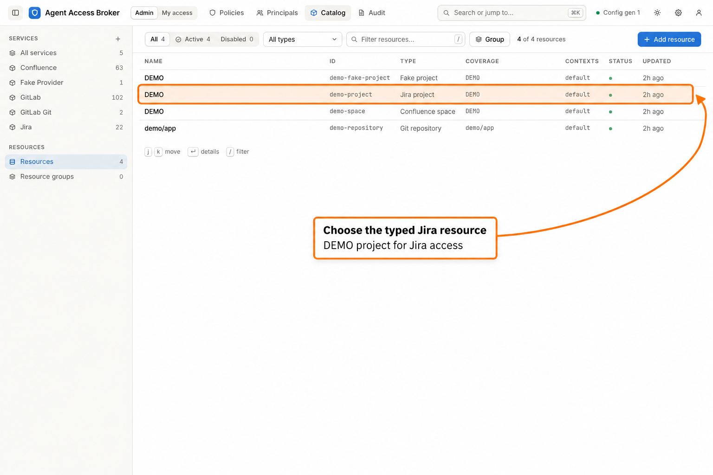
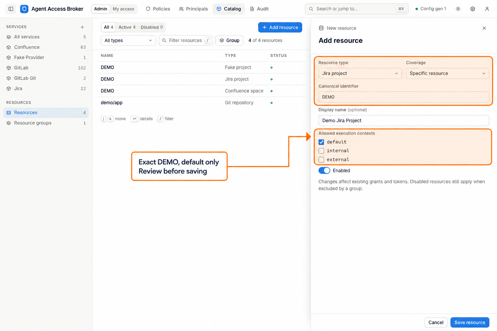
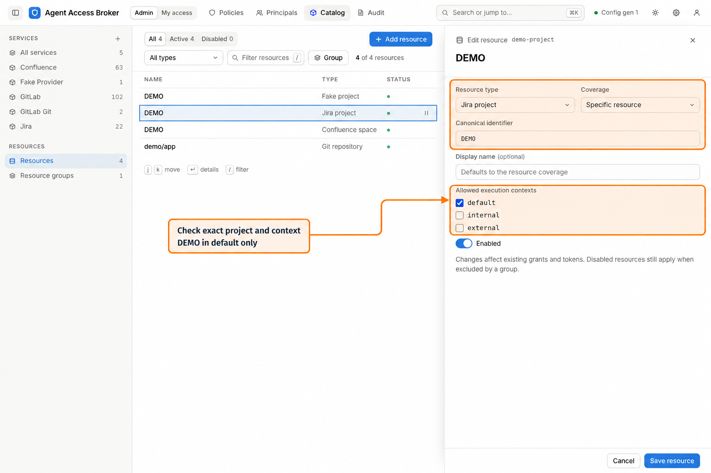
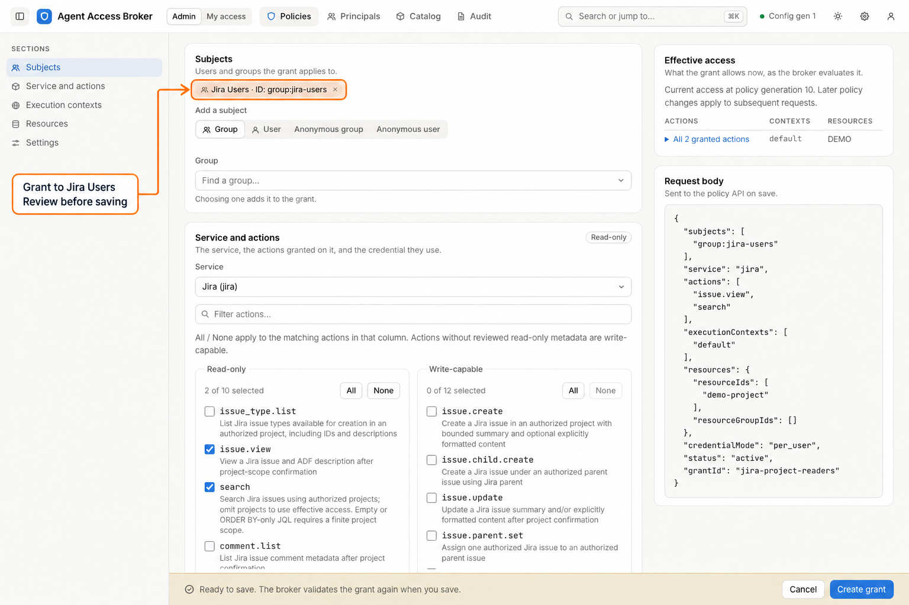
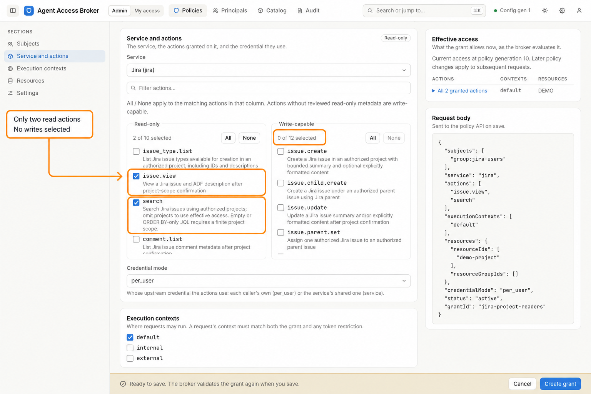
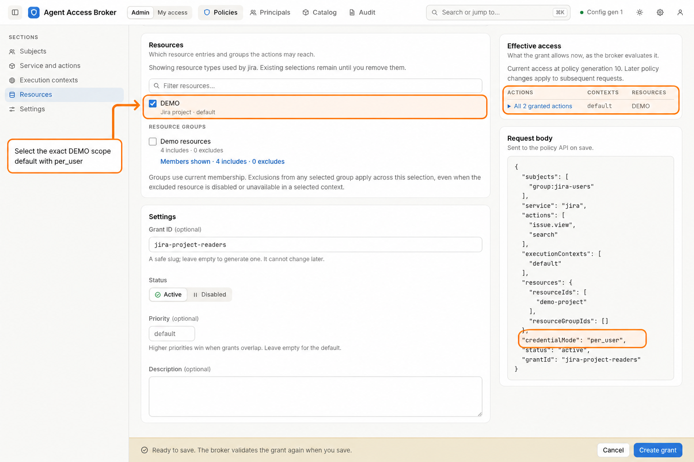
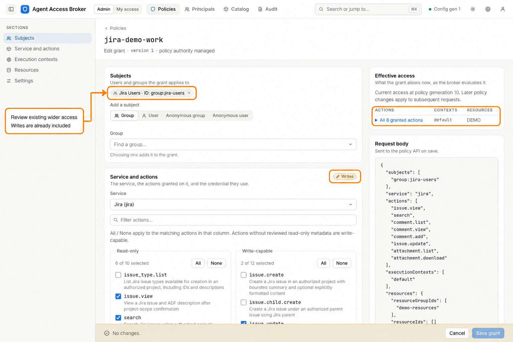

# Administrator: resources and grants

Give the **Jira Users** group read access to Jira project `DEMO` in the `default`
execution context. The example grant selects only `issue.view` and `search`,
uses each principal's own credential (`per_user`), and references the exact DEMO
project resource.

Start from [Sign in and choose a workflow](index.md) and
[users and groups](admin-users-groups.md). The Jira integration and its
credential connection must already be configured by the operator. These steps
assume managed policy. An administrator creates resources; a service policy
manager can manage grants for directly assigned services, using the resource
catalog made available to them. See [roles](../roles.md) and
[Jira configuration](../providers-jira.md).

The screenshots use synthetic demo data. New forms are unsaved illustrations.
The existing `jira-demo-work` grant is broader than the read-only example: it
also permits comment creation and issue updates.

## Define the project resource

1. Select **Admin > Catalog > Resources**. Check for an existing **Jira project**
   whose canonical identifier is `DEMO`.

2. Reuse the existing DEMO Jira resource in the demo. For a deployment without
   it, select **Add resource** and choose **Resource type: Jira project**,
   **Coverage: Specific resource**, and **Canonical identifier: DEMO**. Give it
   an optional **Display name** if that improves recognition.
3. Select only **default** under **Allowed execution contexts**, leave
   **Enabled** on, and select **Save resource** when creating the entry.
   To review an existing entry, open its row and select **Edit**.

*This creation form illustrates a fresh deployment. The demo already has the
same Jira project selector, so reuse its existing entry rather than submitting
this duplicate draft.*

**Expected outcome:** an active Jira project entry covers the canonical key
`DEMO` in `default`. This is a selectable authorization scope; saving it does
not create a Jira project or synchronize its issues. Each resource type and
selector has one catalog entry, so reuse an existing exact entry rather than
creating a duplicate.

If saving reports a duplicate, choose **Open existing resource** to inspect
the named entry. Display name, execution contexts, and enabled state do not
make the same selector a different resource. Update the existing entry and
select it when adding group members. After saving a resource or changing group
membership, review **Admin > Audit** for its success record and recorded
names; a preflight alone does not confirm that the change completed.

**Specific resource** bounds this example to one project. Broad coverage can
include upstream objects created later. Jira authorization is at the project
boundary; individual issues are operation targets, not separate resource
entries. See [resource selectors](../resources.md#resource-entries).

## Create the read grant

1. Select **Admin > Policies > Create grant**.
2. In **Subjects**, choose **Group** under **Subject type**, then select
   **Jira Users** in the **Group** picker. Choosing an account or group adds it
   to the grant's selected subjects; inspect that list before continuing.
3. In **Service and actions**, choose **Jira (jira)**. Select only `issue.view`
   and `search`. Set **Credential mode** to `per_user` so calls use the caller's
   own upstream identity.

*This new grant selects two read actions. The preview and request body reflect
the same subjects, context, resource, and credential mode.*

4. In **Execution contexts**, select only `default`.
5. In **Resources**, select the existing exact **Jira project DEMO** entry.
   For this example, use the direct resource rather than the demo's shared
   **Demo resources** group. Inspect all selected entries and groups; empty
   selections do not imply unrestricted access.

6. In **Settings**, enter **Grant ID: jira-project-readers**, a clear **Description**,
   and **Active** status. Leave **Priority** empty for the default unless an
   intentional overlap requires a reviewed priority choice.
7. Review **Effective access** and any validation messages. Confirm that the
   preview shows only the selected Jira reads, `default`, and `DEMO`. Select
   **Create grant** when the boundary is correct.

The editor's section list lets you jump between subjects, actions, contexts,
resources, settings, and the effective-access preview. Saving stores explicit
action selections; provider actions added later do not automatically join this
grant.

**Expected outcome:** the saved grant opens in its detail drawer and appears in
**Policies**. Members of Jira Users can perform the selected reads when the
request, token restrictions, and credentials also permit them. A preview does
not verify upstream permissions or establish that a credential works.

## Inspect or adjust an existing grant

1. In **Policies**, select a grant row to open its details. Inspect its
   **Subjects**, read-only and write-capable **Actions**, **Scope**, and
   **Effective access**.

*This existing demo grant contains eight actions, including `comment.add` and
`issue.update`, and selects the Demo resources group. It illustrates the detail
drawer; it is not the two-action read grant described above.*

2. Select **Edit** to open the grant editor. Review each section, make the
   intended change, check the preview, and select **Save grant**. Select
   **Cancel** to leave a reviewed grant unchanged.

3. Open **Admin > Principals > Users**, select Alice, and inspect her **Access**
   tab. Confirm the intended actions, resources, and contexts. Continue the
   [user handoff](user.md) with credential setup and a restricted invocation token.
4. Trace a representative request through **Audit** and Alice's personal
   **Activity**. See [audit and maintenance](admin-maintenance.md).

**Expected outcome:** the saved policy and the account's effective access agree
with the intended boundary. Other eligible grants may provide additional
access; narrowing one grant does not remove permissions from every other grant.

## If the result differs

| Symptom | Check |
| --- | --- |
| Resource creation or grant editing is unavailable | Check the account role, managed policy authority, and the service policy manager's direct service assignments. Resource changes require administrator authority. |
| Jira is unavailable in the Service picker | Have the operator configure the integration, validate it, and reload. The portal does not create the provider configuration. |
| `per_user` is marked not configured | Have the operator configure a credential connection for the selected service. Choosing a mode in a grant does not create that connection. |
| A project resource cannot be saved | Check its canonical key, contexts, and whether the same Jira project selector already exists. |
| Effective access is empty | Check active status, selected actions, resource type, enabled resources, matching execution contexts, and any selected resource-group exclusions. |
| Validation prevents saving | Follow the reported field or section, correct the selection, and review the preview again. |
| The preview looks correct but a call fails | Check the authenticated principal, ingress execution context, token boundary, user credential, upstream permissions, and Audit reason code. |
| Disabling one grant does not remove access | Inspect other eligible grants for the same principal or groups. Use the account's Access view to review the combined result. |

For selector, exclusion, overlap, and multi-resource rules, use the
[resource reference](../resources.md). For credential modes and the full
administrator handoff, use the [administrator guide](../administrator-guide.md#verify-the-user-handoff).
Continue with [maintenance and audit](admin-maintenance.md) or return to the
[portal guide index](index.md).
