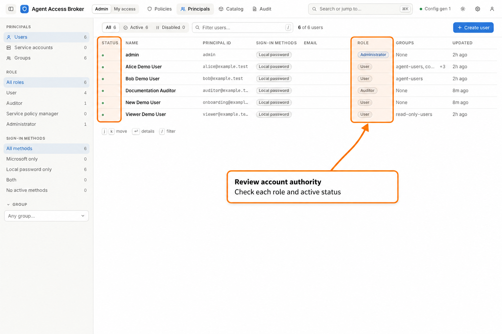
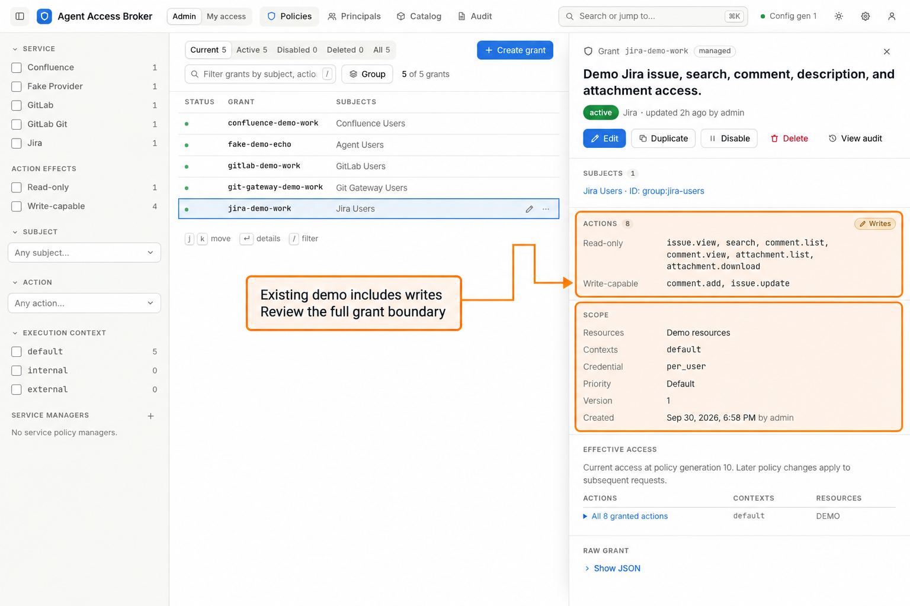
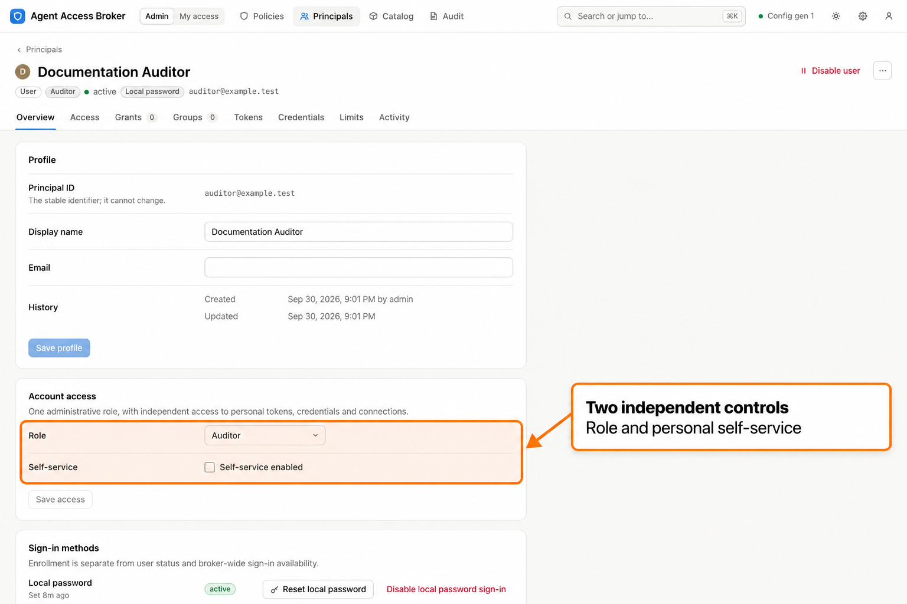
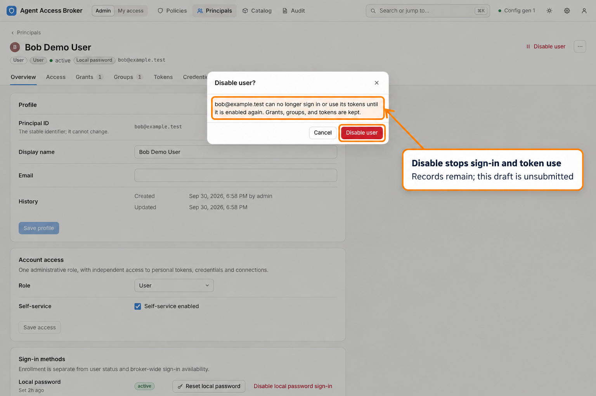
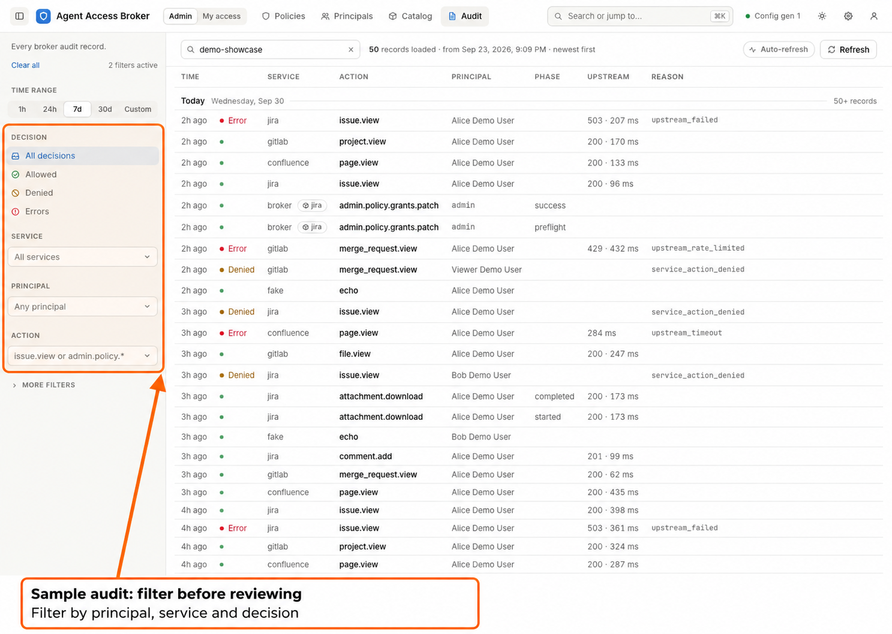

# Administrator maintenance and offboarding

[Portal guide](index.md) · [Users and groups](admin-users-groups.md) ·
[Grants](admin-grants.md)

Use this walkthrough after accounts and grants have been created. An administrator
reviews account authority, delegated policy ownership, tokens, credentials, and
audit, then removes access when its purpose ends. The screenshots use synthetic
local demonstration accounts and policy.

## Review access regularly

1. Open **Admin > Principals** and review users, service accounts, and groups.
   Confirm who owns each workload and which accounts still need access.
2. Open a principal's **Overview** and inspect **Account access**: its **Role**
   and **Self-service enabled** setting. Review sign-in methods separately.
3. Inspect **Access**, **Grants**, and **Groups**. Follow grant references to
   **Policies** to review actions, contexts, credential modes, and resources.
4. Review **Tokens**, including expiry, last use, paused/revoked status, and
   resource/action restrictions. Review **Credentials** and **Limits** where
   applicable.
5. Open **Admin > Audit** or the principal's **Activity** tab to investigate
   unexpected use or management changes.

*Synthetic account inventory for reviewing users, roles, and account status.*

*Synthetic policy fixture. Review each subject, action, context, and resource
selection rather than relying on the grant's name.*

Expected result: every active account, privileged role, workload token, and grant
has an understood owner and purpose. Include direct service-manager assignments,
resource-group inclusions/exclusions, personal credential rights and expiry, and
nonexpiring tokens in the review. Dormant records for a removed service can
become effective again if that service ID is restored.

## Adjust role and personal self-service

1. Open the target user's **Overview**.
2. In **Account access**, choose the intended **Role** and independently set
   **Self-service enabled**.
3. Select **Save access**, read **Update account access?**, then choose
   **Update access**.

*Synthetic account settings. Administrative role and personal self-service are
independent controls.*

Expected result: the account receives the selected administrative authority and
personal-management setting. Roles do not grant service invocation. A role change
revokes that account's administrative API tokens; leaving the service policy
manager role also removes its direct management assignments. A self-service-only
change does not revoke invocation tokens or stored credentials.

The portal prevents changing your own role here. The broker protects the last
active human administrator from demotion or disable. See [account roles](../roles.md)
for the full authority contract.

## Delegate service policy ownership

1. Change the intended human account's role to **Service policy manager** and
   save the change.
2. In its **Overview > Managed services**, select the configured services it
   should manage.
3. Choose **Save managed services**.
4. Have the manager sign in and confirm its **Policies** and **Audit** views are
   limited to the assigned services.

Expected result: the manager can read and change all grants for those services,
including grants for themselves. Assignments belong directly to the account;
groups do not confer policy-management authority. The assignment does not grant
invocation or credential access. Personal self-service remains controlled by the
separate account setting.

This assignment editor requires managed identity and managed policy authority.
Review the breadth of the delegation before saving it. Use the
[role reference](../roles.md#assign-service-policy-managers) for CLI equivalents.

## Manage tokens and credentials for an account

1. Open **Admin > Principals > the account > Tokens** to inspect its
   **Agent tokens** and, for eligible human accounts, **Management tokens**.
2. To create an agent token, choose **Issue token**. The creation page shows
   the account as the fixed owner and uses the same action columns, boundary
   summary, and access preview as [personal token creation](user.md#5-issue-a-token-with-the-smallest-useful-boundary).
   Only administrators can issue for another account; disabled accounts cannot
   receive new tokens. After issuance, save the one-time secret before closing
   **Token created**.
3. Select an agent token to inspect its ceiling. Use **Pause token** for a
   temporary suspension, **Resume token** to restore a paused token, or **Revoke**
   to retire it. Changing its restrictions requires a replacement token.
4. Open **Credentials** to inspect the account's configured stored API-token
   targets. Replace or delete the stored credential when its purpose changes.
5. Return to **Access** and confirm that current grants still match the intended
   service/action/resource boundary.

Expected result: administrative changes apply to the selected account. Your own
**My access > Credentials** and **Tokens** act on your personal account instead.
An administrator's own OAuth setup needs self-service, a configured binding, a
matching `per_user` action grant and browser consent. The import discovery
workflow has a bounded administrator exception. Editing another account's stored
API-token credential does not grant it invocation access or complete its OAuth
consent.

Deleting a broker credential copy does not revoke the upstream secret. Arrange
upstream revocation or rotation when needed. See
[personal OAuth setup](../administrator-guide.md#enable-personal-oauth-connections),
[classless static credential rights](../administrator-guide.md#grant-personal-credential-rights)
and the [end-user guide](../end-user-guide.md#rotate-pause-and-revoke).

## Offboard a user or workload

1. Open the account's principal page and choose **Disable user** or
   **Disable service account**. Review
   **Disable user?** or **Disable service account?** and confirm the disable.
2. Open **Tokens** and revoke the affected agent and management tokens. A pause
   preserves the existing token secret and is suitable for temporary suspension.
   Revoke a token that may have been compromised.
3. Remove directory/JIT eligibility when it could admit the person again.
4. Revoke exposed upstream credentials at their service and remove obsolete
   broker credential copies and personal credential rights.
5. Review direct grants and group memberships; remove obsolete access while
   preserving other subjects that share a grant.
6. Review **Admin > Audit** by principal, token, and request ID and preserve the
   required evidence and backups.

*Synthetic user-disable confirmation. Disabling keeps the account's durable
records for review.*

Expected result: a disabled principal cannot sign in or use its tokens. Disabling
self-service only removes personal management and does not stop invocation.
Disabling preserves grants, groups, credentials, and tokens; re-enabling can
restore unexpired tokens and retained access. Reconcile those records before
restoring an account.

*Synthetic audit fixture illustrating a maintenance review, not evidence of live
upstream calls. See the [auditor walkthrough](auditor.md) for filters, outcomes,
timelines, and request-ID correlation.*

For the full sequence, see
[access review and offboarding](../administrator-guide.md#access-review-and-offboarding).

## Check configuration status

1. Open **Admin > System** using the gear.
2. Inspect **Runtime**, including **Generation**, **Loaded**, **Config hash**,
   **Identity authority**, and **Policy authority**.
3. After an operator prepares a validated configuration change, use
   **Reload config** and inspect **Last reload** for **Applied** or **Rejected**.

Expected result: the runtime facts describe the active configuration. File-owned
identity or policy can be inspected in the portal but requires configuration edits
and reload for changes. Follow the operator's
[reload procedure](../operator-guide.md#config-reload-operations) for validation,
failure handling, and supported changes. Database migrations, keys, backups, and
deployment upgrades belong to the [operator guide](../operator-guide.md).

## When maintenance stalls

| Symptom | Next step |
| --- | --- |
| A change control is absent | Check the signed-in role and runtime authority. Auditors read metadata; managers write grants only for assigned services. |
| **Managed services** is unavailable | Confirm both identity and policy are managed; retry a failed assignment/catalog read before changing delegation. |
| An account still invokes after self-service is disabled | Disable the principal or revoke the invocation token; self-service does not authorize invocation. |
| A replacement credential does not restore access | Check active grants, token restrictions, execution context, and upstream permissions independently. |
| Reload is rejected or a page keeps failing | Preserve the reason/request IDs and use [operator common failures](../operator-guide.md#common-failures). |

Return to the [portal guide](index.md), review
[users and groups](admin-users-groups.md), or continue with the
[auditor walkthrough](auditor.md).
