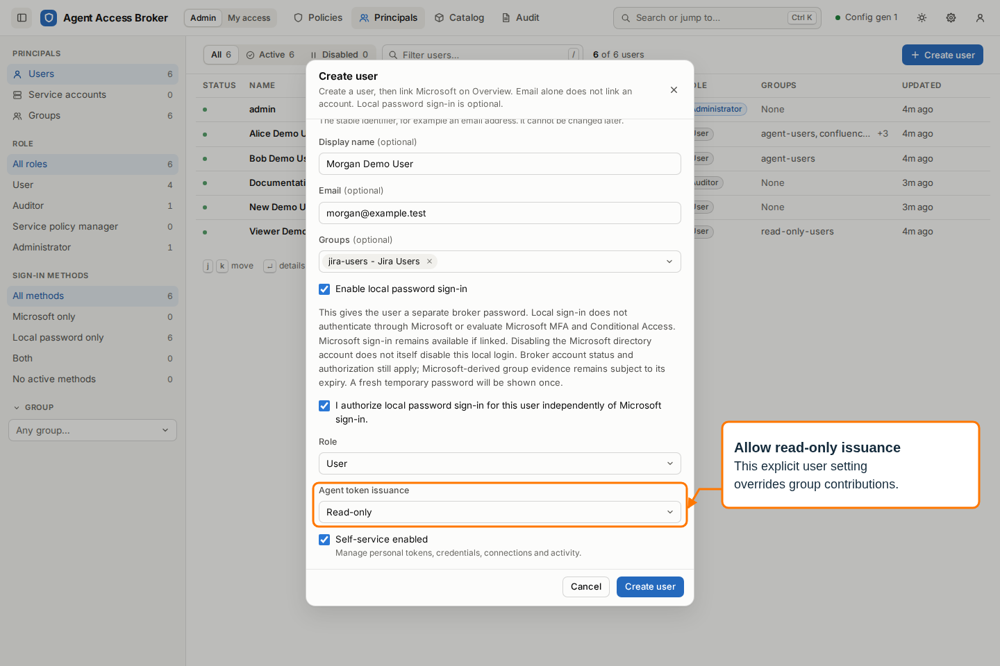
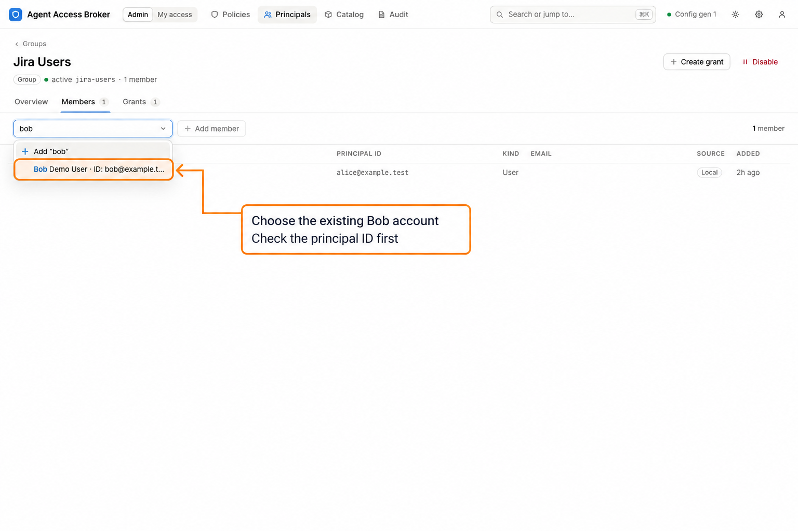
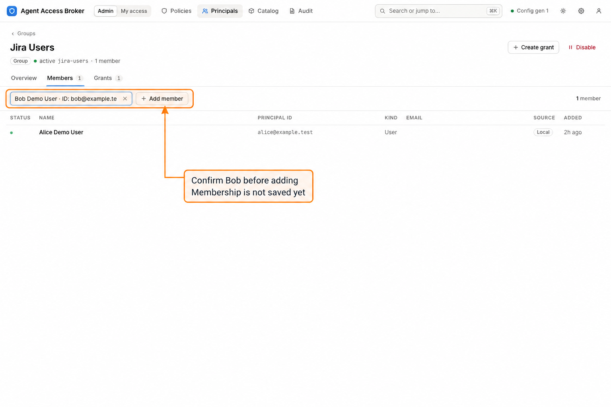
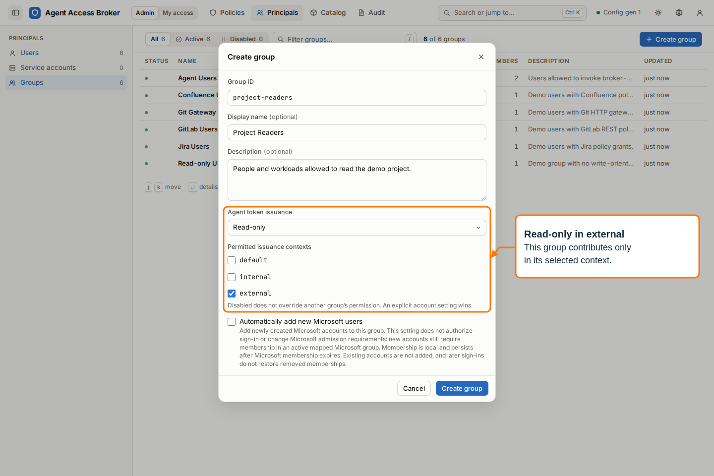
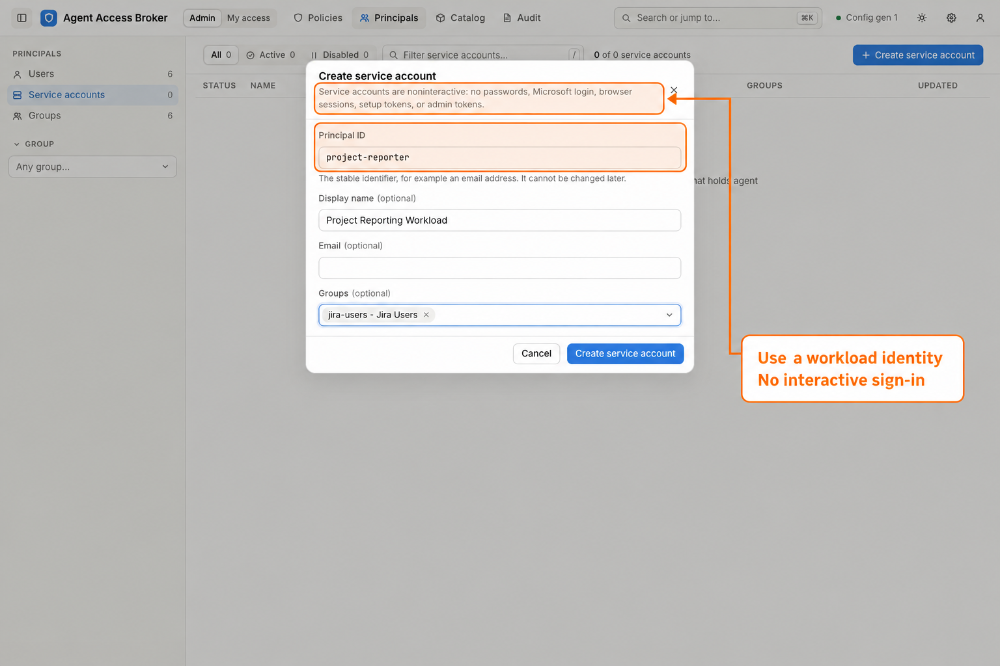

# Administrator: users, groups, and workloads

Create an account, give it a sign-in method, and place it in a group before
configuring its service access. This walkthrough uses the demo's **Jira Users**
group (`jira-users`), which already contains Alice. Morgan and Project Readers
are examples shown in unsaved forms; the screenshots do not show completed
account or group creation.

Start from [Sign in and choose a workflow](index.md). These steps require an
administrator and managed identity. Auditors can inspect account metadata but
cannot create accounts or change membership. Service policy managers manage
grants for assigned services; account and group administration still requires
an administrator. See [account roles](../roles.md).

## Onboard a human user

1. Select **Admin > Principals > Users**, then **Create user**.
2. Enter a stable **Principal ID**, such as `morgan@example.test`, and a clear
   **Display name**, such as `Morgan Demo User`. An **Email** is optional.
   In **Groups**, select **Jira Users** if the account should receive that
   group's invocation grants. Create the group first if it does not exist.
3. Keep **Role** set to **User** for an ordinary user and select
   **Self-service enabled** so they can manage their own credentials, tokens,
   connections, and activity. A role and the self-service setting do not grant
   upstream service access; [grants](admin-grants.md) provide that access. Choose
   **Read-only** under **Agent token issuance** and check **default** and
   **internal** in its execution-context checklist for this demo. At least one
   context is required.
   The default, **Inherit from groups**, permits no issuance until an active
   group contributes permission for a context. An explicit user setting
   replaces every group contribution.
4. Choose the sign-in method. For the local-password example, select
   **Enable local password sign-in** and its acknowledgement. Then select
   **Create user**. The portal displays a fresh temporary password once;
   deliver it securely and have the user change it on first sign-in.

*The populated form is a draft, with Read-only issuance selected for `default`
and `internal`. Local sign-in creates an independent broker password; it does
not authenticate through Microsoft or evaluate Microsoft MFA and Conditional
Access.*

For Microsoft onboarding, select **Prepare Microsoft sign-in by email** in
**Create user** and enter **Microsoft email**. The portal initially uses it for
both profile email and pending enrollment; subsequent edits are independent.
The account's **Overview > Sign-in methods** shows **Awaiting first Microsoft
sign-in**, **Pending match email**, **Tenant**, **Enrollment ID** and **Revision**.
Creating the account is the approval. Its first matching validated Microsoft
sign-in binds that same account with prepared access intact, without another
approval step or an Object ID lookup. No password, upstream credential or
Broker token is distributed by this flow.

For an existing user without a Microsoft method, select **Prepare Microsoft
sign-in** and enter **Microsoft match email**. Use **Edit Microsoft enrollment**
or **Cancel Microsoft enrollment** for a pending account. Refresh after a stale
conflict; an earlier edit cannot recreate consumed enrollment. Disabling the
account retains its email reservation and blocks binding. Cancellation releases
the reservation while keeping account setup, and does not ban ordinary JIT.
Preparation remains available with a paused configured provider; actual sign-in
requires it enabled. Cancel pending enrollment before linking by Object ID.

Profile email alone does not authorize a Microsoft match. Matching uses the
validated token's `email`, which may differ from the sign-in name, with no UPN
or preferred-username fallback. Microsoft sign-in also refreshes the display
name and may replace an administrator's name edit; profile email stays unchanged.
Follow [Microsoft onboarding](../administrator-guide.md#microsoft-onboarding)
for matching, recovery, group assignment and evidence rules. When the operator
has enabled Microsoft membership renewal, the **Microsoft** row under
**Sign-in methods** also shows one renewal status once the user has signed in with Microsoft, such
as **Groups renew automatically**, **Renewal blocked** with its reason, or
**Sign-in required to renew groups**; the
[Microsoft onboarding](../administrator-guide.md#microsoft-onboarding) table
explains each one.

**Expected outcome:** the new user opens on its account page. Confirm the
principal ID, role, self-service setting, token issuance mode and context list,
current saved effective context summaries, sign-in method, and **Groups** tab.
The account is ready for a [resource and grant review](admin-grants.md), followed
by the [user's credential setup](user.md). Creating the account does not provision an
upstream Jira account or credential.

## Add an existing user to a group

1. In **Admin > Principals**, select **Groups**, open **Jira Users**, and open
   its **Members** tab. The demo initially shows Alice as a member.
2. Search **Principal to add** for `bob` and select **Bob Demo User**. Inspect
   the principal ID before proceeding; display names alone are not stable
   identifiers.

3. Select **Add member** to save the membership. Check that Bob now appears in
   the **Members** table and that the member count increases.

*This screenshot stops before submission: Alice is still the sole member.*

**Expected outcome:** Bob receives invocation access from eligible grants
referencing `group:jira-users`. He still needs the required upstream credentials
and permissions. A group does not confer an administrative role or service
policy-management assignment. Review the user's **Access** tab and the
[grant boundary](admin-grants.md) after changing membership.

## Create another group

1. Select **Admin > Principals > Groups > Create group**.
2. Enter a stable **Group ID**, a **Display name**, and a useful **Description**.
   For example, use `project-readers`, **Project Readers**, and a description
   explaining which project and operations members need. Set **Agent token
   issuance** to **Read-only**, then check **external** for this demo to let
   inheriting members issue read-only tokens there. Its default is Disabled;
   enabling a mode never selects contexts automatically.
   Select **Automatically add new Microsoft users** only if accounts created
   after the enrollment migration should receive persistent local membership
   at their first Microsoft sign-in, including prepared accounts.
3. Select **Create group**, then use **Members** to add existing accounts.
   Create a grant for that group before expecting it to provide service access.

*This draft contributes Read-only issuance in `external`; the other configured
contexts are unchecked.*

**Expected outcome:** the group opens on its own page and appears in the group
list. A new group starts without members or invocation grants unless you add
them. Principal groups are distinct from **Catalog > Resource groups**:
principal groups collect accounts; resource groups collect selectable scopes.

## Review token issuance permission

On a user's **Overview > Account access**, choose **Inherit from groups**,
**Disabled**, **Read-only**, or **Write-capable**. Read-only and Write-capable
require explicit choices from the configured context checklist; Inherit and
Disabled clear it. A managed group's **Overview > Token issuance** offers the
three group modes. An explicit user setting replaces group permission. Otherwise,
the most permissive active effective group wins separately for each context.
A Disabled group does not veto another group. Disabled groups retain their
settings without contributing them; TOML identity groups contribute nothing.

Review the **current saved** effective context summaries and group provenance.
They are read-only results, not an editor or a preview of an unsaved switch to
Inherit. Save and refresh to see that inherited result. Newly configured contexts
remain unchecked; removed selected contexts stay visible as **No longer
configured** until you deselect them. A valid enabled policy always has at least
one context.

If an edited field changed since you opened the form, choose **Discard draft**
or **Keep my draft** before saving. Both preserve your opportunity to review;
neither submits automatically. Unedited fields adopt the latest saved values.
A failed save retains your edits. API and CLI writes replace the submitted
complete object without a version precondition; the portal's final refresh can
detect observed conflicts but cannot prevent a later concurrent write.

Read-only permission allows **Follow current grants**, including future reads
while blocking writes. A token covering a mix of Read-only and Write-capable
contexts must be read-only; a token selecting only Write-capable contexts may
allow writes. Changing permission leaves all existing tokens unchanged.
Administrators can issue either token type for the target's granted contexts from
its Tokens tab under separate administrative authority; service accounts always
use that path.

## Automatically add new Microsoft users

Open a group's **Overview** and enable **Automatically add new Microsoft users**.
Repeat on each group users should join at their first Microsoft sign-in. The
setting is also available in **Create group** and is off by default. It takes
effect immediately without a Broker configuration reload.

This setting does not admit users. Prepared and Object-ID-linked accounts use
their explicit approval; unmatched JIT still requires an active Entra group
mapping. At the first successful Microsoft sign-in of an account created after
migration `036_microsoft_enrollments`, Broker adds missing local memberships in
selected active groups, including for prepared or Object-ID-linked users. Even
an established local account qualifies at its first Microsoft sign-in. Existing
memberships retain their attribution. Accounts present at migration receive no
backfill. The one-time assignment is processed even with no selected groups;
later sign-ins, unlink/relink and replacement enrollment never repeat it or
restore removed memberships. Local sign-in and membership renewal do not trigger it.

Local membership persists after Microsoft group evidence expires or is removed.
The **Microsoft** tab calls out this consequence when enrollment is enabled:
users automatically added to a mapped group retain the local contribution when
the Microsoft contribution ends. Such a membership can show both sources.

A disabled group retains the setting and shows enrollment as paused. Re-enabling
the group resumes assignment for future first Microsoft sign-ins, without adding
accounts that already signed in while it was disabled. Turning the setting off
leaves existing local memberships intact. Use **Members** to review or remove
them. See
[Microsoft onboarding](../administrator-guide.md#microsoft-onboarding) for CLI
commands and account-linking details.

## Onboard a workload account

1. Select **Admin > Principals > Service accounts > Create service account**.
2. Enter a stable **Principal ID**, such as `project-reporter`, a **Display
   name**, and the appropriate **Groups**. The illustration selects Jira Users.
3. Select **Create service account**, review its group grants, and issue its
   invocation token from the account's **Tokens** tab as an administrator.

**Expected outcome:** the workload has its own principal for grants and audit.
Service accounts are noninteractive: they cannot use passwords, Microsoft
sign-in, browser sessions, setup tokens, or administrator tokens. They have the
User role and self-service disabled. Plan the credential mode in
[resource and grant setup](admin-grants.md) before issuing an invocation token.

## Configure managed identity

In the human's identity controls, **Identity access** pauses both trusted username
and fingerprint invocation. It leaves independently issued Broker tokens and
browser sign-in available.

Below it, the **Access paths** table has one row for the built-in identity token,
always first and never deletable, with its configured state, then one row for each
username binding with its exact namespace, name and namespace availability. Each
row has **Enabled** and **Read-only** toggles. A disabled row stops that path
only; a disabled identity token keeps its secret. A read-only row can list and
call only actions classified as reads, within the person's grants. A toggle
change is checked against the row's current version or revision; a conflict
requires refreshing the record before retrying. To create a binding, use the
**Add username binding** form below the table: pick a configured namespace,
enter the exact username, select **Read-only** for a read-only binding, and
choose **Add binding**. Disabling keeps the name reserved; delete/create to
rename or reassign. Auditors see the same table without controls or the form.

**Identity token** retains reveal/copy, set, generate and remove controls. Removing
inventory disables fingerprint access but leaves username bindings, shared pause
and the token's Enabled and Read-only settings unchanged. Clients must initialize
a fresh MCP session after an identity transition, including any toggle change.
See [managed identity](../managed-identity.md) for lifecycle and CLI commands.
These controls affect Broker; independently authorized access through other
services has its own controls.

## If the result differs

| Symptom | Check |
| --- | --- |
| Create or membership controls are unavailable | Confirm an administrator session and managed identity authority. TOML-owned identity is changed in configuration and reloaded by the operator. |
| Local sign-in cannot be enabled | Select the independent-sign-in acknowledgement and check the broker's configured login methods. |
| A user cannot sign in | Check account status, its actual sign-in method or pending enrollment, and whether its temporary password must be changed. Profile email alone is not Microsoft enrollment; a pending match uses the token's email. |
| A group does not appear in the picker | Confirm that it exists and is active. Create it before assigning it to a new account. |
| Bob does not appear as an available member | He may already be a local member. Inspect the current Members table before adding another principal. |
| Membership is saved but service access is absent | Review the group's active grants, selected actions, resources, and execution contexts. Then check token restrictions and credential setup. |
| Access through a Microsoft group stopped | Open the user's **Overview** and check the Microsoft renewal status under **Sign-in methods**, and the group's expiry on the **Groups** tab. **Sign-in required** or no status means the user signs in with Microsoft again; **Renewal blocked** needs the reason fixed. |
| My access is absent | Check **Self-service enabled** on the human account. It is always disabled for service accounts. |
| A managed agent connection lacks write actions | Check **Read-only** on the identity token or username binding it uses. A read-only path lists only actions classified as reads; imported actions count as writes until reviewed as reads. |

Continue with [resources and grants](admin-grants.md). Use
[account and grant maintenance](admin-maintenance.md) for later access reviews,
membership removal, and offboarding. The [administrator reference](../administrator-guide.md)
includes CLI equivalents, grant-based OAuth setup and classless credential rights.
