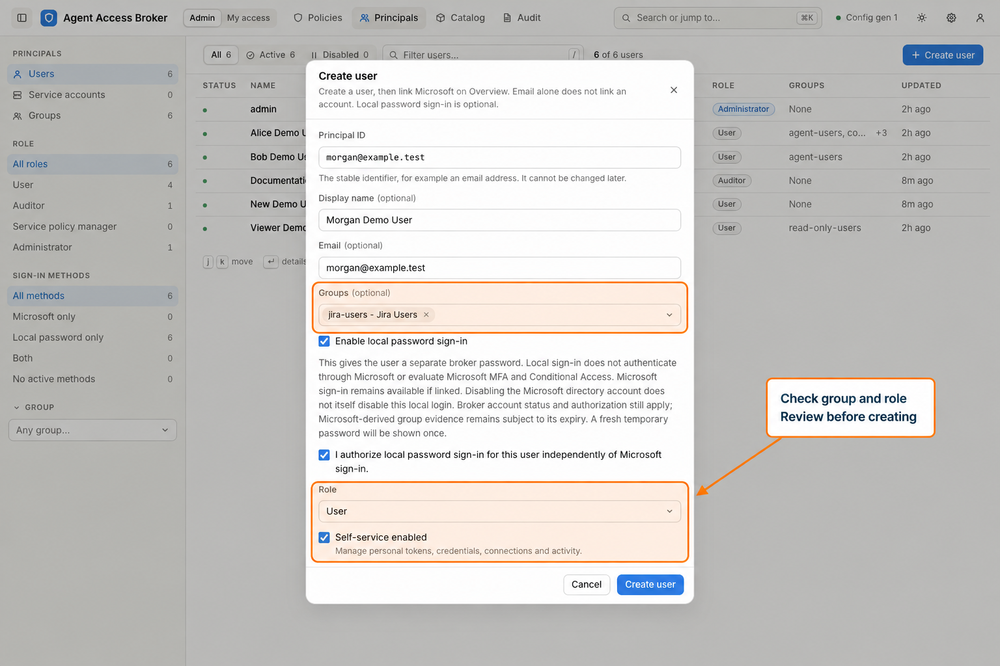
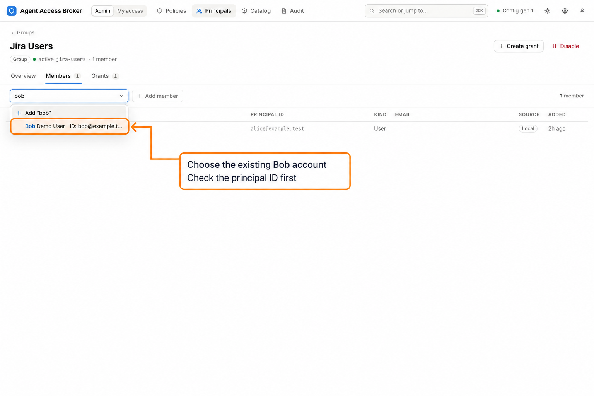
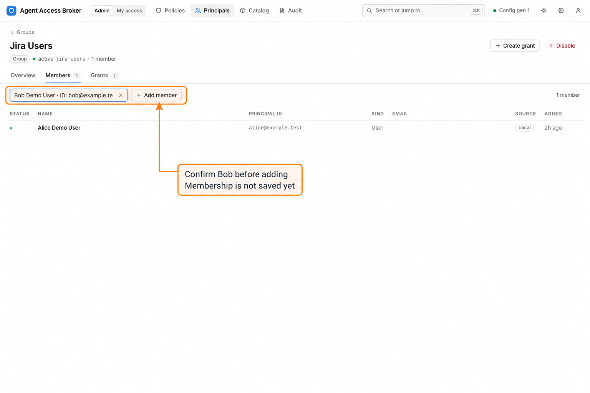
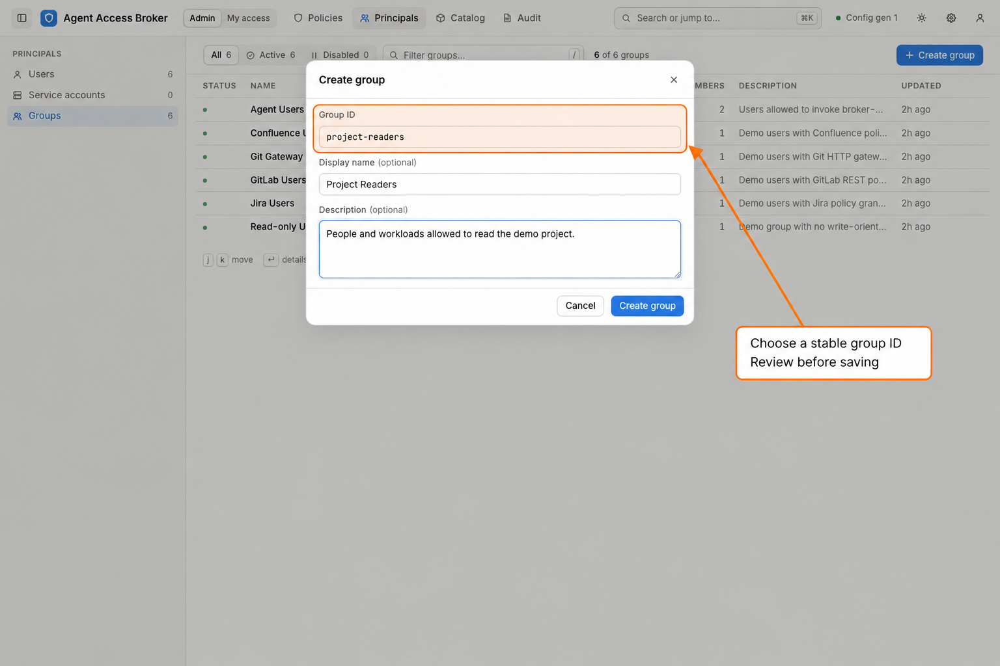
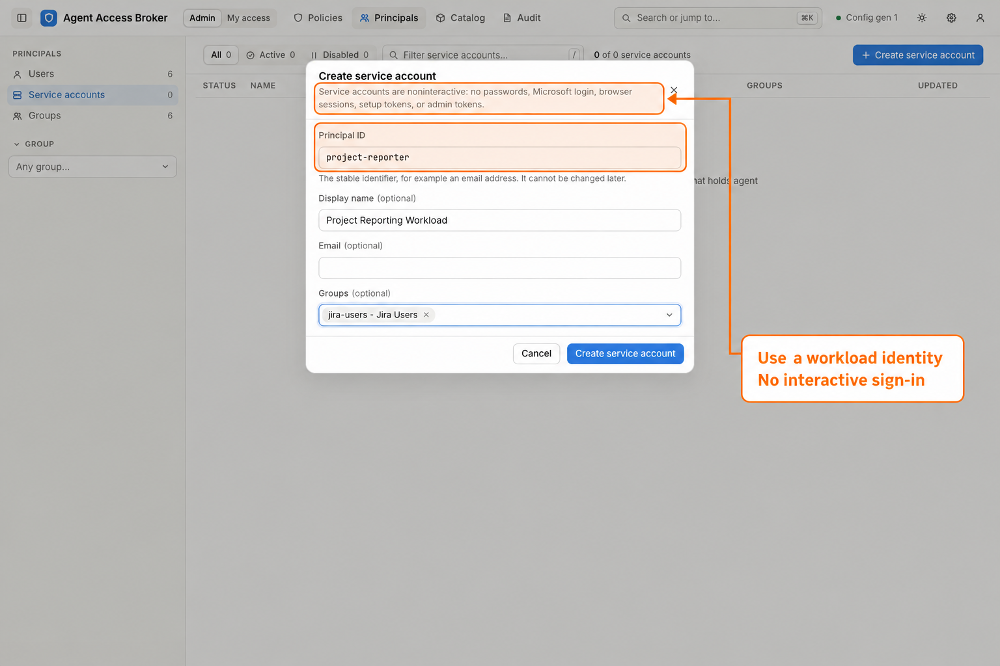

# Administrator: users, groups, and workloads

Create an account, give it a sign-in method, and place it in a group before
configuring its service access. This walkthrough uses the demo's **Jira Users**
group (`jira-users`), which already contains Alice. Morgan and Project Readers
are examples shown in unsaved forms; the screenshots do not show completed
account or group creation.

Start from [Sign in and choose a workflow](index.md). These steps require an
administrator and managed identity. Auditors can inspect account metadata but
cannot create accounts or change membership. Service policy managers manage
grants for assigned services; account and group administration still requires
an administrator. See [account roles](../roles.md).

## Onboard a human user

1. Select **Admin > Principals > Users**, then **Create user**.
2. Enter a stable **Principal ID**, such as `morgan@example.test`, and a clear
   **Display name**, such as `Morgan Demo User`. An **Email** is optional.
   In **Groups**, select **Jira Users** if the account should receive that
   group's invocation grants. Create the group first if it does not exist.
3. Keep **Role** set to **User** for an ordinary user and select
   **Self-service enabled** so they can manage their own credentials, tokens,
   connections, and activity. A role and the self-service setting do not grant
   upstream service access; [grants](admin-grants.md) provide that access.
4. Choose the sign-in method. For the local-password example, select
   **Enable local password sign-in** and its acknowledgement. Then select
   **Create user**. The portal displays a fresh temporary password once;
   deliver it securely and have the user change it on first sign-in.

*The populated form is a draft. Local sign-in creates an independent broker
password; it does not authenticate through Microsoft or evaluate Microsoft MFA
and Conditional Access.*

If Microsoft sign-in is configured, an administrator can create the account
without enabling a local password and link Microsoft from the account's
**Overview**. Entering an email alone does not link the Microsoft account. Follow
[Microsoft onboarding](../administrator-guide.md#microsoft-onboarding) for the
linking, mapping, and group-evidence rules.

**Expected outcome:** the new user opens on its account page. Confirm the
principal ID, role, self-service setting, sign-in method, and **Groups** tab.
The account is ready for a [resource and grant review](admin-grants.md), followed
by the [user's credential setup](user.md). Creating the account does not provision an
upstream Jira account or credential.

## Add an existing user to a group

1. In **Admin > Principals**, select **Groups**, open **Jira Users**, and open
   its **Members** tab. The demo initially shows Alice as a member.
2. Search **Principal to add** for `bob` and select **Bob Demo User**. Inspect
   the principal ID before proceeding; display names alone are not stable
   identifiers.

3. Select **Add member** to save the membership. Check that Bob now appears in
   the **Members** table and that the member count increases.

*This screenshot stops before submission: Alice is still the sole member.*

**Expected outcome:** Bob receives invocation access from eligible grants
referencing `group:jira-users`. He still needs the required upstream credentials
and permissions. A group does not confer an administrative role or service
policy-management assignment. Review the user's **Access** tab and the
[grant boundary](admin-grants.md) after changing membership.

## Create another group

1. Select **Admin > Principals > Groups > Create group**.
2. Enter a stable **Group ID**, a **Display name**, and a useful **Description**.
   For example, use `project-readers`, **Project Readers**, and a description
   explaining which project and operations members need.
   Select **Automatically add new Microsoft users** only if new accounts
   admitted through Microsoft should receive persistent local membership.
3. Select **Create group**, then use **Members** to add existing accounts.
   Create a grant for that group before expecting it to provide service access.

**Expected outcome:** the group opens on its own page and appears in the group
list. A new group starts without members or invocation grants unless you add
them. Principal groups are distinct from **Catalog > Resource groups**:
principal groups collect accounts; resource groups collect selectable scopes.

## Automatically add new Microsoft users

Open a group's **Overview** and enable **Automatically add new Microsoft users**.
Repeat on each group new Microsoft accounts should join. The setting is also
available in **Create group** and is off by default. It takes effect immediately
without a broker configuration reload.

This setting does not admit users: Microsoft sign-in must still meet the
configured JIT requirements, including an active Entra group mapping. After
admission, Broker adds the new account to every selected active group as a local
member. It does so only when creating an account, never for an existing linked
account or on a later sign-in. Removing a user's local membership stays
effective; enabling this setting does not add existing users.

Local membership persists after Microsoft group evidence expires or is removed.
The **Microsoft** tab calls out this consequence when enrollment is enabled:
users automatically added to a mapped group retain the local contribution when
the Microsoft contribution ends. Such a membership can show both sources.

A disabled group retains the setting and shows enrollment as paused. Re-enabling
the group resumes enrollment for future accounts, without adding accounts
created while it was disabled. Turning the setting off leaves existing local
memberships intact. Use **Members** to review or remove them. See
[Microsoft onboarding](../administrator-guide.md#microsoft-onboarding) for CLI
commands and account-linking details.

## Onboard a workload account

1. Select **Admin > Principals > Service accounts > Create service account**.
2. Enter a stable **Principal ID**, such as `project-reporter`, a **Display
   name**, and the appropriate **Groups**. The illustration selects Jira Users.
3. Select **Create service account**, review its group grants, and issue its
   invocation token from the account's **Tokens** tab as an administrator.

**Expected outcome:** the workload has its own principal for grants and audit.
Service accounts are noninteractive: they cannot use passwords, Microsoft
sign-in, browser sessions, setup tokens, or administrator tokens. They have the
User role and self-service disabled. Plan the credential mode in
[resource and grant setup](admin-grants.md) before issuing an invocation token.

## Configure managed identity

In the human's identity controls, **Identity access** pauses both trusted username
and fingerprint invocation. It leaves independently issued Broker tokens and
browser sign-in available.

Below it, the **Access paths** table has one row for the built-in identity token,
always first and never deletable, with its configured state, then one row for each
username binding with its exact namespace, name and namespace availability. Each
row has **Enabled** and **Read-only** toggles. A disabled row stops that path
only; a disabled identity token keeps its secret. A read-only row can list and
call only actions classified as reads, within the person's grants. A toggle
change is checked against the row's current version or revision; a conflict
requires refreshing the record before retrying. Create a binding only in a
configured namespace, and select **Read-only** in the create form for a
read-only binding. Disabling keeps the name reserved; delete/create to rename or
reassign. Auditors see the same table without controls.

**Identity token** retains reveal/copy, set, generate and remove controls. Removing
inventory disables fingerprint access but leaves username bindings, shared pause
and the token's Enabled and Read-only settings unchanged. Clients must initialize
a fresh MCP session after an identity transition, including any toggle change.
See [managed identity](../managed-identity.md) for lifecycle and CLI commands.
These controls affect Broker; independently authorized access through other
services has its own controls.

## If the result differs

| Symptom | Check |
| --- | --- |
| Create or membership controls are unavailable | Confirm an administrator session and managed identity authority. TOML-owned identity is changed in configuration and reloaded by the operator. |
| Local sign-in cannot be enabled | Select the independent-sign-in acknowledgement and check the broker's configured login methods. |
| A user cannot sign in | Check account status, its actual sign-in enrollment, and whether its temporary password must be changed. An email address alone is not Microsoft enrollment. |
| A group does not appear in the picker | Confirm that it exists and is active. Create it before assigning it to a new account. |
| Bob does not appear as an available member | He may already be a local member. Inspect the current Members table before adding another principal. |
| Membership is saved but service access is absent | Review the group's active grants, selected actions, resources, and execution contexts. Then check token restrictions and credential setup. |
| My access is absent | Check **Self-service enabled** on the human account. It is always disabled for service accounts. |
| A managed agent connection lacks write actions | Check **Read-only** on the identity token or username binding it uses. A read-only path lists only actions classified as reads; imported actions count as writes until reviewed as reads. |

Continue with [resources and grants](admin-grants.md). Use
[account and grant maintenance](admin-maintenance.md) for later access reviews,
membership removal, and offboarding. The [administrator reference](../administrator-guide.md)
includes CLI equivalents, grant-based OAuth setup and classless credential rights.
