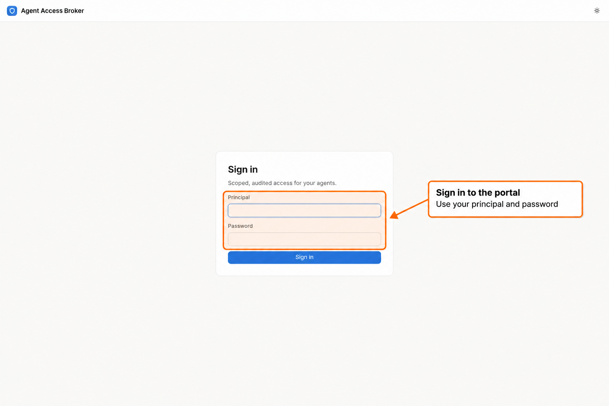
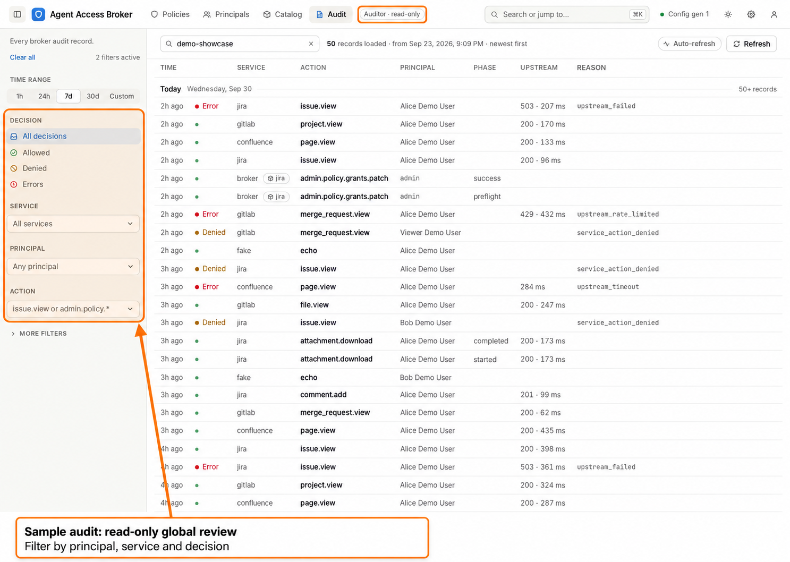
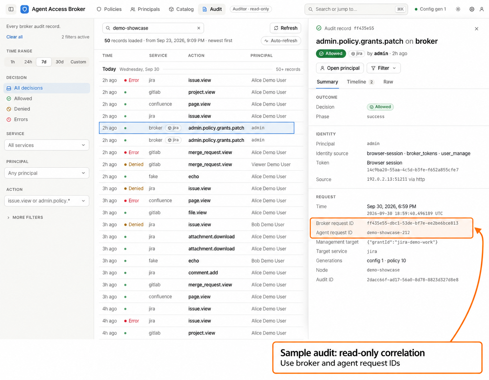
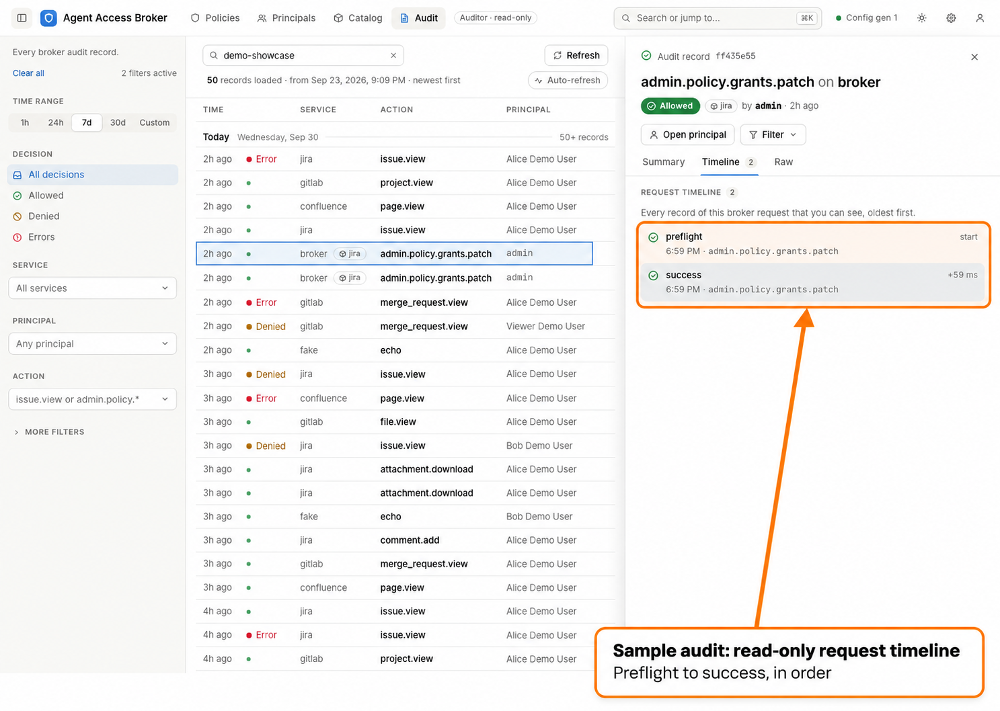
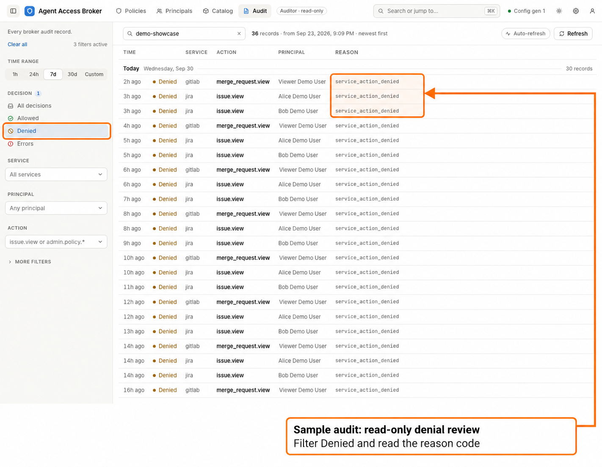

# Auditor walkthrough

[Portal guide](index.md) · [Administrator maintenance](admin-maintenance.md)

An auditor can review global audit records, policy, account metadata, catalog
entries, and runtime status. The auditor role permits administrative reads;
it does not permit administrative changes, secret reveals, credential
verification, or import discovery. See the [role reference](../roles.md).

The illustrated reviewer account has self-service disabled. It still signs in
and opens **Admin**, but has no **My access** space. Account and password settings
remain available. The ordinary read-only user in a demo is a different persona:
read-only invocation grants do not make an account an auditor.

## Sign in and find the review area

1. Open the broker's `/ui` address.
2. Enter the auditor's **Principal** and **Password**, or use the configured
   Microsoft sign-in method. Change a temporary password if prompted.
3. Open **Admin > Audit**. The scope sentence reads **Every broker audit record.**

*Shared sign-in screen from the synthetic local demonstration.*

Expected result: the reviewer can inspect administrative pages without controls
to create, edit, disable, reload, or reveal secrets. An account with self-service
disabled does not gain personal token or credential management through its role.

## Narrow an audit review

1. Choose a time range covering the activity under review.
2. Set **Principal** to the stable account ID, such as `alice@example.test`.
3. Use **Service**, **Action**, and **Allowed**, **Denied**, or **Errors** to
   narrow the list. An action filter can use a prefix such as `admin.policy.*`.
4. Expand **More filters** for **Reason code**, **Token ID**, or **Request ID**.
   The request filter accepts a broker or agent request ID.
5. Select a row to open its detail drawer. The selected record and filters are
   kept in the URL so the review can be bookmarked.

*Synthetic audit fixture showing representative principals, services, decisions,
and request records; it is not evidence of calls to live upstream services.*

Service **broker** includes management operations and designated admission
failures. A broker record may also name a related service that the operation
changed. Inspect the action and management target before interpreting it as an
upstream invocation.

Expected result: the list contains records matching the selected filters. Clear
a filter or widen the time range if the expected record is absent. **Refresh**
loads current results; **Load more** continues through older matching records.

## Read an outcome and correlate a request

1. On the drawer's **Summary** tab, inspect **Decision**, **Reason code**, and
   **Phase**. For an invocation, also inspect **Matched grant**,
   **Execution context**, and **Credential mode** when present.
2. Confirm the principal and token under **Identity**. A known token name is a
   convenient label; its ID identifies the actual token record.
3. Record **Broker request ID**, **Agent request ID**, timestamp, and **Audit ID**
   when handing the finding to an operator.
4. Use **Request ID** in the list, or the drawer's **Filter to this request**
   action, to isolate the request. Open **Timeline** to inspect its stored phases.
5. Use **Raw** and **Copy JSON** when the operator needs the stored record.

*Synthetic audit fixture illustrating outcome, identity, and correlation fields.*

*Synthetic audit fixture illustrating several records for one request.*

Expected result: the timeline connects records for the same broker request. A
single request can produce several audit records; a list row is one record, not
necessarily the whole request. Use the operator's
[service-log correlation procedure](../operator-guide.md#service-logs-and-correlation)
to join these IDs to logs. Missing phases do not establish that an upstream
operation never happened; preserve the available evidence for investigation.

### Follow resource and resource-group changes

Resource and group changes show readable summaries using names recorded when
the change committed. An unnamed resource uses its recorded selector as its
label; the snapshot's name field shows **Not set**. Open a success record to
inspect its before/after state and the included members or exclusions added
and removed. A preflight is labeled
as an attempt: **Allowed** means admission passed, not that the resource was
created or the group changed. Use **Timeline** to check for completion; the list
keeps one row per stored record.

Summaries of combined edits identify the rename and accompanying coverage,
enabled-state, context, or membership changes. Use the change details to review
the complete before/after state.

Search by a recorded resource or group name to find its change records. Older
events lacking snapshots or membership deltas cannot supply those details.
Today's name or group membership is not substituted for history.

An administrator or auditor can follow a recorded name to the current resource
or group. These links open current state at the recorded ID, including a later
replacement if that ID was reused. They do not prove it is the same historical
object. A missing destination shows **Resource unavailable** or **Resource group
unavailable**; it may have been deleted. Service policy managers and personal
Activity viewers receive no links to catalog pages they cannot read.

Failure to find a completion does not establish that a change failed. The
managed and audit stores commit separately; an audit failure or process crash
can leave only the preflight. Preserve the request IDs and follow
[audit operations](../operator-guide.md#audit-operations) before repeating a
mutation.

## Investigate a denied request

1. Choose **Denied** and select the relevant record.
2. Read **Reason code** and the recorded context/resource information.
3. Inspect the principal's current **Access**, **Grants**, **Groups**, and
   **Tokens** under **Admin > Principals**.
4. Open the relevant grant under **Policies** and inspect its subjects, actions,
   contexts, credential mode, resources, and effective-access preview.
5. Report the finding to an administrator or assigned service policy manager.

*Synthetic denied-request fixture used to demonstrate investigation; no live
upstream change is implied.*

Expected result: the reviewer can explain the recorded decision and compare it
with current policy. Current grants and group membership can change after a
request; retain the request's recorded grant/version and IDs rather than assuming
today's access exactly reproduces the earlier evaluation.

For the policy controls being reviewed, see
[create and review a grant](admin-grants.md) and
[users and groups](admin-users-groups.md). An auditor can inspect safe previews
and metadata, including stored import previews, but cannot run discovery,
verify credentials, reveal identity tokens or secrets, or accept changes.

## When a review stalls

| Symptom | Next step |
| --- | --- |
| **Admin** is absent | Ask an administrator to check the account's actual role; invocation access does not grant audit authority. |
| **Audit** is absent | Ask the operator whether the configured audit store supports portal queries. SQLite does; JSONL is intended for shipping logs. |
| The list is empty | Widen the time range and remove principal/service/action filters. Use the exact stable ID from the record or client receipt. |
| Suggestions are unavailable | Enter the known filter identifiers manually; suggestions do not determine authorization or query availability. |
| A query or timeline fails | Use the displayed retry control and preserve the request ID; follow [audit operations](../operator-guide.md#audit-operations) if the failure persists. |

Return to the [portal guide](index.md) or continue with
[administrator maintenance](admin-maintenance.md).
