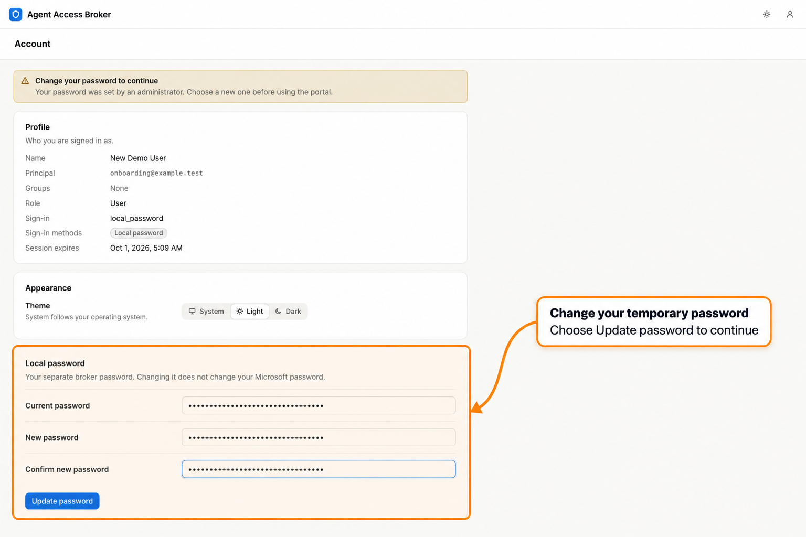
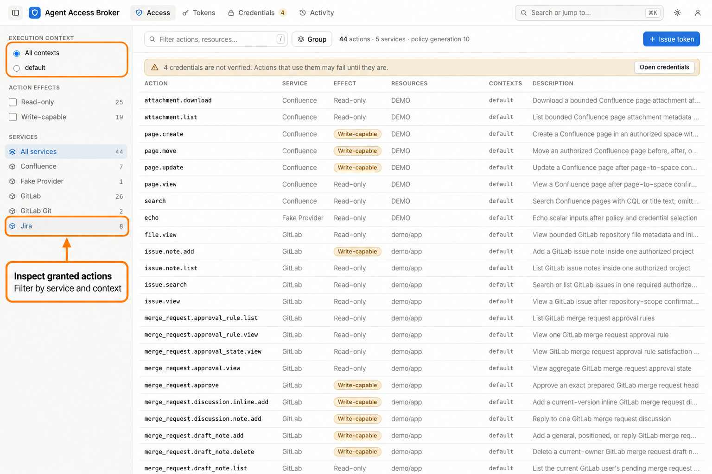
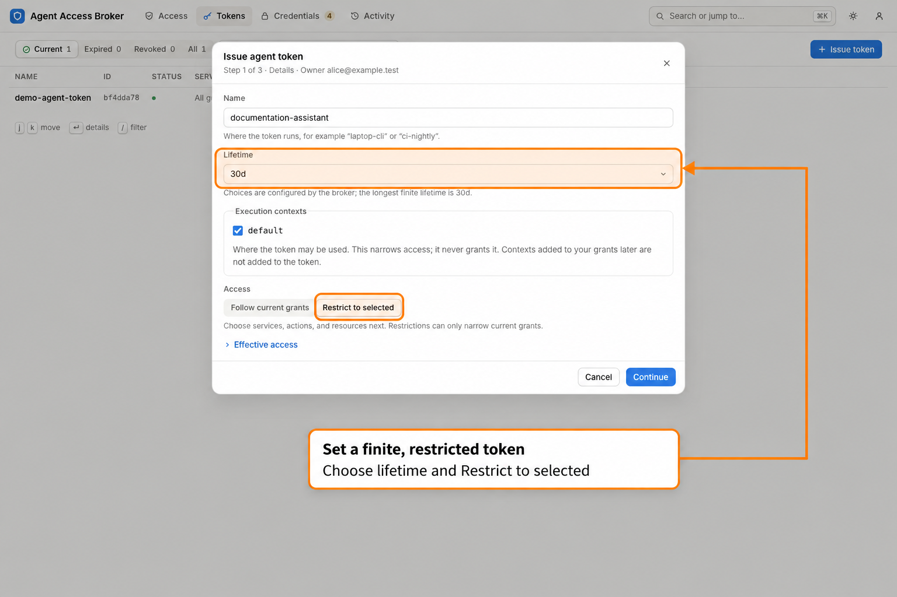
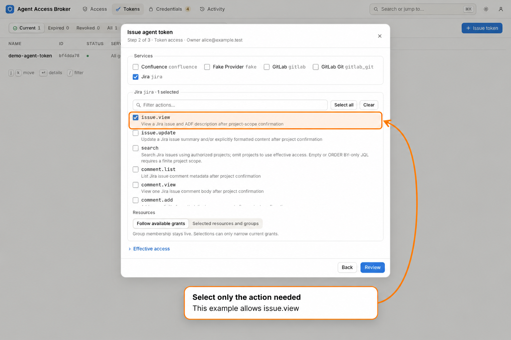
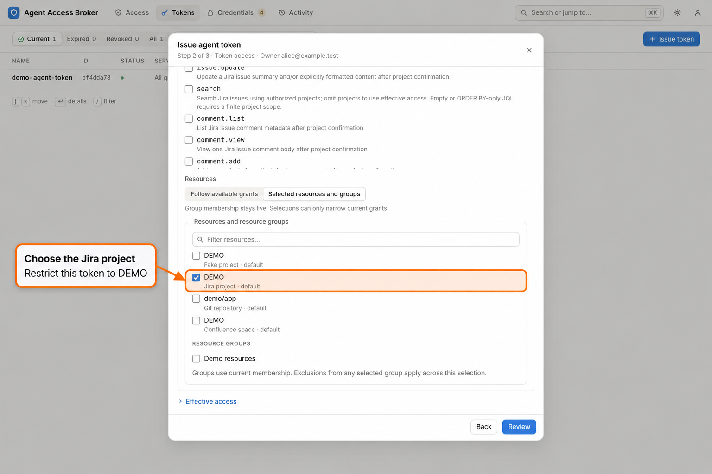
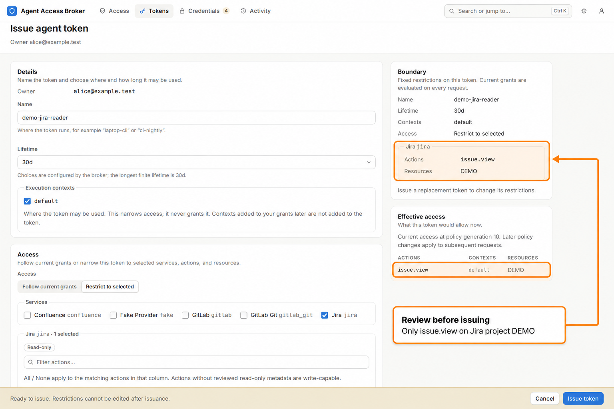
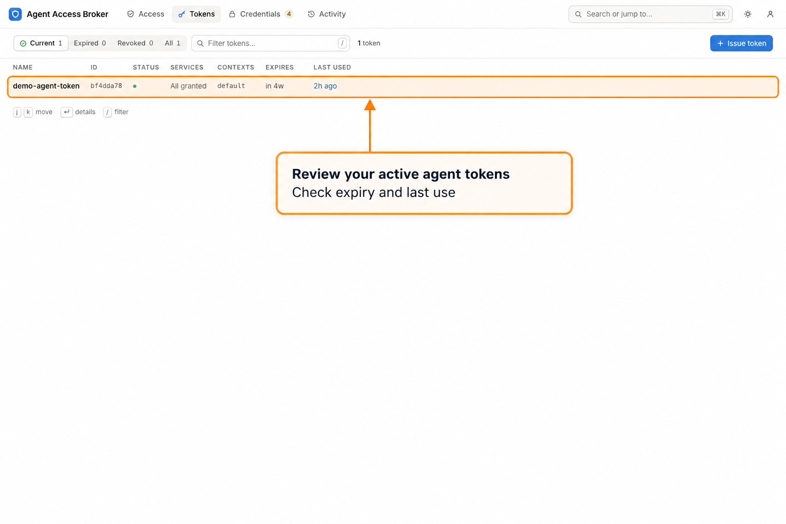
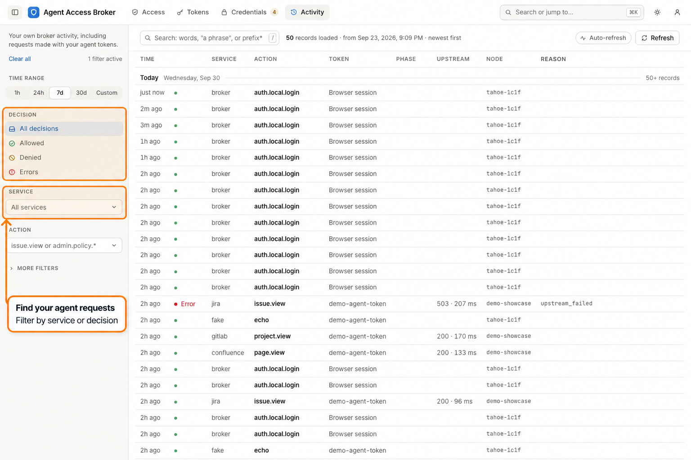
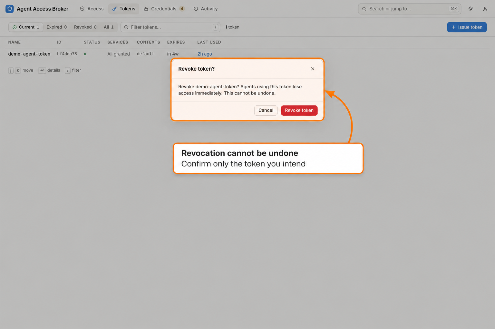

# User self-service walkthrough

Use the portal to check your access, connect an upstream account, and issue a
restricted token for an agent. This walkthrough follows Alice, a synthetic user
with Jira access to the `DEMO` project. Ask your administrator for the broker URL,
your sign-in method, and the services and execution contexts you should use.

The screenshots use synthetic accounts and credentials in the local managed
demo. The demo's Atlassian configuration uses an example host and fake
credentials. Run the CLI invocation below only against a configured deployment
with a real issue you are allowed to read.

For the complete credential, OAuth, and client setup reference, see the
[end-user guide](../end-user-guide.md). Return to the
[portal guide](index.md) for other roles and workflows.

## 1. Sign in and change a temporary password

1. Open the broker's `/ui` URL, for example `https://broker.example/ui`.
2. Enter your account ID in **Principal** and your password in **Password**, then
   choose **Sign in**. If your deployment offers Microsoft sign-in, use that
   method when instructed by your administrator.
3. Check that the signed-in account is yours. If a temporary password requires a
   change, the portal opens **Account** with **Change your password to continue**.
4. Enter the temporary password in **Current password**, enter your chosen
   password in **New password** and **Confirm new password**, and choose
   **Update password**.


*Local password sign-in. Microsoft sign-in appears only when configured.*



*A temporary-password account must finish the password change before using the
other portal pages.*

Expected result: the password-change requirement clears and your permitted
portal navigation becomes available. Later password changes are available on
**Account** for accounts with active local password sign-in. Microsoft-only users
change their password with Microsoft.

If sign-in opens an unexpected Microsoft-linked account, contact your
administrator. If **My access** is missing, your account may have self-service
disabled; **Account** and password settings remain available. Self-service is
independent of your administrative role and invocation grants.

## 2. Inspect your permissions before issuing a token

1. Open **My access > Access**.
2. Find the service your agent needs. Review the available actions, resources,
   execution contexts, and credential requirements.
3. Select an action to inspect its complete resource alternatives and exclusions.
   For this walkthrough, the intended action is Jira `issue.view` within `DEMO`
   and the intended execution context is `default`.



*The access page summarizes current grants. Filtering this page changes the
display, not your permissions.*

Expected result: you can identify an effective grant covering the operation your
agent will perform. Roles, saved credentials, and issued tokens do not create
invocation grants. An empty access page needs administrator attention before you
can issue a useful agent token.

Confirm the context with your administrator. Selecting `default` on a token
narrows where it may be used; it cannot assert a trusted ingress context on an
outgoing request. Changes to grants and resource groups can affect subsequent
requests, including requests made with an existing token.

## 3. Save or replace your upstream credential

A Broker invocation token identifies your agent to the broker. An upstream
credential identifies the broker to Jira or another service. The broker retains
the upstream credential; give your agent only its Broker invocation token.

1. Open **My access > Credentials** and select the credential connection. Each
   row is one connection and lists the services you are granted that use it; a
   shared connection, such as Atlassian for Jira and Confluence or GitLab for
   GitLab REST and Git, needs one token.
2. Check its profile and the services in **Used by**. Use the fields requested
   by the connection; for example, the `atlassian-api-token` profile asks for
   your Atlassian account email and API token.
3. Enter your upstream values and choose **Save credential** for an empty connection.
   If a credential already exists, the drawer shows **Replace secret** and the
   button is **Replace credential**. Supply the required replacement fields.
4. After saving, check the status and verify it as described below.

Credential connections come from the broker's configuration and your permitted
personal credential access. Stored plaintext is never loaded into the
replacement form.

Expected result: the broker saves its encrypted copy and the form clears the
entered fields. Saving does not create service access or prove that the upstream
credential works. Service-mode actions may use a shared credential managed by the
administrator instead of your personal credential.

For supported OAuth services, use the offered connection flow and upstream
consent rather than pasting an OAuth access token into these fields. Each OAuth
registration is one row of the same list, with **Connect account**,
**Reconnect** and **Disconnect**. OAuth setup requires self-service, a credential
connection with OAuth and a matching active `per_user` action grant on a service
that uses it, for you or one of your current groups. An existing connection
remains visible and disconnectable after grant removal; reconnect requires a
matching grant. Rows marked **Not used** are stored credentials no service
reads any more; delete them when you no longer need them. See the [end-user guide](../end-user-guide.md#store-a-credential-or-connect-oauth)
if **Connect** or **Reconnect** is unavailable.

## 4. Verify the saved credential

1. In the credential drawer, choose **Verify**. The broker verifies through one
   of the connection's services.
2. To verify through a Git gateway service, enter a permitted
   `namespace/repository` in **Repository** under **Verify through Git**, then
   choose that section's **Verify**.
3. Read **Status**, **Last checked**, **Last verified**, and any **Last error**.
   The last successful verification time and the latest attempt time are separate.

Expected result: the status reflects the latest supported verification outcome.
An upstream verification establishes the tested credential's access at that time;
it does not guarantee every later action or resource. A local verification does
not establish live upstream access.

If verification fails, inspect the error, check that the credential matches the
configured profile and account, and confirm its upstream permissions. For a
repository check, also confirm the repository path. Replace an expired or invalid
credential and verify again. If the error concerns broker encryption keys or
connectivity, ask the operator to investigate rather than replacing an agent token.

## 5. Issue a token with the smallest useful boundary

This example token allows only Jira `issue.view` for the selected `DEMO` project
in `default`. It does not authorize Jira search or writes.

1. Open **My access > Tokens** and choose **Issue token**. The creation page
   keeps the details, access choices, a summary, and an effective-access
   preview together.
2. In **Details**, give it a descriptive **Name**, such as `demo-jira-reader`.
   Choose a finite **Lifetime** offered by your broker and select the required
   **Execution contexts**.
3. In **Access**, choose **Restrict to selected**.



*Synthetic, unsubmitted token draft. Restrict to selected adds a ceiling to your
current grants. The operator configures the available lifetime choices.*

4. Select Jira, then select only `issue.view` in its **Read-only** column.
   The same action selector is used in the grant builder. **All** and **None**
   affect only search-matching actions in their column, preserving other
   selections. Actions without reviewed read-only metadata appear under
   **Write-capable**.
5. Choose **Selected resources and groups** and select the catalog resource
   representing the `DEMO` Jira project. Avoid choosing a broader group when the
   agent needs just this project.



*Synthetic, unsubmitted token draft. Select only the service and action needed
by this agent task. Unavailable selected actions remain visible for removal.*



*Synthetic, unsubmitted resource choice. Select the Jira project entry. Each
service lists only the resource types its actions use; resource groups may mix
types.*

6. Check **Summary** beside the form and **Effective access** below it.
   Confirm the name, lifetime, contexts, and each service's action and resource
   selection; select a service in the summary to return to its section. The
   preview waits until contexts, services, and actions are complete. An
   explicitly empty resource selection is valid and currently allows no
   resources.



*Synthetic, unsubmitted token draft. The summary and preview update as you edit;
current grants remain necessary on every request.*

7. Choose **Issue token** in the persistent action bar. While anything is
   missing, the bar counts the issues and links to the first one. Keep the page
   open until issuance completes. Copy the token immediately into the agent's
   protected secret location, or retain it only long enough to use the CLI's
   secure token prompt below. The raw token is shown once and cannot be shown
   again after the dialog closes. It is deliberately omitted from this guide's
   screenshots.
8. Close **Token created** to inspect the selected token in the list.

Use **Cancel** to return without issuing, confirming **Discard changes** when
prompted. Unsaved drafts are lost on refresh. Closing or refreshing the page
during issuance can also lose the one-time token response.



*Token metadata remains available after the one-time secret dialog closes.*

Expected result: an active `agent_invoke` token exists with the intended boundary
and expiry. Token issuance never expands your grants. **Follow current grants**
instead follows effective grants within the selected contexts, including later
grant changes. For dedicated automation, the selected boundary makes the intended
access explicit. To change a token's restrictions later, issue a replacement.

## 6. Connect the CLI or an MCP client

Create a separate invocation configuration, replacing `https://broker.example`
with the broker base URL supplied by your administrator:

```toml
# ~/.config/agent-access/agent.toml
[service]
url = "https://broker.example"

[identity]
header = "Authorization"
scheme = "Bearer"
disabled = false
token_file = "~/.config/agent-access/agent.token"
```

Use the prompt to save the newly issued invocation token without putting its
value in a command-line argument:

```bash
agent-access --config ~/.config/agent-access/agent.toml config validate
agent-access --config ~/.config/agent-access/agent.toml auth token set
agent-access --config ~/.config/agent-access/agent.toml auth status
agent-access --config ~/.config/agent-access/agent.toml broker status
agent-access --config ~/.config/agent-access/agent.toml services list
```

Expected result: identity checks show your principal, and service discovery shows
the caller-filtered services available to this token. Keep a `user_manage` setup
token in a separate setup configuration; the invocation token cannot manage
credentials or issue more tokens.

With a real Jira integration and an accessible issue in the selected project,
test the single action this token permits:

```bash
agent-access --config ~/.config/agent-access/agent.toml jira issue view DEMO-42
```

Replace `DEMO-42` with an existing permitted issue. A successful read should return
the issue view. The local screenshot demo does not supply a live Jira issue.
Running a search requires a token and grant that also permit `search`; the example
token above permits only `issue.view`.

For a local stdio MCP client, configure it to launch:

```bash
agent-access --config ~/.config/agent-access/agent.toml mcp serve --service jira
```

Service-specific MCP presentation does not change the token's authorization.
See the [CLI reference](../cli.md) for configuration and commands, and the
[MCP guide](../mcp.md) for complete client configuration and remote HTTP MCP.

## 7. Review your activity

1. Open **My access > Activity**.
2. Filter by service, action, decision, time, or token to find the operation you
   are investigating. For a token that has been used, **View activity** in its
   details opens filtered activity.
3. Select a record to inspect its request timeline. For support, retain the
   reason code, service/action, time, and request identifiers.



*Activity combines recorded invocations, sign-ins, credential changes, token
changes, and denied or failed requests for the signed-in user.*

Expected result: recorded requests explain the decision and correlate related
events. Successful routine metadata reads are not recorded. Queryable personal
activity requires a SQLite audit store; a JSONL-only deployment does not expose
this view. Keep raw tokens, cookies, upstream secrets, and private payloads out of
support reports.

## 8. Replace, pause, or revoke a token

To rotate a token or change its restrictions:

1. Issue a replacement with the intended boundary.
2. Save the replacement in the agent's secret location or use **auth token set**
   to replace the local token file.
3. Verify an allowed read against your configured integration.
4. Open the old token, choose **Revoke**, and confirm **Revoke token**.



*Revoke permanently disables the old token. The confirmation identifies which
agent credential will lose access.*

Expected result: the old token is **Revoked** and cannot authenticate future
requests. Its metadata can remain visible. **Pause token** temporarily disables an
agent token while preserving its secret and boundary; **Resume token** restores it only
when the secret remains trusted. Revocation cannot be undone.

If a token may have been disclosed, revoke it promptly and issue a new one.
Deleting a stored upstream credential removes the broker's encrypted copy; it
does not revoke that credential with the upstream provider.

## Troubleshooting

| What you see | What to check |
| --- | --- |
| My access is missing or `self_service_disabled` | Ask an administrator to enable self-service or manage credentials and tokens for you. |
| No services, actions, or contexts to select | Ask the administrator to review active grants, group membership, and execution contexts. |
| Credential is missing or unverified | Select the configured service/name/profile, save the needed credential, then Verify when supported. |
| `credential_not_found` during invocation | Check that the required personal credential exists, or reconnect the configured OAuth connection. |
| `service_action_denied` | Compare the requested action and resource with current grants and token restrictions. The example token cannot search. |
| `execution_context_denied` | Use the approved ingress and a token/grant covering its context. Selecting a context does not attest it. |
| `broker_token_class_denied` during management | Use a browser session or a separate `user_manage` setup token. |
| `broker_token_paused`, expiry, or revocation | Resume a trusted paused token, or issue and install a replacement. |
| No Activity view | Ask whether the deployment uses queryable SQLite audit and whether self-service is enabled. |
| Failed verification in the local demo | Example hosts and fake credentials do not connect to live Jira, Confluence, or GitLab. Use a configured integration for live verification. |

Further troubleshooting and rotation commands are in the
[end-user guide](../end-user-guide.md#review-activity-and-get-help).
