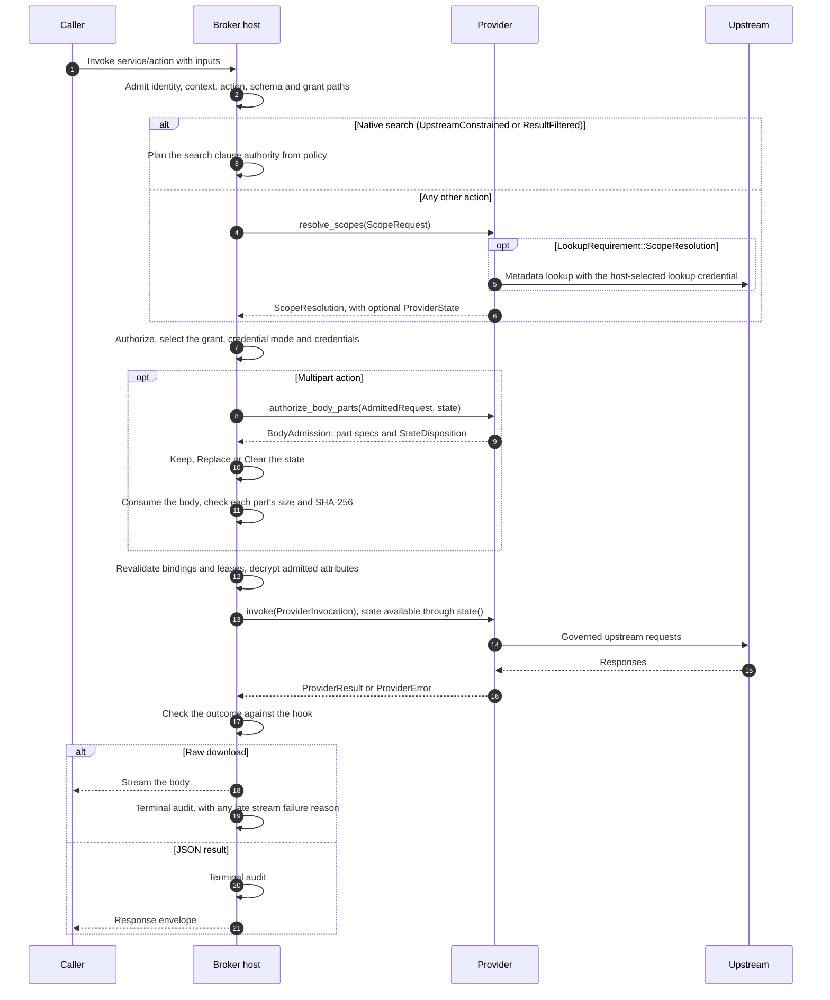
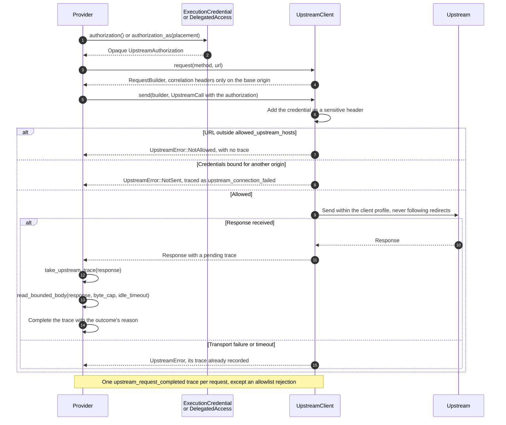
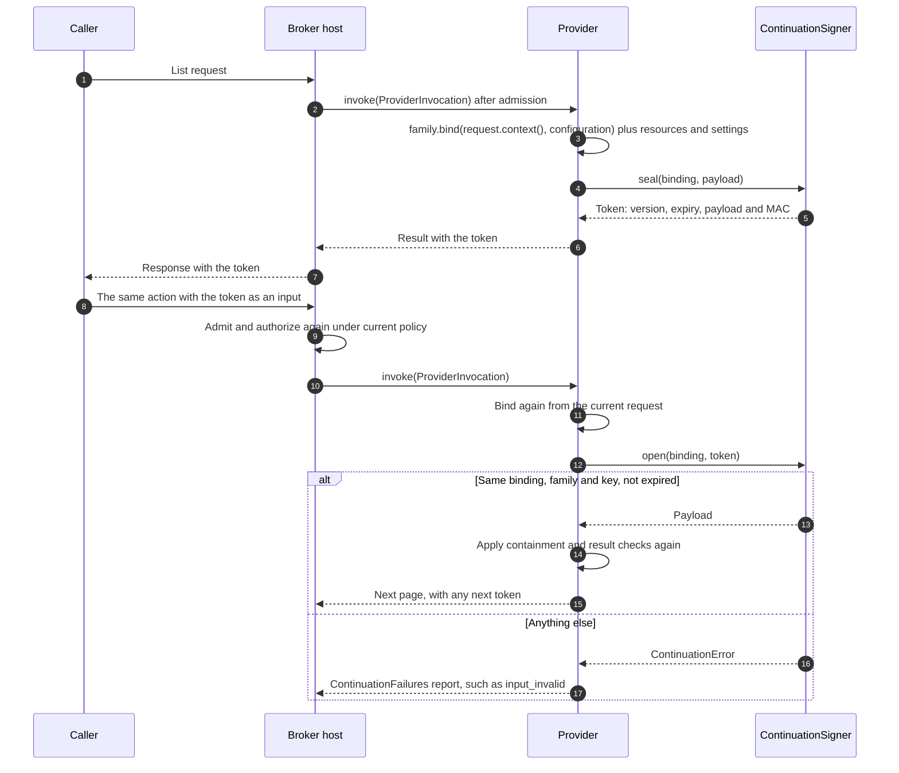

# Provider SDK guide

This guide is for developers who write a native provider: a Rust crate that
gives Agent Access Broker typed actions for one upstream service. A provider
crate depends on the provider SDK, `agent-access-provider`. It declares
configuration, resource types and actions. It resolves the resources an action
touches and executes admitted invocations against its upstream. The Broker host
owns everything around that: identity, policy, credential custody, admission,
limits, audit and process lifecycle.

Providers are ordinary compiled crates. An assembly selects them when it is
built, and changing a provider means rebuilding that assembly. There is no
runtime module loader, plugin protocol or stable binary interface. The upstream
`agent-access-broker` executable is one assembly. Another team can build its own
distribution from upstream crates and its own providers; see the
[downstream assembly guide](downstream-assembly.md).

The surrounding runtime contract is in [the architecture](design.md), wire
reasons and status mapping are in [the HTTP API](http-api.md), and configuration
keys are in [the configuration reference](configuration.md). The
[worked example](#worked-example) at the end is a complete minimal provider.

## Contents

- [Supported surface](#supported-surface)
- [Trust model](#trust-model)
- [Registration and configuration](#registration-and-configuration)
- [Descriptors and scope resolution](#descriptors-and-scope-resolution)
- [Authority and credentials](#authority-and-credentials)
- [Network](#network)
- [Signing and continuations](#signing-and-continuations)
- [Reasons and outcomes](#reasons-and-outcomes)
- [Testing](#testing)
- [Compatibility policy](#compatibility-policy)
- [Worked example](#worked-example)

## Supported surface

The supported Rust interfaces are:

- **The provider SDK**, `agent-access-provider`: the provider contract at the
  crate root, where each item has exactly one path; the `presentation` module;
  the `host` module of host cooperation ports; the `deps` module of third-party
  re-exports; and the `test_support` module behind its `test-support` feature.
  The crate documentation summarizes the same surface.
- **The Broker host's composition interface**, `agent-access-broker-host`:
  `BrokerComposition`, `BrokerApplication`, `AssemblyIdentity` and their
  companion types, plus its test support. Assemblies use them; see the
  [downstream assembly guide](downstream-assembly.md).
- **Selection entry points of shipped modules**: the registration statics of the
  shipped native providers and OAuth dialects, such as
  `agent_access_cloudbees_ci::CLOUDBEES_CI_BACKEND`, and the `registration()`
  functions of the shipped MCP and OpenAPI import adapters.
- **Public types that those signatures expose**, to the extent they expose them.

The checked-in [public API inventory](../api/README.md) lists this surface
item by item. A provider crate's production dependencies are the SDK and,
optionally, ordinary helper libraries. It never depends on `agent-access-core`,
the host, an assembly, the CLI or an import adapter. Upstream enforces this
for its own workspace with `node scripts/check-crate-boundaries.mjs`, and a
downstream provider repository should hold itself to the same rule.

These traits are intentionally implementable:

| Trait | Implemented by |
| --- | --- |
| `Provider` | Each provider instance: scope resolution, body admission, credential verification and invocation. |
| `BackendConfig` | Each provider's parsed `[providers.<kind>]` table. |
| `OAuthDialect` | An OAuth companion for one family of authorization servers. |
| `EmbeddedBodyCodec`, `WholeResultRenderer` | Optional presentation of rich bodies and whole results. |
| `host::UpstreamClientFactory`, `StableSigningKey`, `DelegatedLease` | The host, and deterministic doubles in provider tests. |

Supported types are built through constructors and builders, never struct
literals, so a compatible release can add a field:

- Static registrations and definitions, such as `BackendRegistration`,
  `ResourceTypeDescriptor`, `ProviderReasonDefinition` and
  `ContinuationFamily`, have private fields, `const` builders and accessors.
- Data types whose fields are the data the other side reads, such as
  `ProviderResult` and `ServiceDescriptor`, keep public fields but are
  non-exhaustive and built with `new` and `with_*` builders.
- Inputs only the SDK reads, such as `UpstreamClientSpec`, `RedirectRules` and
  `CredentialPlacement`, and lent credential material, such as
  `DelegatedAccess`, have private fields and constructors.
- Values the host constructs for a request, such as `ScopeRequest`,
  `ExecutionCredential`, `DelegatedBindingId`, `AdmittedRequest` and
  `ProviderInvocation`, have private fields. The `host` module constructs them
  for the host, `test_support` constructs them for provider tests, and provider
  code reads them through accessors. Credential material has no accessor: the
  SDK presents it upstream (see [static credentials](#static-credentials)).

Extendable enums are non-exhaustive. The
[construction and exhaustiveness policy](../api/README.md#construction-and-exhaustiveness-policy)
lists the intentionally exhaustive items.

The following are not supported provider interfaces:

- The Rust API of `agent-access-core`. It is host implementation, even where a
  supported signature exposes one of its types.
- Helper crates such as `agent-access-content`, and the Jira and Confluence
  helpers in `agent-access-atlassian` beside its dialect registration. They are
  ordinary libraries for the first-party providers, not SDK contracts.
- Custom imported-protocol adapters. The MCP and OpenAPI adapters are shipped
  selections only; their construction contract is internal to core.
- Typed CLI wrappers and provider-specific portal plugins. A provider without
  typed CLI commands works through the generic `agent-access invoke`, JSON
  `send`, HTTP and MCP surfaces, and the portal renders its descriptor-driven
  metadata.
- Several configured instances of one native kind. A kind has one
  `[providers.<kind>]` table and one service.

## Trust model

One distribution may link modules owned by several teams. Every linked native
provider, OAuth companion and import adapter is trusted with the entire
deployment: every credential, store, file, environment variable, network route
and audit record the process can reach. The assembler must review and qualify
those dependencies before linking them.

The SDK's checks are cooperation contracts, not a sandbox. Read-only authority
values, privately constructed credentials that providers present upstream
without reading, network wrappers and reason validation keep a cooperating
provider within its contract, and they catch bugs. They cannot stop linked Rust code from deliberately bypassing them, for
example by building another HTTP client or reading process state directly. In
particular:

- The host-origin failure branch ([`host::port_failure`](#contract-failures)) is
  public across crates, so a module could forge a host failure. Modules use host
  ports only in their documented roles.
- Module metadata and the assembly's provenance map are labels, not
  cryptographic attestation; whoever builds the assembly controls them.
- A development-only registration is gated by configuration admission. Linking
  it into a production assembly is permitted; configuring it in production is
  rejected.

Deploy mutually untrusted modules in separate processes or deployments, each
with its own state, keys and credentials. The broader security posture is in the
[security model](security-model.md#linked-module-trust).

## Registration and configuration

### Registration

A provider crate exports one `BackendRegistration` static. Selecting it in an
assembly's composition is the only host change a provider needs:

```text
BackendRegistration::new(module_metadata!(), "notes", parse_backend_config::<NotesConfig>)
    .with_resource_types(&[&NOTEBOOK_RESOURCE])
    .with_domain_reasons(&[&NOTE_ARCHIVED])
```

- `module_metadata!()` captures the declaring package's Cargo name and version.
  The host reports it in the build status's module inventory, and an assembly
  keys its provenance map by it. Several registrations from one package, such as
  a native provider and its OAuth dialect, are roles of the same module.
- The kind is the `[providers.<kind>]` table name and the service ID. It
  matches `^[a-z][a-z0-9_-]{0,62}$`. The host rejects the kind `broker`, a
  kind another selected module uses, and a configured Git gateway or retained
  imported service with the same name. These checks apply even when the
  provider is not configured.
- `with_resource_types` lists the resource types the provider defines, in
  listing order; see [typed resources](#typed-resources).
- `with_domain_reasons` lists the provider's own failure reasons; see
  [domain reasons](#domain-reasons).
- `development_only()` marks a fixture. Configuring it requires a
  non-production deployment with `deployment.enable_fake_service = true`.

An OAuth companion is a separate `OAuthDialectRegistration` static, built with
`OAuthDialectRegistration::new(module_metadata!(), id, &DIALECT)` and selected
independently. Several providers can then share one dialect. The host owns
consent, PKCE, state, encryption, single-flight refresh and connection fences.
A dialect owns the wire protocol: authorization URLs, token requests, identity
and target discovery, and failure classification. It sends each token request
once through `OAuthHttp`, which the host routes. The
[OAuth guide](oauth.md) describes the operator-facing behavior.

### Configuration parsing and validation

The parser deserializes one `[providers.<kind>]` table into a type that
implements `BackendConfig`. `parse_backend_config::<T>` serves any `T` that
derives `Deserialize`. Reject unknown fields with
`#[serde(deny_unknown_fields)]`.

`BackendConfig` methods run offline, at startup, on reload and in
`config validate`:

- `validate(&ValidationContext, &mut errors)` pushes messages that name fields
  under `providers.<kind>`. The context exposes only `deployment.environment`
  (with `production()`), the policy authority, the Broker limits and the
  credential sources configured for this service under `credentials.service`,
  `credentials.per_user` and `credentials.lookup` (`ServiceCredentialKinds`):
  - `service` and `lookup` are each a `CredentialSource`: `Static` with the
    configured kind and the token profile the entry names, if any, or
    `SecretStore`. Match it with a fallback arm that rejects other sources.
    `lookup` is the shared read-only lookup credential, which is never
    execution material: a backend that requires an execution credential does
    not count it.
  - `per_user_profiles` are the token profiles the per-user credential
    connection accepts, from both of its lists, as this service declares them
    (`CredentialProfile`: name, kind, label and route-bound flag).
  - `per_user_delegated` is set whenever the connection offers delegated
    access; a backend that cannot use delegated access rejects it.
  - `per_user_secret_store` is set for a `secret_store` per-user entry, whose
    records each carry their own kind, known only at run time.

  The context does not expose the rest of the configuration or any store.
- `validate_resource_attributes` checks private resource values against the
  active configuration. Its diagnostics must not contain the supplied values,
  because administrators see them.
- `descriptor()` returns the service descriptor. It depends on the
  configuration alone, because offline validation calls it before any provider
  exists. A descriptor may vary with configuration; Jira and Confluence omit
  write actions when their content formats are disabled.
- `egress_proxies()` lists configured per-service proxies with their
  configuration labels. The host checks each proxy at startup, even when an
  environment proxy takes precedence.

The SDK provides pure validators for common fields:
`validate_upstream_base_url` (HTTPS, or loopback HTTP outside production),
`validate_upstream_allowlist`, `validate_egress_proxy_config`,
`validate_tenant_host` and the attachment and limit relation checks. For any
other list of URL patterns, such as destinations a provider lets the upstream
deliver to, `validate_url_patterns` applies the allowlist grammar (a fixed
host, no embedded credentials, path segments that are literal, `*` or `**`)
under a `UrlPatternPolicy` that chooses the schemes, whether the list may be
empty, and whether queries, fragments and normalized repeats are rejected.
`base_covered_by_patterns` checks offline that an allowlist reaches an API base
the provider uses: some pattern on the base's scheme, host and port must be able
to match a path at or under it (its path glob intersects `base/**`, with `*` and
`**` anywhere), and query constraints are ignored. Coverage is not permission:
each request is still checked against the allowlist. None of them reads files,
the process environment or secret references; the host resolves secret
references such as a proxy's `password_ref`.

### Building a provider

`build(&BuildContext)` constructs the provider for one runtime generation. It is
synchronous and offline. It may prepare clients and local capabilities, but it
never contacts an upstream, verifies a credential or refreshes OAuth. The build
context offers:

- `limits()`, the Broker's `ProviderLimits`;
- `clients()`, the host's upstream client factory (see [network](#network));
- `attribution()`, the attribution footers enabled for this service;
- `stable_signing_key()`, the stable key scoped to this service, when one is
  configured (see [signing](#signing-and-continuations)).

A failure is a `ProviderBuildError`. `ProviderBuildError::invalid` carries a
safe configuration diagnostic. When the host could not construct a client,
`UpstreamClient::build` returns an error that keeps the host's own cause for its
logs.

A reload builds a new provider from the new configuration and leaves admitted
operations on the generation that admitted them. A reload cannot link or unlink
a crate; that needs a new build and a restart.

## Descriptors and scope resolution

### Service descriptors

The `ServiceDescriptor` is the one authoritative description of the service.
Configuration validation, policy validation, admission, discovery, the runtime
catalog, OpenAPI, the send schema, MCP tools and the portal's credential forms
all read it. The host validates every descriptor before activation and in
`config validate`; see [the descriptor checks](design.md#service-descriptors).

Build actions with `ActionDescriptor::new(name, description, input_schema)` and
its builder methods:

| Method | Declares |
| --- | --- |
| `.scope(name)` | The resource scope the action is authorized against. Without one the action is action-only. |
| `.credential_modes(["service", "per_user"])` | The grant modes that may select its credentials. |
| `.token_only()` | That the upstream accepts only a static (token) credential for the action, never delegated (OAuth) access. See [token-only actions](#token-only-actions). |
| `.read_only()` | A reviewed read. Actions default to `read_only = false`; never infer it from a name. |
| `.reports_universal_reach()` | Ask the host whether this scoped native read has effective access to every resource in its selected credential mode; see [universal reach](#universal-reach). |
| `.lookup(LookupRequirement::ScopeResolution)` | That scope resolution needs a host-selected lookup credential before policy. `LookupRequirement::Execution` asks for one only at execution. |
| `.native_search(NativeSearchEnforcement::UpstreamConstrained)` or `.native_search(NativeSearchEnforcement::ResultFiltered)` | Reviewed native search with a complete host-admitted boundary and the declared query/result enforcement. |
| `.listing_of(resource_type)` | Explicit live enumeration of the action's scoped resource type; advertises `listingOf` for discovery. |
| `.raw_download()`, `.multipart_upload(plan)` | Streamed response bodies, or admitted file uploads. |
| `.resource_attributes()` | That dispatch needs the private attributes of the one admitted exact resource. |
| `.sensitive_output(pointer)` | A JSON pointer into `/result` whose value is a deliberate secret. The host sends such responses with `Cache-Control: no-store`. |
| `.requires_stable_signing_key()` | That the action issues durable handles, so the Broker must hold a stable key. |
| `.documentation(json)`, `.presentation(..)`, `.attribution(..)`, `.upstream_resource_ownership(..)` | Extended usage text, rich rendering, attribution footers and static ownership metadata. |

Keep the description and input schema concise; they are part of initial MCP tool
discovery. Put grammar, limits and examples in `documentation`, which detailed
discovery, OpenAPI and the send schema carry but MCP tool definitions omit.

`listing_of(ResourceType)` declares ordinary live enumeration of canonical items
of that type without a required query, such as a project collection. Query
searches and collections of other objects must not declare it. It requires a
scoped, reviewed read-only JSON action
whose scope binds that same resource type, with native search enforcement and
without private resource attributes. Capabilities and catalogs expose the type
as `listingOf`; OpenAPI and send projections carry
`x-agent-access-listing-of`. Generic resource-access discovery uses this metadata
for `liveListings` only when the caller can use the listing action. The listing
has its own grants and credentials: its results do not enumerate another
action's authority. A name such as `project.list` alone declares nothing.

`CredentialDescriptor` states whether invocations need a broker-selected
execution credential (`CredentialDescriptor::without_execution_credential()`
when they do not), which static kinds `credentials.service.<service>` accepts,
the token profiles a credential connection may store, inputs that credential
verification needs, and, with `.delegated(description)`, that per-user
delegated OAuth credentials are accepted.

Declare a token profile with `.profile(name, kind)`, or with
`.with_profile(CredentialProfile::new(name, kind))` to add the options below.
Declare each name once: descriptor validation rejects a repeated profile.

- `.with_label(label)`, the name people see where they choose a token type
  (management falls back to the profile name);
- `.route_bound()`, which marks a profile only this provider may present,
  because the provider decides where it goes (for example, by its upstream
  route). The host never lets a Git gateway present a route-bound profile:
  configuration rejects a connection that lists one beside a Git gateway
  consumer, and the gateway and Git verification refuse such a credential, or
  one whose profile no service declares, before sending anything.

```rust check
use agent_access_provider::{CredentialDescriptor, CredentialProfile};

/// A site token and a route-bound token the provider sends elsewhere.
fn credentials() -> CredentialDescriptor {
    CredentialDescriptor::default()
        .profile("notes-api-token", "basic_api_token")
        .with_profile(
            CredentialProfile::new("notes-gateway-token", "bearer_token")
                .with_label("Gateway token")
                .route_bound(),
        )
}
```

`.with_upstream_authority(authority)` declares the upstream instance the
service's credentials act on, derived from its configuration alone: an
`UpstreamAuthority` built with `UpstreamAuthority::from_base_url` (a normalized
origin and instance path), optionally `.with_tenant(id)` and
`.with_tenant_gateway(url)`. Services that consume one credential connection
with token profiles must declare authorities naming the same instance
(`UpstreamAuthority::same_instance`): the same origin and instance path, and
the same tenant and tenant gateway, or neither. Declare a tenant in one
canonical spelling, since it is compared exactly. An OAuth connection's dialect
checks each consumer's authority (see [delegated access](#delegated-access)). A
service that declares none cannot share a token connection with another
service.

### Token-only actions

Mark an action `.token_only()` when the upstream documents the operation as
needing a token, such as one that accepts only a personal access token. The
host applies the marker with the credential mode that wins each grant region,
after grant precedence, never with the caller's personal method alone:

- Where a `per_user` grant wins and the caller's credential connection selects
  OAuth, discovery hides the action and invocation denies it without ever
  acquiring, refreshing or using the caller's OAuth credential, and never falls
  back to a lower grant or to another credential. When the action's lookup
  would use the caller's own credential, the denial is
  `credential_not_provisioned` before any lookup. When a shared lookup
  credential resolves scope first, as with mixed `service` and `per_user`
  grants, that lookup runs and final policy then denies the winning `per_user`
  grant as `scope_unresolved`.
- A `service` region with its static credential, and a `per_user` region whose
  connection selects a stored token, keep the action usable, so the provider
  receives only static execution material for it.

The marker matters only for a service that also declares `.delegated(..)`; it
is part of the native descriptor contract, and imported services' descriptors
never carry it.

```rust check
use agent_access_provider::ActionDescriptor;
use agent_access_provider::deps::serde_json::{Map, Value};

/// Issuing a notebook API key needs a personal token upstream, so delegated
/// access never reaches it.
fn key_create() -> ActionDescriptor {
    let mut schema = Map::new();
    schema.insert("type".to_owned(), Value::String("object".to_owned()));
    ActionDescriptor::new("key.create", "Issue an API key", schema.into())
        .scope("notebook")
        .credential_modes(["service", "per_user"])
        .token_only()
}
```

### Typed resources

A `ResourceTypeDescriptor` static defines one resource type.
`ResourceTypeDescriptor::new(id, label, plural_label, example, canonical,
attributes)` takes an identifier (`^[a-z][a-z0-9_]{0,63}$`), labels, an
example, a canonical-target grammar and the type's private string attributes
(`&[]` for none), and supports exact and all selectors.
`with_namespace(NamespaceSelectorDescriptor::new(..))` adds namespace selectors
and `with_action_inputs` adds an action-input projection. Exact selectors and every resolved target must
satisfy the canonical grammar, which keeps namespace prefix matching sound.
Policy validation, resource management, discovery and the portal read the
published metadata.

Both `new` and `declared` default to supporting group exclusions.
`with_supports_exclusions(false)` opts a type out, and `supports_exclusions()`
reads the capability; both methods are `const`. The published metadata always
includes the resolved `supportsExclusions` boolean. Opting out prevents any
resource of the type from becoming an excluded group member; direct and group
inclusions still work. This applies to every action using the type. Use separate
types when actions need different exclusion capabilities.

Private attributes (`ResourceAttributeDescriptor::required` or `optional`)
are secret values on exact managed resource entries, such as a Teams Workflow
URL. The host encrypts them, reveals them only through an audited administrator
action, and decrypts only the admitted resource's attributes immediately before
dispatch. Declare a nonempty attribute list as its own `static` and pass a
reference to it: attribute descriptors own their data, so an inline array is not
promoted to a `'static` borrow.

```rust check
use agent_access_provider::{ResourceAttributeDescriptor, ResourceType, ResourceTypeDescriptor};

pub static DESTINATION_RESOURCE: ResourceTypeDescriptor = ResourceTypeDescriptor::new(
    ResourceType::from_static("example_destination"),
    "Destination",
    "Destinations",
    "release-alerts",
    is_destination_name,
    &DESTINATION_ATTRIBUTES,
)
.with_supports_exclusions(false);

static DESTINATION_ATTRIBUTES: [ResourceAttributeDescriptor; 1] =
    [ResourceAttributeDescriptor::required(
        "webhookUrl",
        "Webhook URL",
        "Signed endpoint that receives notifications",
        |value| value.starts_with("https://"),
    )];

fn is_destination_name(value: &str) -> bool {
    (1..=64).contains(&value.len()) && value.bytes().all(|b| b.is_ascii_lowercase() || b == b'-')
}
```

The host always registers the `git_repository` type. A provider may scope
actions to it, as GitLab REST does, instead of defining its own. The registry
rejects duplicate type identifiers across selected providers.

A `ResourceTypeRegistry` holds shared descriptors (`Arc<ResourceTypeDescriptor>`):
`new` registers a build's statics and `from_shared` any shared descriptors in
order. The host also registers types declared at runtime, such as those an
imported service describes. `ResourceTypeDescriptor::declared` and
`ResourceAttributeDescriptor::declared` build them, attributes included, from
owned labels and a `ResourcePattern`: a regular expression in the `regex`
crate's linear-time dialect that must match the whole value within a
byte-length bound, and must be a complete expression on its own. Providers
define static types; the host owns declared ones.

`Provider::resource_roots` may return configuration-derived roots of a type,
such as CloudBees CI controller aliases, which discovery filters by each
caller's coverage. Neither roots nor renderer support authorize anything. Each
action has one resource scope, but that scope may name several resources that
one grant must cover together, as GitLab cross-project operations do.

### Scope resolution

```text
async fn resolve_scopes(&self, request: ScopeRequest<'_>) -> Result<ScopeResolution, ProviderError>;
```

The host calls `resolve_scopes` for every ordinary action before it authorizes
the action. The `ScopeRequest` carries the service and action, inputs validated
against the schema, the host-selected execution context, the minimal caller
identity, correlation and, only for `LookupRequirement::ScopeResolution`
actions with a viable grant path, the host-selected
[lookup access](#lookup-access) (`lookup_access()`). It carries no admitted
authority and no execution credential. A provider must not use another lookup
credential or fall back to a shared one.

- A local resolver parses the inputs and returns at once:
  `ScopeResolution::resources(scopes)`, where `ResourceScopes` maps each scope
  name to its canonical values.
- An action-only provider returns `ScopeResolution::no_resources()`.
- A provider that looks up upstream metadata must use only the lookup
  access.
  The host keeps lookup failures concealed until resource authorization has
  succeeded.

The host then intersects the scopes with token restrictions and selects one
grant covering every required resource. Native search actions with `native_search`
set to `UpstreamConstrained` or `ResultFiltered` skip this hook; the host plans
their clause authority from policy instead (see
[authority variants](#authority-variants)).

### Provider state and body admission

A provider can carry what one hook learned to its later hooks in the same
prepared operation with `ScopeResolution::with_state(ProviderState::new(value))`.
`ProviderState` holds owned `'static` data behind an `Arc`, so clones share it
and its `Debug` output is redacted. The host carries it without inspecting,
serializing or merging it, and it never reaches another generation's provider.
Prefer immutable snapshots; any interior mutation, including under cancellation,
is the provider's responsibility.

Read state with `ProviderState::require::<T>` when the hook needs it, or
`ProviderState::optional::<T>` when it may be absent. Missing state, or state of
another type, is a `ProviderStateError`. Returned with `?`, it becomes the host's
`broker_provider_contract_failed` with a diagnostic code; the state's contents
are never logged.

```rust check
use agent_access_provider::{
    ProviderError, ProviderInvocation, ProviderState, ResourceScopes, ScopeResolution,
};

/// What scope resolution learned upstream, reused when the action runs.
struct ResolvedNote {
    notebook: String,
    revision: u64,
}

fn resolved(notebook: String, revision: u64) -> ScopeResolution {
    let scopes = ResourceScopes::from([("notebook".to_owned(), vec![notebook.clone()])]);
    ScopeResolution::resources(scopes)
        .with_state(ProviderState::new(ResolvedNote { notebook, revision }))
}

fn resolved_note(request: &ProviderInvocation) -> Result<(&str, u64), ProviderError> {
    let note = ProviderState::require::<ResolvedNote>(request.state())?;
    Ok((note.notebook.as_str(), note.revision))
}
```

Multipart actions admit their file metadata before the host reads the body.
`authorize_body_parts(&AdmittedRequest, Option<&ProviderState>)` returns
`BodyAdmission::new(part_specs, disposition)`, where the disposition states what
happens to the state:

- `StateDisposition::Keep` keeps the state the hook received;
- `StateDisposition::Replace(state)` replaces the whole state; to keep scope
  and admission data, compose them into one value;
- `StateDisposition::Clear` drops it.

There is no default disposition, and missing state never means Keep. The
admission view has neither body data nor decrypted private attributes, and it
cannot change the service, identity, authority, credential selection or policy.
After admission the host consumes the body and checks each part's declared size
and SHA-256. At invocation the provider still checks that each part matches the
metadata it admitted. The default `authorize_body_parts` denies every multipart
request with `body_malformed`.

## Authority and credentials

### The admitted request

After policy admits an operation, the host builds a read-only admitted context
and hands the provider a `ProviderInvocation`. Its accessors are the provider's
only view of the operation:

| Accessor | Value |
| --- | --- |
| `service()`, `action()` | The admitted service and action. |
| `execution_context()` | The context the host authorized. It never comes from a tool input. |
| `identity()` | The principal and whether it authenticated, nothing more. |
| `correlation()` | Request identifiers for upstream correlation headers. |
| `credential_mode()` | `CredentialMode::Service` or `CredentialMode::PerUser`. |
| `authority()`, `resource_scopes()`, `search_authorization()` | The exact admitted authority. |
| `universal_reach()` | Whether an opted-in read has universal same-mode resource coverage for disclosing metadata already carried in the same upstream response. |
| `inputs()` | Inputs validated against the action's schema. |
| `execution()`, `lookup_access()` | The selected execution material and any [lookup access](#lookup-access). |
| `body_parts()`, `resource_attributes()`, `state()` | Staged body parts, the admitted resource's private attributes and provider state. |

`context()` returns the shared `AdmittedContext`, which continuation bindings
use. Live invocation, credential, stream and state values implement neither
`Serialize` nor `Deserialize`, and credential `Debug` output is redacted.
Providers never read credential material (see
[static credentials](#static-credentials)); keep private resource attributes
and other secrets out of results, audit data, error messages and logs.

The host owns ordering. It admits identity, context, action, schema and grant
paths; the provider resolves scopes; the host authorizes and selects
credentials; the provider admits multipart metadata; and the host stages the
body. Immediately before dispatch the host revalidates private resource
bindings, decrypts only the admitted resource's attributes and revalidates
delegated leases. The provider then performs its own execution-side checks with
the execution credential. Lookup authority never substitutes for execution
authority.

One invocation, with the provider's hooks and the provider state they pass on:



### Authority variants

`InvocationAuthority` is chosen from the action's validated contract:

- `ActionOnly`: an action without a resource scope. It never inherits resources.
- `Resources(ResourceScopes)`: the canonical resources one admitted grant
  covers. An ordinary scoped action never receives empty authority.
- `Search(SearchAuthorization)`: the complete search boundary of a
  native search or scoped command-enforced action: a scope type and a normalized
  `SearchAuthorizationScope`, constructed from `SearchAuthorizationClause` values.
  Each clause admits its included selectors minus its excluded selectors; the
  scope unions clauses. Empty clauses admit nothing. Namespace selectors use the
  shared descendant matcher and retain exclusions local to each grant.

`resource_scopes()` and `search_authorization()` return the expected variant,
or an `AuthorityMismatch` that `?` turns into `broker_provider_contract_failed`.
`UpstreamConstrained` providers constrain the upstream query before pagination
and check every result. `ResultFiltered` providers may retrieve unauthorized
candidates with the admitted execution credential, but discard them before any
output, presentation, audit, object IDs, traces, or continuation payload. Both
check current resource ownership with `SearchAuthorizationScope::matches`.
Neither mode replaces authority with the descriptive `*` envelope summary.
Imported descriptors always have `native_search: None`; core separately classifies
command enforcement from accepted resource declarations and input pointers.

The SDK supplies normalized union/intersection, `covers` proofs over the complete
union, and `exact_projection()` for consumers with exact/all resource types.
Jira and Confluence use that strict projection to compose JQL/CQL; unexpected
namespaces are contract errors. `ExactSearchProjection` is derived query data,
not an alternative accepted invocation authority. Core owns the command
protocol's exact resources/any-except projection and preserves per-grant modes.

Act on the admitted resources, not on raw inputs. When an input names the
resource, check that it equals the admitted value before you use it.

### Universal reach

An ordinary scoped native read may opt into
`ActionDescriptor::reports_universal_reach()`. The host then computes
`universal_reach()` after selecting the source operation's policy and execution
credential, using that admission's policy snapshot, caller, execution context
and token caveats. The value is immutable on `AdmittedContext`,
`AdmittedRequest` and `ProviderInvocation`, and is `false` without the opt-in.

`true` means the same action's effective reach covers every canonical resource
of its scope type in the already-selected credential mode. The host combines
ordinary effective clauses, retaining grant-local exclusions, per-target
precedence, competing credential modes and token resource restrictions, and
proves coverage of the universal selector. Merely covering all currently
registered resources is insufficient. Several positive grants can jointly
cover every resource; a winning different-mode grant can leave a gap even if
the caller can read that resource in its other mode.

This value permits disclosure of metadata about other resources already
carried in the same upstream response. It grants no additional authority:
`InvocationAuthority::Resources` remains the source operation's exact scopes.
Providers must not use the value to make requests for other resources, acquire
credentials, widen the source scopes, or infer that a later direct read will
succeed. Upstream permissions and separate lookup visibility still apply.
Jira uses it to request embedded `issuelinks` in the source issue read; it does
not resolve or fetch linked issues.

The host rejects this opt-in for unscoped actions, writes, native searches,
resource-attribute-bound actions and imported or command-enforced actions.
The proof depends on the resource scope being the action's only
target-dependent authorization input. Revisit it before adding issue-level,
issue-type or other target-specific authorization.
The hint is not a catalog, OpenAPI, send-schema or tool-input field.

Host constructors supply `host::AdmittedRequestParts.universal_reach`;
they must pass `false` unless the host established the proof above. This
required field follows that struct's intentionally exhaustive construction
contract. Provider tests use `InvocationBuilder::universal_reach(bool)`,
whose default is `false`; test opt-in behavior through real host admission as
well as through synthetic invocations.

### Static credentials

`execution()` returns `ExecutionAccess`:

- `ExecutionAccess::None`: the action needs no broker-selected credential, as
  for a Teams Workflow whose authority is a private resource attribute.
- `ExecutionAccess::Static(ExecutionCredential)`: one of the two static kinds.
- `ExecutionAccess::Delegated(DelegatedCredential)`: a person's delegated
  connection, described below.

Static and delegated material never coexist. The static kinds are exactly
`basic_api_token` and `bearer_token`, and `ExecutionCredential::kind()` returns
the `StaticCredentialKind`. `ExecutionCredential::profile()` returns the token
profile the credential was stored or configured as: a credential connection
token's own stored profile, or the `profile` a `credentials.service` or
`credentials.lookup` entry names. It is `None` for a configured credential
without one and for `secret_store` records. A provider whose profiles need
different handling, such as different upstream routes, may branch on it, and
must refuse a profile it does not recognize rather than treat it as another.
Only the host constructs credentials, so the material a kind requires is
always present. Provider-defined kinds and credential JSON are not supported.

Provider code never reads credential material and never holds a request that
carries it. Neither an `ExecutionCredential` nor `DelegatedAccess` has a
plaintext accessor. The provider turns the credential into an opaque
`UpstreamAuthorization` and hands it to the upstream client's send method with
the request; the client adds the header to the request it builds, immediately
before dispatch:

- `credential.authorization()` presents the credential in its kind's own HTTP
  authentication scheme, as stored: `Authorization: Basic` with the username
  and token for `basic_api_token`, and `Authorization: Bearer` with the token
  for `bearer_token`.
- `credential.authorization_as(&placement)` presents it in the
  `CredentialPlacement` the upstream requires. The placement checks the kind
  and material first and fails with a `CredentialPlacementError`
  (`KindMismatch` or `InvalidMaterial`, both non-exhaustive variants) instead of
  sending anything:

  | Placement | Header | Accepts |
  | --- | --- | --- |
  | `CredentialPlacement::bearer()` | `Authorization: Bearer <token>` | A `bearer_token` credential or delegated access whose token is 1 to 32,768 visible ASCII characters, with no space. |
  | `CredentialPlacement::basic()` | `Authorization: Basic <base64 of username:token>` | A `basic_api_token` credential with a non-empty username and token. |
  | `CredentialPlacement::header(name)` | `<name>: <token>` | The same tokens as `bearer()`, as the whole header value, such as an API key. |

  The host-only `host::token_as_basic(username)` placement, which presents a
  token as HTTP Basic under a configured username, is for the host's own Git
  gateway. Provider crates never use it, and the crate-boundary check rejects
  it there.

- `UpstreamCall::new(operation).with_authorization(&authorization)` sends a
  request with the credential; `with_authorizations(&[..])` sends several,
  such as an API key and a separate transport token, in order. The client adds
  each header right after its correlation headers, before the headers the
  provider set, or in place of a provider header with the same name. For a
  redirect chain, `RedirectRules::with_authorization` presents it on every hop
  within the chain's authorized path, after the hop's decoration (see
  [requests, redirects and traces](#requests-redirects-and-traces)).
- The header value is marked sensitive, so the client refuses a request to
  another origin than its base that would carry it (see
  [credentials and origins](#credentials-and-origins)). An
  `UpstreamAuthorization` exposes nothing, and its Debug output names only the
  header.

The client sends the same bytes as reqwest's `basic_auth` and `bearer_auth`.
A provider has no other way to present a credential: there is no query
parameter or cookie placement, and no request signing with the material.
Release builds offer no credential comparison. With the `test-support` feature,
credentials and delegated access compare with `==`, in constant time over
digests of their material, so a test double records the credential it received
and compares it with the one the test expects.

When the selected kind is not one the provider can use, deny with
`credential_not_provisioned`. `StaticCredentialKind` is non-exhaustive, so a
match on it ends with an arm that rejects every other kind. Declare the
accepted service kinds and managed profiles in the descriptor so administrators
see the right forms.

```rust check
use agent_access_provider::deps::http::{HeaderName, Method};
use agent_access_provider::deps::reqwest::Response;
use agent_access_provider::deps::url::Url;
use agent_access_provider::{
    CredentialPlacement, ExecutionCredential, ProviderError, ReasonCode, StaticCredentialKind,
    UpstreamAuthorization, UpstreamCall, UpstreamClient,
};

/// The selected bearer token, or a denial for any other kind.
fn bearer_authorization(
    credential: &ExecutionCredential,
) -> Result<UpstreamAuthorization, ProviderError> {
    match credential.kind() {
        StaticCredentialKind::BearerToken => Ok(credential.authorization()),
        _ => Err(ProviderError::deny(
            ReasonCode::CredentialNotProvisioned,
            "notes needs a bearer token",
        )),
    }
}

/// The selected token as the `X-Api-Key` header the upstream reads.
fn api_key(credential: &ExecutionCredential) -> Result<UpstreamAuthorization, ProviderError> {
    credential
        .authorization_as(&CredentialPlacement::header(HeaderName::from_static(
            "x-api-key",
        )))
        .map_err(|_| {
            ProviderError::deny(
                ReasonCode::CredentialInvalid,
                "the selected credential is not an API key the upstream accepts",
            )
        })
}

/// GETs `url` with the credential; the client adds it when it sends.
async fn get_note(
    client: &UpstreamClient,
    url: Url,
    credential: &ExecutionCredential,
) -> Result<Response, ProviderError> {
    let authorization = bearer_authorization(credential)?;
    client
        .send(
            client
                .request(Method::GET, url)
                .header("Accept", "application/json"),
            UpstreamCall::new("note.view").with_authorization(&authorization),
        )
        .await
        .map_err(|error| ProviderError::error(error.reason_code(), "notes request failed"))
}
```

### Delegated access

A service that accepts per-user OAuth connections declares
`CredentialDescriptor::delegated(description)`. Its invocations receive a
`DelegatedCredential` that wraps the host's lease. Binding a connection to an
OAuth registration does not prove which upstream resource or API audience the
token serves, so the provider must check that on every use:

1. Before each upstream request, including each page or detail call of one
   invocation, call `revalidated_access_for(target, audience).await`. It
   confirms the connection is still current and renews stale access, then
   returns the access only when it is bound to exactly the target and issued for
   exactly the audience the provider requires.
2. Return a `DelegatedAccessError::Revalidation` failure unchanged. Deny a
   `DelegatedAccessError::Mismatch` with `credential_invalid`.
3. Send the request with the access it returned, as `access.authorization()`
   (`Authorization: Bearer`) or `access.authorization_as(&placement)`, through
   `UpstreamCall::with_authorization` (see
   [static credentials](#static-credentials)). The client presents it only to
   the provider's own origin (see
   [credentials and origins](#credentials-and-origins)). The provider reads the
   access's target, audience, version and expiry, never its token.
4. Follow a redirect chain with a `RedirectAuthorizer` given to
   `RedirectRules::with_authorizer`, never with one access for the whole chain:
   the client asks it for each authorized hop immediately before sending that
   hop, so the authorizer calls `revalidated_access_for` per hop, as the
   example below does.

```rust check
use agent_access_provider::{
    DelegatedAccessError, DelegatedCredential, ProviderError, ReasonCode, UpstreamAuthorization,
};

const NOTES_TARGET: &str = "https://notes.example.com/";
const NOTES_AUDIENCE: &str = "https://notes.example.com/api";

/// The authorization to present on the next upstream request, with the access
/// version an upstream 401 would reject.
async fn delegated_authorization(
    credential: &DelegatedCredential,
) -> Result<(UpstreamAuthorization, String), ProviderError> {
    let access = credential
        .revalidated_access_for(NOTES_TARGET, NOTES_AUDIENCE)
        .await
        .map_err(|error| match error {
            DelegatedAccessError::Revalidation(failure) => failure,
            _ => ProviderError::deny(
                ReasonCode::CredentialInvalid,
                "the connected account does not grant access to the notes service",
            ),
        })?;
    Ok((access.authorization(), access.version().to_owned()))
}
```

A download that follows redirects revalidates the access for each authorized
hop through a `RedirectAuthorizer`. Here one workspace's path on a notes origin
shared by many workspaces is the authorized path, so a redirect to another
workspace is never sent:

```rust check
use agent_access_provider::deps::async_trait;
use agent_access_provider::deps::reqwest::Response;
use agent_access_provider::deps::url::Url;
use agent_access_provider::{
    DelegatedAccessError, DelegatedCredential, ProviderError, ReasonCode, RedirectAuthorizer,
    RedirectRules, UpstreamAuthorization, UpstreamClient, UpstreamError,
};
use std::time::Duration;

const NOTES_TARGET: &str = "https://notes.example.com/";
const NOTES_AUDIENCE: &str = "https://notes.example.com/api";

/// Presents access revalidated immediately before each authorized hop.
struct DelegatedHops<'a>(&'a DelegatedCredential);

#[async_trait]
impl RedirectAuthorizer for DelegatedHops<'_> {
    async fn authorize(&self, _hop: &Url) -> Result<UpstreamAuthorization, ProviderError> {
        let access = self
            .0
            .revalidated_access_for(NOTES_TARGET, NOTES_AUDIENCE)
            .await
            .map_err(|error| match error {
                DelegatedAccessError::Revalidation(failure) => failure,
                _ => ProviderError::deny(
                    ReasonCode::CredentialInvalid,
                    "the connected account does not grant access to the notes service",
                ),
            })?;
        Ok(access.authorization())
    }
}

/// Downloads `url`, an attachment of the workspace at `workspace`, following
/// its storage redirects.
async fn download_attachment(
    client: &UpstreamClient,
    credential: &DelegatedCredential,
    workspace: &Url,
    url: Url,
) -> Result<Response, ProviderError> {
    let hops = DelegatedHops(credential);
    let rules = RedirectRules::new(3, Duration::from_secs(30))
        .with_authorizer(&hops)
        .with_authorized_prefix(workspace);
    client
        .get_following_redirects(url, rules, "note.attachment.download")
        .await
        .map_err(|error| match error {
            // The lease's own failure, for the hop it stopped.
            UpstreamError::Authorization(failure) => *failure,
            other => ProviderError::error(other.reason_code(), "notes download failed"),
        })
}
```

`access_for(target, audience)` makes the same comparison without revalidating,
for a check that sends nothing upstream, such as comparing a continuation's
binding with the selected lease before opening it.

Return lease failures unchanged, from `revalidated_access_for` as above and from
the other lease methods with `?`. They are host-origin failures; a refresh
already in progress, for example, reports `concurrency_limited` (HTTP 429), which
a provider cannot report itself.

An upstream 401 does not license a retry. `mark_rejected(version)` invalidates
only the rejected access version for later calls, without refreshing or
replaying. `recover_after_unauthorized()` obtains replacement access once per
invocation and its clones; a second call fails. Repeating a request after that
recovery is a deliberate, documented provider decision. Gmail repeats a
subrequest once after a received HTTP 401, never after a transport error, 403,
429, 5xx or malformed response. Imported MCP never repeats.

`binding_identity()` returns an opaque `DelegatedBindingId` for the lease. Routine
refresh keeps it; new consent, replacement and reconnection change it. Bind
continuation tokens to it (see [binding](#binding)).

### Lookup access

An action whose descriptor declares a `LookupRequirement` confirms what its
inputs name with upstream metadata reads, before policy (scope resolution) or
at execution. `ScopeRequest::lookup_access()` and the admitted request's
`lookup_access()` return the host-selected `Option<&LookupAccess>`:

- `LookupAccess::Static(ExecutionCredential)`: the service's shared lookup
  credential or the caller's own token, presented as in
  [static credentials](#static-credentials).
- `LookupAccess::Delegated(DelegatedCredential)`: the caller's delegated
  connection, lent only to a service that declares delegated credentials, for
  a `per_user` lookup when the caller's credential connection selects OAuth.
  It holds the operation's one lease, which execution shares, so the
  operation has one `recover_after_unauthorized()` budget across its lookups
  and its execution. Clones share the lease and never add a recovery. Use it
  as in [delegated access](#delegated-access): call
  `revalidated_access_for(target, audience)` immediately before each lookup
  request, and return lease failures unchanged. The host conceals other scope
  resolution failures, but passes on the lease's consent-pending, refresh-busy
  and throttled-refresh failures, which describe the connection rather than
  the resource.

Lookup access is used only for lookups and never stands in for execution
material. `LookupAccess` is non-exhaustive: a provider that accepts only some
variants, such as one that declares no delegated credentials, matches with an
arm that rejects the others instead of treating them as missing or as another
variant.

```rust check
use agent_access_provider::{ExecutionCredential, LookupAccess, ProviderError, ReasonCode};

/// The static lookup credential of a service that accepts no delegated
/// credentials.
fn static_lookup(lookup: Option<&LookupAccess>) -> Result<&ExecutionCredential, ProviderError> {
    match lookup {
        Some(LookupAccess::Static(credential)) => Ok(credential),
        None => Err(ProviderError::deny(
            ReasonCode::CredentialNotProvisioned,
            "lookup credential is not provisioned",
        )),
        Some(_) => Err(ProviderError::deny(
            ReasonCode::CredentialNotProvisioned,
            "notes lookups do not accept delegated credentials",
        )),
    }
}
```

An OAuth dialect whose grants act on one upstream instance or tenant overrides
`OAuthDialect::check_consumer_authority(registration, profile, consumer)`. The
host calls it offline, at configuration validation, startup and reload, for
each service that consumes a credential connection using the registration, with
that service's declared authority (`None` when it declares none). The default
accepts every consumer.

A dialect whose authorization server revokes tokens (RFC 7009) overrides
`OAuthDialect::supports_revocation` to return `true` and implements
`OAuthDialect::revoke(http, client, TokenRevocation)`. The host calls it for
each access and refresh token of a family it ends (disconnect, a replacing
consent, an uncertain refresh or the owner's disablement), from a durable
pending record, so it may call it again for a token after a restart. Send one
request through `OAuthHttp` with the token and its
`token_type.hint()`, and return `RevocationOutcome::Revoked`, or
`RevocationOutcome::AlreadyInvalid` when the server reports the token already
invalid. Report a retryable failure as `NotSent`, `Failed`, `Throttled`,
`RetryAfter` or `ClientRejected`; the host retries those on a bounded schedule
and treats any other error as final for that token. Include the revocation
endpoint in `upstream_allowlist`. The default `revoke` fails as
`Configuration`, and a dialect that does not opt in leaves every ended family
`not_requested`.

A registration's optional `login_binding` (`OAuthLoginBinding`: the Broker
sign-in `provider`, the upstream's `upstream_identity_provider` name and the
attested `upstream_tenant_id`) makes the host install only upstream accounts
linked to the owner's Broker sign-in. A dialect whose `identity` can report the
account's links overrides `OAuthDialect::supports_login_binding` to return
`true` and returns them with
`ConnectedIdentity::with_linked_identities([LinkedIdentity::new(provider, external_id)])`,
leaving out entries it cannot read rather than failing. The host compares them;
`validate_registration` need not check the field, and the host rejects a
`login_binding` on a dialect that does not opt in. The field is omitted from a
registration's serialized form when unset, so existing registrations keep their
fingerprints.

### Credential verification

`verify_execution_credential(&ExecutionCredential, &CorrelationContext)` checks
selected static material upstream for administrators. Return
`Ok(Some(ProviderCredentialVerification { .. }))` with the upstream status,
duration and safe audit data. The default `Ok(None)` means verification is
unsupported, never that it succeeded.

## Network

### Upstream clients and profiles

Build every upstream client in `BackendConfig::build` through the host's factory:

```text
UpstreamClient::build(
    UpstreamClientSpec::new(label, provider, base, egress, allowed_upstream_hosts, profile),
    host.clients(),
)?
```

- `label` names the client in diagnostics, such as `providers.notes`. It
  decides nothing.
- `provider` is the name traces record.
- `base` is the service's base URL. `request()` adds the invocation's
  correlation headers only on this origin, and the send methods deliver
  credentials only to it; see [credentials and origins](#credentials-and-origins).
- `egress` declares the route the client needs; see below.
- `allowed_upstream_hosts` are URL patterns. The client's send methods and its
  redirect helper refuse every request and redirect hop outside them.
- `profile` bounds time and retries; see below.
- `.with_status_reasons(..)` optionally declares default trace classifications
  for statuses the provider leaves unclassified, such as 409 for a version
  conflict.

The host captures the generation's limits, outbound TLS trust and proxy
environment, applies the profile, disables automatic redirects and returns the
client with a sanitized route. The SDK never hands a provider proxy credentials
or TLS files; `egress_route()` reports only the mode and proxy origin for audit. Build
several clients when the protocol needs them: one per profile, per destination
or per credential route.

`ClientProfile` bounds time and retries:

| Profile | Use |
| --- | --- |
| `Request` | Ordinary requests, each within `request_timeout_ms`. |
| `SingleAttempt` | The same deadline with every automatic HTTP retry disabled, for requests that must not repeat, such as non-idempotent mutations. |
| `Stream` | No whole-request deadline, for streamed downloads. Bound each chunk with the streaming idle timeout. |
| `Upload` | Only connecting is bounded; `send_upload` fails when upload progress stalls. |
| `Bounded { total, connect }` | Explicit shorter bounds with retries disabled. |

Keep a provider's established profile choice when you change unrelated code.
`Request` is not a no-retry promise.

### Routes, proxies and the loopback rule

`EgressDeclaration::Ordinary(proxy)` takes the host's ordinary selection: a
`NO_PROXY` match connects directly; otherwise the environment proxy for the
scheme, then the client's configured service proxy, then the global
`network.egress_proxy`, and otherwise a direct connection. Loopback URLs are no
exception for production providers.

`EgressDeclaration::LiteralLoopback` asks for a direct connection to a literal
IPv4 or IPv6 loopback base URL, bypassing every proxy. The host grants it only
to its own OAuth clients and to enabled development-only registrations, and only
for a literal loopback IP address such as `http://127.0.0.1:8099` or
`http://[::1]:8099`. `localhost` and every other host name never qualify; the
host resolves no name to grant it. Any other caller or URL fails client
construction instead of routing elsewhere. Development fixtures use it for
local test servers; it is not a general proxy bypass.

### Requests, redirects and traces

- `client.request(method, url)` starts a request. It carries the invocation's
  correlation headers only on the service's own origin.
- `client.send(builder, UpstreamCall::new("note.view"))` sends it within the
  profile. `send_with_deadline` adds a header deadline for streaming clients,
  and `send_upload` sends a streamed body with progress tracking. Always send
  through these methods: the builder's own `send` would bypass the allowlist
  and the trace.
- An `UpstreamError` means no usable response. `NotSent` proves the request
  never reached the upstream; `Timeout` and `Transport` may have been received
  and acted on. `Authorization` returns a redirect authorizer's own failure
  for a hop it stopped; report that failure. `reason_code()` gives the
  standard reason to report. Keep a
  write's proof or uncertainty in its outcome with a mutation receipt (see
  [outcomes and receipts](#outcomes-and-receipts)).
- Clients never follow redirects. `get_following_redirects(url, rules,
  operation)` follows a GET chain by hand under
  `RedirectRules::new(max_redirects, deadline)`. Every hop, including the
  first, must be allowlisted, carry no embedded credentials and pass any
  `with_vet` check.
- A redirect chain presents its authorization only on hops within its
  authorized path: the client's base origin, at or below the base's path by
  whole segments. `with_authorized_prefix(&prefix)` names another path on that
  origin instead, wider or narrower than the base, such as one tenant's path on
  a gateway that serves many tenants from one origin. A path a server could
  decode into a `.` or `..` segment, such as `..%2F`, is outside every path.
  - `with_authorization(&authorization)` presents the same static credential
    on each authorized hop.
  - `with_authorizer(&authorizer)` asks a `RedirectAuthorizer` for each
    authorized hop's authorization immediately before that hop is sent, as
    [delegated access](#delegated-access) requires. Its failure stops the
    chain before the hop as `UpstreamError::Authorization`.
  - With either, a hop on the base origin outside the authorized path fails the
    chain as `UpstreamError::Redirect` before it is sent, with or without the
    credential, because its bytes would come from outside the authority the
    credential was lent for. A hop to another origin is sent without the
    credential, and a credential its decoration adds outside the path fails as
    `NotSent`.
  - Other origins receive correlation headers only with
    `correlating_other_origins()`. Atlassian attachment downloads opt in for
    media hosts; CloudBees CI artifact downloads do not.

Each request records one `upstream_request_completed` trace. Classify the
response with `complete_upstream_trace(&mut response, reason)`, or detach the
pending trace with `take_upstream_trace` while you read the body and call
`complete` with the outcome. A dropped response records its status alone. The
host checks each classification against the hook that sent the request (see
[upstream traces](#upstream-traces)).

One request with a credential, from the provider's side, including the origin
rule from [credentials and origins](#credentials-and-origins):



Task-local invocation context does not follow `tokio::spawn`. Run work you move
to another task with `InvocationScope::current().run(future)`. That keeps its
correlation, hook, deadline and tracing span, so its traces stay attributed.

### Credentials and origins

Credentials stay on the client's base origin. Every send method, including
each hop of `get_following_redirects`, refuses a request whose URL is on
another origin while it carries an `Authorization`, `Proxy-Authorization` or
`Cookie` header or any header value marked sensitive. The request fails before
it is sent with `UpstreamError::NotSent`, and its trace records
`upstream_connection_failed`. The client adds every `UpstreamAuthorization` a
call carries as a sensitive header, including a `CredentialPlacement::header`
API key, so lent credentials are always covered. Credentials embedded in a URL
also produce a sensitive
`Authorization` header. Mark any other header that carries a secret the
provider holds itself sensitive with `HeaderValue::set_sensitive(true)`. A
secret in a URL query is not a header: keep such URLs on the base origin
yourself.

A request without credentials may still go to any allowlisted origin, such as a
media or artifact host. There is no opt-in for sending credentials to a second
origin; build another client whose base is that origin, as the Atlassian
gateway route and each OAuth destination do.

- Build request URLs from `client.base()`. Treat a URL from an upstream response
  or a caller input, such as a pagination link or a download location, as
  untrusted, and check its origin first, as `same_origin(&url, client.base())`
  does, when you want to report your own reason instead of `NotSent`.
- For a redirect chain, give the authorization to
  `RedirectRules::with_authorization`, or a `RedirectAuthorizer` to
  `with_authorizer`; the client presents it only on hops within the chain's
  authorized path on the base origin, after `with_decorate`'s headers. When
  several tenants share the base origin, name the configured tenant's path with
  `with_authorized_prefix`. Headers from `with_decorate` go to every hop, so
  they must not carry credentials.

```rust check
use agent_access_provider::deps::http::Method;
use agent_access_provider::deps::reqwest::Response;
use agent_access_provider::deps::url::Url;
use agent_access_provider::{
    ProviderError, ReasonCode, UpstreamAuthorization, UpstreamCall, UpstreamClient, same_origin,
};

/// GETs an upstream-supplied link with the credential, reporting a link on
/// another origin as a protocol failure before the client would refuse it.
async fn authorized_get(
    client: &UpstreamClient,
    link: Url,
    authorization: &UpstreamAuthorization,
) -> Result<Response, ProviderError> {
    if !same_origin(&link, client.base()) {
        return Err(ProviderError::error(
            ReasonCode::UpstreamProtocolFailed,
            "the upstream returned a link on another origin",
        ));
    }
    client
        .send(
            client.request(Method::GET, link),
            UpstreamCall::new("note.attachment").with_authorization(authorization),
        )
        .await
        .map_err(|error| ProviderError::error(error.reason_code(), "notes request failed"))
}
```

The shipped providers follow this split. Confluence rejects an upstream
pagination link on another origin before it sends the link with credentials.
Jira and Confluence attachment downloads follow redirects to Atlassian media
origins with correlation headers but without credentials, present the
credential only within the route's site (on the gateway, the configured cloud
ID's `/ex/<product>/<cloudId>/` path), and revalidate delegated access before
each authorized hop. CloudBees CI artifact downloads send neither to artifact
storage.

### Limits and throttling

Respect the `ProviderLimits` the build context lends: `max_upstream_response_bytes`
for JSON bodies read into memory, `max_download_bytes` and
`streaming_idle_timeout_ms` for streams, `request_timeout_ms` and
`max_http_body_bytes`. Read bodies chunk by chunk against the cap; never trust
a `Content-Length` alone. `read_bounded_body(response, byte_cap, idle_timeout)`
does both: it rejects a declared length over the cap before reading, stops
reading past the cap, optionally bounds each chunk by an idle timeout, and
returns a `BodyReadError` (`TooLarge`, `IdleTimeout`, or `Transport` with
`timed_out` set when the client's deadline expired) for you to map to your own
outcome.

Bounded multi-request operations create one `UpstreamRequestBudget` and attach
it with `UpstreamCall::with_request_budget` to every resource send, including
identity confirmations, approved rename-resolution requests, and explicit
replays. The client debits a permit immediately before sending; transport
failures consume their permit, while pre-send validation failures do not.
Budgeted calls require `SingleAttempt` or `Bounded`; retry-enabled profiles
fail before sending. `remaining_requests()` is a capacity check, not a
reservation: the provider owns whole-page admission and any concurrent work.
Budgeted operations must resolve approved redirects through explicit `send`
calls carrying the same budget. They must never use `get_following_redirects`,
which cannot carry a request budget.
An OAuth token endpoint uses the separately bounded credential recovery flow,
which must never reset resource-request counters.

For aggregate response limits, create one `SharedBodyBudget` and call
`read_bounded_body_with_budget(response, byte_cap, idle_timeout, Some(&budget))`
for every consumed body, including errors and authentication failures. Each
decoded chunk is atomically charged before retention, across concurrent readers.
The per-response cap still applies. `BodyReadError::BudgetExceeded` and
`UpstreamError::RequestBudgetExceeded` abort unfinished pages without advancing
a continuation. Accepted bytes and attempted requests are never refunded.

Return a raw download with `ProviderResultStream::from_bounded_response`,
bounded by a `BoundedDownload` with a label, the byte cap, the reason an overrun
reports and the idle timeout. The stream fails once no chunk arrives within the
idle timeout, past the byte cap with that reason, and when the body overruns or
falls short of the expected size, each as a
[late stream failure](#late-stream-failures) whose message names only the
label. Read the declared length before the response moves into the stream, and
reject one over the cap first, while it can still be an ordinary error:

```rust check
use agent_access_provider::deps::reqwest::Response;
use agent_access_provider::deps::serde_json::Value;
use agent_access_provider::{
    BoundedDownload, ProviderError, ProviderLimits, ProviderResult, ProviderResultStream,
    ReasonCode,
};
use std::time::Duration;

/// Returns `response`'s body as a raw download, with `metadata` as its result.
fn attachment_download(
    response: Response,
    limits: &ProviderLimits,
    metadata: Value,
) -> Result<ProviderResult, ProviderError> {
    let expected_size = response.content_length();
    if expected_size.is_some_and(|size| size > limits.max_download_bytes) {
        return Err(ProviderError::deny(
            ReasonCode::AttachmentSizeDenied,
            "the attachment exceeds the download limit",
        ));
    }
    let content_type = response
        .headers()
        .get("content-type")
        .and_then(|value| value.to_str().ok())
        .unwrap_or("application/octet-stream")
        .to_owned();
    let download = BoundedDownload::new(
        "Notes attachment download",
        limits.max_download_bytes,
        ReasonCode::AttachmentSizeDenied,
        Duration::from_millis(limits.streaming_idle_timeout_ms),
    )
    .with_expected_size(expected_size);
    let stream = ProviderResultStream::from_bounded_response(content_type, response, download);
    Ok(ProviderResult::new(metadata).with_stream(stream))
}
```

The host also stops every raw download, streamed or in memory, at
`max_download_bytes`, with an `attachment_size_denied` late stream failure. This
is a backstop, not a replacement: keep rejecting a declared length over the cap
while it can still be an ordinary error, and bound your own stream so the
provider stops reading upstream and applies any smaller limit of its own.

Report upstream throttling with `upstream_rate_limited(service, retry_after)`,
where `UpstreamRetryAfter::from_headers` reads a bounded `Retry-After`. Its
result names the service and the wait. Throttling after a mutation was applied
is never `upstream_rate_limited`, because a retry would repeat the write. Use
`mutation_unverified_after_throttling` or
`ProviderError::unverified_if_throttled` (see
[outcomes and receipts](#outcomes-and-receipts)).

## Signing and continuations

Seal every resumable cursor, page token or handle that a native action returns
or relays in an SDK continuation envelope. Signed families authenticate their
payloads; confidential families also encrypt them. Never pass an upstream
pagination token through unwrapped.

### Token families

Declare each token family once as a `ContinuationFamily` constant:

```text
ContinuationFamily::new(service, purpose, version, lifetime, max_payload_bytes)
```

- Each service, purpose and version is a separate family. Tokens of one family
  never open as another's, even under the same key.
- `ContinuationLifetime` chooses the signing key and therefore how long tokens
  stay valid:
  - `Generation`: a key generated with the provider instance. A reload or
    restart invalidates the tokens, even when a stable key is configured.
  - `StableWhenConfigured`: the service-scoped stable key when one is
    configured, otherwise the generation key.
  - `Durable`: only the stable key. Without one, sealing and opening fail; an
    action issuing such handles declares `.requires_stable_signing_key()` so the
    host requires the key.
- `.expires_after(duration)` gives tokens a lifetime; `.clock_skew(duration)`
  tolerates instances with differing clocks sharing a stable key.
- `.owner(ContinuationOwner::PerUserCaller)` binds the principal only in
  per-user mode. A service-mode token is then deliberately shared by every
  principal admitted in service mode under an otherwise identical binding. The
  default `ContinuationOwner::Caller` always binds the principal.
- `.shared_across_actions()` lets several actions of the service accept a token,
  such as a handle; `.token_prefix(prefix)` adds a visible family prefix.

Build one `ContinuationSigner` per provider instance from
`ContinuationSigner::new(host.stable_signing_key().cloned())`; clones share its
keys. Changing a token's format means a new version. Obsolete versions are
rejected, never decoded alongside the new one.

### Confidential continuations with carried expiry

A new family selects `.confidential().expires_after(ttl)`. It has one fixed
protection mode and cannot open signed tokens. `.fixed_payload_length()` requires
exactly the declared payload cap, making every token the same length. For a
32-byte payload the confidential envelope is 99 unpadded base64url ASCII bytes.
Scope-resolution opening and relayed-token APIs apply only to signed families;
confidential tokens require the complete admitted binding.

At first admission call `signer.deadline(&binding)` to fix the expiry using the
SDK clock, then `seal_until(&binding, payload, deadline)` after completing the
page. First sealing requires `now < deadline <= now + TTL`. On later operations,
`open_confidential(&binding, token)` returns an opaque `OpenedContinuation`:
`payload()` exposes authenticated plaintext and `expiry()` the original deadline.
Keep this value only within the current operation and use
`seal_resumed(&binding, next_payload, &opened)` to preserve that exact deadline.
The proof cannot be constructed or serialized by the provider; resealing checks
its family and complete binding. Relative-expiry `seal`/`seal_at` reject these
families, so they cannot accidentally renew a continuation.

Opening permits an expiry no further than TTL plus the declared `.clock_skew`
in the future. This is only a clock-difference allowance: expired tokens fail,
and a resumed seal requires the original deadline to remain in the future.
If a nonterminal page needs a token after expiry, return a sanitized
`input_invalid` error. A legitimately terminal page needs no token.

The SDK uses AES-256-GCM with independent random 96-bit nonces and 128-bit tags.
A separate HMAC domain obtains 32 raw seed bytes from the selected stable or
generation key, then HKDF-SHA256 binds the derived key to the service, purpose,
family version, protection mode, and complete binding digest. The canonical
binding and envelope header are authenticated associated data. The v1 header is
`AACE`, format byte `1`, family-version byte, big-endian 64-bit expiry, and nonce.
The seed, key, and implementation crypto types never enter the provider API,
Debug, or serialization. Stable-key failure fails closed; it never selects a
less protected mode. Existing signed families retain their wire and expiry
behavior.

### Binding

`family.bind(request.context(), configuration)` binds a token to the admitted
service, the action (unless shared), the execution context, the credential
mode, the principal as the owner policy declares, and `configuration`, the
provider's fingerprint of the configuration the token depends on (never
credentials). Add the resource identifiers and the normalized query, filter and
output settings with `.text`, `.number`, `.flag`, `.optional_text`,
`.optional_number`, `.texts` and `.bytes`, including defaulted values. For
delegated access, `.delegated(&credential)` binds the lease's
`DelegatedBindingId`, target and audience; routine refresh keeps all three. A
provider that accepts both static credentials and delegated access binds the
method it executes with, too: the static credential's `kind()`, or
`.delegated(&credential)`, so a token does not open after a switch between
them.

The binding uses a canonical, length-delimited encoding. Its digest enters the
signed token's MAC context, or the confidential token's derived key and
authenticated associated data. A changed context, principal, mode,
configuration, resource or setting is
indistinguishable from forgery. A token never carries authority. The host
authorizes every continuation under current policy, and the provider applies its
containment and result checks again on every page. Existing upstream-constrained
searches bind their rewritten upstream query as described below. Result-filtered
searches bind the complete normalized effective boundary, query, selected engine,
page size, and any confirmed explicit resource identity; a changed value requires
a fresh search. Never weaken a restriction to reuse a cursor.

A page token's round trip:



```rust check
use agent_access_provider::{
    ContinuationError, ContinuationFailures, ContinuationFamily, ContinuationLifetime,
    ContinuationSigner, ProviderError, ProviderInvocation, ReasonCode,
};
use std::time::Duration;

/// Note-list page tokens carry the next upstream offset.
const NOTE_PAGES: ContinuationFamily = ContinuationFamily::new(
    "notes",
    "note-list-page",
    1,
    ContinuationLifetime::Generation,
    8,
)
.expires_after(Duration::from_secs(15 * 60));

/// Bounds the `pageToken` input in the action schema.
const PAGE_TOKEN_MAX_LENGTH: usize = NOTE_PAGES.max_token_bytes();

fn next_page_token(
    signer: &ContinuationSigner,
    request: &ProviderInvocation,
    configuration: &str,
    notebook: &str,
    page_size: u64,
    offset: u64,
) -> Result<String, ProviderError> {
    let binding = NOTE_PAGES
        .bind(request.context(), configuration)
        .text("notebook", notebook)
        .number("pageSize", page_size);
    signer
        .seal(&binding, &offset.to_be_bytes())
        .map_err(page_token_failure)
}

fn page_token_offset(
    signer: &ContinuationSigner,
    request: &ProviderInvocation,
    configuration: &str,
    notebook: &str,
    page_size: u64,
    token: &str,
) -> Result<u64, ProviderError> {
    let binding = NOTE_PAGES
        .bind(request.context(), configuration)
        .text("notebook", notebook)
        .number("pageSize", page_size);
    let payload = signer.open(&binding, token).map_err(page_token_failure)?;
    let offset = <[u8; 8]>::try_from(payload.as_slice()).map_err(|_| invalid_page_token())?;
    Ok(u64::from_be_bytes(offset))
}

fn invalid_page_token() -> ProviderError {
    ProviderError::deny(
        ReasonCode::InputInvalid,
        "invalid or expired page token, or a changed request; list again without it",
    )
}

fn page_token_failure(error: ContinuationError) -> ProviderError {
    ContinuationFailures::new(
        invalid_page_token(),
        |_| {
            ProviderError::error(
                ReasonCode::OperationFailed,
                "page token could not be sealed",
            )
        },
        ProviderError::error(
            ReasonCode::CursorSigningUnavailable,
            "page token signing is unavailable",
        ),
    )
    .report(error)
}
```

### Caps

Each family declares an explicit payload cap of at most 64 KiB.
`max_token_bytes()` is the exact encoded size of a token carrying the largest
payload, so the action schema can bound the token input by it. An oversized
payload or token is an error; nothing is ever truncated. A family that relays
an upstream token of undocumented size derives its cap from the response limit
instead; see [relayed upstream cursors](#relayed-upstream-cursors).

### Errors

`ContinuationFailures` reports each `ContinuationError` as one of three provider
failures:

- A rejected token, which the caller must not reuse: invalid, tampered, rebound,
  an obsolete version, expired, too large, or for a changed upstream query
  (`ContinuationError::is_token_rejection()`). Report it as a caller error such
  as `input_invalid` with `decision = deny`.
- An oversized payload. Its failure is built from the family's cap.
- An unavailable signing key, such as `cursor_signing_unavailable`.

`.expired(..)`, `.upstream_query_changed(..)` and `.durable_key_unavailable(..)`
word one variant differently from the rest of its category, for example to ask
the caller to repeat a search whose authorization changed. The SDK assigns every
variant to a category, so the provider's mapping needs no fallback arm.

### Relayed upstream cursors

When an upstream service issues its own page token, the provider seals that
token instead of passing it through. `ContinuationSigner::seal_relayed(&binding,
upstream_query, upstream_token)` seals the token as text, and `open_relayed`
returns it. With `Some(upstream_query)`, the token also carries a keyed
commitment to the upstream query that the provider composed for the page under
the current authorization. When a later grant change recomposes that query,
opening fails with `ContinuationError::UpstreamQueryChanged`, and the upstream
token is never sent with a different query. Relayed tokens open only as relayed
tokens with the same commitment choice. The commitment
(`UPSTREAM_QUERY_COMMITMENT_BYTES`) counts toward the payload cap.

An upstream that documents no maximum token size gets no invented cap. The
response limit already bounds the response the upstream token arrives in and the
result the continuation leaves in. Declare the family's expiry and prefix, then
size it with
`family.with_max_payload_bytes(family.max_payload_bytes_within(response_limit))`.
The continuation then always fits the result it is returned in. Jira and
Confluence search continuations use `max_upstream_response_bytes` this way;
Gmail keeps its documented 2048-byte upstream cap.

A family whose tokens must be read during scope resolution, before the host
admits a credential mode, declares `.opened_during_scope_resolution()`.
Confluence draft handles name the space to authorize this way. Scope resolution
binds the token with `family.bind_scope(&request, configuration)` and opens it
with `ContinuationSigner::open_during_scope_resolution`. That binding covers
only what scope resolution knows: the service, the action (unless shared), the
execution context, the configuration and the provider's fields. The token's owner
travels inside it as a keyed ownership commitment. Scope resolution accepts the
token only when the current principal could own it, and after admission the
provider opens it again with `open`, which checks the admitted credential mode
and principal. The host selects execution material only after scope
resolution, so such a binding cannot cover it. To bind it, carry a keyed
commitment in the payload, from `ContinuationSigner::commit` under the
admitted binding extended with the material, and check it with
`verify_commitment` when the token is opened after admission. Confluence draft
handles do this.

## Reasons and outcomes

Every response and audit record carries one `reasonCode` string. A provider
reports a standard reason from the provider-emittable subset or one of its own
domain reasons. The host checks every reported outcome at the hook that
produced it.

### Standard reasons a provider may report

The host runs four hooks and supplies the phase: scope resolution (S), body
admission (A), the invocation result (I) and credential verification (V). Each
provider-emittable standard reason fixes its HTTP status, the decisions it
allows and the hooks it may come from:

| Hooks | Reasons |
| --- | --- |
| S, A, I, V | `input_invalid`, `body_malformed`, `service_action_denied`, `scope_unresolved`, `locator_invalid`, `credential_not_provisioned`, `credential_invalid`, `git_ref_denied`, `webhook_destination_denied`, `resource_not_found`, `verification_mismatch` (deny), `version_conflict`, `body_size_denied`, `attachment_size_denied`, `attachment_integrity_mismatch`, `body_format_unsupported`, `response_format_unsupported`, `attachment_media_type_denied`, `upstream_unauthorized`, `upstream_forbidden`, `upstream_failed`, `upstream_rate_limited`, `upstream_connection_failed`, `upstream_protocol_failed`, `upstream_timeout`, `operation_failed`, `operation_cancelled` |
| S, A, I | `invalid_draft_handle`, `cursor_signing_unavailable` |
| I only | `mutation_verification_failed`, and `verification_mismatch` with `decision = allow` and its verification result |

The decisions each reason allows are in the
[provider-reported reason table](http-api.md#provider-reported-standard-reasons).
`ProviderError::deny` and `ProviderError::error` construct standard failures, and
the decision is fixed at construction. `ReasonCode::permits_provider_failure`,
`permits_provider_allow` and `permits_late_stream` answer the same questions in
tests. Every other standard reason, such as caller authentication, Broker rate
limits or management failures, is reported only by the host. A listed hook does
not authorize upstream work in that hook, and lookup failures keep their
concealment.

`upstream_rate_limited` must carry the upstream rate-limit result that
`upstream_rate_limited(service, retry_after)` builds, naming the invoked service.

### Domain reasons

A provider may define failure reasons for its own domain as static
`ProviderReasonDefinition`s, listed on its registration with
`with_domain_reasons` and reported with `ProviderError::domain(&DEFINITION,
message)`:

```text
pub static NOTE_ARCHIVED: ProviderReasonDefinition =
    ProviderReasonDefinition::deny("notes_note_archived", ProviderFailureStatus::Conflict);
```

- The code matches `^[a-z][a-z0-9_]{0,63}$` and starts with the provider's
  kind (hyphens written as underscores) followed by `_` and a nonempty name.
- Each definition fixes one decision, `deny` or `error`, and one status from
  `ProviderFailureStatus`: 400 or 404 (CLI exit 3), 403, 409, 413 or 415 (exit
  2), 424, 502 or 504 (exit 4), and 500 or 503 (exit 5). There is no allow,
  success, redirect, authentication challenge, rate-limit or cancellation
  outcome, and a domain status never adds a `Retry-After` header.
- Before serving, the host rejects a code without the kind's prefix, a code
  that another selected provider or a standard reason already uses, and domain
  reasons on a kind whose prefix starts `broker_` or leaves no room for a name
  within 64 bytes. Such kinds may still register without domain reasons.
  Overlapping prefixes such as `gitlab` and `gitlab_dedicated` coexist while
  their full codes differ.
- The host compares a reported definition by value with the registration's own.
  A same-spelled definition that the provider did not register, or one with a
  different outcome, is a contract failure.

Responses, audit records and audit filters carry the code as a plain string,
which stays readable after the provider is no longer linked. A provider's domain
reason inventory and each fixed outcome are part of its compatibility contract
(see [compatibility](#compatibility-policy)).

### Late stream failures

A raw download that fails after its response started reports a
`ProviderStreamError` with a reason code only; the host keeps its committed
response and its own late-failure decision and records the code in the terminal
audit record. Standard codes are limited to `attachment_size_denied`,
`upstream_connection_failed`, `upstream_protocol_failed` and `upstream_timeout`;
the provider's domain reasons are also accepted. A bounded download
(`ProviderResultStream::from_bounded_response`) reports a stall or an expired
client deadline as `upstream_timeout`, another read failure as
`upstream_connection_failed`, a size mismatch as `upstream_protocol_failed` and
an overrun of its byte cap with the reason its `BoundedDownload` names. The host
fails a download that passes `max_download_bytes` the same way, with
`attachment_size_denied`, whatever bound the provider applied.

### Upstream traces

A trace classification uses a reason the enclosing hook may report, a registered
domain reason, or the client's declared status reason; it confers no decision.
The host captures the hook when the request is sent, including from work carried
with `InvocationScope`, and never infers the phase from the reason. A transport
failure's classification is the client's own.

### Contract failures

Any other outcome becomes the host's `broker_provider_contract_failed` (HTTP
500, `decision = error`) with a fixed message and an internal diagnostic code.
The provider's own code, message and result are discarded. An invocation's
contract failure also reports `executionState = "unknown"` and
`retrySafe = false`, because the provider may already have acted upstream.

Host cooperation ports mark their failures with `host::port_failure`, so a
provider passes them on unchanged within that port's allowlist: a delegated
lease's failures, and the SDK's own `ProviderStateError` and
`AuthorityMismatch`. Ordinary provider code never calls `port_failure`.

### Outcomes and receipts

A successful invocation returns `ProviderResult::new(result)`, with optional
`with_stream` for a single-consumption raw download body, `with_audit` for safe
provider audit data, `with_upstream` for the upstream status and duration, and
`with_object_ids`. Return an upstream download with
`ProviderResultStream::from_bounded_response` (see
[limits and throttling](#limits-and-throttling)). Build any other stream with
`ProviderResultStream::from_stream`, bound each chunk, and add
`with_expected_size` when its length is known. A stream is handed to
the host once; it is never buffered into base64 JSON or replayed. Provider audit
data cannot replace host-owned identity, admission, decision or provenance
fields.

Errors can carry a bounded `result` with `with_result`, and upstream facts with
`with_upstream`. Report each outcome as what it is:

- **Confirmed rejection**: the upstream refused and nothing changed. Report the
  matching deny or error reason.
- **Proven unsent**: `UpstreamError::NotSent`, so nothing reached the upstream.
- **Unknown**: a write's request may have reached the upstream, but nothing
  confirmed whether it applied: it timed out or its connection failed after
  sending, its upload stalled, the upstream answered with a redirect, which a
  write never follows, or a 5xx, or the client
  reported a failure the provider does not recognize.
- **Applied**: success, with safe locators of what changed.
- **Partial**: a batch in which some writes applied. Keep the batch's `status`,
  per-item results and failures in the error result.
- **Unverified**: the upstream accepted the write with a success status, but
  its response could not be read or validated, or its read-back failed.

A failed write tells its caller whether repeating it is safe through a mutation
receipt in its result. The receipt describes the whole operation, and never
claims a retry is safe when anything may have applied. Build one with
`MutationReceipt` and attach it with `ProviderError::with_mutation_receipt`,
which keeps the result's other fields, with `or_mutation_receipt`, which keeps
a more specific receipt the error already carries, or write it into a result
value with `write_into`:

| Constructor | `mutationStatus` | `retrySafe` | Use for |
| --- | --- | --- | --- |
| `MutationReceipt::not_applied()` | `not_applied` | `true` | A proven-unsent write (`UpstreamError::NotSent`), with its ordinary reason, such as `upstream_connection_failed`; or a batch whose first item was proven unsent. |
| `MutationReceipt::unknown()` | `unknown` | `false` | A write that may have reached the upstream without a definitive answer: a timeout, transport failure, stalled upload, unrecognized `UpstreamError`, redirect (3xx) or 5xx response, with its ordinary reason. Also a batch that failed after any item may have applied, alongside its partial result. |
| `MutationReceipt::applied_unverified(stage, safe_locators)` | `applied_unverified` | `false` | A write the upstream accepted (2xx) whose response then stalled, failed, exceeded a cap or failed validation, or whose read-back failed, with the failure's own reason; or `mutation_verification_failed` when the verification itself failed. Use a stage such as `mutation_response`, and safe locators from the validated request or an earlier verified response, never from the unreadable one. |

Report a failed read-back after an applied write with
`ProviderError::unverified_after_mutation(stage, safe_locators)`: throttling
becomes `mutation_verification_failed`, as `unverified_if_throttled` reports
it, and any other failure keeps its reason and gains the `applied_unverified`
receipt. A 4xx rejection, upstream throttling of the write itself, and a local
failure before anything was sent, such as an upload file that cannot be opened,
carry no receipt. Attach a receipt only to the action's own write and what follows it.
Reads never carry one, and once an earlier write in the action applied, a later
failure is never `not_applied`. `MutationStatus` is non-exhaustive: a match on
it ends with an arm that treats an unknown status as unsafe to retry, and a
match on `UpstreamError` ends with an arm that reports `unknown`.

```rust check
use agent_access_provider::deps::serde_json::Map;
use agent_access_provider::{MutationReceipt, ProviderError, UpstreamError};

/// The failure of an action's only write, from the error its send returned.
fn write_send_failure(error: UpstreamError) -> ProviderError {
    let receipt = match &error {
        UpstreamError::NotSent { .. } => Some(MutationReceipt::not_applied()),
        // The SDK refused the URL before sending; only `NotSent` is the proof
        // that makes a retry safe.
        UpstreamError::NotAllowed => None,
        // A timeout, a transport failure and any failure this module does not
        // know may have reached the upstream.
        _ => Some(MutationReceipt::unknown()),
    };
    let failure = ProviderError::error(error.reason_code(), "the notes request failed");
    match receipt {
        Some(receipt) => failure.with_mutation_receipt(receipt),
        None => failure,
    }
}

/// A failure after the upstream accepted the write, such as a response that
/// fails validation. A throttled read-back's receipt is kept.
fn after_accepted_write(error: ProviderError, note_id: &str) -> ProviderError {
    let mut locators = Map::new();
    locators.insert("noteId".into(), note_id.into());
    error.or_mutation_receipt(MutationReceipt::applied_unverified(
        "mutation_response",
        locators.into(),
    ))
}
```

Neither the host nor the CLI replays an operation: not after a failed
read-back, a timeout, cancellation, forced shutdown or a local output failure.
A provider must not repeat a mutation itself either, except through a
documented explicit recovery such as Gmail's single 401 recovery. Use `SingleAttempt`
clients for requests that must not repeat.

## Testing

### SDK test support

Enable the SDK's `test-support` feature in a provider's development
dependencies. It adds construction helpers only and never changes runtime
behavior:

- `TestHost` lends a `BuildContext` with configurable limits, attribution and
  stable signing key, and a deterministic, offline client factory. Its clients
  trust only an embedded test CA, ignore proxy environment variables, use a
  configured service proxy only when it has no credential references, grant the
  literal loopback route only for a literal loopback base URL, and never follow
  redirects. `built_clients()` records each requested label, base URL, profile
  and route.
- `ScopeRequestFixture` builds a `ScopeRequest` for an anonymous caller in the
  `internal` context, with optional static (`lookup_credential`) or delegated
  (`delegated_lookup`) lookup access.
- `InvocationBuilder` builds an `AdmittedRequest` (`admitted()`) or a
  `ProviderInvocation` (`build()`) the way the host admits them: authority,
  credential mode, static or delegated credentials and lookup access, body
  parts, private attributes and state.
- `basic_credential`, `bearer_credential`, `credential_with_profile`,
  `delegated_binding_id` and `test_signing_key` construct host values. Test
  support reads no credential material either: with this feature, compare a
  credential a test double received with `==` (its profile, then its kind and
  material in constant time over digests), or assert the header a mock
  upstream received.
- `in_invocation_hook(service, action, future)` runs a future as the host runs
  an invocation hook, so upstream traces are checked as they would be in the
  Broker. It does not include the provider's domain reasons.
- `install_trace_capture()` installs one capturing dispatcher for the test
  binary. `TraceCaptureDispatcher::start()` then records only the events inside
  its span, including work carried by `InvocationScope`.
  `take_upstream_requests()` returns the upstream trace events.
- `DescribedProvider` lets a test provider state its own descriptor so it can
  be injected without a configuration.

### Conformance reference

`agent-access-conformance` is a test-only provider that uses every extension
point: a namespace-capable resource type with an action-input projection and
configured roots, typed configuration, a managed credential profile, JSON,
raw-download and multipart-upload actions (the upload token-only), embedded
and whole-result presentation, and an endpoint type whose private key a single-attempt action
consumes. It depends only on the SDK. Its unit tests show how to drive each
shape with `TestHost`, `InvocationBuilder` and a mock upstream, and the host's
`tests::conformance` suite registers it beside the shipped providers to prove
that a provider needs no host changes. Use it as the reference for an
independent provider build; it is never linked into a release.

### Host acceptance tests

The host's `test-support` feature provides isolated Broker applications for
acceptance tests. `test_support::IsolatedBroker::new(composition, identity)`
starts an assembly's composition on a real configuration file through the same
startup as `serve`: validation, state locks, readiness, reload publication and
operation drain, on loopback listeners with ephemeral ports. It installs no
signal handler or global log subscriber; `RunningBroker::reload`, `shutdown` and
`join` stand in for the process signals, and `audit()` and `managed_store()`
give read-only store views. `ProviderFixture` serves a test provider for a
selected and configured kind in place of the one its registration would build;
configuration validation, admission and generation ownership still apply. It is
a fixture control, not an embedding API. Release builds never enable either
test-support feature. See [testing](testing.md) for the commands.

## Compatibility policy

The SDK, host composition interface, test-support interfaces and shipped
workspace packages share one release train and the workspace version. A
downstream provider crate keeps its own version and release ownership.

- Within a compatible line, a patch release preserves the supported source
  contracts and module-acceptance behavior: composition, shipped module
  selection, test support, descriptor validation, public dependency types and
  documented lifecycle semantics.
- An incompatible change advances the minor version on the 0.x line, and the
  changelog documents the required source and behavior changes. Old interfaces
  are removed rather than kept behind wrappers or parallel parsers.
- Adding a required method to an implementable trait is breaking. A default
  method is compatible only if it preserves the documented semantics.
- Supported types are built through constructors and builders, so a new field
  is compatible. Extendable enums, such as `StaticCredentialKind`,
  `CredentialPlacementError`, `InvocationAuthority`, `ExecutionAccess` and
  `ContinuationLifetime`, are
  non-exhaustive; end every match on one with an arm that rejects what the
  provider does not support, never one that treats it as success or as another
  variant. Making an item exhaustive, or changing an intentionally exhaustive
  one such as `Decision`, `CredentialMode` or `ProviderFailureStatus`, is
  incompatible.
- Third-party types in SDK signatures tie the SDK to those packages' versions.
  `agent_access_provider::deps` re-exports every third-party type and macro a
  provider must name to implement the SDK traits, such as the `async_trait`
  attribute, `deps::reqwest::Response`, `deps::http::Method` and
  `deps::url::Url`, so a provider builds against the SDK's versions without
  naming those packages. A provider that needs more of a package, such as the
  `serde_json::json!` macro, or that derives `serde` traits, depends on the same
  semver line directly, and Cargo resolves one copy. An incompatible release of
  one of these packages is an SDK compatibility event; the crate documentation
  lists the packages and their lines.
- A provider's domain reason inventory and each definition's outcome are part
  of the provider's own contract. Adding, removing or renaming a domain reason,
  including the first one, is an incompatible provider release, so that a
  supposedly compatible upgrade cannot newly claim a code another module uses.
- Security fixes that must reject previously accepted behavior say so
  explicitly.

Changing a released native resource type to `with_supports_exclusions(false)`
is an incompatible policy change. Existing exclusions of that type make startup
fail; operators must remove those memberships using the previous binary before
upgrading. Document that requirement in the provider's changelog. Adding the
capability with its default `true` preserves existing policy behavior.

`0.2.0` is the first released baseline of the
[public API inventory](../api/README.md). Release review compares the
inventory with the previous release on the same line; a compile-surface diff
does not replace descriptor, lifecycle and feature behavior checks. The tested toolchain is the repository's pinned Rust toolchain;
no wider minimum supported Rust version is implied.

## Worked example

This provider serves a synthetic notes service at `https://notes.example.com`.
It has one read action, `note.view`, scoped to a notebook resource. It uses a
static bearer token, reads a bounded JSON response and declares one domain
reason. It is derived from the development `fake` and conformance providers.
Every Rust block on this page compiles against the current SDK; the blocks in
this section form one crate's `src/lib.rs`.

### Manifest

A provider in its own repository pins the SDK by the canonical Git URL and a
full 40-character revision; see
[canonical pins](downstream-assembly.md#canonical-pins). The `async_trait`
attribute and the `reqwest` and `url` types come from the SDK's `deps` module;
the crate depends directly only on `serde` for its derives and on `serde_json`
for the `json!` macro, on the SDK's semver lines.

```toml file=example-notes/Cargo.toml
[package]
name = "example-notes"
version = "0.1.0"
edition = "2024"

[dependencies]
agent-access-provider = { git = "https://github.com/kcosr/agent-access-broker.git", rev = "<full 40-character commit>" }
serde = { version = "1.0", features = ["derive"] }
serde_json = "1.0"

[dev-dependencies]
agent-access-provider = { git = "https://github.com/kcosr/agent-access-broker.git", rev = "<full 40-character commit>", features = ["test-support"] }
tokio = { version = "1", features = ["macros", "rt"] }
wiremock = "0.6"
```

### Registration, resource type and configuration

```rust file=example-notes/src/lib.rs
use agent_access_provider::deps::async_trait;
use agent_access_provider::deps::http::Method;
use agent_access_provider::deps::reqwest::Response;
use agent_access_provider::deps::url::Url;
use agent_access_provider::{
    ActionDescriptor, BackendConfig, BackendRegistration, BodyReadError, BuildContext,
    ClientProfile, CredentialDescriptor, EgressDeclaration, EgressProxyConfig, Provider,
    ProviderBuildError, ProviderError, ProviderFailureStatus, ProviderInvocation,
    ProviderReasonDefinition, ProviderResult, ReasonCode, ResourceScopeCapabilities,
    ResourceScopes, ResourceType, ResourceTypeDescriptor, ScopeRequest, ScopeResolution,
    ServiceDescriptor, StaticCredentialKind, UpstreamCall, UpstreamClient, UpstreamClientSpec,
    ValidationContext, complete_upstream_trace, module_metadata, parse_backend_config,
    read_bounded_body, take_upstream_trace, validate_egress_proxy_config,
    validate_upstream_allowlist, validate_upstream_base_url,
};
use serde::Deserialize;
use serde_json::{Value, json};
use std::collections::BTreeMap;
use std::sync::Arc;
use std::time::Instant;

const KIND: &str = "notes";
const LABEL: &str = "providers.notes";

/// The registration an assembly selects.
pub static NOTES_BACKEND: BackendRegistration = BackendRegistration::new(
    module_metadata!(),
    KIND,
    parse_backend_config::<NotesConfig>,
)
.with_resource_types(&[&NOTEBOOK_RESOURCE])
.with_domain_reasons(&[&NOTE_ARCHIVED]);

/// The upstream keeps archived notes but no longer serves them.
pub static NOTE_ARCHIVED: ProviderReasonDefinition =
    ProviderReasonDefinition::deny("notes_note_archived", ProviderFailureStatus::Conflict);

/// Notebooks, named like `team-handbook`.
pub static NOTEBOOK_RESOURCE: ResourceTypeDescriptor = ResourceTypeDescriptor::new(
    ResourceType::from_static("notes_notebook"),
    "Notebook",
    "Notebooks",
    "team-handbook",
    is_notebook_name,
    &[],
);

fn is_notebook_name(value: &str) -> bool {
    (1..=64).contains(&value.len())
        && value.starts_with(|c: char| c.is_ascii_lowercase())
        && value
            .bytes()
            .all(|b| b.is_ascii_lowercase() || b.is_ascii_digit() || b == b'-')
}

/// `[providers.notes]`.
#[derive(Debug, Clone, Deserialize)]
#[serde(deny_unknown_fields)]
pub struct NotesConfig {
    pub base_url: String,
    pub allowed_upstream_hosts: Vec<String>,
    #[serde(default)]
    pub egress_proxy: Option<EgressProxyConfig>,
}

impl BackendConfig for NotesConfig {
    fn kind(&self) -> &'static str {
        KIND
    }

    fn validate(&self, context: &ValidationContext<'_>, errors: &mut Vec<String>) {
        validate_upstream_base_url(
            &format!("{LABEL}.base_url"),
            &self.base_url,
            context.production(),
            errors,
        );
        validate_upstream_allowlist(
            &format!("{LABEL}.allowed_upstream_hosts"),
            &self.allowed_upstream_hosts,
            context.production(),
            errors,
        );
        validate_egress_proxy_config(
            &format!("{LABEL}.egress_proxy"),
            self.egress_proxy.as_ref(),
            errors,
        );
    }

    fn descriptor(&self) -> ServiceDescriptor {
        notes_descriptor()
    }

    fn egress_proxies(&self) -> Vec<(String, &EgressProxyConfig)> {
        self.egress_proxy
            .iter()
            .map(|proxy| (format!("{LABEL}.egress_proxy"), proxy))
            .collect()
    }

    fn build(&self, host: &BuildContext<'_>) -> Result<Arc<dyn Provider>, ProviderBuildError> {
        let base = Url::parse(&format!("{}/", self.base_url.trim_end_matches('/')))
            .map_err(|_| ProviderBuildError::invalid(format!("{LABEL}.base_url is invalid")))?;
        let client = UpstreamClient::build(
            UpstreamClientSpec::new(
                LABEL,
                KIND,
                &base,
                EgressDeclaration::Ordinary(self.egress_proxy.as_ref()),
                &self.allowed_upstream_hosts,
                ClientProfile::Request,
            ),
            host.clients(),
        )?;
        Ok(Arc::new(NotesProvider {
            client,
            max_response_bytes: host.limits().max_upstream_response_bytes,
        }))
    }
}
```

### Descriptor

```rust file=example-notes/src/lib.rs
/// The notes service. It depends on nothing but constants, so offline
/// validation can call it before a provider exists.
pub fn notes_descriptor() -> ServiceDescriptor {
    ServiceDescriptor::new(KIND, "Notes")
        .with_resource_scopes(BTreeMap::from([(
            "notebook".to_owned(),
            ResourceScopeCapabilities::new(
                NOTEBOOK_RESOURCE.id().clone(),
                vec!["exact".to_owned(), "all".to_owned()],
            ),
        )]))
        .with_actions(vec![
            ActionDescriptor::new(
                "note.view",
                "View one note in a notebook",
                json!({
                    "type": "object",
                    "required": ["notebook", "note"],
                    "properties": {
                        "notebook": {"type": "string", "description": "Notebook name, such as team-handbook"},
                        "note": {"type": "string", "pattern": "^[0-9]{1,12}$"}
                    },
                    "additionalProperties": false
                }),
            )
            .read_only()
            .scope("notebook")
            .credential_modes(["service", "per_user"]),
        ])
        .with_credentials(
            CredentialDescriptor::default()
                .service_kinds(&["bearer_token"])
                .profile("api_token", "bearer_token"),
        )
}
```

### Provider

```rust file=example-notes/src/lib.rs
struct NotesProvider {
    client: UpstreamClient,
    max_response_bytes: u64,
}

#[derive(Deserialize)]
#[serde(deny_unknown_fields)]
struct NoteInputs {
    notebook: String,
    note: String,
}

fn invalid(message: &str) -> ProviderError {
    ProviderError::deny(ReasonCode::InputInvalid, message)
}

fn note_inputs(action: &str, inputs: &Value) -> Result<NoteInputs, ProviderError> {
    if action != "note.view" {
        return Err(ProviderError::deny(
            ReasonCode::ServiceActionDenied,
            "notes action is not supported",
        ));
    }
    let inputs: NoteInputs =
        serde_json::from_value(inputs.clone()).map_err(|_| invalid("notes inputs are invalid"))?;
    if !is_notebook_name(&inputs.notebook) {
        return Err(invalid("notebook name is invalid"));
    }
    if inputs.note.is_empty() || !inputs.note.bytes().all(|b| b.is_ascii_digit()) {
        return Err(invalid("note ID is invalid"));
    }
    Ok(inputs)
}

impl NotesProvider {
    /// Reads a JSON body within the response limit.
    async fn read_json(&self, response: Response) -> Result<Value, ProviderError> {
        let protocol = |message| ProviderError::error(ReasonCode::UpstreamProtocolFailed, message);
        let body = read_bounded_body(response, self.max_response_bytes, None)
            .await
            .map_err(|error| match error {
                BodyReadError::TooLarge => protocol("notes response exceeds the response limit"),
                // A transport failure, or a failure this version does not know.
                _ => ProviderError::error(
                    ReasonCode::UpstreamConnectionFailed,
                    "notes response failed",
                ),
            })?;
        serde_json::from_slice(&body).map_err(|_| protocol("notes response is not JSON"))
    }
}

#[async_trait]
impl Provider for NotesProvider {
    /// The notebook comes from the inputs; no upstream lookup is needed.
    async fn resolve_scopes(
        &self,
        request: ScopeRequest<'_>,
    ) -> Result<ScopeResolution, ProviderError> {
        let inputs = note_inputs(request.action(), request.inputs())?;
        Ok(ScopeResolution::resources(ResourceScopes::from([(
            "notebook".to_owned(),
            vec![inputs.notebook],
        )])))
    }

    async fn invoke(&self, request: ProviderInvocation) -> Result<ProviderResult, ProviderError> {
        let inputs = note_inputs(request.action(), request.inputs())?;
        // Act on the admitted resource, and only when it is the one named.
        let admitted = request
            .resource_scopes()?
            .get("notebook")
            .map(Vec::as_slice);
        if admitted != Some(std::slice::from_ref(&inputs.notebook)) {
            return Err(ProviderError::deny(
                ReasonCode::ScopeUnresolved,
                "the admitted notebook does not match the request",
            ));
        }
        // The client presents the token when it sends; the provider never
        // reads it.
        // `StaticCredentialKind` is non-exhaustive: every other kind is rejected.
        let authorization = match request.execution().static_credential() {
            Some(credential) if credential.kind() == StaticCredentialKind::BearerToken => {
                credential.authorization()
            }
            _ => {
                return Err(ProviderError::deny(
                    ReasonCode::CredentialNotProvisioned,
                    "notes needs a bearer token",
                ));
            }
        };

        // Built from the client base, so the token stays on its origin.
        let mut url = self.client.base().clone();
        url.path_segments_mut()
            .expect("base URLs have a path")
            .pop_if_empty()
            .extend([
                "notebooks",
                inputs.notebook.as_str(),
                "notes",
                inputs.note.as_str(),
            ]);
        let started = Instant::now();
        let mut response = self
            .client
            .send(
                self.client.request(Method::GET, url),
                UpstreamCall::new("note.view").with_authorization(&authorization),
            )
            .await
            .map_err(|error| ProviderError::error(error.reason_code(), "notes request failed"))?;
        let status = response.status().as_u16();
        let failure = match status {
            200 => None,
            401 => Some(ProviderError::deny(
                ReasonCode::UpstreamUnauthorized,
                "notes rejected the credential",
            )),
            403 => Some(ProviderError::deny(
                ReasonCode::UpstreamForbidden,
                "notes denied the request",
            )),
            404 => Some(ProviderError::deny(
                ReasonCode::ResourceNotFound,
                "note not found",
            )),
            410 => Some(ProviderError::domain(
                &NOTE_ARCHIVED,
                "the note is archived",
            )),
            _ => Some(ProviderError::error(
                ReasonCode::UpstreamFailed,
                "notes request failed",
            )),
        };
        if let Some(error) = failure {
            complete_upstream_trace(&mut response, Some(error.reason_code()));
            return Err(error.with_upstream(Some(status), Some(elapsed_ms(started))));
        }

        // Classify the trace once the body has been read.
        let trace = take_upstream_trace(&mut response);
        let outcome = self.read_json(response).await;
        if let Some(trace) = trace {
            trace.complete(outcome.as_ref().err().map(ProviderError::reason_code));
        }
        let note = outcome?;
        Ok(
            ProviderResult::new(json!({"notebook": inputs.notebook, "note": note}))
                .with_audit(
                    json!({"provider": KIND, "operation": "note.view", "note": inputs.note}),
                )
                .with_upstream(Some(status), Some(elapsed_ms(started)))
                .with_object_ids(json!({"notebook": inputs.notebook, "note": inputs.note})),
        )
    }
}

fn elapsed_ms(started: Instant) -> u64 {
    u64::try_from(started.elapsed().as_millis()).unwrap_or(u64::MAX)
}
```

### Tests

The tests build the provider through `TestHost`, resolve scopes with
`ScopeRequestFixture` and invoke it against a local mock upstream with
`InvocationBuilder`, inside an invocation hook as the Broker runs it.

```rust file=example-notes/src/lib.rs
#[cfg(test)]
mod tests {
    use super::*;
    use agent_access_provider::test_support::{
        InvocationBuilder, ScopeRequestFixture, TestHost, bearer_credential, in_invocation_hook,
    };
    use wiremock::matchers::{header, method, path};
    use wiremock::{Mock, MockServer, ResponseTemplate};

    fn provider(base_url: &str) -> Arc<dyn Provider> {
        let config = NotesConfig {
            base_url: base_url.to_owned(),
            allowed_upstream_hosts: vec![format!("{base_url}/**")],
            egress_proxy: None,
        };
        config.build(&TestHost::default().context()).unwrap()
    }

    fn invocation(note: &str) -> ProviderInvocation {
        InvocationBuilder::new("notes", "note.view")
            .inputs(json!({"notebook": "team-handbook", "note": note}))
            .resources(ResourceScopes::from([(
                "notebook".to_owned(),
                vec!["team-handbook".to_owned()],
            )]))
            .credential(bearer_credential("notes-token"))
            .build()
    }

    #[test]
    fn the_descriptor_is_valid() {
        notes_descriptor().validate().unwrap();
    }

    #[tokio::test]
    async fn scope_resolution_names_the_notebook_locally() {
        let provider = provider("https://notes.example.com");
        let fixture = ScopeRequestFixture::new(
            "notes",
            "note.view",
            json!({"notebook": "team-handbook", "note": "42"}),
        );
        let resolution = provider.resolve_scopes(fixture.request()).await.unwrap();
        assert_eq!(resolution.scopes()["notebook"], ["team-handbook"]);
        assert!(resolution.state().is_none());
    }

    #[tokio::test]
    async fn a_note_is_read_with_the_bearer_token() {
        let upstream = MockServer::start().await;
        Mock::given(method("GET"))
            .and(path("/notebooks/team-handbook/notes/42"))
            .and(header("authorization", "Bearer notes-token"))
            .respond_with(ResponseTemplate::new(200).set_body_json(json!({"title": "Welcome"})))
            .expect(1)
            .mount(&upstream)
            .await;
        let provider = provider(&upstream.uri());
        let result = in_invocation_hook("notes", "note.view", provider.invoke(invocation("42")))
            .await
            .unwrap();
        assert_eq!(result.result["note"]["title"], "Welcome");
        assert_eq!(result.upstream_status, Some(200));
    }

    #[tokio::test]
    async fn an_archived_note_reports_the_domain_reason() {
        let upstream = MockServer::start().await;
        Mock::given(method("GET"))
            .respond_with(ResponseTemplate::new(410))
            .mount(&upstream)
            .await;
        let provider = provider(&upstream.uri());
        let error = provider.invoke(invocation("7")).await.unwrap_err();
        assert_eq!(error.reason_code().domain(), Some(&NOTE_ARCHIVED));
        assert_eq!(error.reason_code().http_status(), 409);
    }

    #[tokio::test]
    async fn a_missing_bearer_token_is_denied_before_any_request() {
        let provider = provider("https://notes.example.com");
        let request = InvocationBuilder::from(invocation("42"))
            .execution(agent_access_provider::ExecutionAccess::None)
            .build();
        let error = provider.invoke(request).await.unwrap_err();
        assert_eq!(error.reason_code(), ReasonCode::CredentialNotProvisioned);
    }
}
```

### Configuring it

Once an assembly selects `NOTES_BACKEND`, an operator configures the service and
its credential like any other provider; see
[the configuration reference](configuration.md#credentials) and
[resources](resources.md) for credentials, resources and grants.

```toml
[providers.notes]
base_url = "https://notes.example.com"
allowed_upstream_hosts = ["https://notes.example.com/**"]
```
