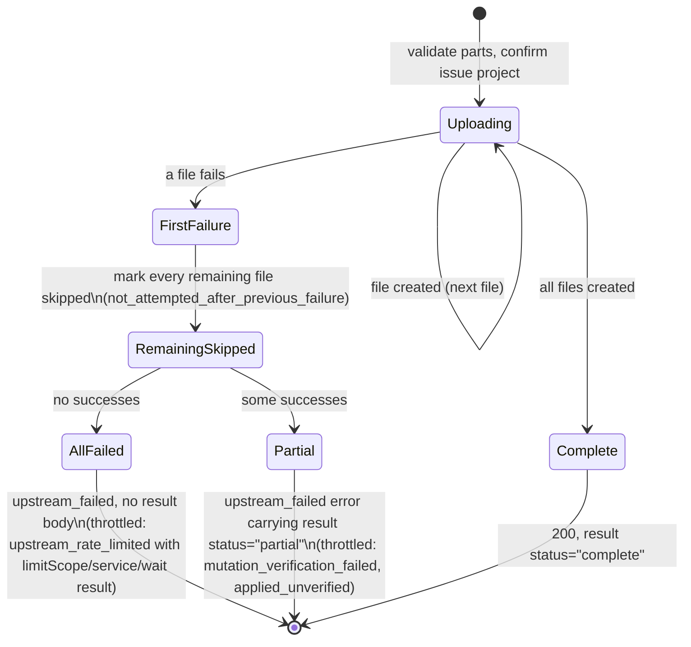

# Jira Provider Contract

This document owns Jira-specific action behavior, canonical action names,
locators, typed CLI examples, request-body rules, attachment behavior, audit
metadata, and attribution notes. Shared provider concepts and runtime discovery
guidance are in [providers.md](providers.md); CLI-wide behavior is in
[cli.md](cli.md).

Service name `jira`. Policy scope type `project`, bound to `jira_project` resources. Every action advertises
credential modes `[service, per_user]`.

## Operator setup

This integration targets Atlassian Cloud. Add the following fragment to a Broker
configuration with identity, policy and audit already configured:

```toml
[providers.jira]
tenant_host = "example.atlassian.net"
allowed_upstream_hosts = [
  "https://example.atlassian.net/rest/api/3/**",
  "https://api.media.atlassian.com/**",
]

[providers.jira.content]
comment_formats = ["adf"]

[credentials.service.jira]
type = "basic_api_token"
username_ref = "env:JIRA_SERVICE_USERNAME"
token_ref = "env:JIRA_SERVICE_API_TOKEN"

[credentials.lookup.jira]
type = "basic_api_token"
username_ref = "env:JIRA_LOOKUP_USERNAME"
token_ref = "env:JIRA_LOOKUP_API_TOKEN"
read_only = true
```

The username is the upstream account's email address. Use a separately restricted
upstream account/token for lookup: `read_only = true` declares its Broker role;
it does not remove write permissions from the upstream token. Lookup-backed
service-mode grants require this credential. Per-user-only paths instead use the
principal's selected credential for lookup and execution.

For per-user credentials, replace the service execution stanza with a
[credential connection](configuration.md#credential-connections). Jira and
Confluence declare the same Atlassian token profiles, so one connection serves
both on one site. Without a `cloud_id`, as above, the classic API token is the
only type they accept, so the connection needs no `token_profiles` list:

```toml
[credentials.connections.atlassian]
display_name = "Atlassian"

[credentials.per_user.jira]
type = "connection"
connection = "atlassian"

[credentials.per_user.confluence]
type = "connection"
connection = "atlassian"
```

Each principal stores their own account email and classic API token for the
connection, or an administrator provisions a service account's, and grants use
`credential_mode = "per_user"`. Without Confluence, omit its entry. To keep the
products' tokens separate, give each product its own connection. The
[configuration reference](configuration.md#connection-token-profiles) describes
secret sources, token profiles, attachment limits and optional egress/TLS
settings.

With a `cloud_id`, Jira accepts several token types, so a connection without
OAuth lists those it accepts in `token_profiles`; a connection may accept
several, and the person saving a token, or an administrator for a service
account, picks one. Each type takes its own route:

| Token type (profile) | Stored as | Route |
| --- | --- | --- |
| Classic API token (`atlassian-api-token`) | email and token, presented as Basic | Site: `https://<tenant_host>/rest/api/3/` |
| Scoped API token (`atlassian-scoped-api-token`) | email and token, presented as Basic | Gateway: `https://api.atlassian.com/ex/jira/<cloud_id>/rest/api/3/` |
| Service account token (`atlassian-bearer-token`) | token, presented as Bearer | Gateway |

The scoped API token covers a person's scoped API token and an Atlassian
service account's token used with its email. The gateway types require
`providers.jira.cloud_id`, and every accepted type's route must be covered by
`allowed_upstream_hosts`, which validation checks (see
[route coverage](configuration.md#providersjira)). People's scoped or classic
tokens, with service accounts on classic tokens only, look like this:

```toml
[credentials.connections.atlassian]
display_name = "Atlassian"
token_profiles = ["atlassian-scoped-api-token", "atlassian-api-token"]
service_account_token_profiles = ["atlassian-api-token"]
```

For ordinary managed browser or `user_manage` credential management, enable the
owner's self-service flag and grant them a `per_user` action on a service that
uses this connection. Those management paths use current per-user policy
visibility and do not require separate `credentials:self:*` rights for
connection tokens. The account role
alone does not grant invocation access. Deliberately configured classless
management uses explicit scoped credential rights; see the
[administrator guide](administrator-guide.md) for that distinct setup and the
complete user handoff. OAuth connections use grant-based personal setup instead.

### OAuth connections

People can connect their Atlassian account instead of storing a token. Give
each product's connection an `oauth` registration of the
[`atlassian` dialect](oauth.md#atlassian) for the site, beside the token types
service accounts use, or alone. Here service accounts keep classic API tokens
of regular accounts on the site and Atlassian service-account tokens on the
gateway side by side, so the allowlist covers the tenant, the gateway and the
media host. Without Confluence, omit its entries:

```toml
[providers.jira]
tenant_host = "example.atlassian.net"
cloud_id = "00000000-0000-0000-0000-000000000000"
allowed_upstream_hosts = [
  "https://example.atlassian.net/rest/api/3/**",
  "https://api.atlassian.com/ex/jira/00000000-0000-0000-0000-000000000000/rest/api/3/**",
  "https://api.media.atlassian.com/**",
]

[credentials.connections.jira]
display_name = "Atlassian"
token_profiles = ["atlassian-api-token", "atlassian-bearer-token"]
oauth = { registration = "atlassian", profile = "default" }

[credentials.connections.confluence]
display_name = "Atlassian"
token_profiles = ["atlassian-api-token", "atlassian-bearer-token"]
oauth = { registration = "atlassian", profile = "default" }

[credentials.per_user.jira]
type = "connection"
connection = "jira"

[credentials.per_user.confluence]
type = "connection"
connection = "confluence"
```

Both connections use one registration, so a person connects Atlassian once for
both products. Service accounts keep a token per product: Atlassian does not
document one service-account token holding both products' scopes.

- **Route.** OAuth always goes through the Atlassian gateway,
  `https://api.atlassian.com/ex/jira/<cloud_id>/rest/api/3/`, so `cloud_id`
  is required and the allowlist must cover that base; service accounts' tokens
  beside it take the route their type selects (see the
  [connection table](oauth.md#atlassian-registration)).
- **Access per request.** Before every request, including the project
  lookups before policy and at execution and each authorized hop of an
  attachment download, Jira revalidates the invocation's lease and pins its
  access to the gateway route's cloud ID and the `api.atlassian.com` audience.
  Access for another site fails as `credential_invalid` before anything is
  sent, and a connection lost between two download hops fails with its own
  reason before the next hop.
- **401.** The lookups and the execution share one recovery: when Jira answers
  the connection's access with 401, the Broker marks it rejected, renews it
  once and repeats the request, writes and uploads included, because the 401
  applied nothing. A second 401 fails as `credential_invalid`, asking the
  person to reconnect Atlassian. A connection that cannot be refreshed fails
  with its own reason, such as `concurrency_limited` while another refresh
  runs.
- **Writes.** A connection failure before a write keeps its own reason and
  carries no receipt; in an attachment batch, before any upload applied, the
  batch fails with it. One that stops the read-back after Jira accepted the
  write reports `mutation_verification_failed` with an `applied_unverified`
  receipt.
- **Verification.** Credential verification (`myself`) applies to stored and
  service tokens, each probed on the route its type selects; OAuth connections
  are checked by connecting them.

Each action needs these Atlassian OAuth scopes:

| Actions | Scopes |
| --- | --- |
| `project.list`, `project.view`, `issue_type.list`, `issue.view`, `search`, `comment.list`, `comment.view`, `comment.property.list`, `comment.property.get`, `attachment.list`, `attachment.download`, `verify` | `read:jira-work` |
| `issue.create`, `issue.child.create`, `issue.update`, `issue.parent.set`, `issue.dependency.add`, `comment.add`, `comment.reply`, `comment.update`, `comment.delete`, `comment.property.set`, `comment.property.delete`, `attachment.add` | `read:jira-work`, `write:jira-work` |

`read:jira-user` serves only token verification and is not needed. The
registration also requests `read:me` and `offline_access`; see
[Atlassian scopes](oauth.md#atlassian-scopes).

Create `jira_project` resources and action grants through the configured policy
authority, then validate and reload configuration. Start with a granted view or
search action and verify its scope and audit record. The explicit content settings
above enable the write formats used in this document; inspect the running catalog
before using a mutation. Jira comment writes require the ADF setting shown above.

## Access surfaces and examples

Jira actions are available through the typed CLI wrappers, generic
`agent-access invoke`, JSON `agent-access send` request files, and direct HTTP
`POST /v1/invoke/jira/{action}`. Use `agent-access spec catalog` against the
target broker to see the caller-visible hot catalog before relying on an action
or input schema.

Typed CLI examples:

```bash
agent-access --url http://127.0.0.1:8787 jira issue view PROJ-123
agent-access --url http://127.0.0.1:8787 jira issue view --issue-url https://example.atlassian.net/browse/PROJ-123
agent-access --url http://127.0.0.1:8787 jira issue child create --project PROJ --issue-type-id 10001 --summary 'Add rollout checklist' --parent PROJ-100
agent-access --url http://127.0.0.1:8787 jira issue update PROJ-123 --content-file description.md --content-format markdown
agent-access --url http://127.0.0.1:8787 jira issue search --project PROJ --text 'deployment checklist' --max-results 10
agent-access --url http://127.0.0.1:8787 jira issue comment add --issue PROJ-123 --content-file comment.md --content-format markdown
agent-access --url http://127.0.0.1:8787 jira issue attach PROJ-123 ./report.txt --content-type text/plain
agent-access --url http://127.0.0.1:8787 jira issue attachment download PROJ-123 10055 --output ./downloaded-report.txt
```

Generic invoke uses canonical action names and compact JSON inputs:

```bash
agent-access invoke jira.issue.view --input-json '{"issue":"PROJ-123"}'
agent-access invoke jira.issue.view --input-json '{"url":"https://example.atlassian.net/browse/PROJ-123"}'
agent-access invoke jira.issue.child.create --input-json '{"project":"PROJ","issueTypeId":"10001","summary":"Add rollout checklist","parentIssue":"PROJ-100"}'
agent-access invoke jira.search --input-json '{"query":{"type":"text","value":"release notes"},"projects":["PROJ"],"maxResults":10}'
agent-access invoke jira.comment.add --input-file jira-comment-add.json
```

Example `jira-comment-add.json`:

```json
{
  "issue": "PROJ-123",
  "contentFormat": "markdown",
  "content": "## Update\n\nDeployment completed."
}
```

JSON `send` request files use the same service/action/input vocabulary:

```json
{
  "version": "agent-access.send.v1",
  "kind": "invoke",
  "service": "jira",
  "action": "comment.add",
  "inputs": {
    "issue": "PROJ-123",
    "contentFormat": "plain_text",
    "content": "Deployment completed."
  }
}
```

Direct HTTP uses the same action path and wraps inputs under `inputs`. The
example assumes `$AAB_CURL_AUTH` points to a curl config containing the broker
`Authorization` header.

```bash
curl -fsS \
  --config "$AAB_CURL_AUTH" \
  -H "X-Agent-Access-Request-Id: jira-view-1" \
  -H "Content-Type: application/json" \
  -d '{"inputs":{"issue":"PROJ-123"}}' \
  "$BROKER_URL/v1/invoke/jira/issue.view"
```

For multipart uploads, use `agent-access send` to construct upload metadata.
For raw attachment downloads, use `agent-access invoke --output`, a typed download
command, or a `send` output sink.
Direct HTTP multipart and raw-download negotiation are specified in
[http-api.md](http-api.md).

## Project issue types

Discover issue types before creating an issue:

```bash
agent-access jira issue-type list --project PROJ
agent-access jira issue-type list --project PROJ --output-format markdown
agent-access jira issue-type list --project PROJ --start-at 50 --max-results 50
agent-access invoke jira.issue_type.list --input-json '{"project":"PROJ"}'
```

The read-only `issue_type.list` action requires an uppercase `project` key.
Existing grants must add `issue_type.list` explicitly. The portal's Read-only
column helps select the action while editing a grant; classification never
adds new actions to saved grants. Project restrictions still apply.
`startAt` defaults to `0`; `maxResults` defaults to `50` and accepts `1`–`100`.
Each call retrieves one bounded page from Jira Cloud's
`GET /rest/api/3/issue/createmeta/{project}/issuetypes`, using the selected
execution credential after broker project authorization, without a lookup
credential. Jira requires that credential to have **Create issues** permission
in the project. The action lists creation metadata, rather than the tenant-wide
issue-type catalog.

The result contains `operation`, `project`, `issueTypes`, `startAt`, `maxResults`,
`total`, `count`, `isLast`, and nullable `nextStartAt`. Each issue type contains
`id`, `name`, plain-text `description`, and `subtask`. Descriptions can be empty;
an omitted upstream description is represented as an empty string.
IDs are decimal strings, such as `"10001"`, matching `issue.create` and
`issue.child.create` inputs. Pass a returned `id` as `issueTypeId`; never infer
an ID from a type name or hard-code IDs across Jira sites or projects.

When `isLast` is false, request the same project with `startAt` set to
`nextStartAt`. Each page is independently authorized; project configuration may
change between pages. Use the same credential context for discovery and create.
Discovery does not grant write access or guarantee creation succeeds: the
broker's create actions do not expose arbitrary required custom fields, and
Jira still validates parent/subtask compatibility and current permissions.

## Live project listing

`project.list` lists visible **live** projects through Jira Cloud’s project
collection, in project-key order. Archived and deleted projects are excluded.
The action is independently grantable from issue search and issue reads; an
all-project grant can return projects absent from the local resource catalog.
The selected service or personal credential (including Atlassian OAuth) supplies
upstream visibility. No lookup credential or per-project detail request is used.

```bash
agent-access jira project list --max-results 50
agent-access jira project list --max-results 50 --page-token '<nextPageToken>'
agent-access jira project list --output-format markdown
agent-access invoke jira.project.list --input-json '{"maxResults":50}'
```

Only `maxResults` and `pageToken` are accepted. The result contains `items`,
`count`, `maxResults`, `scanStatus`, and a nonterminal `nextPageToken`.
Each item contains `id`, current canonical `key`, `name`, optional
`projectTypeKey`, and a tenant browser `webUrl`. Names exceeding 4096 UTF-8
bytes become previews with `previewTruncated: true`. Current keys are checked
against normalized grants, exclusions, execution context and token restrictions
before metadata is released. Old registered project keys do not authorize a
renamed live key. `count` is the released item count; no upstream total is exposed.

`more` means a productive page with remaining upstream work; `scan_budget`
means the work limit stopped scanning at a resumable boundary. Either can lead
to another empty page: pass `nextPageToken` as `pageToken` with the same page
size until `exhausted`. A narrow exact grant on a large tenant may need many
empty continuations. Exhaustion describes the credential’s observed stream,
not a complete grant inventory or a snapshot: concurrent changes may cause
omissions or duplicates. Deduplicate by project ID when needed.

Confidential tokens bind caller, action, execution context, credential method,
route, listing limits, page size and effective scope. They expire 15 minutes
after the first page; resuming does not extend expiry. A configured Broker
signing key preserves tokens across restarts; without one they are generation
scoped. Changed settings or authority require a fresh listing.

`[providers.jira.listing]` defaults to `max_results = 50` (range 1–100),
`max_candidate_pages = 4`, `max_upstream_requests = 8`, and
`max_scan_bytes = 16777216` (16 MiB); work limits must be positive. Every HTTP
attempt, including the invocation’s one shared OAuth replay, and every consumed
response body counts. Before an OAuth page, an unused replay slot is reserved;
a first page needs at least two attempts, and later calls stop at a resumable
boundary when that reservation cannot fit. Per-response and result byte caps also apply. Oversized
pages fail explicitly; start a fresh listing with a smaller `maxResults`.
Permission failures, malformed pagination, rate limits and timeouts remain
errors, never successful exhaustion. Jira’s `nextPage` URL is never followed.

## Project details and searchable fields

Use `project.list` to find a project, `project.view` to inspect its searchable
fields, then `search` to run bounded JQL in that project:

```bash
agent-access jira project list
agent-access jira project view PROJ
agent-access jira project view PROJ --output-format markdown
agent-access jira project view PROJ --include fields,versions --query external
agent-access jira issue search --project PROJ --jql 'cf[12345] ~ "EXT-4812" AND fixVersion = "2.4"'
agent-access invoke jira.project.view --input-json '{"project":"PROJ","include":["fields","versions"]}'
```

`project.view` is a separately granted, read-only action. Its required `project`
is an uppercase project key; it does not accept an issue key, numeric project
ID, or URL. The Broker authorizes that key before any upstream request, then
uses the selected service or personal execution credential, including OAuth,
for all metadata. No lookup credential is required. The returned project's
current key must match the authorized key, so a renamed project's old key does
not disclose its new metadata. The execution credential needs Jira's Browse
Projects access. Discovery does not grant search or issue access.

`include` selects any of `fields`, `versions`, `components`, `issueTypes`, and
`statuses`. Omitting it selects only `fields`; an empty array requests only
project details. Typed CLI uses comma-separated `--include` values. Optional
`query` (`--query`) accepts at most 256 UTF-8 bytes, contains no control
characters, and must be nonempty after trimming. It filters each requested
collection by case-insensitive name or ID substring,
also matching `jqlReference` for fields, before the item cap. Use it to narrow
a large catalog. The result contains `operation: "project.view"` and `project`
with `id`, `key`, `name`, `description`, and a tenant browser `webUrl`. Requested
sections contain `items`, `count`, and `truncated`; unrequested sections are
absent. Each section returns at most 100 items, and `truncated: true` means
additional entries were omitted. Text previews are bounded to 4096 UTF-8 bytes
and marked `previewTruncated` when shortened. Response and result byte limits
still apply; a successful bounded section is not a promise of complete inventory.

Each `fields.items` entry contains:

| Property | Meaning |
| --- | --- |
| `id` | Stable field ID, such as `customfield_12345`. |
| `name` | Jira's display name; names need not be unique. |
| `jqlReference` | Broker-supported query reference, such as `cf[12345]`. |
| `types` | Jira's reported search types. |
| `operators` | Operators supported by both Jira's discovery response and Broker's parser. |

Versions include their ID, name, description, released/archived flags and
optional release and start dates. Components include ID, name and description. Issue
types add a `subtask` flag; statuses are deduplicated by ID and may include
`statusCategory`. Statuses do not report per-issue-type mappings.

Use `jqlReference` rather than the display name or REST `id` when constructing
JQL. A text field might advertise `~`, while a select field might advertise `=`
or `IN`. Text `~` uses Jira's text-search semantics, not strict whole-value
equality. Discovery describes search capabilities visible to this credential;
it is not a complete configuration inventory for every issue type and does not
enumerate custom-field options. Jira still validates each query against the
field's current type, searcher, permissions and configuration. Search preserves
the existing [project containment and continuation rules](#search-and-jql).

Project identity comes from `GET /rest/api/3/project/{project}`. After validating
that identity, field discovery calls `POST /rest/api/3/jql/autocompletedata`
with the confirmed numeric project ID and `includeCollapsedFields: false`.
Optional project metadata comes from that project response and the project's
statuses endpoint. These reads do not use administrator field catalogs or
creation metadata. Use [`issue_type.list`](#project-issue-types) for the
separately authorized, paginated Create issues workflow.

## Actions and lookup requirements

Twenty-four actions:

| Action | Required scope type | Lookup requirement |
| --- | --- | --- |
| `project.list` | `project` | no |
| `project.view` | `project` | no |
| `issue_type.list` | `project` | no |
| `issue.view` | `project` | yes |
| `issue.create` | `project` | no |
| `issue.child.create` | `project` | yes |
| `issue.update` | `project` | yes |
| `issue.parent.set` | `project` | yes |
| `issue.dependency.add` | `project` | yes |
| `search` | `project` | no |
| `comment.list` | `project` | yes |
| `comment.view` | `project` | yes |
| `comment.add` | `project` | yes |
| `comment.reply` | `project` | yes |
| `comment.update` | `project` | yes |
| `comment.delete` | `project` | yes |
| `comment.property.list` | `project` | yes |
| `comment.property.get` | `project` | yes |
| `comment.property.set` | `project` | yes |
| `comment.property.delete` | `project` | yes |
| `attachment.add` | `project` | yes |
| `attachment.download` | `project` | yes |
| `attachment.list` | `project` | yes |
| `verify` | `project` | yes |

`project.list`, `project.view`, `issue_type.list`, `issue.create`, and `search` do not require pre-authorization metadata lookup.
`project.view` authorizes the supplied project key before requesting details or
search metadata with the selected execution credential.
`issue.create` resolves scope from the caller-supplied project after input
validation; `search` resolves scope from policy rather than from an upstream
metadata lookup. `issue.child.create` is lookup-backed because the broker must
resolve the requested parent before authorization and mutation.

Each credential's token type selects its base. Classic API tokens, and
`basic_api_token` credentials without a profile, use the tenant base
(`https://<tenant_host>/rest/api/3/`). Scoped API tokens (Basic), bearer
tokens and OAuth use the Atlassian gateway
(`https://api.atlassian.com/ex/jira/<cloud_id>/rest/api/3/`), which requires
`providers.jira.cloud_id`. A credential whose token profile Jira does not
declare, or whose kind differs from its profile's, and a gateway credential
without a `cloud_id` are refused before anything is sent, as
`credential_not_provisioned`. Every Jira request,
including each attachment redirect hop, must match `allowed_upstream_hosts`,
so the allowlist must cover the REST paths in use (for example
`https://<tenant_host>/rest/api/3/**`, and
`https://api.atlassian.com/ex/jira/<cloud_id>/rest/api/3/**` for gateway
credentials); validation checks that each configured credential's base is
covered.

Broker-side ADF and body-format validation remains actionable on lookup-backed
actions: malformed ADF returns `body_malformed`, and an unsupported format
returns `body_format_unsupported`, rather than either being hidden as
`scope_unresolved`. Once policy has authorized a Jira mutation, a Jira 400 or
422 may also return a bounded, sanitized validation message derived only from
allowlisted fields in Jira's structured error map. Body/description validation
is classified as `body_malformed`; other recognized safe field validation is
`input_invalid`. The broker ignores Jira's free-form error-message list and
never returns the raw response body. Lookup, readback, authentication,
permission, existence, scope, conflict, throttling, and server-error bodies
remain hidden. A Jira HTTP 429 returns `upstream_rate_limited` with the bounded
`Retry-After` wait when Jira sends one; see
[http-api.md](http-api.md#reason-code-table). A 429 on a mutation request itself
means Jira did not apply it. When the mutation was applied but the readback that
verifies it is throttled (`issue.create`, `issue.child.create`, `issue.update`,
`issue.parent.set`, and `issue.dependency.add`), the error is instead
`mutation_verification_failed` with `mutationStatus: "applied_unverified"`,
`retrySafe: false`, `verificationStage` (the audit `failurePhase`, such as
`post_create_readback`), and `safeLocators` holding the created or changed issue
IDs and keys. It carries no retry wait: inspect those issues instead of repeating
the mutation. A person's [OAuth connection](#oauth-connections) failing during
that readback, or Jira rejecting its access again, reports the same
`mutation_verification_failed` receipt; before the mutation, such a failure
keeps its own reason without a receipt.

A Jira write action sends its mutation request after its reads. When the Broker
proves that request never reached Jira, because no connection was established
(including a connect timeout) or the request could not be built, the action
keeps its ordinary failure and adds `mutationStatus: "not_applied"`,
`retrySafe: true` to its result: nothing was applied, and the action can be
repeated. Every write action except `attachment.add` sends a single mutation
and fails with `upstream_connection_failed` (`Jira request failed`) or
`upstream_timeout` (`Jira request timed out`). An `attachment.add` batch whose
first upload was never sent keeps `upstream_failed` with `Jira attachment
upload failed` (see [Attachments](#attachments)). A read that was never sent
carries no receipt.

Every other write failure after which Jira may have applied the write keeps its
ordinary reason and message and reports what Jira may have done:

| What happened | Receipt |
| --- | --- |
| The mutation request may have been sent but got no response (a timeout, a stalled upload, a connection failure after sending, or an unclassified failure), or Jira or a proxy answered with a redirect, which the Broker never follows, or a 5xx | `mutationStatus: "unknown"`, `retrySafe: false` |
| Jira answered the mutation with a success status, but its response then failed, stalled, exceeded the byte cap, did not parse or did not match the request, such as a created issue in another project | `mutationStatus: "applied_unverified"`, `retrySafe: false`, `verificationStage: "mutation_response"` |
| The read-back after an applied `issue.create`, `issue.child.create`, `issue.update`, `issue.parent.set` or `issue.dependency.add` failed or did not match, or the result exceeded the response limit | `mutationStatus: "applied_unverified"`, `retrySafe: false`, the read-back `verificationStage` (such as `post_update_readback`) |

`safeLocators` name the target from the validated request and the reads before
the write, never from the failed response: the `project` (and parent issue) of
a create, the created issue IDs once the create response was validated, or the
issue and comment IDs of an update. Inspect the issue before repeating a write
with either receipt. A 4xx rejection and throttling of the write itself carry
no receipt.

## Read response formats

Jira normalized reads use common top-level invoke fields, never Jira `inputs`.
`readContentFormat` accepts `native`, `markdown`, or `text`; omission is
`native`. It is advertised on exactly these seven actions:

- `issue.view`, whose `renderedBody` is beside root `description`, with a
  companion inside each supported non-null ADF custom-field entry;
- `issue.create` and `issue.update`, whose companion is inside `result.issue`;
- `comment.view`, `comment.add`, `comment.reply`, and `comment.update`, whose
  companion is inside `result.comment` beside `body`.

Markdown and text preserve the native ADF field unchanged. Missing or null
native content has no companion; a present empty document has a present,
possibly empty companion. `search` stays description-free, `comment.list`
stays body-free, `issue.child.create` does not expose its internal description
readback, and comment-property JSON is never guessed to be ADF.

The deterministic ADF subset covers documents, paragraphs, headings, hard
breaks, rules, quotes, panels, expands, bullet/ordered/task/decision lists,
collision-safe code blocks, tables, and readable mention, emoji, status, date,
card, and media fallbacks. Supported marks are strong, emphasis, strike, code,
and safe links. Only absolute `http`/`https` links with a host and no user
information, plus `mailto`, remain active. Unknown containers preserve safe
textual descendants, unknown leaves emit `[unsupported content]`, and media
fallbacks never disclose internal IDs. Plain text uses the same structural
traversal without Markdown markers. Conversion is offline, preserves source
order, never fetches linked content, and never truncates or returns a partial
rendering.

`responseFormat` accepts `json` or `markdown`; omission is `json`. Exactly eleven
retrievals advertise whole-result Markdown: `project.list`, `project.view`, `issue_type.list`, `issue.view`, `search`,
`comment.list`, `comment.view`, `comment.property.list`,
`comment.property.get`, `attachment.list`, and `verify`. Their deterministic
templates represent every meaningful present field, preserve exact identifiers,
URLs, timestamps, booleans, counts, collection order, and pagination tokens,
and end with one LF. Copyable identifiers and timestamps render as code spans;
safe absolute URLs render as autolinks. Metadata text has control characters and
embedded newlines neutralized so it cannot create unintended Markdown structure.
Arbitrary comment-property JSON, including the valid value `null`, is retained
in a safely delimited `json` fence. Verification mismatches use the same template
while retaining `allow_with_result`, HTTP 409, and CLI exit 2.

Whole-result formatting uses the exact result already produced: it makes no
second Jira call, changes no selected fields or query parameters, follows no
pagination token, and fetches no related content. Direct HTTP and `send` retain
the normal JSON response envelope with
`result = { "format": "markdown", "value": "..." }`; typed CLI and generic
`invoke --output-format markdown` print only `result.value` on a formatted
success. The caller-filtered catalog, OpenAPI, and action-specific send schema
advertise support. Confluence and GitLab normalized reads are also available on
their declared actions.

Every returned declared ADF field is structurally validated and bounded by
`providers.jira.content.max_body_bytes` even in native mode. Malformed custom
ADF is explicitly withheld as described under [custom fields](#custom-fields);
malformed descriptions or comment bodies fail the request. Oversized,
over-complex, or over-budget native/rendered content fails the complete request
without truncation as sanitized `upstream_protocol_failed`/502. Native ADF,
custom-field names and values, rendered content, whole-result Markdown, property
values, and pagination tokens are excluded from audit, tracing, logs, errors,
and object identifiers.

## Keys, locators, and project confirmation

- **Project key** matches `^[A-Z][A-Z0-9_]+$`: an uppercase letter followed by
  one or more uppercase letters, digits, or underscores, such as `OPS_TOOLS`.
- **Issue key** matches `^[A-Z][A-Z0-9_]+-[1-9][0-9]*$` — uppercase only, with a
  non-zero, non-leading-zero issue number.

The same key rules apply to registered project resources, explicit search
projects, JQL project/key operands, issue URLs, and returned issues. An
authorized issue such as `OPS_TOOLS-12345` remains valid on continuation pages;
underscores do not bypass project exclusions or key/project consistency checks.

An issue may be supplied as a key or as a URL. A URL locator
(`issue_locator_from_url`) requires `https`, a host equal to the configured
`tenant_host`, no userinfo, no explicit port, no query and no fragment. Accepted
browser paths are `/browse/{issueKey}` and modern Jira paths of the form
`/jira/.../projects/{projectKey}/issues/{issueKey}`. The modern path's project
segment must be a valid project key, but it is navigation context and is not
compared with the issue key: the issue key alone identifies the issue (see
[Renamed project keys](#renamed-project-keys)). REST API `self` URLs
such as `/rest/api/3/issue/{id}` are rejected because they carry only the
numeric issue ID. Malformed issue keys and invalid URL locators are
`locator_invalid` (HTTP 403).

Issue view, issue search, and embedded issue metadata results include a
generated browser `webUrl` of `https://<tenant_host>/browse/{issueKey}`. This
includes issue metadata nested under comment list/view/property/mutation results
and `attachment.list`. Jira REST responses do not provide a browser URL, so the
broker derives this field only from confirmed issue keys.

The key prefix is never treated as authoritative project scope on its own. For
every action that names an issue, the broker confirms the issue's project
through pre-authorization metadata lookup before authorization. Invocation
then confirms each named issue again, before any execution read or write, and
denies with `scope_unresolved` if its current project is no longer within the
admitted scopes. This covers an issue moved, or a project key changed, after
authorization. Nothing is read from or written to an issue that left the
admitted projects, so such a denial carries no mutation receipt.
`issue.view` also denies with `scope_unresolved` if the full read's id, key, or
project disagree with the confirmed metadata.

### Renamed project keys

When a Jira administrator changes a project key, for example from `OLD` to
`NEW`, Jira re-keys the project's issues (`OLD-123` becomes `NEW-123`) and keeps
the previous keys as aliases. Old issue keys, browser links, and JQL that names
`OLD` keep working in Jira, and issue text keeps the old keys. Jira's issue API
resolves `OLD-123` without a redirect and returns the issue under its current
key and project. The Broker handles these references as follows:

- **Issue keys and URLs.** `OLD-123`, `/browse/OLD-123`, and modern links whose
  project segment and key mix old and new keys are accepted as locators. The
  pre-authorization lookup resolves them through Jira, and policy authorizes
  the issue's current project `NEW`, never the alias prefix. A grant that
  names only `OLD` no longer covers the issue: such requests deny with
  `scope_unresolved` without returning content. After confirmation, every
  read and write uses the current key, and results, `webUrl`, audit, and
  object IDs report `NEW-123`. To detect an alias, compare the returned issue
  key with the locator you sent.
- **Search.** Jira also resolves `OLD` in explicit `projects`, JQL `project`
  clauses, and `key`/`text` queries for `OLD-123`. Returned issues carry their
  current keys and are checked against the authorized project boundary, as
  described in [`search` and JQL](#search-and-jql).
- **Project-key inputs.** `issue_type.list`, `issue.create`,
  `issue.child.create`, and explicit search `projects` are authorized by the
  project key as written. With finite grants for `NEW`, `OLD` is denied before
  any Jira request, except that `issue.child.create` first looks up the parent
  issue, so that metadata request reaches Jira before the denial; the create
  request itself is never sent. If a grant still names `OLD` and Jira creates the issue as
  `NEW-5`, the create fails with `scope_unresolved` and an
  `applied_unverified` receipt (see [`issue.create`](#issuecreate)).
- **Operator action.** Project resource entries name project keys. After a key
  change, update every entry, group exclusion, and token restriction that names
  the previous key. An entry still naming `OLD` stops authorizing the
  project's issues. An exclusion still naming `OLD` stops excluding them from
  issue actions, although search's injected `project NOT IN (OLD)` predicate
  still excludes them through Jira's alias. Jira can release a previous key
  for reuse by another project, so treat an old key as the current key of
  whichever project holds it.

Static config validation requires `credentials.lookup.jira` whenever any
lookup-backed Jira grant uses `credential_mode = "service"`. At runtime, the
broker uses that shared lookup credential when a service-mode Jira grant can be
viable for the caller/action. If all viable Jira lookup-backed grants are
`per_user`, the broker uses the caller's per-user Jira credential for both the
pre-authorization metadata lookup and any provider-side execution-time
confirmation.

## Normalized rich-content writes

Exactly six Jira actions accept rich content: `issue.create`,
`issue.child.create`, `issue.update`, `comment.add`, `comment.reply`, and
`comment.update`. Their canonical fields are `content` and the explicit
`contentFormat`; accepted formats are `adf`, `markdown`, and `plain_text`.
Issue actions map content to Jira `description`, and comment actions map it to
Jira `body`. Create/child-create descriptions are optional, update content is
optional when another mutable field is present, and comment content is
required.

Native `adf` content is a JSON object. Markdown and plain text are strings and
are deterministically converted to ADF. Plain-text punctuation is never
interpreted as Markdown. Raw HTML and unsafe links in Markdown do not become
trusted provider markup; unsupported constructs retain safe readable content.
Conversion is pure and offline.

Every write validates the closed source shape, explicit format, source type,
source structure, and source-byte limit; validates native ADF or converts under
bounded depth/event/work/output budgets; adds configured attribution in native
ADF; validates the complete ADF structure; enforces the final serialized-body
limit; and only then submits upstream. The Broker never truncates. Source or
final expansion beyond `providers.jira.content.max_body_bytes` returns
`body_size_denied` (HTTP 413); an unsupported action/format combination returns
`body_format_unsupported` (HTTP 415).

Rich-content write schemas use `content` and `contentFormat` and reject
undeclared fields. Typed CLI callers use exactly one of `--content` or
`--content-file` with `--content-format`; there are no format defaults.
Clients detect supported formats from the exact action's catalog
`contentFormat.enum`, not from a Broker version. Comment write
actions are omitted from the caller-visible catalog when native ADF is not
enabled by `providers.jira.content.comment_formats`.

Audit and tracing never contain caller source content, converted ADF, mutation
readback bodies, parser excerpts, or extracted links. Safe requested/effective
formats, source/final byte counts, conversion status, and attribution metadata
may be recorded.

## `issue.view`

`issue.view` is a project-scoped issue read. Authorization and containment
lookup use only `fields=project`; after authorization, the execution credential
performs the full read with
`fields=*all,-comment,-attachment,-worklog` and `expand=names,schema` when the
[all-project coverage condition](#issue-links) holds. Otherwise it also excludes
`subtasks`, `parent`, and `issuelinks`, using
`fields=*all,-comment,-attachment,-worklog,-subtasks,-parent,-issuelinks`.
The same response supplies standard context, permitted embedded references,
custom-field values, names, and type metadata; no field-discovery request or
linked-resource fetch is added. An ordinary full Broker invocation makes three
requests: scope-resolution metadata lookup, invocation-time metadata
confirmation, and the authorized issue fetch. Existing credential selection
and OAuth recovery rules still apply.

Successful results include issue id/key/project, generated `webUrl`, summary,
status, issue type, `created`, `updated`, `creator`, `reporter`, `assignee`,
`priority`, `labels`, `description`, and `customFields`. The description is Jira
ADF JSON when Jira returns one and `null` when Jira returns no description or
omits the field. The [standard context](#standard-context) fields below are
also always present; [parent/subtasks](#parent-and-subtasks) and
[issue links](#issue-links) depend on the shared disclosure rule.
When requested through `readContentFormat`, the broker also adds the normalized
companion described above. User summaries expose only `accountId` and
`displayName`; priority exposes only `id` and `name`.

Returned descriptions are validated with a read-path structural ADF check and
bounded by `providers.jira.content.max_body_bytes` before returning. This
read-path check does not apply the broker's write-time ADF node allowlist, so
ordinary existing Jira descriptions with nodes the broker would not let agents
write can still be viewed. Audit records for `issue.view` do not include
description content.

### Standard context

Detailed views always include these additional top-level fields:

| Result field | Jira source | Value |
| --- | --- | --- |
| `resolution` | `fields.resolution` | Nullable `{id, name}` |
| `resolutionDate` | `fields.resolutiondate` | Nullable string |
| `dueDate` | `fields.duedate` | Nullable string |
| `components` | `fields.components` | Nullable array of `{id, name}` |
| `fixVersions` | `fields.fixVersions` | Nullable array of `{id, name}` |
| `affectedVersions` | `fields.versions` | Nullable array of `{id, name}` |
| `statusCategory` | `fields.status.statusCategory` | Nullable `{id, key, name}` |

Missing and explicit null source values both become null. Null can mean Jira
hid or did not return the field; it does not prove the field is unset. Explicit
empty collections remain `[]`. Arrays preserve order and duplicates. Dates
retain Jira's strings without time-zone conversion or reformatting.

Resolution, component, and version IDs are nonempty strings; their names are
nullable strings. Status-category `id` is a nonnegative JSON integer, `key` is
a nonempty string, and `name` is a nullable string. Category keys are preserved
without an enum restriction. Missing/null names become null; supplied wrong
types fail the complete view with sanitized `upstream_protocol_failed`.
The same failure applies to malformed objects or array members. Missing/null
`fields.status` or its `statusCategory` produces null category; a supplied
non-object status is malformed.

Projection strips every other property, including version descriptions,
component leads, email addresses, API URLs, and nested project objects.
Markdown presents returned context near the issue metadata, omits null context
fields, and displays `None.` for empty collections. IDs, dates and category
keys use code spans; missing names fall back to the corresponding ID or key.
Search and mutation readbacks do not acquire these detailed-view fields.

### Custom fields

Every successful `issue.view` contains a `customFields` array, including when
empty. Entries come only from canonical `customfield_[1-9][0-9]*` keys present
in Jira's returned `fields`; metadata alone creates no entry. The array is
ordered by the numeric field-ID suffix, without an integer-size limit. An empty
array means no custom fields were returned, not that the project defines none.
Custom fields are automatic: no label mapping, input flag, configuration, or
additional credential is needed. Search and mutation readbacks do not include
this array, and create/update do not accept custom-field writes.

Each entry has `id`, nullable `name`, nullable `type`, and `status`. `name` is
Jira's display text, so duplicate names are valid; use `id` for identity. A
missing, null, or malformed individual name becomes null, and readable output
uses the ID. For example:

```json
{
  "customFields": [
    {
      "id": "customfield_12345",
      "name": "Business impact",
      "type": "text",
      "status": "supported",
      "value": "Customer-facing"
    },
    {
      "id": "customfield_12346",
      "name": "External object",
      "type": null,
      "status": "unsupported"
    }
  ]
}
```

`supported` entries always contain a validated, typed `value`. `unsupported`
means the custom implementation or schema is not supported, including missing
or malformed type metadata, and has `type: null`. `withheld` means a recognized implementation with
a matching schema returned an invalid value shape or malformed ADF; it retains
its normalized `type`. Unsupported and withheld entries omit nonempty values.
For every returned field, explicit `null` and empty-array values are retained
even when unsupported or withheld, preserving empty-versus-absent semantics.
All supported types accept null; an empty array is supported only for array
types. Missing `names` or `schema` maps count as absent metadata, but a supplied
non-object map fails the request with sanitized `upstream_protocol_failed`.

The exact allowlist below uses the
`com.atlassian.jira.plugin.system.customfieldtypes:` prefix for `schema.custom`.
Both the implementation and its `schema.type`/`items` must match:

| Implementation suffix | Schema type (`items` for arrays) | Result type | Value |
| --- | --- | --- | --- |
| `textfield` | `string` | `text` | String |
| `url` | `string` | `url` | String, displayed as a code span |
| `float` | `number` | `number` | JSON number |
| `datepicker` | `date` | `date` | String |
| `datetime` | `datetime` | `datetime` | String |
| `textarea` | `string` | `adf` | Structurally validated Cloud v3 ADF document |
| `select`, `radiobuttons` | `option` | `option` | `{id, value}` |
| `multiselect`, `multicheckboxes` | `array` (`option`) | `options` | Array of `{id, value}` |
| `cascadingselect` | `option-with-child` | `cascadingOption` | `{id, value, child}` with one nullable option child |
| `userpicker` | `user` | `user` | `{accountId, displayName}` |
| `multiuserpicker` | `array` (`user`) | `users` | Array of user summaries |
| `labels` | `array` (`string`) | `labels` | Array of strings |

Option IDs and values must be strings. User `accountId` must be a string;
missing/null `displayName` becomes null, and a supplied non-string is invalid.
A missing/null cascading option child becomes null. A textarea's schema uses
`string`, but its value must be an ADF document, not a plain string.
Every array member must validate or the entire field is withheld. Projection
strips other option/user properties, including email and self/avatar URLs.
Custom Labels preserve string order and duplicates, with null and empty arrays
retained under the normal custom-field rules. Markdown displays each label as
a literal code span. Only the exact `labels` implementation and matching
array/string schema qualify; an arbitrary string-array schema is unsupported.
Project, issue, group, version, sprint, Assets, and app-specific fields are
unsupported as custom-field implementations; the standard context projections
above do not enable custom version fields. A scalar schema alone never makes an
unknown implementation safe.
The expanded raw issue, unrelated standard fields, and complete `names`/`schema`
maps are never returned. Free text and ADF can mention resources, under the same
policy as issue descriptions.

Whole-result Markdown has a custom-field section with escaped names, IDs, and
readable values. Null and empty arrays display as not set, retaining an
unsupported/withheld marker when applicable. `readContentFormat` preserves
native values and adds `renderedBody` only inside supported non-null `adf`
entries, at `/result/customFields/*`; the description's companion stays at the
root. Unsupported, withheld, and null ADF entries have no companion.

`providers.jira.content.max_body_bytes` applies to each ADF document separately
(default 1 MiB), not to the custom-field collection. Description and custom
ADF validation/rendering share the existing request budgets: 131,072
rich-content nodes and 524,288 work units, with per-document protections too.
Malformed custom ADF can be withheld; any byte or complexity exhaustion fails
the complete request, without dropping supported fields or retrying with less
content. Markdown-specific expansion limits apply when Markdown is requested.
There is no separate custom-field-count or aggregate custom-field byte limit.

The complete upstream response and Broker result remain bounded by
`limits.max_upstream_response_bytes` (default 512 MiB). HTTP MCP additionally
uses `mcp.max_response_bytes` (default 16 MiB, configurable), counting structured
content and its text copy; excess returns `mcp_response_too_large`. The local
stdio MCP adapter has a 16 MiB Broker-JSON receipt cap. These are ceilings, not
target response sizes. Custom-field audit metadata contains only
`customFields: {count, unsupported, withheld}` counts, never names, values, or
parser excerpts.

### Issue links

`issue.view` includes `issueLinks` only when the caller's effective access to
that action covers every possible Jira project in the selected credential
mode, including projects not registered in Broker. This proof includes the
execution context, identity ceilings, token restrictions, grant precedence and
grant-local exclusions. Several same-mode grants can together provide full
coverage. A project restriction, an unrestored exclusion, or a winning grant
in another credential mode that leaves a gap disables all link, parent and
subtask output for the whole view, including references to otherwise readable
projects. A `search`
grant does not satisfy this condition.

When eligible, Broker requests the source issue's embedded `issuelinks` with
the execution credential. It makes no additional requests for linked issues.
Each returned link contains exactly these fields:

```json
{
  "key": "CHANGE-42",
  "type": "Blocks",
  "direction": "outward",
  "relationship": "blocks",
  "summary": "Prepare deployment",
  "issueType": "Task"
}
```

`type` is the relationship type name. `direction` is `inward` or `outward`
relative to the source issue, and `relationship` is Jira's label for that
direction. Read it as `<viewed issue> <relationship> <key>`: outward `blocks`
means the viewed issue blocks the linked issue; inward `is blocked by` means
the viewed issue is blocked by the linked issue. Markdown makes the subject
explicit, for example `This issue blocks CHANGE-42`.
`summary` and `issueType` are nullable when Jira omits those linked issue
details. Broker reads the canonical
`fields.issuetype` spelling and does not accept alternate field aliases.
Linked status, priority, assignee, description, IDs, API URLs and other embedded
fields are not returned.

An absent `issueLinks` field means links were withheld or Jira did not supply
the requested field; **absence never means no links**. An explicit `[]` means
Jira returned an empty list. A present list preserves every returned entry,
its order and multiplicity. Markdown shows an **Issue links** section only
when the field is present, and prints `None.` for an empty list.

These are the embedded details Jira returned to the execution credential.
Broker does not independently confirm each linked issue's current project or
key, or promise that Jira returned every relationship. A later `issue.view`
on a linked key performs its own authorization, lookup and credential selection
and can fail, including when the lookup credential has narrower visibility.
Do not infer a target's current project from its embedded key.

Malformed required link fields or incorrectly typed supplied metadata fail the
view with a sanitized `upstream_protocol_failed`; entries are not silently
dropped. Existing response-size, presentation and operation-time limits apply.
There is no separate link-count cap or truncation. Link audit metadata records
only `issueLinks.status` (`withheld`, `not-returned`, or `disclosed`), plus
`count` when disclosed, without linked identities or summaries. Search and
mutation readbacks do not request or return `issueLinks`.

### Parent and subtasks

The same [effective all-project access condition](#issue-links) gates embedded
`parent` and `subtasks`. A raw allow-all grant is insufficient when effective
coverage has a gap. When coverage is absent, both properties are omitted even
if Jira supplies unsolicited values; their payloads are not parsed. Eligible
views use the existing issue fetch and make no requests for related issues.

An eligible view always includes `parent`: a missing or null Jira parent becomes
null, meaning no parent was returned to the execution credential. A returned
parent object has exactly this shape:

```json
{
  "key": "PROJ-100",
  "summary": "Prepare deployment",
  "issueType": "Epic"
}
```

`subtasks` is omitted if Jira did not return the field; otherwise it is an array
of the same `{key, summary, issueType}` references, preserving order and
duplicates. An explicit `[]` means Jira returned no subtasks. A supplied null
or non-array is malformed and fails the view.

Keys must be valid Jira issue keys. Optional summary and issue-type name come
only from `fields.summary` and `fields.issuetype.name`; missing/null values
become null. Missing/null `fields` or `issuetype` containers make their optional
metadata unavailable. Supplied non-object containers, non-string summary/type
names, or invalid keys fail with sanitized `upstream_protocol_failed`. Other
embedded properties are stripped, including IDs, status, descriptions, project
objects, and API URLs.

`parent` is Jira's direct modern parent. It may be an epic, a story, or another
permitted parent; Broker does not classify it from its type name, infer further
ancestors, or read legacy Epic Link/Parent Link custom fields. Subtasks are not
a complete list of epic children or descendants. These are embedded details
visible to the execution credential, without independent target confirmation;
a later view of a related key performs its own authorization and lookup.

An absent `parent` means withheld. A null parent is not proof that the issue has
no parent. An absent `subtasks` means withheld or not returned; an empty array
says nothing about other child issue types. Markdown renders sections only for
present properties, with `No parent returned.` for null parent and `None.` for
empty subtasks under **Subtasks**.

Audit adds only `parent.status` (`withheld` or `disclosed`) and
`subtasks.status` (`withheld`, `not-returned`, or `disclosed`). Disclosed parent
has count 0 for null or 1 for an object; disclosed subtasks have their array
length as count. No related keys, summaries, or new context values enter audit.
Search and mutation readbacks retain their existing contracts.

## `issue.create`

`issue.create` creates a normal Jira issue in an authorized Jira project. It is
project-scoped and deliberately narrow: inputs are `project`, `issueTypeId`,
`summary`, and optional `content`/`contentFormat`. It does not expose raw Jira `fields`,
`update`, transitions, parent/subtask creation, reporter/assignee, labels,
priority, custom fields, properties, or notification flags.

The broker validates the project key, requires `issueTypeId` to be a non-empty
ASCII decimal id string, and rejects summaries that are empty after trimming,
contain NUL/CR/LF, or exceed 1024 UTF-8 bytes. Jira Cloud may enforce a tighter
summary product limit; those upstream validation failures remain sanitized and
do not log or return the submitted summary. When present, the content pair is
processed through the normalized rich-content pipeline above.

The provider sends `POST /rest/api/3/issue` with only
`fields.project.key`, `fields.issuetype.id`, `fields.summary`, and optional
`fields.description`. Jira must return `201 Created` with a created issue id and
key. Before full readback, the broker validates that the created key is a valid
Jira issue key whose project prefix matches the authorized requested project.
It then reads the issue back with the execution credential and returns
`operation: "issue.create"` plus the bounded standard issue metadata and
description. This readback omits `customFields`, the detailed-view
[standard context](#standard-context), `issueLinks`, `parent`, and `subtasks`.
An invalid created key is `upstream_protocol_failed`. A valid key in another
project, for example when Jira resolves a
[previous project key](#renamed-project-keys) and creates the issue under the
current one, is `scope_unresolved`: the issue exists outside the authorized
project. Both failures carry the `applied_unverified` receipt. Reconcile the
created issue id/key from `safeLocators` or failure audit, and update grants to
the current project key before retrying.

Audit includes issue id/key when available, project, issue type id,
`descriptionProvided`, credential mode, egress proxy, and attribution metadata
when configured. It excludes submitted summary text, source content, converted
ADF, returned description ADF, and raw upstream error bodies.

## `issue.child.create`

`issue.child.create` creates a new Jira issue with a parent issue or Epic in the
same upstream create request. It is separate from `issue.create`; grants for
`issue.create` do not authorize parented child creation. Inputs are `project`,
`issueTypeId`, `summary`, exactly one parent locator (`parentIssue` or
`parentUrl`), and optional `content`/`contentFormat`. The action does not expose raw
Jira `fields`, `update`, labels, components, assignee, priority, sprint, rank,
custom fields, transitions, legacy Epic Link fields, or Parent Link fields.

The typed CLI lowers to the same canonical input shape:

```bash
agent-access --url http://127.0.0.1:8787 \
  jira issue child create \
  --project PROJ \
  --issue-type-id 10001 \
  --summary 'Add rollout checklist' \
  --parent PROJ-100 \
  --content 'Follow the deployment checklist.' \
  --content-format plain_text
```

is equivalent to invoking `jira.issue.child.create` with:

```json
{
  "project": "PROJ",
  "issueTypeId": "10001",
  "summary": "Add rollout checklist",
  "parentIssue": "PROJ-100",
  "content": "Follow the deployment checklist.",
  "contentFormat": "plain_text"
}
```

Issue browser URLs may be used for the parent:

```bash
agent-access --url http://127.0.0.1:8787 \
  jira issue child create \
  --project PROJ \
  --issue-type-id 10001 \
  --summary 'Add rollout checklist' \
  --parent-url https://example.atlassian.net/browse/PROJ-100
```

Before authorization, the broker resolves the parent locator to authoritative
Jira metadata, and invocation reconfirms the parent immediately before mutation
instead of reusing stale preflight metadata. Authorization must permit the
requested target project and the resolved parent project. Individual issue
keys are operation locators, not separate grant or token scopes.

The provider sends `POST /rest/api/3/issue` with only
`fields.project.key`, `fields.issuetype.id`, `fields.summary`,
`fields.parent.key`, and optional `fields.description`. Jira must return
`201 Created` with a created issue id and key. The broker validates the created
key against the requested target project as `issue.create` does, reads the
new issue back with the execution credential, then reads
`fields=project,parent` and verifies that Jira reports the requested parent
key or id. Tenant-specific Jira rules for Epics,
subtasks, hierarchy levels, issue types, and cross-project parenting remain
upstream validation failures.

Successful results include `operation: "issue.child.create"`, bounded metadata
for the created child and parent issues, and
`verification.status: "matched"`. Audit includes child and parent issue keys
and projects, issue type id, description-provided state, verification status,
credential mode, egress proxy metadata, and attribution metadata when
configured. It excludes submitted summary text, source content, converted ADF,
returned description ADF, and raw upstream error bodies. If Jira accepts the
create request but readback fails or does not confirm the parent, the broker
returns a failure with side-effect audit details.

## `issue.update`

`issue.update` is a narrow issue edit action for `summary` and `description`
only. It is project-scoped, lookup-backed, and deliberately does not expose
Jira's generic `fields`, `update`, transition, history metadata, override flags,
or arbitrary query parameters. Future broader field editing must use separate
action names.

Inputs accept exactly one issue locator (`issue` or `url`) and at least one
mutable field:

- `summary` is a string preserved byte-for-byte when sent upstream. Broker
  validation rejects empty-after-trim summaries, NUL/CR/LF characters, and
  values over 1024 UTF-8 bytes.
- `content` and `contentFormat` update the description through the normalized
  rich-content pipeline. Both must be supplied together.
- `notifyUsers` is optional. When omitted, the broker omits Jira's query
  parameter and leaves Jira's default notification behavior in place. `true`
  and `false` are sent explicitly; Jira Cloud may require project/global admin
  permission to suppress notifications with `notifyUsers=false`.

The provider resolves the issue's authoritative current project with a lookup
credential before authorization, re-confirms the issue at invocation time, sends
`PUT /rest/api/3/issue/{currentKey}` with only `fields.summary` and/or
`fields.description`, and then performs its own bounded readback using
`fields=project,summary,status,issuetype,created,updated,creator,reporter,assignee,priority,labels,description`.
The readback uses the execution credential and must still match the confirmed
issue id, key, and project. Invalid readback key/project shapes fail with
`upstream_protocol_failed`; mismatched issue or project readback fails with
`scope_unresolved`.

Successful results include `operation: "issue.update"`, bounded standard issue
metadata and description, stable
`changedFields` order (`summary`, then `description`), and `notifyUsers` as
`true`, `false`, or `null` when omitted.
The readback omits `customFields`, the detailed-view
[standard context](#standard-context), `issueLinks`, `parent`, and `subtasks`.
Readback description content is returned in `result.issue.description` when Jira
returns it. Audit includes issue id/key, project, changed field names, booleans
for which fields changed, notification mode, credential mode, and egress proxy
metadata; it excludes submitted summary text, source content, converted ADF,
returned description ADF, and raw upstream error bodies. Content attribution for
`issue.update` applies only when the request supplies `content`; it never
mutates summaries.

## `issue.parent.set`

`issue.parent.set` assigns an existing Jira issue to an existing parent issue
or Epic. It is separate from `issue.update`; grants for `issue.update` do not
authorize parent changes. Inputs must provide exactly one child locator
(`issue` or `url`) and exactly one parent locator (`parentIssue` or
`parentUrl`). The action does not accept raw Jira `fields`, `update`, issue
type changes, project moves, parent clearing, transitions, or custom fields.

The typed CLI lowers to the same canonical input shape:

```bash
agent-access --url http://127.0.0.1:8787 \
  jira issue parent set PROJ-124 --parent PROJ-123
```

is equivalent to invoking `jira.issue.parent.set` with:

```json
{
  "issue": "PROJ-124",
  "parentIssue": "PROJ-123"
}
```

Issue browser URLs may be used instead:

```bash
agent-access --url http://127.0.0.1:8787 \
  jira issue parent set \
  --issue-url https://example.atlassian.net/browse/PROJ-124 \
  --parent-url https://example.atlassian.net/browse/PROJ-123
```

Before authorization, the broker resolves both issue locators to authoritative
Jira metadata and rejects self-parenting after both parse-time normalization
and lookup-time canonicalization. Authorization must permit the resolved
project scope for both the child issue and parent issue.

The provider sends `PUT /rest/api/3/issue/{currentKey}` with only:

```json
{
  "fields": {
    "parent": { "key": "PROJ-123" }
  }
}
```

After the update, the broker reads back `fields=project,parent` for the child
issue and verifies that the child metadata still matches the authorized issue
and that Jira reports the requested parent key or id. Tenant-specific Jira
rules for Epic parents, subtasks, hierarchy levels, issue types, and
cross-project parenting remain upstream validation failures; the broker does
not add a raw-field escape hatch.

Successful results include `operation: "issue.parent.set"`, bounded metadata
for the child and parent issues, and `verification.status: "matched"`. Audit
includes child and parent issue keys and projects, verification status,
credential mode, and egress proxy metadata. If Jira accepts the update but
readback fails or does not confirm the parent, the broker returns a failure
with side-effect audit details.

## `issue.dependency.add`

`issue.dependency.add` declares that one Jira issue blocks another. It is
project-scoped, lookup-backed, and narrow: inputs must provide exactly one
locator for the blocking issue (`blockingIssue` or `blockingUrl`) and exactly
one locator for the blocked issue (`blockedIssue` or `blockedUrl`). The action
does not accept a caller-supplied link type, comment, transition, field update,
or arbitrary Jira issue-link payload.

The typed CLI lowers to the same canonical input shape:

```bash
agent-access --url http://127.0.0.1:8787 \
  jira issue dependency add --blocking PROJ-123 --blocked PROJ-124
```

is equivalent to invoking `jira.issue.dependency.add` with:

```json
{
  "blockingIssue": "PROJ-123",
  "blockedIssue": "PROJ-124"
}
```

Issue browser URLs may be used instead:

```bash
agent-access --url http://127.0.0.1:8787 \
  jira issue dependency add \
  --blocking-url https://example.atlassian.net/browse/PROJ-123 \
  --blocked-url https://example.atlassian.net/browse/PROJ-124
```

Before authorization, the broker resolves both issue locators to authoritative
Jira issue metadata and rejects a dependency where both locators identify the
same canonical issue. Authorization must permit the resolved project scope for
both issues. Issue locators do not introduce a separate policy scope.

The provider fetches Jira's configured issue link types, validates
`providers.jira.issue_links.dependency_link_type` plus the configured outward
and inward direction names, then sends `POST /rest/api/3/issueLink` with
`outwardIssue` set to the blocking issue and `inwardIssue` set to the blocked
issue. No Jira link comment is sent. After the create request, the broker reads
back the blocking issue's `issuelinks` and requires the configured link type to
show the blocked issue as an outward linked issue.

Successful results include `operation: "issue.dependency.add"`,
`status: "present"`, the link type name, bounded metadata for both issues, and
`verification.status: "matched"`. Audit includes both issue keys and projects,
the link type, verification status, credential mode, and egress proxy metadata.
If Jira accepts the create request but readback fails or does not confirm the
link, the broker returns a failure with side-effect audit details so operators
can reconcile the upstream relationship.

## Epic, child, and dependency workflow

The broker does not expose a single atomic Jira planning workflow. Use the
narrow actions in sequence:

```bash
agent-access jira issue create \
  --project ENG \
  --issue-type-id "$EPIC_TYPE_ID" \
  --summary "Importer reliability"

agent-access jira issue child create \
  --project ENG \
  --issue-type-id "$TASK_TYPE_ID" \
  --parent ENG-100 \
  --summary "Retry controls"

agent-access jira issue child create \
  --project ENG \
  --issue-type-id "$TASK_TYPE_ID" \
  --parent ENG-100 \
  --summary "Telemetry"

agent-access jira issue dependency add \
  --blocking ENG-101 \
  --blocked ENG-102
```

Use the Epic key returned by `issue.create` as `--parent`, and use the child
keys returned by `issue.child.create` in the dependency call. To attach an
already-existing issue to the Epic instead of creating a new child, use
`jira issue parent set <issue> --parent <epic>`.

Each call is independently authorized, executed, audited, and verified. If a
later call fails, the broker does not roll back earlier created issues or links;
operators should reconcile from each action's result or side-effect audit. Some
Jira tenants require custom fields for Epic or child issue creation. This
workstream intentionally does not add creation profiles or raw field
passthroughs; those require a separate typed policy and validation design.

## `search` and JQL

The `search` input takes a `query` object of `{ type: "jql" | "text", value }`,
an optional `projects` array (min 1), an optional `maxResults`, and an optional
`nextPageToken` continuation (see [Search pagination](#search-pagination)).
Omit `projects` to search the caller's effective broker scope,
including grant exclusions and token restrictions; explicit projects only narrow
that scope. A project clause in JQL is optional.

MCP tool definitions carry concise input descriptions. For complete grammar,
examples, pagination, and limits, call `actions_describe` with
`service="jira"` and `action="search"`. Its `documentation` object includes
field/operator, function, and sorting tables generated from the parser definitions.
The stable service/action arguments remain valid if a harness renames MCP tools.

The typed CLI lowers to that shape:

```bash
agent-access --url http://127.0.0.1:8787 --no-token \
  jira issue search --project PROJ --jql 'status = Done ORDER BY updated DESC'
```

is equivalent to invoking `jira.search` with:

```json
{
  "query": { "type": "jql", "value": "status = Done ORDER BY updated DESC" },
  "projects": ["PROJ"]
}
```

Exactly one of `--jql` or `--text` is accepted by the CLI. There is no AQL
mode: Jira Assets/AQL queries are not parsed by this provider, there is no
`--aql` typed command, and `query.type` accepts only `jql` or `text`.

The broker parses raw JQL into a broker-owned AST and re-emits it canonically; it
never forwards caller JQL verbatim. Even unrestricted access uses canonical AST output. Caps applied
to raw input:

| Limit | Value |
| --- | --- |
| Raw JQL | 4096 bytes |
| Tokens | 512 |
| Parse depth | 32 |
| `IN`-list values | 100 |
| String literal | 512 bytes |
| `ORDER BY` terms | 5 |
| Text query | 512 bytes |

Accepted JQL fields: `project`, `key`/`issuekey`, `status`, `statusCategory`,
`issuetype`/`type`, `priority`, `resolution`, `assignee`, `reporter`, `creator`,
`labels`/`label`, `component`/`components`, `fixVersion`/`fixVersions`,
`affectedVersion`/`affectedVersions`, `created`, `updated`, `resolutiondate`,
`duedate`, `summary`, `description`, and `text`, plus stable custom-field
references such as `cf[12345]`. Discover custom fields with
[`project.view`](#project-details-and-searchable-fields). The `currentUser()`
function is accepted only when the request's credential mode is `per_user`.

Supported JQL is intentionally bounded:

- `project` and `key` accept only `=` and `IN`.
- `status`, `statusCategory`, `issuetype`/`type`, and `priority` accept `=`,
  `!=`, `IN`, and `NOT IN`.
- `resolution`, `assignee`, `labels`, `component`, `fixVersion`, and
  `affectedVersion` also accept `IS EMPTY` and `IS NOT EMPTY`.
- `reporter` and `creator` accept `=`, `!=`, `IN`, and `NOT IN`.
- Date fields (`created`, `updated`, `resolutiondate`, `duedate`) accept `=`,
  `!=`, `<`, `<=`, `>`, and `>=`, with date literals or date functions.
- Text fields (`summary`, `description`, `text`) accept only `~` with a quoted
  string.
- Custom fields accept `=`, `!=`, `<`, `<=`, `>`, `>=`, `IN`, `NOT IN`,
  `IS EMPTY`, `IS NOT EMPTY`, and `~`. Use only operators advertised for the
  selected field; Jira validates type compatibility. `~` requires a quoted
  string. Custom-field values use the existing scalar/list literal grammar
  and limits; functions and custom-field sorting are not supported.

Custom-field IDs must be positive decimal integers within the unsigned 64-bit
range, with no leading zero, sign, or whitespace inside `cf[...]`. The `cf`
prefix is case-insensitive and canonicalizes to lowercase. Display names and
REST IDs such as `customfield_12345` are not query aliases. The parser's literal
handling and project predicates apply to custom fields exactly as to other
filters; a custom field cannot supply or widen project authority.

Supported date functions are `now()`, `startOfDay()`, `endOfDay()`,
`startOfWeek()`, `endOfWeek()`, `startOfMonth()`, `endOfMonth()`,
`startOfYear()`, and `endOfYear()`. The start/end functions may take one
relative-date argument such as `-7d`; nested functions and unsupported offsets
are rejected. `ORDER BY` supports `created`, `updated`, `priority`, `status`,
`issuetype`/`type`, and `key`/`issuekey`; omitted directions canonicalize to
`ASC`.

Scope composition:

- For a **finite** effective project scope, the broker composes
  `(<caller filter>) AND project IN (...)` and appends any `ORDER BY` from the
  caller filter. Empty or whitespace-only JQL and ordering-only JQL (for example
  `ORDER BY updated DESC`) omit the caller filter and use `project IN (...)`
  directly. The injected predicate is `project_in`.
- For **all except** selected projects, the broker composes a grouped
  `project NOT IN (...)` predicate before upstream pagination and counts.
- For unrestricted **all** with no requested projects, the canonical caller JQL
  needs no additional containment predicate.
- Explicit project selections narrow the composed query and cannot discard
  exclusions: each requested project must be inside the authorization
  boundary.
- Returned issues are checked against the authorization boundary (finite
  projects, or all except exclusions, after token restrictions), not against
  explicit `projects` or JQL `project` clauses. Jira resolves a
  [previous project key](#renamed-project-keys) in those clauses to the
  renamed project, whose issues carry its current key. Those issues are
  returned when that project is authorized and rejected otherwise.
- Empty or ordering-only JQL with **all** or **all except** scope returns
  `input_invalid`: supply explicit authorized `projects` or a filter such as
  `updated >= -7d`. Jira's enhanced search endpoint requires a bounded query;
  the broker conservatively does not treat exclusions alone as a sufficient
  bound. Ordinary filtered queries retain the containment rules above; Jira
  remains responsible for evaluating its endpoint-specific query bounds.

A `text` query is converted to a `key = <value>` clause when the value is a valid
issue key, otherwise to a `text ~ "<value>"` clause.

Examples with a finite project scope of `PROJ`:

| Input | Composed JQL sent upstream |
| --- | --- |
| `--jql ''` | `project IN (PROJ)` |
| `--jql 'ORDER BY updated DESC'` | `project IN (PROJ) ORDER BY updated DESC` |
| `--text PROJ-123` | `(key = PROJ-123) AND project IN (PROJ)` |
| `--text 'deploy checklist'` | `(text ~ "deploy checklist") AND project IN (PROJ)` |
| `--jql 'status = "Done"'` | `(status = Done) AND project IN (PROJ)` |
| `--jql 'status = "In Progress" AND (priority = High OR priority = Highest)'` | `(status = "In Progress" AND (priority = High OR priority = Highest)) AND project IN (PROJ)` |
| `--jql 'labels NOT IN (security, "needs triage")'` | `(labels NOT IN (security, "needs triage")) AND project IN (PROJ)` |
| `--jql 'resolution IS NOT EMPTY'` | `(resolution IS NOT EMPTY) AND project IN (PROJ)` |
| `--jql 'cf[12345] ~ "EXT-4812" AND fixVersion = "2.4"'` | `(cf[12345] ~ "EXT-4812" AND fixVersion = 2.4) AND project IN (PROJ)` |
| `--jql 'updated >= startOfDay(-7d) ORDER BY updated DESC, key'` | `(updated >= startOfDay(-7d)) AND project IN (PROJ) ORDER BY updated DESC, key ASC` |

Examples accepted only in `per_user` credential mode:

```bash
agent-access --url http://127.0.0.1:8787 jira issue search \
  --project PROJ \
  --jql 'assignee = currentUser() AND updated >= startOfDay(-7d)'
```

Examples rejected by the broker include mixed `AND`/`OR` without parentheses,
prefix `NOT`, text negation (`!~`), history predicates such as
`status CHANGED FROM Open`, arbitrary fields/functions, unsupported sort fields,
and Jira Assets/AQL clauses such as object schema or object type predicates.
Query grammar and cap failures return `input_invalid`, with safe token locations
and supported alternatives where applicable. Diagnostics do not echo query
literals. `scope_unresolved` covers returned-result identity/containment failures.

### Search pagination

A search result's `nextPageToken` is an opaque broker-signed continuation, not
Jira's own token. To fetch the next page, pass it back unchanged as
`nextPageToken` with the same search:

- the same `query` type and canonical JQL (equivalent spellings, such as quoted
  and bare values, are the same query);
- the same `projects`, compared as a set;
- the same effective `maxResults`; an omitted value equals the configured
  default, and values above `providers.jira.search.max_results` equal the cap.

The continuation is also bound to the execution context, the principal and
whether it authenticated, the credential mode, the credential that reaches
Jira, and the Jira configuration Jira's token depends on: `tenant_host` and
`cloud_id`. The credential binding is the credential method and:

- for a stored or service token, its kind (`basic_api_token` or
  `bearer_token`). The token value is not bound, so replacing a stored token
  with another of the same type keeps the continuation;
- for delegated (OAuth) access, the OAuth connection and its generation, never the current access token: a routine
  refresh keeps the continuation, while disconnecting and reconnecting or
  connecting another Atlassian account invalidates it;
- for a route through the Atlassian gateway (a scoped API token, a bearer
  token or OAuth), the site's `cloud_id`, so a classic and a scoped API token,
  both Basic, never continue each other's searches.

Any change, including a switch between a token and OAuth, rejects the token
with `input_invalid`. Continuations expire 15 minutes after they are issued.
They are signed with a key generated for each broker runtime generation, so a
configuration reload or restart also invalidates them. Jira may also expire its
own token.

A continuation carries no authority and does not bind the effective project
boundary. Every page is authorized again under current policy, its JQL is
composed under the current boundary, and returned issues are checked against
it, so a grant change applies from the next page. When that change alters the
composed upstream query, for example when a grant adds or removes a project of
an effective-access search or a new exclusion applies, the broker rejects the
continuation with `input_invalid` before calling Jira; repeat the search
without `nextPageToken`. Jira's token is never sent with a different query. A
grant change that leaves the composed query unchanged, such as one outside
explicit `projects`, keeps the continuation valid; losing a requested project
denies the request as usual.

Jira documents no maximum token size, and the broker adds no Jira-specific
limit. `limits.max_upstream_response_bytes` bounds both the search response
Jira's token arrives in and the result its continuation is returned in, so a
continuation may be as long as that cap. That holds a Jira token of up to
three quarters of the cap, less 73 bytes of envelope and query commitment. A
longer Jira token fails the page with `upstream_protocol_failed`, as does a
page whose whole result exceeds the cap; nothing is truncated. The
`nextPageToken` input schema sets no maximum length; an empty token, or one
longer than the cap, is rejected with `input_invalid` before Jira is called.

### Diagnosing rejected search results

Search result validation retains the public `scope_unresolved` denial and its
generic message. Operators can distinguish the actual failing check through
`diagnosticCode` on the correlated `invoke_completed` log event:

| Diagnostic code | Check |
| --- | --- |
| `jira_search_issue_key_invalid` | An issue key does not match the broker's accepted key format. |
| `jira_search_issue_project_mismatch` | The issue key's project prefix differs from `fields.project.key`. |
| `jira_search_project_unauthorized` | The reported project is outside the authorization boundary. |

The first failing check in that order determines the log code. All three checks
are recorded as booleans in `providerAudit.searchResultValidation` in the audit
record, along with the zero-based `issueIndex` of the first rejected result.
`issueKey` and `reportedProject` contain SHA-256 fingerprints, byte lengths, and
masked shapes capped at 64 characters (`shapeTruncated` reports truncation).
Shapes map uppercase letters to `A`, lowercase letters to `a`, digits to `9`,
preserve `-` and `_`, and replace every other character with `?`. They expose
format problems without storing the upstream identifiers. Compare fingerprints
with candidate identifiers only through authorized operator investigation.

The failure also retains upstream HTTP status/duration. Its provider audit
records `effectiveSearchScope`, `injectedScopePredicate`,
`canonicalCallerJqlHash`, `queryType`, `pageTokenPresent`, `maxResults`, and
`resultCount`. Raw JQL, page tokens, issue bodies, and raw rejected identifiers
are not included. The log-only diagnostic code is not copied into the audit or
agent response. `searchAuthorization.scope` in the audit remains the full
authorization plan; `effectiveSearchScope` is the scope the composed query uses,
which reflects narrowing by explicit `projects`. Returned issues are checked
against the authorization boundary in `searchAuthorization.scope`.

After deploying a diagnostic build, reproduce once through the same identity
and context. Collect the matching `invoke_completed` event and raw audit record
using `brokerRequestId`, plus the deployed build commit. No debug log level is
needed. If audit persistence fails, the internal code appears instead on
`audit_append_failed`. These diagnostics do not change validation, query scope,
pagination, or which results are returned.

### Upstream search transport

Backend search issues a GET to `search/jql` with `jql`, `maxResults`,
`fields=project,summary,status,issuetype,created,updated,creator,reporter,assignee,priority,labels`,
and, on a continuation, Jira's `nextPageToken` recovered from the caller's
broker continuation. Search results include the same lightweight
issue metadata as `issue.view`, but omit `description`, `customFields`, the
detailed-view [standard context](#standard-context), `issueLinks`, `parent`, and
`subtasks`; callers should use `issue.view` on a specific result when they need
its detailed context or body.
`maxResults` defaults to `providers.jira.search.max_results` (default `50`),
rejects `0`, and is clamped to `providers.jira.search.max_results`. The response
is bounded by `limits.max_upstream_response_bytes`.
Every returned issue must have a valid current key, a key prefix equal to its
project, and an authorized project; otherwise the request denies with
`scope_unresolved` and **no partial results** are returned.

## Comments

The Jira provider exposes issue comments and one-level threaded replies. Jira
returns comments as a flat issue-comment collection; reply comments carry an
upstream parent ID, which the broker returns as `parentCommentId`. Jira Service
Management request comments and public/internal JSM notes are not part of this
surface. `comment.add` creates a top-level issue comment; use `comment.reply`
to create a child reply.

All comment actions accept exactly one issue locator, either `issue` or `url`.
The broker resolves the issue to an authoritative current project before policy
authorization and re-confirms the issue during invocation.

- `comment.list` returns metadata only. It accepts optional `maxResults`,
  `startAt`, and `orderBy` (`created`, `-created`, or `+created`), caps
  `maxResults` at `providers.jira.comments.max_results`, and strips upstream
  comment bodies, raw URLs, avatar URLs, rendered HTML, update-author fields,
  and email-like user fields. Use `comment.view` for ADF body reads.
- `comment.view` fetches one comment through the scoped
  `issue/{key}/comment/{id}` path and validates that Jira returned the requested
  numeric comment id. Its returned ADF body is structurally validated and
  bounded by `providers.jira.content.max_body_bytes` in native and rendered
  modes; overflow or malformed upstream ADF returns the fixed sanitized
  `upstream_protocol_failed`/502.
- `comment.reply` fetches the requested parent through the scoped issue-comment
  path. If the requested parent is already a reply, the broker resolves the
  top-level thread root and creates the new reply under that root, matching the
  Jira UI's one-level thread model. The created reply must return the expected
  `parentCommentId`.
- `comment.add`, `comment.reply`, and `comment.update` require canonical
  `content` and `contentFormat` and accept `adf`, `markdown`, or `plain_text`
  when native ADF is enabled by `config.content.comment_formats`. The complete
  converted and attributed ADF document must pass native validation and
  `config.content.max_body_bytes`.
- `comment.update` is a full-body edit. `notifyUsers` defaults to `false` and is
  sent explicitly. Omitted visibility uses `visibilityMode = "preserve"`: the
  provider reads the current comment with the execution credential and resends
  the existing restriction when one exists. If that pre-read fails or Jira
  returns an indeterminate visibility shape, the update fails before PUT.
- `comment.delete` deletes through the scoped issue-comment path and returns a
  small broker result after Jira returns success.

Visibility restrictions are denied unless allowlisted in
`providers.jira.comments.allowed_visibility`. Group visibility inputs require
the immutable group `identifier`; role visibility inputs require `value`.
Update cannot clear an existing visibility restriction: it
preserves existing visibility unless the caller explicitly sets a new
allowlisted restriction.

Comment properties are scoped by broker contract even though Jira's upstream
property API is comment-ID-only. `comment.property.list/get/set/delete` all
require an issue locator and comment id. Before calling a property endpoint, the
provider proves membership by fetching `issue/{key}/comment/{id}` with the same
execution credential that will read or mutate the property. Property keys must
be ASCII, contain no whitespace or slash, be at most 255 bytes, avoid reserved
prefixes such as `sd.`, `jira.`, `atlassian.`, and `com.atlassian.`, and start
with one configured `providers.jira.comments.allowed_property_key_prefixes`
entry. Property list filters out keys that are not allowed; property values are
returned only by `comment.property.get` and are excluded from audit.

## Attachments

**`attachment.add`** is the only Jira action that accepts multipart body parts.
Each declared part is validated: the `field` and `filename` must be non-empty, and
the `filename` must contain no `/` or `\`; `size` must be in `1..=max_bytes`; the
`contentType` must be in the `media_types` allowlist; and `sha256` must be exactly
64 hex characters matching the uploaded part. The running total is enforced against
`max_total_bytes`. Body admission validates the declared parts; invocation
confirms the issue's project immediately before the first upload. Uploads run
one at a time. On a failure, every remaining file is
recorded as `skipped`. A run where all files fail, or any file fails (partial),
returns `upstream_failed` (the partial result still carries `status: "partial"`);
a full success returns `status: "complete"`. When Jira throttled the failed
upload, the failure's `reason` is `upstream_rate_limited`. If no file was
created, the reason code is `upstream_rate_limited`, with a result carrying
`limitScope`, `service`, and any known wait. If earlier files were created,
waiting and repeating the batch would upload them again, so the reason code is
`mutation_verification_failed`: the partial result keeps `status: "partial"`,
`attachments`, and `failures`, and adds `mutationStatus: "applied_unverified"`,
`retrySafe: false`, `verificationStage: "attachment_upload"`, and
`safeLocators` with the issue and created attachment IDs, with no retry wait.
Upload only the failed and skipped files, later, instead of the whole batch.
When the first upload was proven never sent, nothing was created: the
`upstream_failed` error carries `mutationStatus: "not_applied"` and
`retrySafe: true`, and the whole batch can be repeated. When the first upload
could not present a person's OAuth connection, or Jira rejected its access
again, nothing was created and the batch fails with the connection's own
reason. When an upload may have
created its attachment before the batch failed (an earlier upload succeeded, or
the failed upload got no response, a redirect, a 5xx, or a success status with an
unreadable response), the error keeps its result and adds
`mutationStatus: "unknown"`, `retrySafe: false`, unless throttling already
reported it as `applied_unverified`; repeating the whole batch could upload
files twice.



*The `attachment.add` per-file upload state machine: sequential uploads,
all-remaining-files marked skipped on first failure, and the complete vs partial
vs all-failed terminal outcomes.*

**`attachment.download`** confirms the issue/project and the attachment's
membership by lookup, validates the metadata size and content type, then GETs
`attachment/content/{id}?redirect=false` with the execution credential. It follows
up to 5 allowlisted redirects, presenting the credential only on hops within the
route's site: the tenant host for a classic API token, or the configured cloud
ID's `https://api.atlassian.com/ex/jira/<cloud_id>/` path for OAuth, scoped API
tokens and bearer tokens. A redirect on the same origin outside that site, such as another cloud
ID on the gateway, fails the download (`upstream_protocol_failed`) before it is
sent, whether it comes directly or back from a media host. Hops to other
allowlisted origins, such as Atlassian's media hosts, carry no credential; every
hop carries the correlation headers. The byte
cap is `min(config.attachments.max_download_bytes, limits.max_download_bytes)`, and
the streamed size is checked against the metadata size. Download is served as a raw
stream (see the raw-download negotiation in [docs/http-api.md](http-api.md)).

**`attachment.list`** is a single fetch, not paginated. Its input accepts exactly
`{ issue }` or `{ url }`. One `issue?fields=project,attachment` fetch returns a
confirmed `issue` object including `id`, `key`, `project`, and `webUrl`, plus a
bounded list of `{ attachmentId, filename, size, contentType }` and a `count`.
The resolved issue id/key/project must match the listed issue.

## `verify`

`verify` requires at least one of `expectCommentId` or `expectAttachmentId`. The
issue's project is confirmed first. A full match returns decision `allow` with
`verification.status = "matched"`. A mismatch (a missing comment, or an attachment
that does not resolve) returns decision `allow` with
`verification.status = "mismatch"` and reason code `verification_mismatch`.
