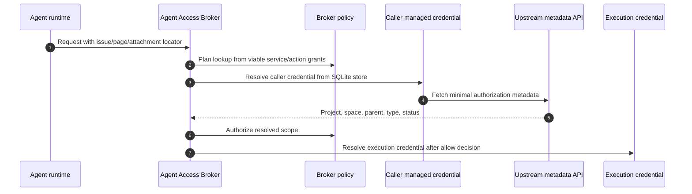
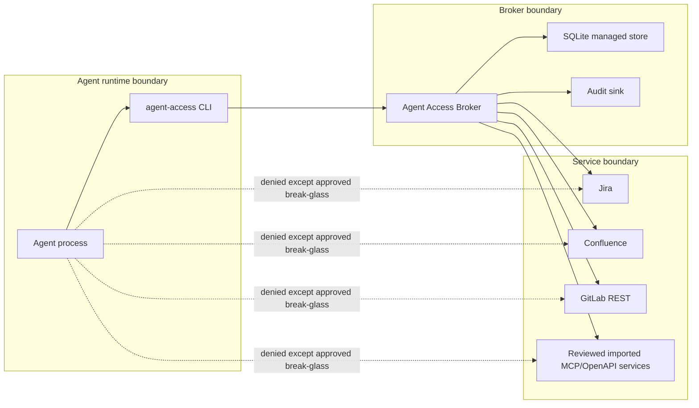
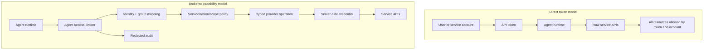
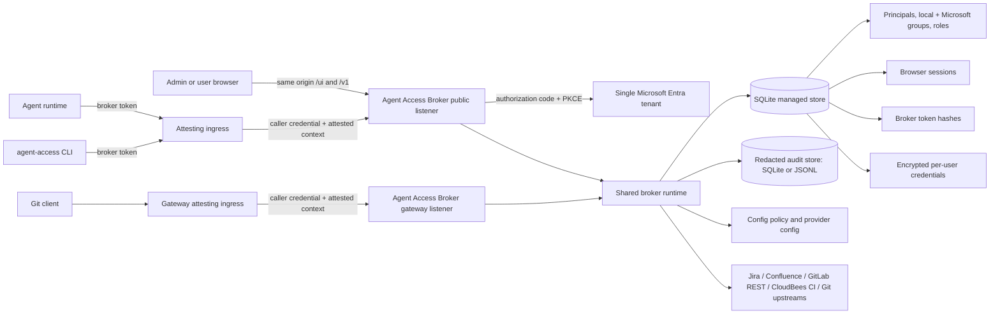

# Agent Access Broker security model

For trusted username authentication on HTTP MCP, registered fingerprint identity
on existing invocation surfaces, explicit managed bindings and shared
identity-access pause, see [managed identity](managed-identity.md). Named callers
authenticate attesters; Broker resolves humans and applies current permissions.
Issued Broker tokens retain their independent authorization boundaries.

This document explains the security need Agent Access Broker addresses and how it
solves it: how it gives AI agents scoped, audited access to upstream
services without putting upstream credentials in the agent runtime, and how that
compares with handing agents direct upstream tokens, vendor CLIs, or raw service
APIs. It is written for security reviewers, platform owners, service
administrators, and agent platform owners.

For implementation details, see [design.md](design.md). For the managed-store
database and encryption model, see [database.md](database.md). For configuration
keys, see [configuration.md](configuration.md). For operational setup, see
[operator-guide.md](operator-guide.md). For provider-specific behavior, see
[providers.md](providers.md).

## Executive summary

Agent Access Broker gives approved AI agents narrow, audited
capabilities for Jira, Confluence, GitLab REST, and CloudBees CI
without putting upstream credentials in the agent runtime. It converts a user's
broad native authority into an explicit, deny-by-default set of typed broker
actions - view an issue, search within an approved project, add a comment, view
or update a page in an approved space, download an approved attachment, verify
an expected result - and keeps the upstream credential encrypted server-side,
decrypted only inside the broker for a single authorized provider call.

This is a second authorization layer. Native service permissions in Jira,
Confluence, GitLab REST, and CloudBees CI stay in force, but the broker does not
treat them as
sufficient approval for agent use: an agent acting for a trusted user is still
an autonomous, injectable tool, and what it may do is owned by the teams
responsible for agent behavior, not by each resource owner. The model holds only
when the deployment also blocks direct agent egress to upstreams and protects
the broker host and keys; those preconditions are part of the security boundary,
not optional hardening. Residual risks are listed at the end of this document.

## The security need: why agent access is different

Traditional resource access management asks one question:

```text
Who is allowed to access this project, space, repository, API, or record?
```

Agent access management must also ask a second:

```text
What exact capabilities may this non-deterministic tool exercise,
under what workflow, with what validation, limits, and audit trail?
```

Agent Access Broker exists to answer that second question. Agents are useful
because they read context, choose tools, and take actions — and those same
properties change the risk model. An agent may be acting for a trusted user, but
from a security-control perspective it is still an autonomous tool that
interprets natural language, tool output, retrieved documents, and sometimes
attacker-controlled or stale content.

The broker therefore assumes an agent may:

- Misinterpret an instruction.
- Over-generalize from incomplete context.
- Be influenced by prompt injection in Jira comments, Confluence pages, search
  results, issue descriptions, attachment contents, or external tool output.
- Attempt broad search or retrieval beyond the user's immediate task.
- Use a tool in an unintended sequence.
- Retry or modify requests in a way a deterministic integration would not.

A user's native permissions answer the first question but not the second. They
were granted for a human's full judgment, not for an injectable tool acting on
the user's behalf. Agent Access Broker adds a second layer that constrains the
agent to approved operations and approved scopes before any upstream request is
made, so native permissions remain necessary but are no longer sufficient on
their own to approve agent use.

## Ownership of agent authorization

Agent authorization has different ownership than ordinary resource membership.
Resource owners decide who may access their project, space, repository, or
service in the native system. Agent platform and security owners decide which of
those resources may be exposed to agent runtimes, which operations are allowed,
which credential mode is acceptable, and what audit and approval controls apply.

The broker is the enforcement point for that organization-level agent policy. It
lets native Jira, Confluence, code-host, or other upstream permissions remain in
force, but it does not treat those native permissions as sufficient approval for
agent use. In practice:

- A user may have broad native access, but the agent acting for that user can be
  limited to a smaller set of broker-approved services, actions, and scopes.
- A resource owner may grant a user access in a native system, but agent
  exposure still requires broker policy.
- Organization-level agent policy can be reviewed and changed without asking
  every resource owner to configure agent-specific controls inside their own
  service.

This is the separation of duties the broker preserves: native resource
authorization stays with resource owners, while agent containment is owned and
enforced by the organization-level agent/security platform.

| Responsibility | Typical owner |
| --- | --- |
| Jira project membership and permissions | Jira/project owners |
| Confluence space membership and permissions | Confluence/space owners |
| Upstream user tokens and token scopes | Security and service administrators |
| Broker deployment and runtime controls | Platform/security engineering |
| Organization-level agent capability policy | Agent platform/security owners with resource-owner approval |
| Audit review and retention | Security operations / compliance |
| Agent prompt and tool configuration | Agent platform owners |

## Brokered capability model

The broker turns broad product authority into explicit broker capabilities. The
authorization unit is:

```text
principal / group -> service -> action -> resource scope -> credential mode
```

The broker resolves a request in a fixed, deny-by-default order: it admits the
caller's identity and groups, resolves the provider scope as structured facts,
authorizes that scope against policy, and only then selects a credential. The
execution credential exists only inside one provider invocation and is never
returned to the caller. Unknown services, unknown actions, missing grants,
unsupported scopes, and ambiguous credential modes all fail closed.

Authorization and credential storage stay separate. Broker policy grants decide
which principal may use which service, action, resource scope, and credential
mode. The managed store holds principals, token state, credential metadata, and
encrypted credential material; user upstream credentials are decrypted only
inside the broker when a policy-authorized provider call needs them. Credential
resolution uses the authorized credential mode and service profile; storing a
credential does not itself grant permission to invoke a provider action.

## Authorization lookup path

Some provider requests do not carry enough authoritative scope information in the
agent input. A Jira issue key can be stale after an issue moves projects. A
Confluence URL may contain only a page ID. An attachment ID may not reveal its
parent issue, page, project, or space. For those cases the broker uses a
lookup-before-policy path to resolve the minimal metadata needed for
authorization:

- The broker resolves the caller's encrypted per-user credential from the managed
  store and uses it for the metadata lookup, so upstream user visibility
  participates in the authorization boundary.
- The lookup fetches only minimal authorization facts — current issue project,
  page space, attachment parent, object type, current status.
- Confluence parent placement resolves only page identity and authoritative
  space before policy. Creation requires any supplied parent to match the
  requested space; `page.move` independently authorizes the moved page, target,
  and effective parent in their common space, then verifies hierarchy and
  sibling position by readback.
- Confluence draft actions resolve policy scope from a broker-signed draft handle
  after draft creation or staging. Per-user handles bind the caller principal;
  service-mode handles do not bind a principal so policy-approved service-mode
  draft handoff remains possible.
- The broker first checks that the caller has at least one grant for the
  requested service/action, reducing the chance that lookup behavior becomes a
  discovery oracle.
- After lookup, normal deny-by-default policy authorizes the resolved scope
  before any execution credential is loaded or any content-bearing upstream
  request is made.
- A per-user credential resolved for pre-authorization lookup is a request-scoped
  lease: revocation, rotation, or replacement after the lease is resolved affects
  later requests, not the in-flight one.
- Lookup failures and unauthorized resources are normalized so the broker does
  not reveal detail about resources outside the caller's approved scope.

Caller resource/action discovery reuses effective clauses with token caveats
and execution context; it does not use the management resource picker. Resource
rows require exact enabled context-eligible metadata and some single-target
policy access. Namespace/all grants are not expanded into inventory. Listing a
resource or action neither probes upstream credentials nor authorizes a later
call. Cross-resource operations still require one applicable effective clause
for the complete request. Hidden and missing services receive the same denial
before resource-type-specific query validation, preventing locator errors from
revealing hidden service types. Cursors bind current policy and caller state
and never carry authority independently of renewed checks.

Search is different for Jira and Confluence. Those searches do not need a
separate metadata lookup. The runtime plans search authorization from policy,
the provider parses JQL/CQL into a broker-owned AST, finite policy scopes are
injected into the canonical query, and every returned result is revalidated
before any result is returned. GitLab REST search remains explicitly
project-scoped and uses project lookup before final repository-scope
authorization.



## Agent egress boundary

For brokered operations, the expected network boundary places the agent runtime,
the broker, and the upstream services in separate zones, with the agent able to
reach only the broker:



For agent deployments, the egress path from the agent runtime is itself a
security boundary. Even if a user can create a Jira, Confluence, or GitLab API
token, the approved agent runtime should not be able to use that token against
the upstream endpoint, because its only allowed path is through the broker.
Deployments should therefore allow approved agents to reach the broker and allow
the broker to reach configured upstreams, while denying direct agent egress to
protected upstreams by default. Migration or break-glass exceptions are handled
outside the normal CLI path and audited separately.

This network rule is a precondition, not optional hardening. The broker's
containment and credential-boundary guarantees assume the agent cannot bypass the
broker by calling raw upstream APIs; without the egress block, an agent could
route around broker policy entirely. The same dependence applies to the host: the
upstream credentials, token-hash key, and password pepper are protected only as
well as the broker host that holds them. The supported deployment is also a single
broker process per state set (managed store, audit store, and upload spool), so
its process-local rate, concurrency, audit, and upload-spool controls are not
split across processes. State locks enforce this, including for a SQLite audit
database (see [operator-guide.md](operator-guide.md) and [design.md](design.md)).

## How brokered access compares

Jira and Confluence let users create API tokens that external tools can use.
Without a broker, a user-delegated agent can simply be handed one of those tokens
and then call Jira or Confluence with the user's full native access — convenient,
but indistinguishable from ordinary user API use and impossible to constrain to
an approved workflow.

Agent Access Broker supports the same user-delegated operation without giving the
user's raw token to the agent. The user stores an upstream credential behind the
broker and receives a broker `agent_invoke` token for the agent. The credential
remains user-delegated but is stored and decrypted only inside the broker; the
agent receives broker authority, not raw upstream authority, and is constrained
by broker policy and any token service allowlist. Network policy blocks the agent
from using a self-minted upstream token directly against Jira or Confluence, so
the broker cannot be bypassed.



| Area | Direct token/API/CLI access | Brokered access |
| --- | --- | --- |
| Credential exposure | Token may be present in the agent environment or tool config. | Upstream credential is encrypted in the SQLite managed store and remains server-side. |
| Authorization unit | Token scopes and upstream account permissions. | Principal/group plus service, action, resource scope, and credential mode. |
| User-created upstream tokens | Users may hand agents tokens that carry broad user access. | Users can store credentials behind the broker and give agents broker tokens constrained by organization policy; network policy prevents normal agent runtimes from using self-minted upstream tokens directly against Jira or Confluence. |
| Request surface | Potentially broad REST API or vendor CLI surface. | Narrow typed operations. |
| Agent ergonomics | Agents may need mixed CLI/API/version-specific logic. | Agents use one discoverable service/action interface for built-in providers and configured route actions. |
| Resource validation | Depends on upstream endpoint and caller behavior. | Broker validates containing project/space and repository scope before execution. |
| Search containment | Caller may attempt broad JQL/CQL if token permits. | Broad or unresolved JQL/CQL is denied before upstream execution. |
| Audit | Distributed across token usage, upstream logs, and agent logs. | Central broker audit with resource and action context. |
| Agent-specific policy | Difficult without many tokens/accounts. | Native broker policy model. |
| Revocation and changes | Token rotation or account permission changes. | Central broker policy/token changes; upstream credential can remain stable. |

Beyond authorization, the single typed service/action interface also narrows the
request surface an agent constructs: one discoverable broker API instead of mixed
vendor CLIs, raw REST calls, tenant-specific URLs, and API versions. A narrower
surface is both easier for agents to use correctly and smaller to reason about.

## Deployment architecture

The supported production deployment uses a single broker process owning one managed
store, audit store (a SQLite audit database or JSONL files), and upload-spool
state set, serving one public HTTP listener
behind the deployment's TLS and trusted-context-ingress boundary. That listener carries the agent invoke API,
discovery, browser authentication, the same-origin portal, self-service
credential/token management, audit queries, DB-backed admin management, and
config reload/status operations. Deployments that enable protocol gateways, such as Git
smart HTTP, bind a separate gateway listener for host-matched protocol traffic;
that listener does not mount `/v1` or `/ui` and authenticates with
`agent_invoke` broker tokens carried by the protocol client or explicitly enabled
managed identity through a named trusted caller. Unix deployments
can also trigger config reload through `SIGUSR2` for service-manager hooks
without exposing a second admin HTTP listener.



With managed identity and policy authority, the managed-store database is the
source of truth for
principals, groups, account roles, self-service settings, local passwords, Microsoft login bindings and
finite group evidence, broker tokens, browser sessions, and encrypted per-user
upstream credentials. Static TOML classless
administrators are bootstrap/recovery exceptions, not the steady-state model.
This gives auditors one primary authority model to review: the database holds
operational identities and secrets, while the broker config holds the
deny-by-default capability policy and provider/network constraints. The specific
config keys and posture flags that set this up are documented in
[configuration.md](configuration.md).

[Trusted callers](trusted-callers.md) authenticate context and optional identity
assertions on HTTP, MCP and Git, including requests with explicit principal tokens.
Fixed callers receive their configured context; asserted callers must supply a
context from their allowed set. Forbidden forwarding is rejected even alongside a
valid principal token. Direct clients without protected headers use ordinary
authentication and a conservative configured default, or fail when context is
required. A caller credential alone never authenticates the principal or adds grants.

Username identity is limited to HTTP MCP. The managed launcher must control both
its private credential and `X-Agent-Access-User`; an end user who can choose the
assertion sent with a hidden credential could impersonate another bound user.
Only an explicit exact namespace/name binding selects a human. Username mode is
selected before ordinary authentication, so a conflicting or invalid assertion
cannot fall back to even a valid administrator token. Missing mappings and paused
or inactive humans share a generic denial. Identity-access pause controls both
username and fingerprint methods, separately from issued tokens and browser login.

MCP proofs pin the original human and binding through body intake and final
admission. Identity changes committed before the final check deny; already admitted
work may complete. Monotonic versions and fresh incarnations prevent restored
values from resurrecting stale sessions. Protected Connection nominations and
trailers cannot supply authority; MCP rejects all request trailers before dispatch.
Neither caller credentials, fingerprints, failed usernames nor private proof
material belong in traces or error messages.

The protected context header is never accepted without caller authentication.
Caller trust does not grant trust in forwarded IP addresses. The CLI intentionally
has no setting that supplies caller attestation; it belongs to the host ingress
or trusted daemon, not the agent workload.

## Identity and admin boundary

Managed control-plane authority is defined in [Account roles and self-service](roles.md).
The singular role distinguishes global read-only auditors, full administrators,
and directly assigned service managers. The separate self-service flag gates
personal management without changing invocation grants or credential refresh.
Admin-token revocation on role changes prevents an old reader token from gaining
write privileges on promotion. Secret reveals and upstream verification are
privileged operations, even when presented alongside metadata reads.

Human management of the broker — creating principals, granting roles, setting
passwords, managing credentials, issuing tokens — happens through a same-origin
portal that is deliberately separated from agent invocation. The
security-relevant properties are:

- **Admin authority is a database role, not a static secret.** Browser admin
  changes require an active principal with the DB `admin` role; the `auditor`
  role permits administrative metadata reads and safe previews. Managed `admin`
  broker tokens re-check the current role at request time. The store refuses any
  operation that would remove the last active admin, revoke the last active admin
  role, or disable the last active admin's password.
- **Service accounts are noninteractive principals.** They may own workload
  credentials, grants, group memberships, and `agent_invoke` tokens, but cannot
  receive an admin role, local or Microsoft login, browser session,
  `user_manage` token, or `admin` token. Both issuance and request-time token
  resolution enforce the kind boundary, including for stored token rows.
- **Portal sessions are separated from `/v1/invoke`.** Local password and
  Microsoft OIDC login create the same HttpOnly, same-origin session cookie,
  which can call read-only discovery plus self-service credential and token
  management when self-service is enabled. The current account role separately
  authorizes administrative reads, changes, or directly assigned service policy
  management. Browser cookies are never accepted for `/v1/invoke`
  — agents use `agent_invoke` broker tokens.
- **Per-token pause is reversible, not revocation.** An owner or global admin
  may pause one `agent_invoke` token without disabling its principal or changing
  its secret. The next admission fails before policy, credential, or upstream
  work, but an already-admitted request may finish. Resume restores the same
  secret under current groups and grants. Use permanent revocation when the
  secret may have been disclosed; revocation wins concurrent transitions.
- **Token boundaries are caveats, not grants.** Optional per-service action and
  canonical resource restrictions are checked in addition to current policy.
  They do not create candidates, affect policy priority, select credentials, or
  stitch grants. Action denial occurs before lookup or credential work; finite
  scope denial follows canonical resolution, and search authorization is
  intersected before the upstream query. Boundary changes require a replacement
  token.
- **Microsoft identity is object-based.** The configured tenant ID and the
  token's immutable user object ID form the login identity. Email, display name,
  and preferred username never match or merge accounts, and the broker does not
  call Microsoft Graph. Administrators can explicitly link or unlink an object
  ID when needed.
- **OIDC flow state is bounded and single-use.** Authorization code flow uses
  PKCE and nonce validation plus encrypted, expiring state bound to a separate
  HttpOnly browser cookie. The callback claims the state once, preventing replay
  or a different browser from completing the flow.
- **External groups are policy inputs, not administrators.** Microsoft group
  object IDs map to managed groups and create finite membership evidence (eight
  hours by default).
  Effective groups combine current Microsoft evidence with explicit local
  memberships, but group mapping never assigns the DB `admin` role.
- **Service policy management is bounded delegation.** With managed identity
  and policy authority, a global DB admin may assign an active account with role
  `service_policy_manager` to manage all otherwise-valid grants for one exact
  service. Assignments are direct to accounts, never groups. One account may
  manage multiple services; group membership never supplies management authority. The manager cannot
  appoint managers, view credentials, administer identities or tokens, or move
  grants between services. Out-of-scope grant access is collapsed to not found,
  and authority is resolved on every management request.
- **Management authority is not invocation authority.** A manager may use their
  whole-service authority to grant themselves access, but the assignment itself
  never authorizes invocation. They retain normal self-service token issuance;
  issuing an `agent_invoke` token still requires an effective invocation grant,
  so dormant bearer tokens cannot be created from an assignment alone.
- **Microsoft failure is provider-scoped.** Discovery, key, or token endpoint
  failure makes Microsoft login unavailable without taking down broker
  readiness, local login, or agent invocation.
- **Runtime specs are authenticated and filtered.** `/v1/spec/*` routes expose
  operational shape, so they require normal identity admission, set `no-store`,
  and filter provider actions and HTTP routes by token class, service allowlist,
  token action boundary, provider policy visibility, non-invoke surface
  exclusion, and management access. Finite resource caveats remain request-time
  authorization and do not rewrite provider schemas. Admin-only
  `visibility=all` is an operator inspection path and logs a structured security
  event.
- **State-changing browser requests are CSRF- and origin-checked.** Cookie-
  authenticated state-changing routes require a CSRF token and same-origin
  metadata; the raw session token is only ever set as the HttpOnly cookie, never
  returned in JSON.
- **Local passwords resist offline and timing attacks.** Passwords are stored as
  salted, peppered, memory-hard Argon2id hashes, and unknown-principal logins
  still run a dummy verification before the generic failure. Resetting or
  disabling a password revokes that login method's sessions, and admin-set
  passwords are temporary, requiring a change before self-service routes work.
- **Password guessing cannot lock a user out from elsewhere.** Failed
  local-password attempts, the authentication principal budget, and the
  pre-authentication login concurrency slot are keyed by `(principal, source)`,
  with IPv6 sources grouped by /64 and IPv4-mapped or `64:ff9b::/96` NAT64
  sources by their embedded IPv4 address; `auth_requests_per_source_per_minute`
  uses the same grouping. A source that reaches `max_failed_attempts` is locked
  out of that principal for `lockout_ttl` without affecting the user's other
  sources, and unknown principal IDs lock out identically so lockouts do not
  reveal which principals exist. Rotating sources never avoids lockout: past
  256 sources with recorded failures, further sources share one overflow
  counter per principal that locks them as a unit.
- **Admin-on-behalf is non-impersonating.** An admin can manage a selected user's
  stored credentials and `agent_invoke` tokens without ever seeing stored
  upstream secret material and without changing the audit actor away from the
  admin.

Parameter values (Argon2 cost, cookie attributes, CSRF key handling), the full
administrator action list, and the managed-user workflow are documented in
[design.md](design.md), [configuration.md](configuration.md),
[database.md](database.md), [operator-guide.md](operator-guide.md), and
[end-user-guide.md](end-user-guide.md).

## Provider capability framing

The broker advertises a finite, typed action inventory — Jira and Confluence
actions authorized by their project/space boundaries, GitLab REST actions
authorized by canonical repository boundaries, and CloudBees CI actions
authorized by controller alias and full job name. Git HTTP gateways use those
same repository resources.
Read-result presentation is also capability-scoped. Common invoke and send
requests may carry top-level `readContentFormat` (`native`, `markdown`, or
`text`) and `responseFormat` (`json` or `markdown`) fields, but only actions
whose caller-filtered catalog entries advertise `readContentFormats` or
`responseFormats` accept the corresponding non-default request. These fields
are protocol controls beside `inputs`; they are never provider input. An
unsupported representation fails before authorization, credential selection,
or provider access, but only after normal identity and token admission. Jira,
Confluence, and GitLab advertise normalized read results only for declared
rich-content owners and whole-result Markdown only for eligible non-streaming
retrievals.
This inventory is not an approval list: actual access is filtered at runtime by
identity, token class, optional token service/action/resource caveats,
deny-by-default policy, resolved resource scope, and configured credential
mode. Provider and gateway
contracts are indexed from [providers.md](providers.md), with detailed action
contracts in [providers-jira.md](providers-jira.md),
[providers-confluence.md](providers-confluence.md),
[providers-gitlab-rest.md](providers-gitlab-rest.md),
[providers-cloudbees-ci.md](providers-cloudbees-ci.md),
and Git smart HTTP gateway rules in [git-http-gateway.md](git-http-gateway.md).

## Shared resource policy

The five production surfaces use catalog references: Jira projects, Confluence
spaces, Git repositories shared by GitLab REST and Git HTTP, and CloudBees CI
jobs. Administrators can deliberately authorize all resources or nested
repository and job namespaces, including new upstream objects. Contexts
restrict each entry's positive contribution; they are not universal upstream
classifications.

Groups may exclude selectors. Exclusions win within one grant and apply even
when the excluded entry is disabled or context-ineligible. A separate grant can
still authorize the target. Token restrictions intersect current grants, so a
token exclusion cannot be overridden by another grant. Search planning preserves
these boundaries before upstream pagination and verifies returned containment.

Only global administrators change shared resource definitions and groups.
`Used by` reveals permitted reference information, and deletion is blocked until
live references are manually removed. Atomic policy snapshots include the whole
resource/group/grant graph. See [resources.md](resources.md).

## Security controls

Agent Access Broker applies these controls in the request path:

- **Identity admission**: every protected endpoint resolves the caller to a
  principal and groups, or fails according to the configured identity mode.
- **DB-backed management authorization**: steady-state admin access requires an
  active managed principal with the DB `admin` role for changes or `auditor` role
  for metadata reads and safe previews. Static TOML classless
  admin identities are reserved for bootstrap or recovery.
- **Browser-session controls**: portal sessions use HttpOnly, same-origin
  cookies, CSRF tokens for state-changing requests, forced password changes for
  temporary local passwords, code/PKCE/nonce and browser-bound single-use state
  for Microsoft login, and route-level separation from `/v1/invoke` (see
  Identity and admin boundary).
- **Deny-by-default policy**: unknown services, unknown actions, missing grants,
  unsupported scopes, and ambiguous credential modes fail closed.
- **Provider scope resolution**: providers resolve the containing Jira project or
  Confluence space, and canonical Git repositories, before execution.
- **Lookup-before-policy metadata resolution**: lookup-backed actions resolve
  ambiguous locators and opaque IDs with the caller's database-managed credential
  before policy authorization, with normalized failures (see Authorization lookup
  path).
- **Broker-owned query parsing**: Jira JQL and Confluence CQL are parsed into a
  broker AST, re-emitted canonically, scoped by policy, and result-validated.
- **Credential containment**: agents never receive broker-held execution
  credentials. Deliberate GitLab token issuance/rotation returns a new token as
  explicitly sensitive output; it does not reveal the broker execution credential.
  Database-managed credentials are decrypted only inside the broker for the
  scoped provider operation.
- **Upstream request confinement**: providers construct upstream requests and
  enforce host, path, redirect, and header constraints.
- **Content and body controls**: Jira, Confluence, and GitLab rich-content mutations
  accept explicit action-specific formats through canonical `content` and
  `contentFormat`. Normalized sources are bounded and converted to ADF or a
  constrained storage-HTML subset, or literal GitLab Markdown before native attribution where supported,
  final structural validation, and a second serialized native-body size check.
  Conversion is deterministic, offline, and bounded by source bytes, parse
  depth/events/work, and incremental output; it neither truncates nor trusts raw
  Markdown HTML. Jira and Confluence normalized reads preserve native ADF or
  storage/ADF bodies, while GitLab preserves native Markdown. Each may add a
  deterministic Markdown or plain-text `renderedBody` companion, or render an
  eligible complete result as bounded Markdown. Whole-result GitLab bodies are
  parsed and safely re-emitted before trusted result metadata is appended.
  Confluence storage conversion uses a bounded tree parser,
  suppresses active content, scripts, unsafe macros, and macro parameters, and
  never calls Atlassian's network conversion endpoint. Native and rendered
  bodies are subject to the corresponding provider `max_body_bytes` cap even when
  `readContentFormat` is omitted or explicitly `native`; aggregate rendering,
  whole-result Markdown, and final serialized results are also bounded. The
  renderer uses safe fallbacks for valid unsupported ADF/storage/Markdown
  constructs and
  fails closed without truncation or native-content fallback for malformed or
  over-limit content. When both Confluence representations are present, ADF is
  selected before storage; malformed selected ADF fails instead of falling back
  to storage. Jira issue summary edits are length- and newline-bounded; Jira issue
  view is a body-read action after body-free project containment lookup, and
  returned descriptions are structurally validated and bounded without writing
  description content to audit; Jira comment property keys are limited
  to broker-owned prefixes and prove issue membership before ID-only upstream
  property calls; Confluence page create/update accepts configured `storage` or
  `atlas_doc_format`; Confluence page hierarchy writes are limited to same-space
  pages through narrow create-parent and `page.move` target/position fields,
  without raw move passthrough; upload sizes, media types, checksums, and
  download limits are enforced before or during provider calls.
- **Bounded validation feedback**: broker-local malformed-body and unsupported
  body-format failures remain actionable through lookup-backed flows. Only
  after an authorized Jira, Confluence, or GitLab REST mutation may the broker
  derive a short sanitized message from a provider-specific structured
  validation shape and action allowlist. Raw upstream bodies and all lookup,
  authentication, permission, existence, scope, conflict, throttling, and
  server-error bodies remain hidden. Git smart HTTP is an unchanged, separately
  bounded protocol passthrough and does not use this REST error projection.
  Unknown response-control fields or mutually exclusive response requests fail
  as `input_invalid`/400. A non-default representation not advertised by the
  resolved action fails as `response_format_unsupported`/415. Malformed or
  oversized upstream/native read content, rendering-limit exhaustion, and
  rendered-result overflow use the fixed sanitized
  `upstream_protocol_failed`/502 response. Write-input overflow retains its
  caller-input semantics.
- **Audit and redaction**: allow, deny, and error outcomes are audited with
  identity, service, action, scope, decision, reason, and sanitized provider
  metadata; caller rich content, provider-native read content, rendered-body
  companions, whole-result Markdown, arbitrary property values, pagination
  tokens, converted provider-native content, mutation readback bodies, parser
  excerpts, extracted links, raw credentials, payload bytes, draft handles,
  draft body/title values, attachment filenames, and attachment hashes are
  excluded from audit, tracing, logs, errors, object identifiers, and metric
  names or labels. Safe requested/effective format names, byte counts,
  conversion state, stable outcome categories, and attribution metadata may be
  recorded; audit construction does not receive rendered strings to derive
  those values. Every management call is audited, including denials and
  failures, except successful read-only operations (see Unaudited management
  reads). Password change and authenticated logout require a durable preflight
  before mutation. If their supplemental completion record fails after commit,
  the broker preserves success and normal cookie handling, reports the audit
  sink fault through readiness, and logs a correlated
  `auth_committed_write_audit_append_failed` event. Logout store failures retain
  the cookie and return a sanitized error; all auth envelopes are `no-store`.
- **Audit visibility**: with a SQLite audit store, audit records can be read
  through `/v1/admin/audit/*`, `/v1/audit/*`, the matching CLI commands, and the
  portal. Records contain principal IDs, groups, source addresses, grant
  details, and resource identifiers, and every reader sees complete records;
  tiers differ only in which records they see. Global admins and auditors see every record.
  Service policy managers see the full records of every principal for the
  services they manage at request time, including admin actions on those
  services (manager assignments, credential and service-limit changes), never
  records without a service scope (users' own token, credential, and login
  activity). Managed users with self-service enabled see only records whose
  principal is their own, including their agent tokens' activity. Agent-invoke
  tokens can read none. Queries are parameterized, and search text is matched
  literally, never as full-text query syntax.
- **Unaudited management reads**: a successful read-only management operation
  (a plain read of data the caller may see that returns no secret material,
  calls no upstream, and changes no state) writes no audit record and no
  replacement log event. This covers session, token, credential, and OAuth
  connection reads, status reads, principal, group, right, token, and credential
  lists and inspections, policy reads, the effective-access and grant
  validation dry runs, and audit queries; [http-api.md](http-api.md#management-audit)
  lists them. Portal page loads therefore do not fill the audit store, and
  these reads, the audit viewer included, keep working when audit writes fail.
  The broker keeps one explicit list of unaudited operations; anything not on
  it, including a new route, is audited. Reads that disclose or move secrets,
  or complete a connection, stay audited on success: identity-token and
  private-attribute reveals (audited before decryption), the whole-policy
  export, credential verification, and the OAuth callback. Denied and failed
  reads are audited like other management errors, so probing for data the
  caller may not see remains visible. Cursors carry the caller's own filters
  (including any search text) and a position, and no scope or secrets; they
  are bound to the caller, the route, and the audit database, visibility is
  re-resolved on every page, and cursors are not recorded in audit.
- **Audit store integrity**: the SQLite audit database has the same guarantees
  as the JSONL file: a broker-owned owner-only directory, owner-only (`0600`)
  database and `-wal`/`-shm` files created by the broker, no symlink following,
  and a single-owner state lock. The broker never resets or deletes audit data
  outside configured retention, and `agent-access-broker audit verify` checks
  integrity offline. Records are not tamper-evident: a host administrator can
  still alter them.
- **GitLab review identity and mutation proof**: draft ownership is GitLab
  credential ownership. Per-user mode isolates a human's pending review;
  service mode deliberately exposes one bot-owned draft set to every granted
  broker principal sharing that credential, so policy must not present it as
  human attribution. Positioned writes require a fresh expected head, a
  complete non-null diff SHA triplet, and validated coordinates; outdated
  discussions may still receive ID-targeted replies. Review writes are never
  automatically retried. An accepted-but-unverifiable write returns HTTP 409,
  `decision = error`, `mutation_verification_failed`, safe locators only, and
  `retrySafe = false`. Bodies, summaries, patches, native line codes, and
  continuation tokens remain outside audit and telemetry; bounded position
  type/numeric-line metadata may be recorded without content.
  Command-like GitLab quick-action lines outside fenced code and suggestion
  blocks are rejected before rich-content writes so ordinary review prose
  cannot cause hidden mutations or provider body stripping; fenced examples
  remain literal content.
  Formal approval resolves the acting upstream user, gates on exact prepared
  diff state including non-null patch ID, and proves actor-specific state rather
  than trusting the edition-dependent aggregate flag. Suggestion application
  starts from scoped discussion/note proof and, for forks, authorizes the
  complete target/source repository set through one grant before using the
  global endpoint. GitLab's source-head/push checks remain authoritative.
  Accepted applies are verified by scoped reread because the immediate
  response may be stale; no commit metadata or implicit thread resolution is
  inferred.
- **GitLab project webhook egress**: project hooks let the selected GitLab user
  configure server-side outbound POSTs carrying project data. Repository grants
  authorize actions, while operator-owned `[providers.gitlab.webhooks]` TOML
  places a separate ceiling on destinations introduced by create or URL
  change. Existing out-of-policy hooks remain operable when granted; the Broker
  deliberately does not maintain hook ownership. Explicit `http://` patterns
  authorize plaintext internal delivery, and disabling HTTPS verification
  requires its separate operator switch. These string checks do not replace
  GitLab outbound-request filtering, DNS/redirect controls, or network egress
  policy. URL-variable mutation is omitted because it could change the
  effective destination without a stored-URL change.
  Hook tokens, signing tokens, custom-header values, and sensitive delivery
  headers are never returned or emitted to observability. Delivery rows omit
  GitLab's upstream URL because interpolation may expose URL-variable secrets.
  Audit records only
  hook/event IDs, fixed operation metadata, introduced-destination scheme, and
  matched allowlist-pattern index; host, port, path, query, full URL, content,
  secret presence, and receiver data are excluded. Ambiguous custom-header
  mutation failures expose only the safe hook ID, not the header key. Test and
  resend are independently granted outbound-delivery actions and are never
  automatically retried.
- **Opt-in OIDC identity diagnostics**: the permanent, module-scoped OIDC
  `debug` tracing target can record a fully validated Microsoft user's name,
  email, tenant/user Object IDs, claimed group Object IDs, matched mappings,
  and admission result for integration and operational diagnosis. It remains
  outside durable audit and never records tokens, authorization codes, flow
  secrets, state, nonce, PKCE data, cookies, sessions, or raw JWT payloads.
  Treat the resulting service logs as directory metadata and PII.
- **Visible write disclosure**: optional content attribution appends a
  broker-owned footer to configured text/body writes with the broker request ID.
  It does not spoof upstream display names or change the authenticated upstream
  actor; upstream services still show the selected credential owner.
- **Operational limits**: request body caps, upstream response caps,
  concurrency/rate limits, timeouts, health, and readiness checks bound runtime
  behavior. Service invocations (invoke, HTTP MCP action tools, and Git pack
  transfers) are rate limited per principal and service, so one agent cannot
  exhaust an upstream service's budget for others and principals sharing an
  ingress address (such as a shared proxy) never lock each other out. Discovery,
  specs, and management are not rate limited; authentication abuse,
  anonymous traffic, and invalid credentials use independent source and
  principal budgets. The count is taken before policy, credential, or upstream
  work, and rate limits never bypass authorization, CSRF checks, or concurrency
  guards. Limits are process-local and bound request admission, not upstream
  call volume within one admitted request.

## Complementary egress and content screening

Some deployments need controls beyond broker authorization, such as TLS
inspection, URL allow/deny lists, request-body screening, response redaction, or
centralized capture for traffic that is not fully represented as a typed broker
operation. Agent Access Broker can be deployed alongside an egress proxy for
those cases.

A compatible deployment can route agent or broker outbound HTTP(S) through a
proxy that provides the required egress policy and content screening. Broker
outbound proxy settings use ordinary HTTP(S) proxy transport; they do not depend
on a particular product. Identity/context attestation on inbound requests is a
separate [trusted-caller contract](trusted-callers.md), and requires an ingress
implementation that verifies those assertions. Agent Access Broker remains the
capability authorization and credential boundary and can operate independently
of those optional controls.

## Admission and in-flight authority

The Broker acquires a global concurrency lease before ordinary HTTP body
extraction, with independent health/readiness probes and MCP admission. Anonymous
control-plane body reads have a separate pool limited to one quarter of global
capacity (minimum one), source admission, small byte caps, and short receive
deadlines. Verified management identities do not share anonymous source slots.
Their bodies instead use a per-principal concurrency slot before extraction,
independent of handler execution permits. Bodiless owner pause/revoke requests
do not need body slots and remain available if a compromised token fills them. Local password hashing runs outside the managed-store connection lock behind
bounded admission, including a reserved administrative slot during login load;
the store rechecks password and account state before issuing a session.

Invocation authorization and ordinary credentials are request snapshots.
Revoking or pausing a token, disabling an account, removing a grant, or rotating
an ordinary credential prevents newly admitted work under the old authority.
Already prepared work may still dispatch the exact operation authorized earlier.
This does not authorize new operations or unrelated services; several already
prepared operations may exist up to the concurrency limits.

Caller-controlled uploads must complete within `limits.request_body_timeout_ms`
(five minutes by default), even while making progress. This limits stale prepared
uploads without turning revocation into cancellation of existing work. Delegated
OAuth leases, private resource attributes, and imported-action availability retain
their explicit dispatch revalidation. An incident requiring all prepared work to
stop requires ingress shutdown and process termination, with audit/upstream checks
for uncertain outcomes; graceful draining allows admitted work to finish.

Management responses prohibit caching, internal store failures use fixed public
messages with detailed server-side diagnostics, and the Git gateway overrides
upstream cache directives with `private, no-store`. CLI transports reject redirects
so configured identity headers remain with the original Broker endpoint.

## Residual risks

| Residual risk | Mitigation |
| --- | --- |
| Authorization is revoked while an already prepared request is uploading. | Existing request snapshots may finish; concurrency limits and a total receive deadline bound pending uploads. Stop ingress and terminate the process when incident response requires canceling prepared work. |
| Agent summarizes sensitive content it was authorized to read. | Keep broker policy narrow and pair it with agent-side output controls for sensitive workflows. |
| An agent asserts its own context header. | Broker always requires a valid named trusted caller credential for protected headers on public and Git listeners. Keep that credential private and configure the caller with only its approved contexts and forwarding capability; asserted ingress must replace client context values. |
| A stored agent token without `allowedExecutionContexts` is copied between environments. | Current context-aware grants still limit access, but the token itself does not restrict execution context. Its caveats cannot be amended. When copied-token containment matters, revoke it and issue a replacement; issuance requires a finite execution-context caveat. |
| A coarse token without `serviceRestrictions` inherits an action or resource added to its owner's policy. | Current grants still limit access, but the token has no independent action or resource ceiling. Use purpose-specific tokens with explicit action lists and finite resource values where expansion containment matters. |
| A token stores a finite value whose supporting grant is later removed. | The token is not mutated and cannot authorize by itself. Requests deny under current policy; restoration makes only the still-caveated value usable again. |
| Resource owner approves an overly broad project or space. | Require broker policy review by security or agent platform owners; start with narrow pilot scopes. |
| Upstream credential is compromised from the broker host. | Protect the SQLite store and encryption keys, restrict host access, rotate tokens, monitor audit, and use least privilege upstream permissions. |
| An attacker shares the victim's source address (for example the same NAT, IPv6 /64, or NAT64 translator using a network-specific prefix) and exhausts `max_failed_attempts`, or a distributed attacker guesses from many sources. | The shared source is locked out for `lockout_ttl`; users at other sources are unaffected, and an admin unlock clears it early. A distributed attacker gets `max_failed_attempts` guesses per source per `lockout_ttl` for up to 256 sources plus `max_failed_attempts` shared across all further sources, bounded by `auth_requests_per_source_per_minute` and Argon2id cost. An attacker controlling more than 256 sources can lock the victim out from every source without a row of its own until the overflow lockout expires; because success clears a source's row, that usually includes the victim's normal address, and only sources with recorded failures of their own keep independent state. Require strong passwords or Microsoft login, monitor `local_login_*` audit records, and use an admin unlock to clear an overflow lockout early. |
| First-use admin password is exposed before reset. | Run initial bootstrap only in a controlled deployment window, require immediate password change, and do not expose a fresh broker to untrusted networks. |
| Admin browser account is compromised. | Use short session TTLs, protect administrator workstations, monitor management audit records, disable the compromised principal, and rotate affected credentials or tokens. |
| A service policy manager reads other principals' audit records for their services. | This is intended: managers need the full records to operate the service. Assign service management deliberately and revoke it when no longer needed; visibility follows current assignments on every page. Records without a service scope remain visible to administrators, auditors, and their owner with self-service enabled. |
| Successful management reads, such as an administrator listing principals or credential metadata, or a user reading audit records, are not in the audit store, so who viewed what cannot be reconstructed from audit. | These reads return only data the caller is already authorized to see and no secret material; denials and failures are audited, and reveals, the policy export, and credential verification stay audited. Protect and monitor administrator sessions and tokens, and keep access logs at the fronting proxy where per-read records are required. |
| A user is removed from a mapped Microsoft group after a successful login. | Microsoft-derived membership expires after the configured finite TTL (eight hours by default) and refreshes on the next login; local memberships remain independent. Reduce that TTL or disable the principal directly when faster revocation is required. |
| Broker logout is mistaken for Microsoft account logout. | Treat logout as revocation of the broker session only; it does not end the user's Microsoft session. Use Microsoft tenant controls for federated-session revocation. |
| Microsoft discovery, signing keys, or token exchange are unavailable. | Fail Microsoft login closed while keeping broker readiness, local login, and agent invocation available; monitor the provider-specific availability signal. |
| Prompt injection causes an allowed but inappropriate action. | Keep operations narrow, require confirmation for sensitive writes, and audit all write operations. |
| Broker implementation defect allows an overbroad operation. | Use reviewed code, deterministic tests, config validation, staged rollout, and release gates. |
| Users bypass the broker by giving direct upstream tokens to agents. | Establish policy and network controls so approved agent access to protected services uses brokered access unless an exception is approved. |

## Outbound server authentication

Every Broker-owned HTTPS client uses the global `network.outbound_tls` policy.
`system` trusts the process-visible native CA store, `custom` trusts only the
configured bundle, and `system_plus_custom` trusts both. Certificate-chain and
hostname verification remain enabled in all modes. These roots authenticate
provider servers, allowlisted transfer destinations, Git upstreams, HTTPS egress
proxies, and Microsoft OIDC endpoints. Adding a root authorizes it to certify any
destination accepted by those clients; URL and credential-forwarding boundaries
continue to apply independently. Trust material is captured per runtime
generation and refreshed by validated config reload.

## Related references

- Architecture and runtime behavior: [design.md](design.md)
- Managed store database and encryption model: [database.md](database.md)
- Configuration schema: [configuration.md](configuration.md)
- Provider controls: [providers.md](providers.md)
- Operational deployment guide: [operator-guide.md](operator-guide.md)
- Managed user onboarding: [end-user-guide.md](end-user-guide.md)
- Trusted ingress contract: [trusted-callers.md](trusted-callers.md)

## Deliberate downstream credential issuance

The optional [GitLab bot provisioning](gitlab-bot-provisioning.md) surface uses a
Broker-held execution credential to create a different credential for an
authorized downstream consumer. That new token is intentionally exported by
create/rotate actions; metadata reads and audits exclude it. Operator role,
scope, and lifetime caps apply in addition to repository/action authorization.
A directly used token is governed by GitLab permissions and is not restricted
by Broker action grants after issuance. Removing a Broker grant does not revoke
that token. Secret output markers describe sensitivity; they do not keep a
returned secret out of client/model transcripts.

## Service-specific MCP views

`/mcp/<service>` and `mcp serve --service <service>` restrict tool listing,
helper discovery and execution to one canonical broker service. This is a
connection boundary, not a token restriction: the credential can use other
endpoints wherever its grants permit. Current identity, context, canonical
action/resource grants, credential bindings and invocation counters still apply.
Readiness checks all active service definitions before caller filtering; hidden
name collisions cannot be bypassed by choosing another principal or transport.
HTTP session and cursor bindings include the view, and stdio selection remains
fixed across local token/configuration changes. Invalid names never receive
automatic aliases. See [MCP setup](mcp.md#service-specific-connections).

## Downstream HTTP MCP

The optional `/mcp` endpoint shares Broker identity, resource policy, credential
selection, execution limits, and audit. It accepts only Authorization Bearer
invocation identities; cookie and anonymous access are unavailable. Session IDs
route protocol state and confer no authority. Each request reauthenticates, and
sessions bind to an exact credential, execution context, and endpoint/security
configuration. Policy reloads preserve sessions while rechecking authority on
each request.
Public Host and explicit Origin validation complement trusted TLS ingress.

HTTP exposes JSON actions and passes inline inputs through the canonical action
schema, including sensitive fields. Such inputs and deliberately issued output
credentials can enter model/client history. Local stdio MCP provides filesystem
request and secret sources when needed. The SDK's raw-message tracing is disabled
by a hard log filter; Broker audit/logging does not record MCP arguments.
Cancellation and disconnected responses cannot establish that a dispatched
mutation was rolled back. Inspect the recorded outcome before retrying.

## Private Workflow destination credentials

A signed Teams Workflow URL is
an encrypted private attribute of an exact managed resource. The caller authorizes
an alias through ordinary grants/groups/token restrictions and cannot supply or
read the URL. Immediately before dispatch, the broker revalidates the admitted
resource and secret versions plus enabled/context state. Broad grants cannot bypass
the requirement for a configured exact destination.

Only explicit admin reveal discloses the URL after authorization, browser CSRF,
and audit preflight, with `Cache-Control: no-store`. Exact nonsecret Microsoft
environment origins constrain outbound requests; signed paths/queries, request
objects, response bodies, and arbitrary upstream errors are excluded from output
and logs. Redirects and automatic POST retries are disabled. A Workflow owner can
change its downstream channel or behavior independently: the Broker authorizes
the endpoint, not a permanent channel identity. Acceptance does not prove delivery.
See [Teams boundaries](providers-teams.md).

## Delegated upstream token custody

The [OAuth manager](oauth.md) keeps refresh tokens and access tokens in
encrypted owner-bound store records. Browser session/CSRF controls and one-use
PKCE flows govern connection management; Broker invocation tokens confer no
consent rights. Personal setup requires enabled self-service, a configured
binding and a current direct/group `per_user` action grant, independently of
resource/context availability and invocation precedence. Consent start, claim
and install recheck that authority and the exact binding; managed grant and
membership changes are ordered within admission transactions. No credential
right bypasses these checks. Owners retain local disconnect after grant loss;
connecting never expands invocation policy.
Ambiguous consuming-token refresh outcomes require reconnect;
dialects declaring reusable refresh material use bounded, persisted recovery. Disconnect is local invalidation, not provider revocation.
Providers never hold the OAuth manager or refresh material: the runtime lends
each admitted invocation the caller's current access and rechecks it just
before dispatch. OAuth requests pass through the same upstream client boundary
as backends:
each registration may reach only its dialect's allowlist, routes each approved
destination through the global egress proxy unless that destination is a literal
loopback IP address, and is traced without tokens, codes or response bodies.

Gmail consent uses `gmail.modify`, whose upstream authority exceeds the Broker’s
supported action set. Broker grants expose reads, archive, Trash and restore only;
sending and permanent deletion have no action. Mail is untrusted content and never
an instruction source. See [Gmail boundaries](providers-gmail.md).

## Imported MCP services

Imported services use the ordinary user, context, token, grant, rate-limit and
audit checks. They authorize whole actions, without broker resource scopes. A
generic search or API tool can therefore reach everything allowed by its selected
upstream credential. Use a resource-aware provider when folder, project, namespace
or query restrictions are required. Read-only classification is an administrator
reviewed assertion; upstream tool annotations are suggestions.

Only base administrators manage imports, under the operator's exact destination
allowlist. Accepted mappings and schemas are stored locally. Complete manual
refresh quarantines changed, missing or unsupported actions; partial discovery
does not publish. Service and personal credentials remain distinct, and a selected
personal credential never falls back to a shared credential. Discovery credentials
are not execution fallback credentials.

Personal MCP OAuth uses operator-approved registrations, exact resource/audience/
target bindings, validated issuer and metadata endpoints, PKCE and the registered
Broker callback. The adapter checks a returned token-response `resource` when
supplied; it does not introspect opaque tokens or independently verify JWT
audience claims. An explicit permission profile requests scopes and requires
them in the token's known scope set, but accepts additional scopes. It is not an
upper bound on upstream authority.

An operator may choose `scope_mode = "server_default"` for MCP OAuth and omit
configured scopes. The Broker then omits `scope` from authorization, code exchange
and refresh requests and accepts unavailable scope details. The server chooses
the original default authority, which can change between consents without a
Broker configuration change. A refresh without requested scopes preserves the
original grant rather than requesting new defaults. Reviewed action/context
grants still constrain agents, but theft of the upstream token or compromise of
the Broker can expose its full upstream authority. See
[MCP permission modes](imported-oauth.md#permission-modes).

Upstream tool calls use the host transport with redirects and automatic retries
disabled. Opaque results are bounded and marked sensitive; embedded links are not
fetched. Write-capable success means upstream acceptance, with an unverified
mutation outcome. An error after dispatch does not establish that a write failed
and must not trigger automatic replay. See [imported services](imported-services.md)
for supported protocol, schema bounds and remaining limitations.
